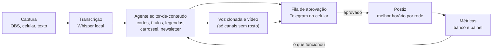

# 3 · Flywheel de conteúdo

[← Operação do grupo](README.md)

Você já produz conteúdo o tempo todo: dá aula, escreve o livro, programa, conserta, cozinha, decide. O flywheel captura esse trabalho uma vez e o transforma em muitas peças, em vez de criar conteúdo do zero.

## Um trabalho, muitas peças

| Trabalho que você já faz | Peças que saem dele | Para qual oferta |
|---|---|---|
| **Aula na escola** (sem alunos na gravação) | Aula do curso, 3 cortes, carrossel com o resumo, questão de concurso, exercício para o AM Mentor, plano de aula para o pacote dos professores | Mini-curso, formação, pacote para professores, banco de questões |
| **Capítulo do livro** | Post de blog, 5 cards de conceito, baralho Anki, vídeo explicando o capítulo, edição da newsletter | Livro, Anki, AM Mentor, Instituto |
| **Projeto de software** | Estudo de caso, vídeo "como eu construí", template vendável, post no LinkedIn, artigo na DIO | Software, templates, vaga de dev, DIO |
| **Reparo na assistência** | Antes e depois, dica curta de manutenção, post no Google Perfil, pergunta frequente no site | Assistência, plano mensal, curso de manutenção |
| **Prato ou ficha técnica** | Vídeo de preparo, foto do cardápio, post no Google Perfil, conteúdo de gestão de restaurante | Restaurantes, consultoria de cardápio, Kaixara |
| **Decisão de negócio** (planejador, setup, número do mês) | Vídeo de build in public, post no LinkedIn, edição da newsletter | Canal com rosto, autoridade, software |
| **Seu estudo do dia** | Card de revisão, post curto "aprendi hoje", aula particular | Aulas, Instituto, canais sem rosto |

## A linha de produção

1. **Captura:** você só grava ou escreve. Arquivos caem numa pasta sincronizada.
2. **Transcrição:** Whisper roda no notebook e gera texto com marcação de tempo.
3. **Agente editor-de-conteudo:** a partir da transcrição e do guia de estilo da marca, propõe cortes com início e fim, títulos, legendas, carrossel, post do Google Perfil, artigo e edição da newsletter.
4. **Aprovação:** nada é publicado sem o seu toque no celular. O agente aprende com o que você recusa.
5. **Publicação:** Postiz agenda em cada rede no horário que o algoritmo de horário escolheu.
6. **Métricas:** retenção, cliques e vendas atribuídas voltam para o banco; o editor recebe o resumo do que funcionou para a próxima rodada.

Detalhes técnicos da publicação automática e da voz clonada estão em [Marketing, vendas e automação](../marketing/README.md).

## Regras

- **Uma peça-pilar por semana** (o vídeo longo ou o artigo) e todo o resto derivado dela.
- **Cada peça tem um destino:** link para a newsletter, para a página da oferta ou para o WhatsApp do negócio.
- **Reaproveitar sem repetir:** o mesmo assunto volta depois de 3 meses com outro ângulo, não com o mesmo vídeo.
- **Aulas da escola:** grave só a tela e a sua voz, nunca alunos. O material que você produz como professor pode ter regras da rede de ensino sobre uso comercial; confirme antes de vender um plano de aula idêntico ao oficial e prefira versões reescritas por você.
