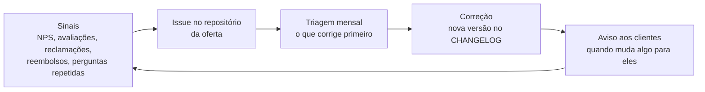

# 5 · Padrão de qualidade

[← Operação do grupo](README.md)

"Pronto" tem a mesma exigência para tudo o que o grupo vende: um checklist por tipo de oferta, conferido antes do lançamento pelo agente `revisor-de-oferta` e por você.

## O que é "pronto" em cada tipo

**Infoproduto (curso, template, pacote de aulas)**
- [ ] Objetivo de aprendizagem escrito para cada módulo e exercício que prova que ele foi atingido
- [ ] Áudio limpo, legendas revisadas, slides no Aura Design System
- [ ] Todo código mostrado compila e tem teste; todo exercício tem gabarito conferido
- [ ] Página de venda com o que está e o que não está incluído, sem promessa de resultado
- [ ] Direito de arrependimento de 7 dias para compras on-line (Código de Defesa do Consumidor, art. 49)
- [ ] Canal de suporte com prazo de resposta (48 h no início)

**Livro:** o [rigor editorial](../editora/03-rigor-editorial.md) da editora.

**Software (projeto ou SaaS)**
- [ ] Testes automatizados e CI verde
- [ ] Varredura de segurança (Dependabot, CodeQL, gitleaks) sem alerta alto aberto
- [ ] Backup testado com restauração
- [ ] Termos, política de privacidade e papel na LGPD definidos
- [ ] Monitoramento (Sentry, Uptime Kuma) e prazo de atendimento combinado

**Serviço (sites, automação, assistência, eventos, aulas)**
- [ ] Escopo e preço por escrito antes de começar
- [ ] Checklist de entrega assinado pelo cliente
- [ ] Garantia declarada (90 dias para serviços duráveis, art. 26 do CDC)
- [ ] Pesquisa de satisfação e pedido de avaliação enviados

**Negócio físico:** licenças da lista de [mínimo legal](../negocios/11-minimo-para-abrir.md), POPs escritos, ficha técnica de tudo o que é vendido e controle de temperatura e perdas nos negócios de comida.

**Conteúdo**
- [ ] Informação conferida (fonte quando houver número)
- [ ] Sem dado de cliente ou aluno; autorização de quem aparece
- [ ] Rótulo de IA quando exigido
- [ ] Chamada para um próximo passo

## O ciclo de melhoria

- **NPS** depois de cada compra ou serviço (uma pergunta, de 0 a 10, e "por quê?").
- **Toda reclamação vira issue**, com o rótulo da oferta. Pergunta que se repete 3 vezes vira melhoria no produto ou na página, não só uma resposta.
- **Reembolso é dado, não derrota:** o motivo de cada um é registrado e lido na triagem.
- **Problema sério** (dado exposto, cliente lesado, intoxicação, sistema fora do ar) ganha uma análise sem culpados: o que aconteceu, por que, o que muda para não repetir.

## Metas iniciais

| Indicador | Meta |
|---|---|
| NPS | 50 ou mais |
| Reembolso de infoproduto | abaixo de 5% |
| Avaliação média no Google | 4,7 ou mais |
| Resposta a avaliações | 100% em até 24 h |
| Retorno em garantia na assistência | abaixo de 3% dos serviços |
