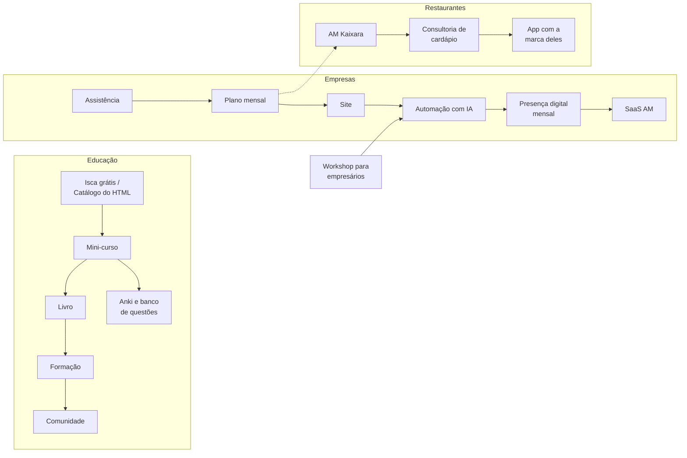

# 6 · Clientes e dados

[← Operação do grupo](README.md)

Uma pessoa pode ser aluna do mini-curso, compradora do livro e cliente da assistência. O grupo cresce quando enxerga essa pessoa inteira, com o consentimento dela.

## CRM único

- **Uma ficha por pessoa ou empresa**, com as ofertas que comprou, a origem (canal e UTM), as conversas e o consentimento.
- **Começa simples:** a planilha de CRM que já está no setup, com o MailerLite como base de e-mails e etiquetas por oferta. Vira tabela no PostgreSQL do grupo quando passar de algumas centenas de clientes.
- **Um identificador por cliente** em todos os sistemas AM (Kaixara, Rotara, Rendara), para o painel juntar compras de negócios diferentes.

## Consentimento (LGPD)

- Cada dado tem uma finalidade declarada: entregar a compra, emitir nota, enviar novidades.
- Marketing só com opt-in claro e saída em um clique.
- Compartilhar dados entre os CNPJs do grupo precisa estar na política de privacidade e na base legal certa; confirme com o advogado antes de cruzar clientes entre empresas.
- Dados de menores (alunos da escola) não entram no CRM de vendas.

## Jornadas entre ofertas

O cliente certo para a próxima oferta é quem já comprou a anterior.

O agente `pos-venda` oferece o próximo passo da jornada no momento certo (por exemplo, 7 dias depois de concluir o mini-curso), nunca a lista inteira de produtos.

## Os números de cada oferta

| Número | O que responde |
|---|---|
| **CAC** (custo para conseguir um cliente) | Quanto custa cada venda, somando anúncio e ferramentas |
| **Ticket e margem por venda** | Quanto sobra de cada venda (a calculadora [Lucro por Venda](../marketing/README.md) faz a conta) |
| **LTV** (quanto um cliente compra ao longo do tempo) | Quanto vale um cliente, somando todas as ofertas da jornada |
| **Retorno do CAC** | Em quantos meses a margem paga o custo de aquisição |
| **Conversão de cada etapa** | Onde a jornada perde gente |

Regra de ouro: **CAC menor que um terço do LTV** antes de aumentar o tráfego pago de uma oferta.

## O painel do grupo

Um painel no Grafana com uma linha por oferta do [portfólio](portfolio.md): estágio, receita do mês, margem, métrica-chave e tendência. Os negócios físicos usam o mesmo painel descrito em [Sistemas e medição](../negocios/12-sistemas-do-grupo.md). O `analista-semanal` lê esse painel toda segunda-feira.
