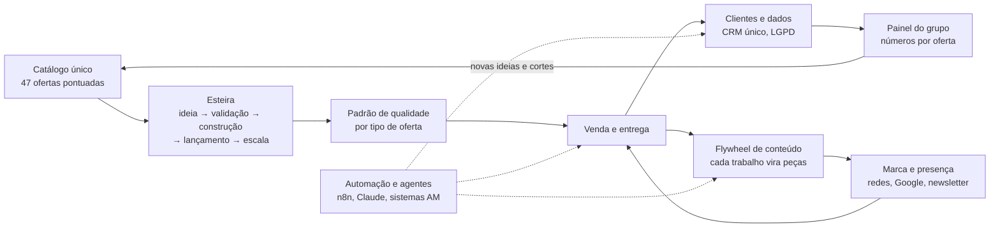

# Operação do grupo

[← Índice da documentação](../README.md)

O sistema que faz **toda** oferta do Grupo AMtech Digital passar pela mesma engenharia: infoprodutos, livros, software, serviços, negócios físicos e canais. Uma esteira só, um catálogo só, um jeito só de medir, divulgar, automatizar e escalar.

## A ideia em uma frase

Nada é vendido sem ter passado pela esteira; nada é feito uma vez só: cada trabalho vira conteúdo, cada cliente vira dado, cada processo repetido vira automação, e cada oferta nova nasce do que já existe.

## Documentos

1. [Esteira de ofertas](01-esteira-de-ofertas.md): os estágios, os portões entre eles e o que o setup faz em cada um
2. [Marca e presença](02-marca-e-presenca.md): arquitetura de marcas, papel de cada rede, Google Perfil da Empresa, avaliações e uma rotina que cabe na sua semana
3. [Flywheel de conteúdo](03-flywheel-de-conteudo.md): como uma aula, um reparo, um capítulo ou um prato viram dez peças de conteúdo
4. [Automação e escala](04-automacao-e-escala.md): os níveis de automação, os agentes do grupo e a alavanca de escala de cada tipo de oferta
5. [Padrão de qualidade](05-padrao-de-qualidade.md): o que é "pronto" para cada tipo de oferta e o ciclo de melhoria
6. [Clientes e dados](06-clientes-e-dados.md): CRM único, consentimento, jornadas entre ofertas e os números de cada uma
7. [Ordem de execução](07-ordem-de-execucao.md): o que fazer nos próximos 90 dias e 12 meses, dentro das horas que você tem
- [Portfólio de ofertas](portfolio.md): o catálogo completo com ranking e as fontes de renda novas (gerado)
- [`portfolio.html`](portfolio.html): o mesmo catálogo com filtros, para abrir no navegador

## Antes de tudo: o limite real

Você trabalha cerca de 63 horas por semana entre escola e restaurante, faz licenciatura e estuda para a vaga de dev. O setup automatiza muito, mas não grava a sua aula, não escreve o seu livro e não atende o primeiro cliente por você. Por isso a regra que segura tudo é a do [documento de execução](07-ordem-de-execucao.md): **uma oferta em construção e uma em validação por vez.** O resto espera na fila do catálogo, pontuado e com o próximo passo escrito, sem ocupar a sua cabeça.

## Como os dados funcionam

- `data/portfolio.json` é a fonte de todas as ofertas. `python tools/portfolio/portfolio.py` valida e gera o [portfólio](portfolio.md) e o `portfolio.html`, com testes em `tools/portfolio/test_portfolio.py`.
- Os números dos negócios físicos vêm de `data/negocios.json` ([Negócios do grupo](../negocios/README.md)).
- O CI confere tudo a cada push.
