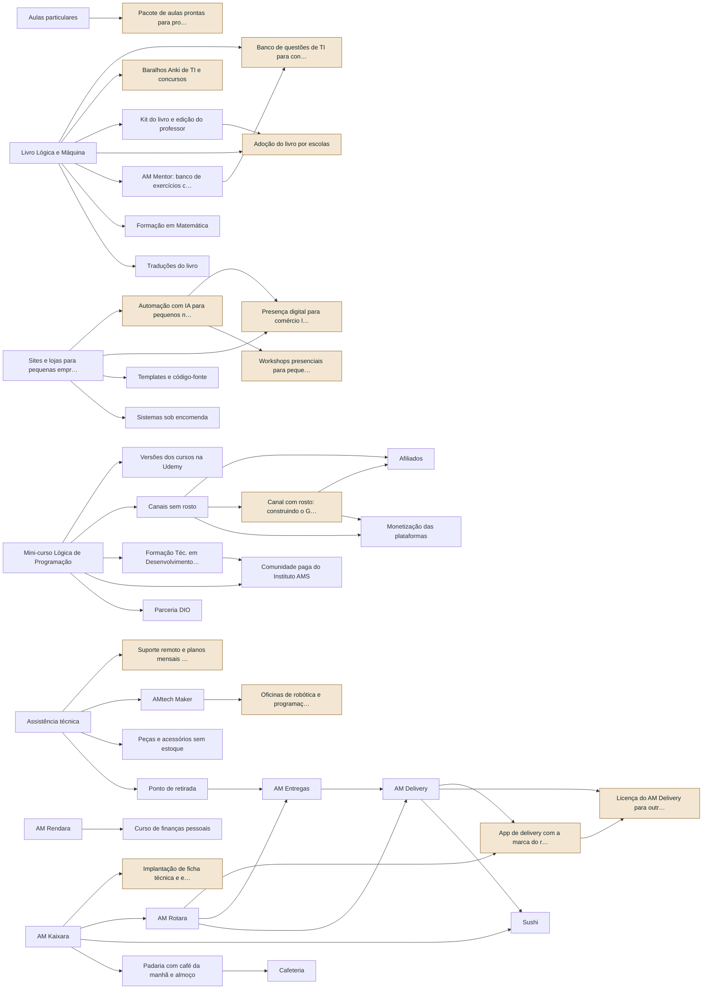

<!-- Arquivo GERADO por tools/portfolio/portfolio.py a partir de data/portfolio.json. Não edite à mão. -->

# Portfólio de ofertas

[← Operação do grupo](README.md)

Todas as 47 ofertas do grupo num catálogo só: o que já existe, o que está planejado e 14 fontes de renda novas que saem do que você já tem. A versão interativa, com filtros, é [`portfolio.html`](portfolio.html).

## Como a fila é decidida

**Pontos = 2 × sinergia + escala + demanda − esforço − capital** (cada nota de 1 a 5; máximo 18).

- **Sinergia:** quanto reaproveita do que já existe (suas aulas, código, livro, clientes, setup).
- **Escala:** 5 quando cada cliente novo quase não custa nada; 1 quando cada venda pede você presente.
- **Demanda:** evidência de que alguém paga. Nas ideias novas, é hipótese até a validação.
- **Esforço e capital:** horas e dinheiro até a primeira venda.

A pontuação ordena; quem decide é a [ordem de execução](07-ordem-de-execucao.md), que respeita a sua agenda e os portões dos negócios físicos.

## Ranking geral

| # | Oferta | Frente | Estágio | Escala | Pontos | Próximo passo | Quando entra |
|---:|---|---|---|---|---:|---|---|
| 1 | Afiliados (ferramentas, livros, equipamentos que você usa) | Conteúdo e mídia | Validação | Digital | 16 | Montar a página 'meu setup' com links de afiliado | passo 14.11 · Semanas 8 a 10 · dez/2026 a jan/2027 |
| 2 | Catálogo do HTML (gratuito) | Instituto AMS e infoprodutos | Lançado | Digital | 16 | Pôr chamada para o mini-curso e para a newsletter | passo 13.9 · Semanas 6 e 7 · dez/2026 |
| 3 | [Mini-curso Lógica de Programação](../marketing/README.md) | Instituto AMS e infoprodutos | Construção | Digital | 16 | Gravar as 5 primeiras aulas e abrir a pré-venda com a isca grátis | passo 17.1 · Semanas 12 a 15 · jan a fev/2027 |
| 4 | Pacote de aulas prontas para professores de informática · **nova** | Instituto AMS e infoprodutos | Ideia | Digital | 16 | Empacotar uma disciplina que você já leciona (planos, slides, avaliações) | passo 22.3 · Fev a dez/2027, uma oferta por vez |
| 5 | AM Rendara (finanças), começando pela planilha | AMtech Software | Validação | Digital | 15 | Vender a planilha do Caixa da Casa antes de construir o sistema | passo 14.20 · Semanas 8 a 10 · dez/2026 a jan/2027 |
| 6 | Automação com IA para pequenos negócios (WhatsApp, n8n, agenda) · **nova** | Serviços locais e B2B | Ideia | Produtizado | 15 | Implantar de graça em um negócio conhecido em troca de caso e depoimento | passo 22.5 · Fev a dez/2027, uma oferta por vez |
| 7 | Banco de questões de TI para concursos (PF, PRF, Forças Armadas) · **nova** | Instituto AMS e infoprodutos | Ideia | Digital | 15 | Publicar 50 questões comentadas grátis e medir a procura | passo 22.6 · Fev a dez/2027, uma oferta por vez |
| 8 | Baralhos Anki de TI e concursos · **nova** | Instituto AMS e infoprodutos | Ideia | Digital | 15 | Gerar o primeiro baralho do Capítulo 1 | passo 22.7 · Fev a dez/2027, uma oferta por vez |
| 9 | Canal com rosto: construindo o Grupo AMtech em público · **nova** | Conteúdo e mídia | Ideia | Digital | 15 | Gravar 1 vídeo por semana mostrando uma decisão real (números do planejador, setup, aula) | passo 23.7 · A partir de fev/2027 |
| 10 | Kit do livro e edição do professor | Editora AMS Silva | Ideia | Digital | 15 | Depois do volume 1 | passo 29.2 · Depois do primeiro livro |
| 11 | Newsletter (patrocínio e vendas) | Conteúdo e mídia | Validação | Digital | 15 | Fazer a isca grátis e a sequência de boas-vindas | passo 17.5 · Semanas 12 a 15 · jan a fev/2027 |
| 12 | Versões dos cursos na Udemy (português e inglês) | Instituto AMS e infoprodutos | Ideia | Digital | 15 | Publicar o mini-curso depois do lançamento próprio | passo 17.8 · Semanas 12 a 15 · jan a fev/2027 |
| 13 | App de delivery com a marca do restaurante (white-label) · **nova** | AMtech Software | Ideia | Digital | 14 | Oferecer a 3 restaurantes que pagam 23% ao iFood | passo 26.5 · 2027 |
| 14 | Presença digital para comércio local (Google Perfil, redes, avaliações) · **nova** | Serviços locais e B2B | Ideia | Produtizado | 14 | Oferecer a 5 clientes de sites como complemento | passo 22.9 · Fev a dez/2027, uma oferta por vez |
| 15 | [Sites e lojas para pequenas empresas](../negocios/01-software-house.md) | AMtech Software | Validação | Produtizado | 14 | Criar 3 pacotes fixos com preço público | passo 13.13 · Semanas 6 e 7 · dez/2026 |
| 16 | Suporte remoto e planos mensais para empresas · **nova** | Serviços locais e B2B | Ideia | Produtizado | 14 | Fechar 3 empresas com o plano de R$ 250 | passo 22.11 · Fev a dez/2027, uma oferta por vez |
| 17 | Adoção do livro por escolas · **nova** | Editora AMS Silva | Ideia | Produtizado | 13 | Piloto na sua própria escola, se permitido | passo 29.4 · Depois do primeiro livro |
| 18 | Aulas particulares | Instituto AMS e infoprodutos | Validação | Local | 13 | Publicar a agenda com pagamento antecipado | passo 14.8 · Semanas 8 a 10 · dez/2026 a jan/2027 |
| 19 | Implantação de ficha técnica e engenharia de cardápio · **nova** | Serviços locais e B2B | Ideia | Produtizado | 13 | Usar o restaurante onde você trabalha como estudo de caso, se o dono aceitar | passo 22.12 · Fev a dez/2027, uma oferta por vez |
| 20 | Monetização das plataformas (YouTube, Instagram) | Conteúdo e mídia | Ideia | Digital | 13 | Consequência dos canais; não é meta em si | passo 23.9 · A partir de fev/2027 |
| 21 | Templates e código-fonte | Instituto AMS e infoprodutos | Validação | Digital | 13 | Empacotar o primeiro frontend já pronto com documentação | passo 18.7 · Junto dos Passos 4 a 6 da trilha de estudo (≈ mar a jun/2027): o modelo nasce no Passo 4 (API e login) e ganha testes e qualidade no Passo 6 |
| 22 | AM Kaixara (PDV, ficha técnica, cardápio) | AMtech Software | Construção | Digital | 12 | Rodar primeiro num cliente piloto pagante | passo 26.2 · 2027 |
| 23 | AM Mentor: banco de exercícios com correção | Instituto AMS e infoprodutos | Ideia | Digital | 12 | Começar com o Capítulo 1 do livro em YAML | passo 22.13 · Fev a dez/2027, uma oferta por vez |
| 24 | [Assistência técnica](../negocios/02-assistencia-e-pecas.md) | Serviços locais e B2B | Ideia | Local | 12 | Começar atendendo em casa e por agendamento antes de alugar a loja | passo 32.3 · Fase A: 12 a 18 meses; B: mais 12 a 18; C: a partir do 3º ou 4º ano |
| 25 | [Canais sem rosto (YouTube, TikTok, Instagram, Facebook)](../marketing/README.md) | Conteúdo e mídia | Construção | Digital | 12 | Publicar 3 vídeos por semana por 8 semanas e medir | passo 22.14 · Fev a dez/2027, uma oferta por vez |
| 26 | Formação Téc. em Desenvolvimento de Sistemas (13 disciplinas) | Instituto AMS e infoprodutos | Ideia | Digital | 12 | Só depois do mini-curso vender 100 cópias | passo 23.10 · A partir de fev/2027 |
| 27 | [Livro Lógica e Máquina](../editora/README.md) | Editora AMS Silva | Construção | Digital | 12 | Entregar o Capítulo 1 para avaliação | passo 20.10 · Quando o capítulo 1 estiver pronto |
| 28 | AM Rotara (pedidos e entregas) | AMtech Software | Ideia | Digital | 11 | Nasce junto com a AM Entregas | passo 26.3 · 2027 |
| 29 | [AMtech Maker (robótica e automação)](../negocios/03-produtos-proprios.md) | Serviços locais e B2B | Ideia | Produtizado | 11 | Primeiro kit sem rádio testado com seus alunos | passo 32.3 · Fase A: 12 a 18 meses; B: mais 12 a 18; C: a partir do 3º ou 4º ano |
| 30 | Comunidade paga do Instituto AMS | Instituto AMS e infoprodutos | Ideia | Digital | 11 | Só com 200 alunos pagantes | passo 22.15 · Fev a dez/2027, uma oferta por vez |
| 31 | Licença do AM Delivery para outras cidades · **nova** | AMtech Software | Ideia | Produtizado | 11 | Só depois de Barbacena dar lucro por 6 meses | passo 32.5 · Fase A: 12 a 18 meses; B: mais 12 a 18; C: a partir do 3º ou 4º ano |
| 32 | Oficinas de robótica e programação para escolas · **nova** | Serviços locais e B2B | Ideia | Produtizado | 11 | Montar o plano de 8 encontros com o kit | passo 22.16 · Fev a dez/2027, uma oferta por vez |
| 33 | Parceria DIO | Instituto AMS e infoprodutos | Ideia | Digital | 11 | Publicar 3 artigos e um projeto na DIO | passo 14.6 · Semanas 8 a 10 · dez/2026 a jan/2027 |
| 34 | [Peças e acessórios sem estoque](../negocios/02-assistencia-e-pecas.md) | Serviços locais e B2B | Ideia | Local | 11 | Só junto com a assistência | passo 32.3 · Fase A: 12 a 18 meses; B: mais 12 a 18; C: a partir do 3º ou 4º ano |
| 35 | [Sistemas sob encomenda](../negocios/01-software-house.md) | AMtech Software | Ideia | Produtizado | 11 | Primeiro cliente via loja ou indicação, com 50% de entrada | passo 22.17 · Fev a dez/2027, uma oferta por vez |
| 36 | Aula de sushi e sushiman para eventos · **nova** | Negócios físicos | Ideia | Local | 10 | Testar 2 eventos com amigos pagantes; confirme as regras sanitárias para preparo na casa do cliente | passo 22.18 · Fev a dez/2027, uma oferta por vez |
| 37 | Formação em Matemática | Instituto AMS e infoprodutos | Ideia | Digital | 10 | Usar os capítulos de matemática do livro como base | passo 23.10 · A partir de fev/2027 |
| 38 | [Ponto de retirada (Shopee e Mercado Livre)](../negocios/04-ponto-de-retirada.md) | Negócios físicos | Ideia | Local | 10 | Junto com a loja | passo 32.3 · Fase A: 12 a 18 meses; B: mais 12 a 18; C: a partir do 3º ou 4º ano |
| 39 | Workshops presenciais para pequenos empresários (IA, planilhas, presença digital) · **nova** | Instituto AMS e infoprodutos | Ideia | Local | 10 | Fazer um piloto com 10 vagas | passo 22.19 · Fev a dez/2027, uma oferta por vez |
| 40 | Curso de finanças pessoais (conteúdo próprio) | Instituto AMS e infoprodutos | Ideia | Digital | 9 | Validar com a planilha do Caixa da Casa antes do curso | passo 23.10 · A partir de fev/2027 |
| 41 | Traduções do livro | Editora AMS Silva | Ideia | Digital | 8 | Depois de 500 cópias em português | passo 29.5 · Depois do primeiro livro |
| 42 | [AM Entregas](../negocios/05-logistica-e-entregas.md) | Negócios físicos | Ideia | Local | 6 | Fase B, depois do portão da loja | passo 32.4 · Fase A: 12 a 18 meses; B: mais 12 a 18; C: a partir do 3º ou 4º ano |
| 43 | AM Taskoro (gestão de projetos ágeis) | AMtech Software | Pausado | Digital | 6 | Fica como projeto de portfólio até o Kaixara ter clientes | passo 22.20 · Fev a dez/2027, uma oferta por vez |
| 44 | [AM Delivery](../negocios/06-delivery-multiempresas.md) | Negócios físicos | Ideia | Local | 5 | Fase B2 | passo 32.5 · Fase A: 12 a 18 meses; B: mais 12 a 18; C: a partir do 3º ou 4º ano |
| 45 | [Sushi (delivery)](../negocios/07-sushi.md) | Negócios físicos | Ideia | Local | 4 | Fase C1 | passo 32.6 · Fase A: 12 a 18 meses; B: mais 12 a 18; C: a partir do 3º ou 4º ano |
| 46 | [Cafeteria](../negocios/08-cafeteria.md) | Negócios físicos | Ideia | Local | 3 | Fase C3, dentro da padaria | passo 32.8 · Fase A: 12 a 18 meses; B: mais 12 a 18; C: a partir do 3º ou 4º ano |
| 47 | [Padaria com café da manhã e almoço](../negocios/09-padaria-e-almoco.md) | Negócios físicos | Ideia | Local | 1 | Fase C2 | passo 32.7 · Fase A: 12 a 18 meses; B: mais 12 a 18; C: a partir do 3º ou 4º ano |

## Fontes de renda novas

Ideias que nasceram do cruzamento entre os negócios, as aulas, o livro e o setup. Cada uma começa pela validação mais barata possível.

| Oferta | Sai de | Modelo de receita | Validação mais barata | Pontos |
|---|---|---|---|---:|
| Pacote de aulas prontas para professores de informática | Aulas particulares | venda única ou assinatura | Empacotar uma disciplina que você já leciona (planos, slides, avaliações) | 16 |
| Automação com IA para pequenos negócios (WhatsApp, n8n, agenda) | Sites e lojas para pequenas empresas | projeto + mensalidade | Implantar de graça em um negócio conhecido em troca de caso e depoimento | 15 |
| Banco de questões de TI para concursos (PF, PRF, Forças Armadas) | Livro Lógica e Máquina, AM Mentor: banco de exercícios com correção | recorrente | Publicar 50 questões comentadas grátis e medir a procura | 15 |
| Baralhos Anki de TI e concursos | Livro Lógica e Máquina | venda única | Gerar o primeiro baralho do Capítulo 1 | 15 |
| Canal com rosto: construindo o Grupo AMtech em público | Canais sem rosto (YouTube, TikTok, Instagram, Facebook) | anúncios, patrocínio e confiança | Gravar 1 vídeo por semana mostrando uma decisão real (números do planejador, setup, aula) | 15 |
| App de delivery com a marca do restaurante (white-label) | AM Delivery, AM Rotara (pedidos e entregas) | mensalidade | Oferecer a 3 restaurantes que pagam 23% ao iFood | 14 |
| Presença digital para comércio local (Google Perfil, redes, avaliações) | Sites e lojas para pequenas empresas, Automação com IA para pequenos negócios (WhatsApp, n8n, agenda) | mensalidade | Oferecer a 5 clientes de sites como complemento | 14 |
| Suporte remoto e planos mensais para empresas | Assistência técnica | recorrente | Fechar 3 empresas com o plano de R$ 250 | 14 |
| Adoção do livro por escolas | Livro Lógica e Máquina, Kit do livro e edição do professor | licença por aluno | Piloto na sua própria escola, se permitido | 13 |
| Implantação de ficha técnica e engenharia de cardápio | AM Kaixara (PDV, ficha técnica, cardápio) | projeto | Usar o restaurante onde você trabalha como estudo de caso, se o dono aceitar | 13 |
| Licença do AM Delivery para outras cidades | AM Delivery, App de delivery com a marca do restaurante (white-label) | licença + royalties | Só depois de Barbacena dar lucro por 6 meses | 11 |
| Oficinas de robótica e programação para escolas | AMtech Maker (robótica e automação) | por turma | Montar o plano de 8 encontros com o kit | 11 |
| Aula de sushi e sushiman para eventos | — | por evento | Testar 2 eventos com amigos pagantes; confirme as regras sanitárias para preparo na casa do cliente | 10 |
| Workshops presenciais para pequenos empresários (IA, planilhas, presença digital) | Automação com IA para pequenos negócios (WhatsApp, n8n, agenda) | ingresso | Fazer um piloto com 10 vagas | 10 |

## De onde cada oferta nasce

Cada seta é um reaproveitamento: a oferta de baixo usa conteúdo, código, clientes ou estrutura da de cima.

## Por frente

### Instituto AMS e infoprodutos

| Oferta | Receita | Automático | Fica com você | Métrica |
|---|---|---|---|---|
| Catálogo do HTML (gratuito) | nenhuma direta: gera público | publicação | conteúdo | visitas e inscritos vindos dele |
| Mini-curso Lógica de Programação | venda única | checkout e entrega, e-mails de boas-vindas, cortes para redes, legendas | gravar as aulas, responder dúvidas | vendas por semana e conversão da página |
| Pacote de aulas prontas para professores de informática | venda única ou assinatura | entrega, atualização anual | revisar as aulas que você já dá | vendas por disciplina |
| Banco de questões de TI para concursos (PF, PRF, Forças Armadas) | recorrente | correção, estatística por assunto | curadoria | assinantes |
| Baralhos Anki de TI e concursos | venda única | geração a partir do YAML do livro | revisão | vendas |
| Versões dos cursos na Udemy (português e inglês) | participação por venda | dublagem por IA, legendas | revisão | vendas e avaliação média |
| Aulas particulares | por hora | agenda e pagamento, lembrete, material da aula | dar a aula | horas vendidas por semana |
| Templates e código-fonte | venda única | entrega do arquivo, licença, atualizações | construir o template | vendas por template |
| AM Mentor: banco de exercícios com correção | recorrente | correção automática, ranking, relatórios | curadoria das questões | assinantes e exercícios resolvidos |
| Formação Téc. em Desenvolvimento de Sistemas (13 disciplinas) | venda única ou assinatura | entrega, certificado, trilha por e-mail | roteiro e gravação | alunos ativos e conclusão |
| Comunidade paga do Instituto AMS | recorrente | acesso e cobrança, boas-vindas | presença semanal ao vivo | membros e cancelamento |
| Parceria DIO | parceria | — | artigos e projetos | convite ou resposta |
| Formação em Matemática | venda única | entrega, exercícios corrigidos | gravação | vendas |
| Workshops presenciais para pequenos empresários (IA, planilhas, presença digital) | ingresso | inscrição e pagamento, certificado | dar o workshop | ingressos vendidos e clientes gerados |
| Curso de finanças pessoais (conteúdo próprio) | venda única | entrega, planilha incluída | roteiro | vendas da planilha |

### Editora AMS Silva

| Oferta | Receita | Automático | Fica com você | Métrica |
|---|---|---|---|---|
| Kit do livro e edição do professor | venda única | gerado do mesmo repositório | revisão | adoções |
| Adoção do livro por escolas | licença por aluno | material do professor gerado | venda B2B | escolas e alunos |
| Livro Lógica e Máquina | venda única | compilação, gabaritos, revisão automática, EPUB e PDF | escrever, decidir | capítulos prontos e leitores beta |
| Traduções do livro | venda única | tradução assistida por IA | revisão por tradutor humano | vendas fora do Brasil |

### AMtech Software

| Oferta | Receita | Automático | Fica com você | Métrica |
|---|---|---|---|---|
| AM Rendara (finanças), começando pela planilha | venda única, depois recorrente | planilha → sistema | suporte | vendas da planilha |
| App de delivery com a marca do restaurante (white-label) | mensalidade | provisionamento automático | venda | lojas ativas |
| Sites e lojas para pequenas empresas | projeto + mensalidade | proposta a partir do modelo, deploy, relatório mensal | reunião e ajustes | contratos por mês |
| AM Kaixara (PDV, ficha técnica, cardápio) | recorrente | onboarding, cobrança Pix Automático, suporte de primeiro nível | vendas iniciais | MRR e cancelamento |
| AM Rotara (pedidos e entregas) | recorrente | roteirização, repasse, notificações | suporte | entregas roteirizadas |
| Licença do AM Delivery para outras cidades | licença + royalties | instância por cidade | contrato e treinamento | cidades licenciadas |
| Sistemas sob encomenda | projeto | CI/CD, testes, documentação | descoberta e arquitetura | margem por projeto |
| AM Taskoro (gestão de projetos ágeis) | recorrente | — | — | — |

### Serviços locais e B2B

| Oferta | Receita | Automático | Fica com você | Métrica |
|---|---|---|---|---|
| Automação com IA para pequenos negócios (WhatsApp, n8n, agenda) | projeto + mensalidade | fluxos reaproveitados, monitoramento | diagnóstico e implantação | contratos e horas por implantação |
| Presença digital para comércio local (Google Perfil, redes, avaliações) | mensalidade | agendamento de posts, relatório mensal, pedido de avaliação | fotos e estratégia | clientes ativos |
| Suporte remoto e planos mensais para empresas | recorrente | monitoramento, backup, alertas | atendimento | contratos ativos |
| Implantação de ficha técnica e engenharia de cardápio | projeto | relatórios do Kaixara | visita e treinamento | contratos |
| Assistência técnica | por serviço | ordem de serviço, aviso de pronto, pesquisa de satisfação | diagnóstico e reparo | serviços por semana e retorno em garantia |
| AMtech Maker (robótica e automação) | venda e projeto | firmware versionado, manual gerado | montagem e instalação | kits vendidos |
| Oficinas de robótica e programação para escolas | por turma | material gerado, certificados | dar a oficina | turmas vendidas |
| Peças e acessórios sem estoque | margem por venda | anúncio, pedido ao fornecedor | conferir peça | margem por pedido |

### Negócios físicos

| Oferta | Receita | Automático | Fica com você | Métrica |
|---|---|---|---|---|
| Aula de sushi e sushiman para eventos | por evento | agenda e sinal | preparo no local | eventos por mês e pedidos de 'quando abre o restaurante?' |
| Ponto de retirada (Shopee e Mercado Livre) | por pacote | registro de pacotes | atendimento | conversão de retiradas em vendas |
| AM Entregas | por entrega | roteirização, repasse, comprovante | despacho | entregas por rota |
| AM Delivery | comissão | pedido, pagamento com split, notificações | comercial com lojistas | pedidos por lojista |
| Sushi (delivery) | por pedido | pedido, cardápio, ficha técnica, previsão | cozinha | pedidos por noite e CMV |
| Cafeteria | por venda | PDV, fidelidade | atendimento | ticket médio |
| Padaria com café da manhã e almoço | por venda | PDV, previsão de produção | gerente e equipe | CMV e perdas |

### Conteúdo e mídia

| Oferta | Receita | Automático | Fica com você | Métrica |
|---|---|---|---|---|
| Afiliados (ferramentas, livros, equipamentos que você usa) | comissão | links rastreados, página de recomendações | testar de verdade | comissões por mês |
| Canal com rosto: construindo o Grupo AMtech em público | anúncios, patrocínio e confiança | cortes automáticos, legendas | gravar sua rotina e decisões | inscritos e vendas atribuídas |
| Newsletter (patrocínio e vendas) | patrocínio e vendas | envio, segmentação, sequências | escrever 1 edição por semana | inscritos e cliques |
| Monetização das plataformas (YouTube, Instagram) | anúncios | — | — | receita por mil visualizações |
| Canais sem rosto (YouTube, TikTok, Instagram, Facebook) | anúncios e tráfego para produtos | roteiro assistido, voz clonada, corte, agendamento no melhor horário | aprovar e revisar | retenção e cliques para os produtos |

## Resumo

| Estágio | Ofertas |
|---|---:|
| Ideia | 35 |
| Validação | 6 |
| Construção | 4 |
| Lançado | 1 |
| Pausado | 1 |

| Escala | Ofertas |
|---|---:|
| Digital (custo por cliente perto de zero) | 26 |
| Produtizado (pacote repetível) | 10 |
| Local (depende de gente e lugar) | 11 |
