<!-- Arquivo GERADO por tools/portfolio/portfolio.py a partir de data/portfolio.json. Não edite à mão. -->

# Portfólio de ofertas

[← Operação do grupo](README.md)

Todas as 108 ofertas do grupo num catálogo só: o que já existe, o que está planejado e 75 fontes de renda novas que saem do que você já tem. A versão interativa, com filtros, é [`portfolio.html`](portfolio.html).

## Como a fila é decidida

**Pontos = 2 × sinergia + escala + demanda − esforço − capital** (cada nota de 1 a 5; máximo 18).

- **Sinergia:** quanto reaproveita do que já existe (suas aulas, código, livro, clientes, setup).
- **Escala:** 5 quando cada cliente novo quase não custa nada; 1 quando cada venda pede você presente.
- **Demanda:** evidência de que alguém paga. Nas ideias novas, é hipótese até a validação.
- **Esforço e capital:** horas e dinheiro até a primeira venda.

A pontuação ordena; quem decide é a [ordem de execução](07-ordem-de-execucao.md), que respeita a sua agenda e os portões dos negócios físicos.

## Arsenal: o que entra agora e o que não dá

**Regras:** hora mínima de **R$ 45** por hora sua em trabalho ativo extra; teto de **7 horas** extras por semana; no máximo **3 rendas em "agora"**; portão para a próxima entrar: 3 meses seguidos se pagando no painel; corte: abaixo da hora mínima por 2 meses: delegar ou cortar.

**Facilidade = sinergia + demanda + (6 − esforço) + (6 − capital)** (de 4 a 20): quanto maior, mais rápido vira dinheiro com o que você já tem.

A semana do arsenal:

- Quinta 13h–16h30: bloco de negócio (vender, atender, comprar no radar)
- Sábado 9h30–12h30: bloco de produção (gravar e revisar o que o estudo gerou)
- Estudo da manhã: o setup transforma em aula, exercício, cartão Anki e roteiro (15 min de revisão)
- Domingo, sono e cães: intocáveis

| Veredito | Ofertas | Passivas |
|---|---:|---:|
| Agora | 3 | 1 |
| Próxima da fila | 7 | 4 |
| Manter (já funciona) | 1 | 1 |
| Fila com portão | 62 | 37 |
| 2027, se a tarde ficar livre | 14 | 1 |
| Decidir depois (capital alto) | 13 | 0 |
| Descartar | 8 | 4 |

### Agora

| Oferta | Marca | Perfil | Automático | Facilidade | Por quê |
|---|---|---|---:|---:|---|
| Mini-curso Lógica de Programação | AMtech Educação · Instituto AMS | Passiva | 85% | 18 | O material já existe e, pronto, vende 24h. Grava no bloco de sábado. |
| Sites e lojas para pequenas empresas | AMtech Software | Ativa que vale a pena | 70% | 18 | Caixa rápido para quitar o cartão e manutenção mensal recorrente; é a sua regra para sair do restaurante. |
| Avaliação de respostas de IA (DataAnnotation, Outlier) | AMtech Digital (serviços remotos e B2B) | Ativa que vale a pena | 0% | 16 | Começa sem custo, ocupa só as brechas e paga em dólar. Sai se ficar abaixo da hora mínima. |

### Próximas, nesta ordem

| Ordem | Oferta | Marca | Perfil | Automático | Facilidade | Por quê |
|---:|---|---|---|---:|---:|---|
| 1 | AM Mentor: banco de exercícios com correção | AMtech Educação · Instituto AMS | Passiva | 90% | 14 | Já existe no seu Desktop; falta ligar cobrança e acesso. |
| 2 | Aulas particulares | AMtech Educação · Instituto AMS | Ativa que vale a pena | 30% | 19 | Em turma online, 1 hora sua vale vários alunos e a gravação vira curso. Entra com o mini-curso no ar servindo de isca. |
| 3 | Notebooks e PCs: comprar, consertar e revender | AMtech Campo (presencial, por parceiros) | Ativa que vale a pena | 40% | 16 | Usa a sua bancada e o radar. Só continua se passar da hora mínima por 2 meses. |
| 4 | Fábrica de documentos para professores de MG (assinatura) | AMtech Educação · Instituto AMS | Passiva | 85% | 17 | Você constrói a Fábrica para si; vender é abrir para outros. Dado de aluno nunca entra. |
| 5 | Setup profissional (curso, template e configuração remota) | AMtech Software | Passiva | 85% | 17 | Você já está construindo; falta empacotar. |
| 6 | Plano de negócios e viabilidade financeira para quem vai abrir empresa | AMtech Economia (finanças e empreendedorismo) | Ativa que vale a pena | 60% | 18 | O motor financeiro e o planejador já existem no setup; você só adapta para o cliente. |
| 7 | Verificador e formatador ABNT automático (TCC, artigos, relatórios) | AMtech Educação · Instituto AMS | Passiva | 90% | 18 | Escala sem a sua hora: o aluno envia o .docx e recebe o laudo e o arquivo corrigido. Só formatação e conferência, nunca escrever o trabalho. |

### Manter

| Oferta | Marca | Perfil | Automático | Facilidade | Por quê |
|---|---|---|---:|---:|---|
| Catálogo do HTML (gratuito) | AMtech Educação · Instituto AMS | Passiva | 95% | 18 | Já está no ar e é a isca gratuita; só manter. |

### Fila com portão (da mais fácil para a mais difícil)

| Oferta | Marca | Perfil | Automático | Facilidade | Por quê |
|---|---|---|---:|---:|---|
| Automação com IA para pequenos negócios (WhatsApp, n8n, agenda) | AMtech Digital (serviços remotos e B2B) | Ativa que vale a pena | 60% | 19 | Mensalidade, e cada automação vira template; depois do primeiro cliente de sites. |
| Afiliados (ferramentas, livros, equipamentos que você usa) | AMtech Mídia | Passiva | 90% | 18 | Links nas páginas e vídeos que já vão existir. |
| Pacote de aulas prontas para professores de informática | AMtech Educação · Instituto AMS | Passiva | 90% | 18 | Entra junto com a Fábrica para professores. |
| Presença digital para comércio local (Google Perfil, redes, avaliações) | AMtech Digital (serviços remotos e B2B) | Ativa que vale a pena | 50% | 18 | Junto com a automação com IA. |
| Suporte remoto e planos mensais para empresas | AMtech Digital (serviços remotos e B2B) | Ativa que vale a pena | 60% | 18 | Contratos mensais com empresas; depois dos primeiros clientes de sites. |
| AM Rendara (finanças), começando pela planilha | AMtech Software | Passiva | 80% | 17 | Valida primeiro pela planilha Cascata. |
| Banco de questões de TI para concursos (PF, PRF, Forças Armadas) | AMtech Educação · Instituto AMS | Passiva | 90% | 17 | Produto, não estudo seu; depois do AM Mentor. |
| Baralhos Anki de TI e concursos | AMtech Educação · Instituto AMS | Passiva | 95% | 17 | Sai do seu estudo; esforço quase zero. |
| Calculadoras financeiras online (CLT x PJ, MEI, financiamento, independência financeira) | AMtech Economia (finanças e empreendedorismo) | Passiva | 90% | 17 | Isca que traz clientes para a mentoria, o BPO e os modelos. Atualizar as regras quando a lei mudar. |
| Canal com rosto: construindo o Grupo AMtech em público | AMtech Mídia | Passiva | 70% | 17 | Sai do bloco de produção de sábado. |
| Cursos dublados por IA em inglês e espanhol (só a sua voz) | AMtech Educação · Instituto AMS | Passiva | 90% | 17 | Depois que houver curso gravado. Nunca a voz de alunos. |
| Kit do livro e edição do professor | Editora AMS Silva | Passiva | 90% | 17 | Depois do livro. |
| Modelos financeiros para empresas (fluxo de caixa, DRE gerencial, precificação, valuation simples) | AMtech Economia (finanças e empreendedorismo) | Passiva | 90% | 17 | Sai do motor financeiro que já existe; vende sozinho. |
| Newsletter (patrocínio e vendas) | AMtech Mídia | Passiva | 80% | 17 | Junto com o canal. |
| Templates de automação n8n | AMtech Software | Passiva | 90% | 17 | Sai das suas automações; esforço baixo. |
| Versões dos cursos na Udemy (português e inglês) | AMtech Educação · Instituto AMS | Passiva | 90% | 17 | Reaproveita os cursos gravados. |
| Laudo de segurança dos sites que você mantém | AMtech Software | Ativa que vale a pena | 65% | 17 | Portão: ensaio no seu site e eJPT. Só nos sites que você mantém, com cláusula no contrato; aumenta o valor da mensalidade. |
| Elaboração e revisão de questões | AMtech Educação · Instituto AMS | Ativa que vale a pena | 50% | 17 | Reaproveita o seu ecossistema de avaliações. |
| Mentoria de organização financeira e palestras em empresas (sem recomendar ativos) | AMtech Economia (finanças e empreendedorismo) | Ativa que vale a pena | 40% | 17 | Orçamento, dívidas e reserva. Recomendar ativo ou gerir dinheiro de terceiros exige certificação e registro (CVM): fica fora. |
| Formatação ABNT de TCC (só formatar e revisar) | AMtech Educação · Instituto AMS | Ativa | 50% | 17 | Ganho baixo e sazonal; só nas temporadas, se sobrar hora. Nunca escrever o trabalho pelo aluno. |
| Recuperação de dados (intermediação com laboratório) | AMtech Campo (presencial, por parceiros) | Ativa | 10% | 17 | Você só coleta e entrega, por comissão; entra com a assistência. |
| App de delivery com a marca do restaurante (white-label) | AMtech Software | Passiva | 70% | 16 | Depende do AM Delivery. |
| Dividendos, FIIs e renda fixa (cascata e ARCA) | Patrimônio (investimentos) | Passiva | 95% | 16 | A cascata manda: só depois do cartão quitado e da reserva cheia. As decisões são suas. |
| Adoção do livro por escolas | Editora AMS Silva | Passiva | 70% | 16 | Depois do livro e do kit. |
| Conferência automática de documentos para coordenações e escolas | AMtech Educação · Instituto AMS | Passiva | 85% | 16 | A coordenação recebe dezenas de planejamentos por semana; o verificador aponta o que falta. Nada de dados de aluno. |
| Monetização das plataformas (YouTube, Instagram) | AMtech Mídia | Passiva | 95% | 16 | Consequência do canal crescer. |
| Templates e código-fonte | AMtech Educação · Instituto AMS | Passiva | 90% | 16 | Sai de cada site entregue; empacotar sem custo extra. |
| BPO financeiro para pequenas empresas (contas, conciliação, fluxo de caixa) | AMtech Economia (finanças e empreendedorismo) | Ativa que vale a pena | 65% | 16 | Recorrente e delegável a um assistente depois do checklist. É gestão financeira, não contabilidade: escrituração e impostos ficam com o contador. |
| Celulares: comprar, consertar e revender | AMtech Campo (presencial, por parceiros) | Ativa que vale a pena | 40% | 16 | Checklist rígido: IMEI, conta Google ou iCloud removida, recibo com CPF. |
| Livros técnicos e didáticos usados | AMtech Campo (presencial, por parceiros) | Ativa que vale a pena | 70% | 16 | Margem pequena; envio quase automático. |
| Parceiro de ERP (Bling, Tiny, Omie): implantação e comissão | AMtech Digital (serviços remotos e B2B) | Ativa que vale a pena | 50% | 16 | Recorrência antes do Kaixara ficar pronto. |
| Peças de máquinas sucateadas (RAM, SSD, placas) | AMtech Campo (presencial, por parceiros) | Ativa que vale a pena | 40% | 16 | Aproveita o que sobra da revenda de notebooks. |
| Peças e acessórios sem estoque | AMtech Campo (presencial, por parceiros) | Ativa que vale a pena | 70% | 16 | Sem estoque; entra com a revenda de notebooks. |
| Professor conteudista EAD | AMtech Educação · Instituto AMS | Ativa que vale a pena | 60% | 16 | Bom por hora porque a Fábrica faz o grosso. Leia o contrato: o direito costuma ficar com a instituição. |
| Blocos e kits de componentes de interface | AMtech Software | Passiva | 90% | 15 | Junto com os templates. |
| Templates Next.js/Tailwind em inglês | AMtech Software | Passiva | 90% | 15 | Esforço inicial alto; depois do Setup profissional. |
| Canais sem rosto (YouTube, TikTok, Instagram, Facebook) | AMtech Mídia | Passiva | 70% | 15 | Começa quando o estudo gerar conteúdo toda semana. |
| Curso: segurança e engenharia reversa para devs | AMtech Educação · Instituto AMS | Passiva | 80% | 15 | Portão: eJPT e 3 relatórios de ensaio, para ensinar o que já fez. Material vem do seu estudo, sem copiar curso pago. |
| Cursos em plataformas que pagam royalties (Alura, Rocketseat, Domestika) | AMtech Educação · Instituto AMS | Passiva | 80% | 15 | Depende de seleção; usa os cursos já gravados. |
| Camisetas e canecas sob demanda (dev e professor) | AMtech Mídia | Passiva | 95% | 15 | Ganho baixo, mas trabalho quase zero. Nada de personagens ou marcas de terceiros. |
| Comunidade paga do Instituto AMS | AMtech Educação · Instituto AMS | Ativa que vale a pena | 60% | 15 | Exige presença constante; só com uma base de alunos já pagando. |
| Parceria DIO | AMtech Educação · Instituto AMS | Passiva | 70% | 15 | Depende de convite da plataforma. |
| Sistemas sob encomenda | AMtech Software | Ativa que vale a pena | 40% | 15 | Só projetos acima da hora mínima. |
| Automação BIM e modelagem para escritórios de engenharia e arquitetura | AMtech Digital (serviços remotos e B2B) | Ativa que vale a pena | 60% | 15 | É TI aplicada à construção: você automatiza e modela, o engenheiro ou arquiteto revisa e assina. Portão: os 3 scripts e um escritório parceiro. |
| Freela internacional em dólar (Upwork) | AMtech Software | Ativa que vale a pena | 30% | 15 | Portão: inglês B1. |
| Segurança digital para pequenas empresas | AMtech Digital (serviços remotos e B2B) | Ativa que vale a pena | 50% | 15 | Só a parte técnica; a jurídica da LGPD fica com advogado. |
| Captação de crédito e editais para pequenos negócios (Pronampe, BDMG, Sebrae, FAPEMIG) | AMtech Economia (finanças e empreendedorismo) | Ativa que vale a pena | 45% | 15 | Paga bem quando aprova; depende do plano de negócios pronto. Nunca prometer aprovação. |
| AM Kaixara (PDV, ficha técnica, cardápio) | AMtech Software | Passiva | 70% | 14 | Projeto de portfólio; venda só depois de validar. |
| Formação Téc. em Desenvolvimento de Sistemas (13 disciplinas) | AMtech Educação · Instituto AMS | Passiva | 85% | 14 | Depois que o mini-curso validar a demanda. |
| Livro Lógica e Máquina | Editora AMS Silva | Passiva | 85% | 14 | Escrita contínua nos blocos de estudo; lançamento pela Editora. |
| Licença do AM Delivery para outras cidades | AMtech Software | Passiva | 70% | 14 | Depende do AM Delivery funcionando em Barbacena. |
| Português para estrangeiros (Preply, italki) | AMtech Educação · Instituto AMS | Ativa | 0% | 14 | Hora pura; portão: inglês básico. |
| AM Rotara (pedidos e entregas) | AMtech Software | Passiva | 70% | 13 | Depende do Kaixara. |
| Formação em Matemática | AMtech Educação · Instituto AMS | Passiva | 85% | 13 | Depende do livro pronto. |
| Curso de finanças pessoais (conteúdo próprio) | AMtech Educação · Instituto AMS | Passiva | 85% | 13 | Cuidado regulatório (não recomendar ativo); depois da planilha validar. |
| Plugin WordPress com versão Pro | AMtech Software | Passiva | 75% | 13 | Suporte contínuo; o problema tem que vir dos clientes. |
| Consultoria de investimentos (AM Rendara premium, com sócia certificada) | AMtech Economia (finanças e empreendedorismo) | Ativa que vale a pena | 30% | 13 | Portão regulatório: recomendar ativos exige certificação e registro na CVM. Sem isso, não existe. |
| Licença do ByteSDCoin para escolas (sem aposta) | AMtech Educação · Instituto AMS | Passiva | 60% | 12 | Precisa de revisão jurídica; demanda ainda não testada. |
| Traduções do livro | Editora AMS Silva | Passiva | 80% | 11 | Depois do livro vender em português. |
| Bug bounty e pentest | AMtech Digital (serviços remotos e B2B) | Ativa | 10% | 11 | Portão: eJPT e laboratórios. Renda irregular; vale pelo histórico que abre a AMtech Segurança. |
| Perito em informática judicial | AMtech Digital (serviços remotos e B2B) | Ativa | 20% | 11 | Portão: estudo de perícia forense e cadastro no TJMG. |
| AM Taskoro (gestão de projetos ágeis) | AMtech Software | Passiva | 70% | 10 | Pausado por você. |

### 2027, se a tarde ficar livre

| Oferta | Marca | Perfil | Automático | Facilidade | Por quê |
|---|---|---|---:|---:|---|
| Implantação de ficha técnica e engenharia de cardápio | AMtech Digital (serviços remotos e B2B) | Ativa | 30% | 17 | Hora presencial em restaurante. |
| PC montado e entregue configurado | AMtech Campo (presencial, por parceiros) | Ativa | 40% | 17 | Montar exige mãos; você vende e configura, o parceiro monta. |
| Instrutor horista (SENAC, SENAI, prefeitura) | AMtech Educação · Instituto AMS | Ativa | 20% | 17 | Hora presencial. |
| Aula de sushi e sushiman para eventos | Negócios físicos | Ativa | 0% | 17 | Hora pura presencial; paga bem por evento, mas ocupa fim de semana. |
| Oficinas de robótica e programação para escolas | AMtech Campo (presencial, por parceiros) | Ativa | 20% | 16 | Hora presencial em escolas. |
| Gestão de tráfego pago para o comércio local | AMtech Digital (serviços remotos e B2B) | Ativa | 50% | 16 | Cliente cobra resultado e cansa; só com contrato mensal alto e gestor júnior. |
| Workshops presenciais para pequenos empresários (IA, planilhas, presença digital) | AMtech Educação · Instituto AMS | Ativa | 30% | 16 | Hora presencial; só se a tarde ficar livre em 2027. |
| Aulas de informática e celular para idosos | AMtech Educação · Instituto AMS | Ativa | 20% | 16 | Hora presencial. |
| Automação e monitoramento para sítios e produtores (AMtech Campo) | AMtech Campo (presencial, por parceiros) | Ativa que vale a pena | 50% | 14 | Usa o mesmo Home Assistant, ESPHome e MQTT da casa; portão: o seu caso rodando 3 meses. Placas com rádio já homologadas pela Anatel. |
| Colônia de férias tech (robótica e programação) | AMtech Educação · Instituto AMS | Ativa | 20% | 14 | Hora presencial. Nunca oferecer para os seus alunos da escola. |
| Redes Wi-Fi e câmeras com monitoramento mensal | AMtech Campo (presencial, por parceiros) | Ativa | 50% | 14 | Instalação presencial; a parte boa é o contrato mensal. |
| AM Obra: diário, medição, compras e estimativa para pequenas construtoras | AMtech Software | Passiva | 75% | 12 | Sistema grande, na stack do Aura; só depois de validar com quem toca obra. A estimativa não substitui o orçamento do profissional. |
| Pentest completo para empresas (AMtech Segurança) | AMtech Digital (serviços remotos e B2B) | Ativa que vale a pena | 25% | 11 | Paga bem por hora, mas exige OSCP, histórico, seguro e contrato; sem isso, o risco jurídico é seu. |
| Casa inteligente para clientes (Home Assistant) | AMtech Campo (presencial, por parceiros) | Ativa | 50% | 10 | Primeiro a sua casa; instalação presencial. |

### Decidir depois: capital alto

| Oferta | Marca | Perfil | Automático | Facilidade | Por quê |
|---|---|---|---:|---:|---|
| Assistência técnica | AMtech Campo (presencial, por parceiros) | Ativa | 30% | 17 | Loja e bancada pedem capital e presença; começa pela revenda e pela intermediação. |
| Ponto de retirada (Shopee e Mercado Livre) | Negócios físicos | Ativa | 30% | 17 | Precisa de loja aberta. |
| AMtech Maker (robótica e automação) | AMtech Campo (presencial, por parceiros) | Ativa | 40% | 15 | Estoque e oficina; capital. |
| Kits e placas de robótica (Tindie e Mercado Livre) | AMtech Campo (presencial, por parceiros) | Ativa | 50% | 13 | Capital em estoque; portão: AMtech Maker validado. |
| AM Entregas | Negócios físicos | Ativa | 30% | 12 | Capital, equipe e veículos. |
| Aluguel de kits de robótica | AMtech Campo (presencial, por parceiros) | Ativa | 40% | 12 | Capital em kits e logística de devolução. |
| Máquina de venda de lanches | Negócios físicos | Ativa | 60% | 11 | Capital alto. |
| Sushi (delivery) | Negócios físicos | Ativa | 30% | 11 | Capital alto e equipe. |
| Cafeteria | Negócios físicos | Ativa | 30% | 11 | Capital alto; depende da padaria. |
| AM Delivery | Negócios físicos | Ativa | 40% | 10 | Capital alto; portões dos negócios físicos. |
| Mercadinho autônomo em condomínio | Negócios físicos | Ativa | 60% | 10 | Capital alto; portão: Kaixara pronto e renda do núcleo pagando o investimento. |
| Padaria com café da manhã e almoço | Negócios físicos | Ativa | 30% | 9 | O maior capital do grupo. |
| Motos e carros: compra e revenda | Negócios físicos | Ativa | 30% | 8 | Capital alto e risco de dívida, restrição, sinistro e golpe. |

### Descartadas (revisão trimestral)

| Oferta | Marca | Perfil | Automático | Facilidade | Por quê |
|---|---|---|---:|---:|---|
| Edição de vídeo para lojas e criadores | AMtech Digital (serviços remotos e B2B) | Ativa | 60% | 15 | Margem pequena. |
| Aplicador e fiscal de provas | AMtech Digital (serviços remotos e B2B) | Ativa | 0% | 14 | Ganho baixo e ocupa o fim de semana inteiro. |
| Modelos 3D e projetos Arduino para download | AMtech Mídia | Passiva | 80% | 13 | Ganho baixo; só publicar o que já existir. |
| Fotos e vídeos em bancos de imagens | AMtech Mídia | Passiva | 80% | 12 | Paga pouco. |
| Fotos de produto para lojas do Mercado Livre | AMtech Campo (presencial, por parceiros) | Ativa | 30% | 12 | Preço baixo e hora presencial. |
| Testes de software pagos por bug | AMtech Digital (serviços remotos e B2B) | Ativa | 0% | 12 | 0% automatizável e paga pouco; automatizar viola as regras das plataformas. |
| Jogo educativo de lógica (itch.io e Steam) | AMtech Software | Passiva | 90% | 10 | Construção longa e retorno incerto. |
| Sites de nicho com anúncios | AMtech Mídia | Passiva | 70% | 10 | O Google pune conteúdo em massa feito por IA, e o tráfego desses sites caiu. |

## Automações: o que o setup faz sozinho e o que falta construir

Nenhuma renda é 100% automática: alguém cria uma vez, aprova e atende a exceção. O que dá para fazer é construir **uma vez** as automações que várias rendas usam. O painel e os comandos pelo Telegram valem para todas.

| Quanto o setup faz | Ofertas | Ativas agora ou próximas |
|---|---:|---:|
| O setup faz tudo, menos criar uma vez e aprovar (85% ou mais) | 28 | 5 |
| O setup faz a maior parte; você atende exceções (50% a 84%) | 44 | 2 |
| Depende da sua hora ou de parceiro (menos de 50%) | 36 | 3 |

### Ordem de construção

Primeiro as que destravam as rendas de agora e as próximas; depois as que destravam mais rendas. As que já existem ficam no fim.

| # | Automação | Estado | Destrava | Rendas de agora e próximas | Passo |
|---:|---|---|---:|---|---|
| 1 | **Comandos e aprovações pelo Telegram**: Você aprova posts, vê vendas e recebe alertas pelo celular, só do seu número. | Construir | todas | Mini-curso Lógica de Programação, Aulas particulares, AM Mentor: banco de exercícios com correção, Sites e lojas para pequenas empresas, Avaliação de respostas de IA (DataAnnotation, Outlier), Notebooks e PCs: comprar, consertar e revender, Fábrica de documentos para professores de MG (assinatura), Setup profissional (curso, template e configuração remota), Plano de negócios e viabilidade financeira para quem vai abrir empresa, Verificador e formatador ABNT automático (TCC, artigos, relatórios) | au-remoto |
| 2 | **Painel de lucro e retorno por hora**: Lucro e R$ por hora sua de cada renda; marca quem ficou abaixo da hora mínima. | Parcial (falta ligar) | todas | Mini-curso Lógica de Programação, Aulas particulares, AM Mentor: banco de exercícios com correção, Sites e lojas para pequenas empresas, Avaliação de respostas de IA (DataAnnotation, Outlier), Notebooks e PCs: comprar, consertar e revender, Fábrica de documentos para professores de MG (assinatura), Setup profissional (curso, template e configuração remota), Plano de negócios e viabilidade financeira para quem vai abrir empresa, Verificador e formatador ABNT automático (TCC, artigos, relatórios) | painel-lucro |
| 3 | **Registro de horas**: Mede as horas suas em cada renda (ActivityWatch) para calcular o retorno por hora. | Construir | 36 | Aulas particulares, Sites e lojas para pequenas empresas, Avaliação de respostas de IA (DataAnnotation, Outlier), Notebooks e PCs: comprar, consertar e revender, Plano de negócios e viabilidade financeira para quem vai abrir empresa | au-horas |
| 4 | **Atendimento de primeiro nível**: Responde as dúvidas frequentes com base no seu material e passa para você o que não souber. | Construir | 23 | Mini-curso Lógica de Programação, AM Mentor: banco de exercícios com correção, Fábrica de documentos para professores de MG (assinatura), Setup profissional (curso, template e configuração remota), Verificador e formatador ABNT automático (TCC, artigos, relatórios) | au-suporte |
| 5 | **Cobrança recorrente e controle de acesso**: Cobra todo mês, corta o acesso de quem não paga e avisa antes. | Construir | 28 | AM Mentor: banco de exercícios com correção, Sites e lojas para pequenas empresas, Fábrica de documentos para professores de MG (assinatura), Verificador e formatador ABNT automático (TCC, artigos, relatórios) | au-recorrencia |
| 6 | **CRM, proposta, contrato e cobrança**: Registra o cliente, gera proposta e contrato de modelo e cobra. | Parcial (falta ligar) | 39 | Aulas particulares, Sites e lojas para pequenas empresas, Plano de negócios e viabilidade financeira para quem vai abrir empresa | crm |
| 7 | **Checkout, entrega e área do cliente**: Recebe o pagamento (Hotmart, Kiwify ou Stripe), libera o acesso e manda o recibo, sem você. | Parcial (falta ligar) | 23 | Mini-curso Lógica de Programação, Setup profissional (curso, template e configuração remota), Verificador e formatador ABNT automático (TCC, artigos, relatórios) | plataformas |
| 8 | **Funil de e-mails e isca gratuita**: Captura o contato com consentimento e manda a sequência de e-mails até a oferta. | Construir | 12 | Mini-curso Lógica de Programação, AM Mentor: banco de exercícios com correção, Fábrica de documentos para professores de MG (assinatura), Verificador e formatador ABNT automático (TCC, artigos, relatórios) | au-funil |
| 9 | **Estudo vira produto**: Das suas anotações de estudo, gera rascunho de aula, exercícios, cartões Anki e roteiro de vídeo para você revisar. | Construir | 13 | Mini-curso Lógica de Programação, Aulas particulares, AM Mentor: banco de exercícios com correção | au-esteira |
| 10 | **Cortes, legendas e dublagem com a sua voz**: Corta, legenda e dubla os vídeos. Só a sua voz, nunca a de alunos. | Parcial (falta ligar) | 13 | Mini-curso Lógica de Programação, Setup profissional (curso, template e configuração remota) | au-midia |
| 11 | **Publicação agendada com aprovação**: Agenda posts, vídeos e artigos; nada vai ao ar sem o seu ok. | Parcial (falta ligar) | 15 | Mini-curso Lógica de Programação | au-publicacao |
| 12 | **Manutenção automática de sites**: Atualiza, faz backup e monitora os sites dos clientes; avisa só quando algo quebra. | Parcial (falta ligar) | 3 | Sites e lojas para pequenas empresas | kuma-monitores |
| 13 | **Estoque, ordem de serviço e parceiros**: Controla compra, conserto, venda e o serviço feito por parceiros, com custo e lucro por item (Kaixara). | Construir | 20 | Notebooks e PCs: comprar, consertar e revender | au-estoque |
| 14 | **Agenda com pagamento antecipado e lembretes**: O cliente escolhe o horário, paga antes e recebe lembrete (Cal.com). | Parcial (falta ligar) | 10 | Aulas particulares | agenda |
| 15 | **Fábrica de aulas e documentos**: Gera aulas e documentos da escola no modelo exigido, a partir das regras e das ementas. Dado de aluno nunca entra. | Construir | 6 | Fábrica de documentos para professores de MG (assinatura) | au-fabrica |
| 16 | **Radar de revenda**: Lê os alertas de busca salvos e avisa só o que passa da hora mínima. | Construir | 5 | Notebooks e PCs: comprar, consertar e revender | ar-radar |
| 17 | **Busca semanal de editais e oportunidades**: Procura editais de conteudista, crédito, fomento e seleções e resume os que servem. | Construir | 4 | — | au-editais |
| 18 | **Conciliação e relatório financeiro de clientes**: Importa extratos, concilia e gera o relatório mensal de cada cliente. | Construir | 1 | — | au-financeiro |
| 19 | **CI que testa e publica pacotes**: Testa e publica templates, plugins e kits a cada versão. | Já existe | 20 | Setup profissional (curso, template e configuração remota) | ci-verde |
| 20 | **Cascata e ARCA**: Mostra a fase da cascata e quanto aportar pelo seu método (Caixa da Casa, depois Rendara). | Já existe | 4 | — | — |

### O que o setup faz sozinho, por oferta

| Oferta | Veredito | Automático | Usa |
|---|---|---:|---|
| Baralhos Anki de TI e concursos | Fila com portão | 95% | Checkout, entrega e área do cliente, Estudo vira produto |
| Camisetas e canecas sob demanda (dev e professor) | Fila com portão | 95% | Publicação agendada com aprovação |
| Catálogo do HTML (gratuito) | Manter (já funciona) | 95% | CI que testa e publica pacotes, Funil de e-mails e isca gratuita |
| Dividendos, FIIs e renda fixa (cascata e ARCA) | Fila com portão | 95% | Cascata e ARCA |
| Monetização das plataformas (YouTube, Instagram) | Fila com portão | 95% | Publicação agendada com aprovação, Cortes, legendas e dublagem com a sua voz |
| AM Mentor: banco de exercícios com correção | Próxima da fila | 90% | Cobrança recorrente e controle de acesso, Estudo vira produto, Atendimento de primeiro nível, Funil de e-mails e isca gratuita |
| Afiliados (ferramentas, livros, equipamentos que você usa) | Fila com portão | 90% | Publicação agendada com aprovação |
| Banco de questões de TI para concursos (PF, PRF, Forças Armadas) | Fila com portão | 90% | Cobrança recorrente e controle de acesso, Estudo vira produto, Atendimento de primeiro nível |
| Blocos e kits de componentes de interface | Fila com portão | 90% | Checkout, entrega e área do cliente, CI que testa e publica pacotes |
| Calculadoras financeiras online (CLT x PJ, MEI, financiamento, independência financeira) | Fila com portão | 90% | Funil de e-mails e isca gratuita, CI que testa e publica pacotes, Publicação agendada com aprovação |
| Cursos dublados por IA em inglês e espanhol (só a sua voz) | Fila com portão | 90% | Cortes, legendas e dublagem com a sua voz, Checkout, entrega e área do cliente |
| Jogo educativo de lógica (itch.io e Steam) | Descartar | 90% | Checkout, entrega e área do cliente, CI que testa e publica pacotes |
| Kit do livro e edição do professor | Fila com portão | 90% | Checkout, entrega e área do cliente, Atendimento de primeiro nível |
| Modelos financeiros para empresas (fluxo de caixa, DRE gerencial, precificação, valuation simples) | Fila com portão | 90% | Checkout, entrega e área do cliente, CI que testa e publica pacotes, Atendimento de primeiro nível |
| Pacote de aulas prontas para professores de informática | Fila com portão | 90% | Checkout, entrega e área do cliente, Fábrica de aulas e documentos, Atendimento de primeiro nível |
| Templates Next.js/Tailwind em inglês | Fila com portão | 90% | Checkout, entrega e área do cliente, CI que testa e publica pacotes, Atendimento de primeiro nível |
| Templates de automação n8n | Fila com portão | 90% | Checkout, entrega e área do cliente, CI que testa e publica pacotes |
| Templates e código-fonte | Fila com portão | 90% | Checkout, entrega e área do cliente, CI que testa e publica pacotes, Atendimento de primeiro nível |
| Verificador e formatador ABNT automático (TCC, artigos, relatórios) | Próxima da fila | 90% | Checkout, entrega e área do cliente, Cobrança recorrente e controle de acesso, Atendimento de primeiro nível, Funil de e-mails e isca gratuita |
| Versões dos cursos na Udemy (português e inglês) | Fila com portão | 90% | Cortes, legendas e dublagem com a sua voz, Estudo vira produto |
| Conferência automática de documentos para coordenações e escolas | Fila com portão | 85% | CRM, proposta, contrato e cobrança, Cobrança recorrente e controle de acesso, Fábrica de aulas e documentos |
| Curso de finanças pessoais (conteúdo próprio) | Fila com portão | 85% | Checkout, entrega e área do cliente, Funil de e-mails e isca gratuita, Cortes, legendas e dublagem com a sua voz, Atendimento de primeiro nível |
| Formação Téc. em Desenvolvimento de Sistemas (13 disciplinas) | Fila com portão | 85% | Checkout, entrega e área do cliente, Funil de e-mails e isca gratuita, Estudo vira produto, Cortes, legendas e dublagem com a sua voz, Atendimento de primeiro nível |
| Formação em Matemática | Fila com portão | 85% | Checkout, entrega e área do cliente, Funil de e-mails e isca gratuita, Estudo vira produto, Cortes, legendas e dublagem com a sua voz, Atendimento de primeiro nível |
| Fábrica de documentos para professores de MG (assinatura) | Próxima da fila | 85% | Fábrica de aulas e documentos, Cobrança recorrente e controle de acesso, Atendimento de primeiro nível, Funil de e-mails e isca gratuita |
| Livro Lógica e Máquina | Fila com portão | 85% | Checkout, entrega e área do cliente, Funil de e-mails e isca gratuita, Publicação agendada com aprovação |
| Mini-curso Lógica de Programação | Agora | 85% | Checkout, entrega e área do cliente, Funil de e-mails e isca gratuita, Estudo vira produto, Cortes, legendas e dublagem com a sua voz, Publicação agendada com aprovação, Atendimento de primeiro nível |
| Setup profissional (curso, template e configuração remota) | Próxima da fila | 85% | Checkout, entrega e área do cliente, CI que testa e publica pacotes, Cortes, legendas e dublagem com a sua voz, Atendimento de primeiro nível |
| AM Rendara (finanças), começando pela planilha | Fila com portão | 80% | Cobrança recorrente e controle de acesso, Atendimento de primeiro nível, CI que testa e publica pacotes, Cascata e ARCA |
| Curso: segurança e engenharia reversa para devs | Fila com portão | 80% | Checkout, entrega e área do cliente, Funil de e-mails e isca gratuita, Estudo vira produto, Publicação agendada com aprovação |
| Cursos em plataformas que pagam royalties (Alura, Rocketseat, Domestika) | Fila com portão | 80% | Cortes, legendas e dublagem com a sua voz, Estudo vira produto |
| Fotos e vídeos em bancos de imagens | Descartar | 80% | Publicação agendada com aprovação |
| Modelos 3D e projetos Arduino para download | Descartar | 80% | Publicação agendada com aprovação |
| Newsletter (patrocínio e vendas) | Fila com portão | 80% | Funil de e-mails e isca gratuita, Publicação agendada com aprovação, Estudo vira produto |
| Traduções do livro | Fila com portão | 80% | Checkout, entrega e área do cliente |
| AM Obra: diário, medição, compras e estimativa para pequenas construtoras | 2027, se a tarde ficar livre | 75% | Cobrança recorrente e controle de acesso, Atendimento de primeiro nível, CI que testa e publica pacotes |
| Plugin WordPress com versão Pro | Fila com portão | 75% | Cobrança recorrente e controle de acesso, CI que testa e publica pacotes, Atendimento de primeiro nível |
| AM Kaixara (PDV, ficha técnica, cardápio) | Fila com portão | 70% | Cobrança recorrente e controle de acesso, Atendimento de primeiro nível, CI que testa e publica pacotes |
| AM Rotara (pedidos e entregas) | Fila com portão | 70% | Cobrança recorrente e controle de acesso, Atendimento de primeiro nível, CI que testa e publica pacotes |
| AM Taskoro (gestão de projetos ágeis) | Fila com portão | 70% | Cobrança recorrente e controle de acesso, Atendimento de primeiro nível, CI que testa e publica pacotes |
| Adoção do livro por escolas | Fila com portão | 70% | CRM, proposta, contrato e cobrança, Checkout, entrega e área do cliente |
| App de delivery com a marca do restaurante (white-label) | Fila com portão | 70% | Cobrança recorrente e controle de acesso, Atendimento de primeiro nível, CI que testa e publica pacotes |
| Canais sem rosto (YouTube, TikTok, Instagram, Facebook) | Fila com portão | 70% | Estudo vira produto, Cortes, legendas e dublagem com a sua voz, Publicação agendada com aprovação |
| Canal com rosto: construindo o Grupo AMtech em público | Fila com portão | 70% | Cortes, legendas e dublagem com a sua voz, Publicação agendada com aprovação |
| Licença do AM Delivery para outras cidades | Fila com portão | 70% | CRM, proposta, contrato e cobrança, Cobrança recorrente e controle de acesso |
| Livros técnicos e didáticos usados | Fila com portão | 70% | Radar de revenda, Estoque, ordem de serviço e parceiros |
| Parceria DIO | Fila com portão | 70% | Cortes, legendas e dublagem com a sua voz |
| Peças e acessórios sem estoque | Fila com portão | 70% | Estoque, ordem de serviço e parceiros, Checkout, entrega e área do cliente |
| Sites de nicho com anúncios | Descartar | 70% | Publicação agendada com aprovação |
| Sites e lojas para pequenas empresas | Agora | 70% | CRM, proposta, contrato e cobrança, Manutenção automática de sites, Cobrança recorrente e controle de acesso, Registro de horas |
| BPO financeiro para pequenas empresas (contas, conciliação, fluxo de caixa) | Fila com portão | 65% | CRM, proposta, contrato e cobrança, Cobrança recorrente e controle de acesso, Conciliação e relatório financeiro de clientes, Registro de horas |
| Laudo de segurança dos sites que você mantém | Fila com portão | 65% | Manutenção automática de sites, Cobrança recorrente e controle de acesso, CRM, proposta, contrato e cobrança |
| Automação BIM e modelagem para escritórios de engenharia e arquitetura | Fila com portão | 60% | CRM, proposta, contrato e cobrança, CI que testa e publica pacotes, Registro de horas |
| Automação com IA para pequenos negócios (WhatsApp, n8n, agenda) | Fila com portão | 60% | CRM, proposta, contrato e cobrança, Cobrança recorrente e controle de acesso, CI que testa e publica pacotes, Registro de horas |
| Comunidade paga do Instituto AMS | Fila com portão | 60% | Cobrança recorrente e controle de acesso, Atendimento de primeiro nível, Publicação agendada com aprovação |
| Edição de vídeo para lojas e criadores | Descartar | 60% | Cortes, legendas e dublagem com a sua voz, CRM, proposta, contrato e cobrança |
| Licença do ByteSDCoin para escolas (sem aposta) | Fila com portão | 60% | CRM, proposta, contrato e cobrança, CI que testa e publica pacotes |
| Mercadinho autônomo em condomínio | Decidir depois (capital alto) | 60% | Estoque, ordem de serviço e parceiros |
| Máquina de venda de lanches | Decidir depois (capital alto) | 60% | Estoque, ordem de serviço e parceiros |
| Plano de negócios e viabilidade financeira para quem vai abrir empresa | Próxima da fila | 60% | CRM, proposta, contrato e cobrança, Registro de horas |
| Professor conteudista EAD | Fila com portão | 60% | Busca semanal de editais e oportunidades, Fábrica de aulas e documentos, Registro de horas |
| Suporte remoto e planos mensais para empresas | Fila com portão | 60% | CRM, proposta, contrato e cobrança, Cobrança recorrente e controle de acesso, Manutenção automática de sites, Atendimento de primeiro nível, Registro de horas |
| Automação e monitoramento para sítios e produtores (AMtech Campo) | 2027, se a tarde ficar livre | 50% | CRM, proposta, contrato e cobrança, Cobrança recorrente e controle de acesso, Registro de horas |
| Casa inteligente para clientes (Home Assistant) | 2027, se a tarde ficar livre | 50% | CRM, proposta, contrato e cobrança, Cobrança recorrente e controle de acesso |
| Elaboração e revisão de questões | Fila com portão | 50% | Busca semanal de editais e oportunidades, Estudo vira produto, Registro de horas |
| Formatação ABNT de TCC (só formatar e revisar) | Fila com portão | 50% | CRM, proposta, contrato e cobrança, Registro de horas |
| Gestão de tráfego pago para o comércio local | 2027, se a tarde ficar livre | 50% | CRM, proposta, contrato e cobrança, Cobrança recorrente e controle de acesso, Registro de horas |
| Kits e placas de robótica (Tindie e Mercado Livre) | Decidir depois (capital alto) | 50% | Estoque, ordem de serviço e parceiros, Checkout, entrega e área do cliente |
| Parceiro de ERP (Bling, Tiny, Omie): implantação e comissão | Fila com portão | 50% | CRM, proposta, contrato e cobrança, Cobrança recorrente e controle de acesso |
| Presença digital para comércio local (Google Perfil, redes, avaliações) | Fila com portão | 50% | CRM, proposta, contrato e cobrança, Cobrança recorrente e controle de acesso, Publicação agendada com aprovação, Registro de horas |
| Redes Wi-Fi e câmeras com monitoramento mensal | 2027, se a tarde ficar livre | 50% | CRM, proposta, contrato e cobrança, Cobrança recorrente e controle de acesso, Estoque, ordem de serviço e parceiros |
| Segurança digital para pequenas empresas | Fila com portão | 50% | CRM, proposta, contrato e cobrança, Cobrança recorrente e controle de acesso, Registro de horas |
| Captação de crédito e editais para pequenos negócios (Pronampe, BDMG, Sebrae, FAPEMIG) | Fila com portão | 45% | Busca semanal de editais e oportunidades, CRM, proposta, contrato e cobrança, Registro de horas |
| AM Delivery | Decidir depois (capital alto) | 40% | Estoque, ordem de serviço e parceiros, Cobrança recorrente e controle de acesso |
| AMtech Maker (robótica e automação) | Decidir depois (capital alto) | 40% | Estoque, ordem de serviço e parceiros, Checkout, entrega e área do cliente |
| Aluguel de kits de robótica | Decidir depois (capital alto) | 40% | Agenda com pagamento antecipado e lembretes, Estoque, ordem de serviço e parceiros, CRM, proposta, contrato e cobrança |
| Celulares: comprar, consertar e revender | Fila com portão | 40% | Radar de revenda, Estoque, ordem de serviço e parceiros, Registro de horas |
| Mentoria de organização financeira e palestras em empresas (sem recomendar ativos) | Fila com portão | 40% | Agenda com pagamento antecipado e lembretes, CRM, proposta, contrato e cobrança, Cascata e ARCA, Registro de horas |
| Notebooks e PCs: comprar, consertar e revender | Próxima da fila | 40% | Radar de revenda, Estoque, ordem de serviço e parceiros, Registro de horas |
| PC montado e entregue configurado | 2027, se a tarde ficar livre | 40% | CRM, proposta, contrato e cobrança, Estoque, ordem de serviço e parceiros, Registro de horas |
| Peças de máquinas sucateadas (RAM, SSD, placas) | Fila com portão | 40% | Radar de revenda, Estoque, ordem de serviço e parceiros |
| Sistemas sob encomenda | Fila com portão | 40% | CRM, proposta, contrato e cobrança, CI que testa e publica pacotes, Registro de horas |
| AM Entregas | Decidir depois (capital alto) | 30% | Estoque, ordem de serviço e parceiros, CRM, proposta, contrato e cobrança |
| Assistência técnica | Decidir depois (capital alto) | 30% | Estoque, ordem de serviço e parceiros, CRM, proposta, contrato e cobrança, Registro de horas |
| Aulas particulares | Próxima da fila | 30% | Agenda com pagamento antecipado e lembretes, CRM, proposta, contrato e cobrança, Estudo vira produto, Registro de horas |
| Cafeteria | Decidir depois (capital alto) | 30% | Estoque, ordem de serviço e parceiros |
| Consultoria de investimentos (AM Rendara premium, com sócia certificada) | Fila com portão | 30% | CRM, proposta, contrato e cobrança, Cobrança recorrente e controle de acesso, Cascata e ARCA |
| Fotos de produto para lojas do Mercado Livre | Descartar | 30% | CRM, proposta, contrato e cobrança |
| Freela internacional em dólar (Upwork) | Fila com portão | 30% | CRM, proposta, contrato e cobrança, Registro de horas |
| Implantação de ficha técnica e engenharia de cardápio | 2027, se a tarde ficar livre | 30% | CRM, proposta, contrato e cobrança, Agenda com pagamento antecipado e lembretes, Registro de horas |
| Motos e carros: compra e revenda | Decidir depois (capital alto) | 30% | Radar de revenda |
| Padaria com café da manhã e almoço | Decidir depois (capital alto) | 30% | Estoque, ordem de serviço e parceiros |
| Ponto de retirada (Shopee e Mercado Livre) | Decidir depois (capital alto) | 30% | Estoque, ordem de serviço e parceiros |
| Sushi (delivery) | Decidir depois (capital alto) | 30% | Estoque, ordem de serviço e parceiros |
| Workshops presenciais para pequenos empresários (IA, planilhas, presença digital) | 2027, se a tarde ficar livre | 30% | Agenda com pagamento antecipado e lembretes, CRM, proposta, contrato e cobrança, Registro de horas |
| Pentest completo para empresas (AMtech Segurança) | 2027, se a tarde ficar livre | 25% | CRM, proposta, contrato e cobrança, Registro de horas |
| Aulas de informática e celular para idosos | 2027, se a tarde ficar livre | 20% | Agenda com pagamento antecipado e lembretes, Fábrica de aulas e documentos, Registro de horas |
| Colônia de férias tech (robótica e programação) | 2027, se a tarde ficar livre | 20% | Agenda com pagamento antecipado e lembretes, CRM, proposta, contrato e cobrança, Registro de horas |
| Instrutor horista (SENAC, SENAI, prefeitura) | 2027, se a tarde ficar livre | 20% | Busca semanal de editais e oportunidades, Fábrica de aulas e documentos, Registro de horas |
| Oficinas de robótica e programação para escolas | 2027, se a tarde ficar livre | 20% | CRM, proposta, contrato e cobrança, Agenda com pagamento antecipado e lembretes, Registro de horas |
| Perito em informática judicial | Fila com portão | 20% | CRM, proposta, contrato e cobrança, Registro de horas |
| Bug bounty e pentest | Fila com portão | 10% | Registro de horas |
| Recuperação de dados (intermediação com laboratório) | Fila com portão | 10% | Estoque, ordem de serviço e parceiros, CRM, proposta, contrato e cobrança |
| Aplicador e fiscal de provas | Descartar | 0% | Registro de horas |
| Aula de sushi e sushiman para eventos | 2027, se a tarde ficar livre | 0% | Agenda com pagamento antecipado e lembretes, CRM, proposta, contrato e cobrança, Registro de horas |
| Avaliação de respostas de IA (DataAnnotation, Outlier) | Agora | 0% | Registro de horas |
| Português para estrangeiros (Preply, italki) | Fila com portão | 0% | Agenda com pagamento antecipado e lembretes, Registro de horas |
| Testes de software pagos por bug | Descartar | 0% | Registro de horas |

## Ranking geral

| # | Oferta | Frente | Estágio | Escala | Pontos | Próximo passo | Quando entra |
|---:|---|---|---|---|---:|---|---|
| 1 | Afiliados (ferramentas, livros, equipamentos que você usa) | AMtech Mídia | Validação | Digital | 16 | Montar a página 'meu setup' com links de afiliado | passo 37.11 · Semanas 8 a 10 · dez/2026 a jan/2027 |
| 2 | Catálogo do HTML (gratuito) | AMtech Educação · Instituto AMS | Lançado | Digital | 16 | Pôr chamada para o mini-curso e para a newsletter | passo 36.9 · Semanas 6 e 7 · dez/2026 |
| 3 | [Mini-curso Lógica de Programação](../marketing/README.md) | AMtech Educação · Instituto AMS | Construção | Digital | 16 | Gravar as 5 primeiras aulas e abrir a pré-venda com a isca grátis | passo 40.3 · Semanas 12 a 15 · jan a fev/2027 |
| 4 | Pacote de aulas prontas para professores de informática · **nova** | AMtech Educação · Instituto AMS | Ideia | Digital | 16 | Empacotar uma disciplina que você já leciona (planos, slides, avaliações) | passo 46.3 · Fev a dez/2027, uma oferta por vez |
| 5 | Verificador e formatador ABNT automático (TCC, artigos, relatórios) · **nova** | AMtech Educação · Instituto AMS | Ideia | Digital | 16 | Publicar a versão web (Horizons) com o verificador e cobrar por documento; testar com 10 universitários | passo 14.7 · Semanas 5 e 6 · nov/2026 |
| 6 | AM Rendara (finanças), começando pela planilha | AMtech Software | Validação | Digital | 15 | Vender a planilha do Caixa da Casa antes de construir o sistema | passo 37.20 · Semanas 8 a 10 · dez/2026 a jan/2027 |
| 7 | Automação com IA para pequenos negócios (WhatsApp, n8n, agenda) · **nova** | AMtech Digital (serviços remotos e B2B) | Ideia | Produtizado | 15 | Implantar de graça em um negócio conhecido em troca de caso e depoimento | passo 45.3 · Recesso escolar de jan/2027 (14 dias seguidos, de dia; o restaurante segue à noite) |
| 8 | Banco de questões de TI para concursos (PF, PRF, Forças Armadas) · **nova** | AMtech Educação · Instituto AMS | Ideia | Digital | 15 | Publicar 50 questões comentadas grátis e medir a procura | passo 46.6 · Fev a dez/2027, uma oferta por vez |
| 9 | Baralhos Anki de TI e concursos · **nova** | AMtech Educação · Instituto AMS | Ideia | Digital | 15 | Gerar o primeiro baralho do Capítulo 1 | passo 46.7 · Fev a dez/2027, uma oferta por vez |
| 10 | Calculadoras financeiras online (CLT x PJ, MEI, financiamento, independência financeira) · **nova** | AMtech Economia (finanças e empreendedorismo) | Ideia | Digital | 15 | Publicar 1 calculadora no site com as regras do Caixa da Casa | passo 46.23 · Fev a dez/2027, uma oferta por vez |
| 11 | Canal com rosto: construindo o Grupo AMtech em público · **nova** | AMtech Mídia | Ideia | Digital | 15 | Gravar 1 vídeo por semana mostrando uma decisão real (números do planejador, setup, aula) | passo 47.7 · A partir de fev/2027 |
| 12 | Cursos dublados por IA em inglês e espanhol (só a sua voz) · **nova** | AMtech Educação · Instituto AMS | Ideia | Digital | 15 | Dublar o mini-curso quando estiver gravado | passo 46.21 · Fev a dez/2027, uma oferta por vez |
| 13 | Fábrica de documentos para professores de MG (assinatura) · **nova** | AMtech Educação · Instituto AMS | Ideia | Digital | 15 | Usar a Fábrica por 1 bimestre em você mesmo e mostrar a 5 colegas | passo 46.21 · Fev a dez/2027, uma oferta por vez |
| 14 | Kit do livro e edição do professor | Editora AMS Silva | Ideia | Digital | 15 | Depois do volume 1 | passo 53.2 · Depois do primeiro livro |
| 15 | Modelos financeiros para empresas (fluxo de caixa, DRE gerencial, precificação, valuation simples) · **nova** | AMtech Economia (finanças e empreendedorismo) | Ideia | Digital | 15 | Separar 3 modelos do motor financeiro dos negócios | passo 46.23 · Fev a dez/2027, uma oferta por vez |
| 16 | Newsletter (patrocínio e vendas) | AMtech Mídia | Validação | Digital | 15 | Fazer a isca grátis e a sequência de boas-vindas | passo 40.8 · Semanas 12 a 15 · jan a fev/2027 |
| 17 | Setup profissional (curso, template e configuração remota) · **nova** | AMtech Software | Ideia | Digital | 15 | Tirar do seu setup tudo o que é pessoal e gravar a primeira aula | passo 46.21 · Fev a dez/2027, uma oferta por vez |
| 18 | Templates de automação n8n · **nova** | AMtech Software | Ideia | Digital | 15 | Publicar as 3 automações que você mais usa | passo 46.21 · Fev a dez/2027, uma oferta por vez |
| 19 | Versões dos cursos na Udemy (português e inglês) | AMtech Educação · Instituto AMS | Ideia | Digital | 15 | Publicar o mini-curso depois do lançamento próprio | passo 40.11 · Semanas 12 a 15 · jan a fev/2027 |
| 20 | App de delivery com a marca do restaurante (white-label) · **nova** | AMtech Software | Ideia | Digital | 14 | Oferecer a 3 restaurantes que pagam 23% ao iFood | passo 50.5 · 2027 |
| 21 | Dividendos, FIIs e renda fixa (cascata e ARCA) · **nova** | Patrimônio (investimentos) | Ideia | Digital | 14 | Seguir a cascata: cartão quitado e reserva cheia antes da bolsa | passo 11.7 · Semana 4 · nov/2026 |
| 22 | Plano de negócios e viabilidade financeira para quem vai abrir empresa · **nova** | AMtech Economia (finanças e empreendedorismo) | Ideia | Produtizado | 14 | Transformar o seu planejador de negócios num modelo e fazer 2 planos de teste | passo 46.23 · Fev a dez/2027, uma oferta por vez |
| 23 | Presença digital para comércio local (Google Perfil, redes, avaliações) · **nova** | AMtech Digital (serviços remotos e B2B) | Ideia | Produtizado | 14 | Oferecer a 5 clientes de sites como complemento | passo 46.9 · Fev a dez/2027, uma oferta por vez |
| 24 | [Sites e lojas para pequenas empresas](../negocios/01-software-house.md) | AMtech Software | Validação | Produtizado | 14 | Criar 3 pacotes fixos com preço público | passo 11.4 · Semana 4 · nov/2026 |
| 25 | Suporte remoto e planos mensais para empresas · **nova** | AMtech Digital (serviços remotos e B2B) | Ideia | Produtizado | 14 | Fechar 3 empresas com o plano de R$ 250 | passo 46.11 · Fev a dez/2027, uma oferta por vez |
| 26 | Adoção do livro por escolas · **nova** | Editora AMS Silva | Ideia | Produtizado | 13 | Piloto na sua própria escola, se permitido | passo 53.4 · Depois do primeiro livro |
| 27 | Aulas particulares | AMtech Educação · Instituto AMS | Validação | Local | 13 | Publicar a agenda com pagamento antecipado | passo 37.8 · Semanas 8 a 10 · dez/2026 a jan/2027 |
| 28 | Blocos e kits de componentes de interface · **nova** | AMtech Software | Ideia | Digital | 13 | Separar 10 blocos dos templates | passo 46.21 · Fev a dez/2027, uma oferta por vez |
| 29 | Conferência automática de documentos para coordenações e escolas · **nova** | AMtech Educação · Instituto AMS | Ideia | Produtizado | 13 | Usar na sua própria escola por um bimestre (sem dado de aluno) e levar o resultado à coordenação | passo 14.7 · Semanas 5 e 6 · nov/2026 |
| 30 | Implantação de ficha técnica e engenharia de cardápio · **nova** | AMtech Digital (serviços remotos e B2B) | Ideia | Produtizado | 13 | Usar o restaurante onde você trabalha como estudo de caso, se o dono aceitar | passo 46.12 · Fev a dez/2027, uma oferta por vez |
| 31 | [Laudo de segurança dos sites que você mantém](../seguranca/03-empresa-de-pentest.md) · **nova** | AMtech Software | Ideia | Produtizado | 13 | Ensaiar o serviço completo no seu próprio site (escopo, testes, relatório) | passo 58.16 · Dez/2026 em diante: 1 bloco de 1 h por semana dentro do estudo da manhã; serviços pagos só depois dos portões (eJPT, ensaio, OSCP) |
| 32 | Monetização das plataformas (YouTube, Instagram) | AMtech Mídia | Ideia | Digital | 13 | Consequência dos canais; não é meta em si | passo 47.9 · A partir de fev/2027 |
| 33 | Templates Next.js/Tailwind em inglês · **nova** | AMtech Software | Ideia | Digital | 13 | Publicar 1 template a partir do Aura Design System | passo 46.21 · Fev a dez/2027, uma oferta por vez |
| 34 | Templates e código-fonte | AMtech Educação · Instituto AMS | Validação | Digital | 13 | Empacotar o primeiro frontend já pronto com documentação | passo 41.7 · Trimestre 2 do eixo (fev a abr/2027): o modelo nasce no esqueleto do AM Rendara (módulo o-dotnet do Professor) e ganha testes e qualidade até o MVP |
| 35 | AM Kaixara (PDV, ficha técnica, cardápio) | AMtech Software | Construção | Digital | 12 | Rodar primeiro num cliente piloto pagante | passo 50.2 · 2027 |
| 36 | AM Mentor: banco de exercícios com correção | AMtech Educação · Instituto AMS | Ideia | Digital | 12 | Começar com o Capítulo 1 do livro em YAML | passo 46.13 · Fev a dez/2027, uma oferta por vez |
| 37 | [Assistência técnica](../negocios/02-assistencia-e-pecas.md) | AMtech Campo (presencial, por parceiros) | Ideia | Local | 12 | Começar atendendo em casa e por agendamento antes de alugar a loja | passo 56.3 · Fase A: 12 a 18 meses; B: mais 12 a 18; C: a partir do 3º ou 4º ano |
| 38 | [Canais sem rosto (YouTube, TikTok, Instagram, Facebook)](../marketing/README.md) | AMtech Mídia | Construção | Digital | 12 | Publicar 3 vídeos por semana por 8 semanas e medir | passo 46.14 · Fev a dez/2027, uma oferta por vez |
| 39 | [Curso: segurança e engenharia reversa para devs](../seguranca/README.md) · **nova** | AMtech Educação · Instituto AMS | Ideia | Digital | 12 | Transformar o crackme da aula e o lab de ataque nas 3 primeiras aulas | passo 58.17 · Dez/2026 em diante: 1 bloco de 1 h por semana dentro do estudo da manhã; serviços pagos só depois dos portões (eJPT, ensaio, OSCP) |
| 40 | Cursos em plataformas que pagam royalties (Alura, Rocketseat, Domestika) · **nova** | AMtech Educação · Instituto AMS | Ideia | Digital | 12 | Candidatar-se com o mini-curso como amostra | passo 46.21 · Fev a dez/2027, uma oferta por vez |
| 41 | Elaboração e revisão de questões · **nova** | AMtech Educação · Instituto AMS | Ideia | Produtizado | 12 | Montar um portfólio de 20 questões e se candidatar | passo 46.22 · Fev a dez/2027, uma oferta por vez |
| 42 | Formação Téc. em Desenvolvimento de Sistemas (13 disciplinas) | AMtech Educação · Instituto AMS | Ideia | Digital | 12 | Só depois do mini-curso vender 100 cópias | passo 47.10 · A partir de fev/2027 |
| 43 | [Livro Lógica e Máquina](../editora/README.md) | Editora AMS Silva | Construção | Digital | 12 | Entregar o Capítulo 1 para avaliação | passo 43.11 · Quando o capítulo 1 estiver pronto |
| 44 | Mentoria de organização financeira e palestras em empresas (sem recomendar ativos) · **nova** | AMtech Economia (finanças e empreendedorismo) | Ideia | Produtizado | 12 | Testar com 3 pessoas usando o seu método da cascata | passo 46.23 · Fev a dez/2027, uma oferta por vez |
| 45 | PC montado e entregue configurado · **nova** | AMtech Campo (presencial, por parceiros) | Ideia | Produtizado | 12 | Achar 1 técnico parceiro e fazer 3 montagens você mesmo para criar o checklist | passo 56.9 · Fase A: 12 a 18 meses; B: mais 12 a 18; C: a partir do 3º ou 4º ano |
| 46 | AM Rotara (pedidos e entregas) | AMtech Software | Ideia | Digital | 11 | Nasce junto com a AM Entregas | passo 50.3 · 2027 |
| 47 | [AMtech Maker (robótica e automação)](../negocios/03-produtos-proprios.md) | AMtech Campo (presencial, por parceiros) | Ideia | Produtizado | 11 | Primeiro kit sem rádio testado com seus alunos | passo 56.3 · Fase A: 12 a 18 meses; B: mais 12 a 18; C: a partir do 3º ou 4º ano |
| 48 | BPO financeiro para pequenas empresas (contas, conciliação, fluxo de caixa) · **nova** | AMtech Economia (finanças e empreendedorismo) | Ideia | Produtizado | 11 | Fazer a rotina completa num negócio conhecido por 2 meses e virar checklist | passo 46.23 · Fev a dez/2027, uma oferta por vez |
| 49 | Camisetas e canecas sob demanda (dev e professor) · **nova** | AMtech Mídia | Ideia | Digital | 11 | Subir 10 estampas que saíram do seu conteúdo | passo 46.21 · Fev a dez/2027, uma oferta por vez |
| 50 | Celulares: comprar, consertar e revender · **nova** | AMtech Campo (presencial, por parceiros) | Ideia | Local | 11 | Depois dos notebooks passarem no portão | passo 11.5 · Semana 4 · nov/2026 |
| 51 | Comunidade paga do Instituto AMS | AMtech Educação · Instituto AMS | Ideia | Digital | 11 | Só com 200 alunos pagantes | passo 46.15 · Fev a dez/2027, uma oferta por vez |
| 52 | Formatação ABNT de TCC (só formatar e revisar) · **nova** | AMtech Educação · Instituto AMS | Ideia | Produtizado | 11 | Fazer o verificador automático e testar em 3 trabalhos | passo 46.22 · Fev a dez/2027, uma oferta por vez |
| 53 | Instrutor horista (SENAC, SENAI, prefeitura) · **nova** | AMtech Educação · Instituto AMS | Ideia | Local | 11 | Só se a tarde ficar livre em 2027 | passo 56.9 · Fase A: 12 a 18 meses; B: mais 12 a 18; C: a partir do 3º ou 4º ano |
| 54 | Licença do AM Delivery para outras cidades · **nova** | AMtech Software | Ideia | Produtizado | 11 | Só depois de Barbacena dar lucro por 6 meses | passo 56.5 · Fase A: 12 a 18 meses; B: mais 12 a 18; C: a partir do 3º ou 4º ano |
| 55 | Livros técnicos e didáticos usados · **nova** | AMtech Campo (presencial, por parceiros) | Ideia | Digital | 11 | Experimento com 10 livros | passo 11.5 · Semana 4 · nov/2026 |
| 56 | Notebooks e PCs: comprar, consertar e revender · **nova** | AMtech Campo (presencial, por parceiros) | Ideia | Local | 11 | Criar as buscas salvas e rodar o radar 4 semanas sem comprar, só medindo | passo 11.5 · Semana 4 · nov/2026 |
| 57 | Oficinas de robótica e programação para escolas · **nova** | AMtech Campo (presencial, por parceiros) | Ideia | Produtizado | 11 | Montar o plano de 8 encontros com o kit | passo 46.16 · Fev a dez/2027, uma oferta por vez |
| 58 | Parceiro de ERP (Bling, Tiny, Omie): implantação e comissão · **nova** | AMtech Digital (serviços remotos e B2B) | Ideia | Produtizado | 11 | Entrar no programa de parceiros quando um cliente de sites pedir gestão | passo 46.22 · Fev a dez/2027, uma oferta por vez |
| 59 | Parceria DIO | AMtech Educação · Instituto AMS | Ideia | Digital | 11 | Publicar 3 artigos e um projeto na DIO | passo 37.6 · Semanas 8 a 10 · dez/2026 a jan/2027 |
| 60 | Peças de máquinas sucateadas (RAM, SSD, placas) · **nova** | AMtech Campo (presencial, por parceiros) | Ideia | Local | 11 | Junto com os notebooks | passo 11.5 · Semana 4 · nov/2026 |
| 61 | [Peças e acessórios sem estoque](../negocios/02-assistencia-e-pecas.md) | AMtech Campo (presencial, por parceiros) | Ideia | Local | 11 | Só junto com a assistência | passo 56.3 · Fase A: 12 a 18 meses; B: mais 12 a 18; C: a partir do 3º ou 4º ano |
| 62 | Professor conteudista EAD · **nova** | AMtech Educação · Instituto AMS | Ideia | Produtizado | 11 | Ligar a busca semanal de editais | passo 46.22 · Fev a dez/2027, uma oferta por vez |
| 63 | Recuperação de dados (intermediação com laboratório) · **nova** | AMtech Campo (presencial, por parceiros) | Ideia | Local | 11 | Fechar parceria com 1 laboratório | passo 46.22 · Fev a dez/2027, uma oferta por vez |
| 64 | [Sistemas sob encomenda](../negocios/01-software-house.md) | AMtech Software | Ideia | Produtizado | 11 | Primeiro cliente via loja ou indicação, com 50% de entrada | passo 46.17 · Fev a dez/2027, uma oferta por vez |
| 65 | Aula de sushi e sushiman para eventos · **nova** | Negócios físicos | Ideia | Local | 10 | Testar 2 eventos com amigos pagantes; confirme as regras sanitárias para preparo na casa do cliente | passo 46.18 · Fev a dez/2027, uma oferta por vez |
| 66 | [Automação BIM e modelagem para escritórios de engenharia e arquitetura](../construcao/README.md) · **nova** | AMtech Digital (serviços remotos e B2B) | Ideia | Produtizado | 10 | Publicar 3 scripts úteis de IFC no GitHub e oferecer a 2 escritórios de Barbacena | passo 61.11 · Ferramentas grátis no estudo da manhã a partir de jan/2027; serviços e o AM Obra só depois das rendas de agora passarem no portão |
| 67 | Formação em Matemática | AMtech Educação · Instituto AMS | Ideia | Digital | 10 | Usar os capítulos de matemática do livro como base | passo 47.10 · A partir de fev/2027 |
| 68 | Freela internacional em dólar (Upwork) · **nova** | AMtech Software | Ideia | Produtizado | 10 | Perfil no Upwork quando o inglês chegar ao B1 | passo 46.22 · Fev a dez/2027, uma oferta por vez |
| 69 | Gestão de tráfego pago para o comércio local · **nova** | AMtech Digital (serviços remotos e B2B) | Ideia | Produtizado | 10 | Testar primeiro nas suas próprias ofertas | passo 56.9 · Fase A: 12 a 18 meses; B: mais 12 a 18; C: a partir do 3º ou 4º ano |
| 70 | [Ponto de retirada (Shopee e Mercado Livre)](../negocios/04-ponto-de-retirada.md) | Negócios físicos | Ideia | Local | 10 | Junto com a loja | passo 56.3 · Fase A: 12 a 18 meses; B: mais 12 a 18; C: a partir do 3º ou 4º ano |
| 71 | [Segurança digital para pequenas empresas](../seguranca/03-empresa-de-pentest.md) · **nova** | AMtech Digital (serviços remotos e B2B) | Ideia | Produtizado | 10 | Documentar 3 casos (começando pelo seu) como checklist | passo 46.22 · Fev a dez/2027, uma oferta por vez |
| 72 | Workshops presenciais para pequenos empresários (IA, planilhas, presença digital) · **nova** | AMtech Educação · Instituto AMS | Ideia | Local | 10 | Fazer um piloto com 10 vagas | passo 46.19 · Fev a dez/2027, uma oferta por vez |
| 73 | [AM Obra: diário, medição, compras e estimativa para pequenas construtoras](../construcao/README.md) · **nova** | AMtech Software | Ideia | Digital | 9 | Entrevistar 5 mestres de obra e engenheiros da região antes de escrever código | passo 61.12 · Ferramentas grátis no estudo da manhã a partir de jan/2027; serviços e o AM Obra só depois das rendas de agora passarem no portão |
| 74 | Aulas de informática e celular para idosos · **nova** | AMtech Educação · Instituto AMS | Ideia | Local | 9 | Só se a tarde ficar livre em 2027 | passo 56.9 · Fase A: 12 a 18 meses; B: mais 12 a 18; C: a partir do 3º ou 4º ano |
| 75 | Captação de crédito e editais para pequenos negócios (Pronampe, BDMG, Sebrae, FAPEMIG) · **nova** | AMtech Economia (finanças e empreendedorismo) | Ideia | Produtizado | 9 | Ligar a busca de editais e fazer o primeiro pedido para um negócio seu | passo 46.23 · Fev a dez/2027, uma oferta por vez |
| 76 | Curso de finanças pessoais (conteúdo próprio) | AMtech Educação · Instituto AMS | Ideia | Digital | 9 | Validar com a planilha do Caixa da Casa antes do curso | passo 47.10 · A partir de fev/2027 |
| 77 | Modelos 3D e projetos Arduino para download · **nova** | AMtech Mídia | Ideia | Digital | 9 | Nenhum: só publicar o que sair das aulas | passo 11.8 · Semana 4 · nov/2026 |
| 78 | Plugin WordPress com versão Pro · **nova** | AMtech Software | Ideia | Digital | 9 | Escolher o problema a partir dos pedidos dos clientes de sites | passo 46.21 · Fev a dez/2027, uma oferta por vez |
| 79 | [Automação e monitoramento para sítios e produtores (AMtech Campo)](../ia/hugging-face.md) · **nova** | AMtech Campo (presencial, por parceiros) | Ideia | Local | 8 | Irrigação da horta e bebedouro funcionando na sua casa por 3 meses, com o painel | passo 60.16 · Modelos em dez/2026 (nada a comprar); SO-101 na primeira compra de robótica de 2027; Reachy Mini e LeKiwi depois do primeiro treino |
| 80 | Avaliação de respostas de IA (DataAnnotation, Outlier) · **nova** | AMtech Digital (serviços remotos e B2B) | Ideia | Local | 8 | Fazer o cadastro e o teste de entrada (quem pede pagamento para você entrar é golpe) | passo 11.3 · Semana 4 · nov/2026 |
| 81 | Colônia de férias tech (robótica e programação) · **nova** | AMtech Educação · Instituto AMS | Ideia | Local | 8 | Só em 2027, em janeiro ou julho | passo 56.9 · Fase A: 12 a 18 meses; B: mais 12 a 18; C: a partir do 3º ou 4º ano |
| 82 | Consultoria de investimentos (AM Rendara premium, com sócia certificada) · **nova** | AMtech Economia (finanças e empreendedorismo) | Ideia | Produtizado | 8 | Só quando a sócia estiver certificada e registrada | passo 57.5 · Contínuo, desde a semana 2 |
| 83 | Edição de vídeo para lojas e criadores · **nova** | AMtech Digital (serviços remotos e B2B) | Ideia | Produtizado | 8 | Nenhum: a IA de corte fica só no seu canal | passo 11.8 · Semana 4 · nov/2026 |
| 84 | Kits e placas de robótica (Tindie e Mercado Livre) · **nova** | AMtech Campo (presencial, por parceiros) | Ideia | Produtizado | 8 | Validar 1 kit com pré-venda | passo 56.10 · Fase A: 12 a 18 meses; B: mais 12 a 18; C: a partir do 3º ou 4º ano |
| 85 | Licença do ByteSDCoin para escolas (sem aposta) · **nova** | AMtech Educação · Instituto AMS | Ideia | Produtizado | 8 | Revisão jurídica e um piloto em outra escola | passo 46.21 · Fev a dez/2027, uma oferta por vez |
| 86 | Traduções do livro | Editora AMS Silva | Ideia | Digital | 8 | Depois de 500 cópias em português | passo 53.5 · Depois do primeiro livro |
| 87 | Fotos e vídeos em bancos de imagens · **nova** | AMtech Mídia | Ideia | Digital | 7 | Nenhum: experimento sem prazo | passo 11.8 · Semana 4 · nov/2026 |
| 88 | Redes Wi-Fi e câmeras com monitoramento mensal · **nova** | AMtech Campo (presencial, por parceiros) | Ideia | Produtizado | 7 | Achar 1 instalador parceiro | passo 56.9 · Fase A: 12 a 18 meses; B: mais 12 a 18; C: a partir do 3º ou 4º ano |
| 89 | [AM Entregas](../negocios/05-logistica-e-entregas.md) | Negócios físicos | Ideia | Local | 6 | Fase B, depois do portão da loja | passo 56.4 · Fase A: 12 a 18 meses; B: mais 12 a 18; C: a partir do 3º ou 4º ano |
| 90 | AM Taskoro (gestão de projetos ágeis) | AMtech Software | Pausado | Digital | 6 | Fica como projeto de portfólio até o Kaixara ter clientes | passo 46.20 · Fev a dez/2027, uma oferta por vez |
| 91 | Aluguel de kits de robótica · **nova** | AMtech Campo (presencial, por parceiros) | Ideia | Produtizado | 6 | Depois do AMtech Maker | passo 56.10 · Fase A: 12 a 18 meses; B: mais 12 a 18; C: a partir do 3º ou 4º ano |
| 92 | Jogo educativo de lógica (itch.io e Steam) · **nova** | AMtech Software | Ideia | Digital | 6 | Nenhum por enquanto | passo 11.8 · Semana 4 · nov/2026 |
| 93 | [AM Delivery](../negocios/06-delivery-multiempresas.md) | Negócios físicos | Ideia | Local | 5 | Fase B2 | passo 56.5 · Fase A: 12 a 18 meses; B: mais 12 a 18; C: a partir do 3º ou 4º ano |
| 94 | Mercadinho autônomo em condomínio · **nova** | Negócios físicos | Ideia | Local | 5 | Kaixara com autoatendimento e conversa com 1 síndico | passo 56.10 · Fase A: 12 a 18 meses; B: mais 12 a 18; C: a partir do 3º ou 4º ano |
| 95 | Máquina de venda de lanches · **nova** | Negócios físicos | Ideia | Local | 5 | Só com capital próprio e um ponto validado | passo 56.10 · Fase A: 12 a 18 meses; B: mais 12 a 18; C: a partir do 3º ou 4º ano |
| 96 | Português para estrangeiros (Preply, italki) · **nova** | AMtech Educação · Instituto AMS | Ideia | Local | 5 | Perfil quando o inglês chegar ao básico | passo 46.22 · Fev a dez/2027, uma oferta por vez |
| 97 | Sites de nicho com anúncios · **nova** | AMtech Mídia | Ideia | Digital | 5 | Nenhum | passo 11.8 · Semana 4 · nov/2026 |
| 98 | Aplicador e fiscal de provas · **nova** | AMtech Digital (serviços remotos e B2B) | Ideia | Local | 4 | Nenhum | passo 11.8 · Semana 4 · nov/2026 |
| 99 | [Bug bounty e pentest](../seguranca/03-empresa-de-pentest.md) · **nova** | AMtech Digital (serviços remotos e B2B) | Ideia | Local | 4 | Laboratórios Apprentice da PortSwigger, eJPT e o primeiro report no BugHunt | passo 58.15 · Dez/2026 em diante: 1 bloco de 1 h por semana dentro do estudo da manhã; serviços pagos só depois dos portões (eJPT, ensaio, OSCP) |
| 100 | [Pentest completo para empresas (AMtech Segurança)](../seguranca/03-empresa-de-pentest.md) · **nova** | AMtech Digital (serviços remotos e B2B) | Ideia | Local | 4 | OSCP, contrato e termo revisados por advogado e seguro de responsabilidade profissional | passo 58.19 · Dez/2026 em diante: 1 bloco de 1 h por semana dentro do estudo da manhã; serviços pagos só depois dos portões (eJPT, ensaio, OSCP) |
| 101 | [Sushi (delivery)](../negocios/07-sushi.md) | Negócios físicos | Ideia | Local | 4 | Fase C1 | passo 56.6 · Fase A: 12 a 18 meses; B: mais 12 a 18; C: a partir do 3º ou 4º ano |
| 102 | [Cafeteria](../negocios/08-cafeteria.md) | Negócios físicos | Ideia | Local | 3 | Fase C3, dentro da padaria | passo 56.8 · Fase A: 12 a 18 meses; B: mais 12 a 18; C: a partir do 3º ou 4º ano |
| 103 | Casa inteligente para clientes (Home Assistant) · **nova** | AMtech Campo (presencial, por parceiros) | Ideia | Produtizado | 3 | Montar primeiro a sua casa | passo 56.9 · Fase A: 12 a 18 meses; B: mais 12 a 18; C: a partir do 3º ou 4º ano |
| 104 | Fotos de produto para lojas do Mercado Livre · **nova** | AMtech Campo (presencial, por parceiros) | Ideia | Local | 3 | Nenhum | passo 11.8 · Semana 4 · nov/2026 |
| 105 | Perito em informática judicial · **nova** | AMtech Digital (serviços remotos e B2B) | Ideia | Local | 3 | Estudar perícia forense | passo 57.4 · Contínuo, desde a semana 2 |
| 106 | Testes de software pagos por bug · **nova** | AMtech Digital (serviços remotos e B2B) | Ideia | Local | 3 | Nenhum | passo 11.8 · Semana 4 · nov/2026 |
| 107 | [Padaria com café da manhã e almoço](../negocios/09-padaria-e-almoco.md) | Negócios físicos | Ideia | Local | 1 | Fase C2 | passo 56.7 · Fase A: 12 a 18 meses; B: mais 12 a 18; C: a partir do 3º ou 4º ano |
| 108 | Motos e carros: compra e revenda · **nova** | Negócios físicos | Ideia | Local | -1 | Nenhum antes de capital próprio, CNPJ e vistoria cautelar | passo 56.10 · Fase A: 12 a 18 meses; B: mais 12 a 18; C: a partir do 3º ou 4º ano |

## Fontes de renda novas

Ideias que nasceram do cruzamento entre os negócios, as aulas, o livro e o setup. Cada uma começa pela validação mais barata possível.

| Oferta | Sai de | Modelo de receita | Validação mais barata | Pontos |
|---|---|---|---|---:|
| Pacote de aulas prontas para professores de informática | Aulas particulares | venda única ou assinatura | Empacotar uma disciplina que você já leciona (planos, slides, avaliações) | 16 |
| Verificador e formatador ABNT automático (TCC, artigos, relatórios) | Formatação ABNT de TCC (só formatar e revisar) | por documento ou assinatura | Publicar a versão web (Horizons) com o verificador e cobrar por documento; testar com 10 universitários | 16 |
| Automação com IA para pequenos negócios (WhatsApp, n8n, agenda) | Sites e lojas para pequenas empresas | projeto + mensalidade | Implantar de graça em um negócio conhecido em troca de caso e depoimento | 15 |
| Banco de questões de TI para concursos (PF, PRF, Forças Armadas) | Livro Lógica e Máquina, AM Mentor: banco de exercícios com correção | recorrente | Publicar 50 questões comentadas grátis e medir a procura | 15 |
| Baralhos Anki de TI e concursos | Livro Lógica e Máquina | venda única | Gerar o primeiro baralho do Capítulo 1 | 15 |
| Calculadoras financeiras online (CLT x PJ, MEI, financiamento, independência financeira) | Modelos financeiros para empresas (fluxo de caixa, DRE gerencial, precificação, valuation simples) | afiliados e captação de clientes | Publicar 1 calculadora no site com as regras do Caixa da Casa | 15 |
| Canal com rosto: construindo o Grupo AMtech em público | Canais sem rosto (YouTube, TikTok, Instagram, Facebook) | anúncios, patrocínio e confiança | Gravar 1 vídeo por semana mostrando uma decisão real (números do planejador, setup, aula) | 15 |
| Cursos dublados por IA em inglês e espanhol (só a sua voz) | Versões dos cursos na Udemy (português e inglês) | venda única, em dólar | Dublar o mini-curso quando estiver gravado | 15 |
| Fábrica de documentos para professores de MG (assinatura) | Pacote de aulas prontas para professores de informática | mensal | Usar a Fábrica por 1 bimestre em você mesmo e mostrar a 5 colegas | 15 |
| Modelos financeiros para empresas (fluxo de caixa, DRE gerencial, precificação, valuation simples) | AM Rendara (finanças), começando pela planilha, Plano de negócios e viabilidade financeira para quem vai abrir empresa | venda única | Separar 3 modelos do motor financeiro dos negócios | 15 |
| Setup profissional (curso, template e configuração remota) | Templates e código-fonte | venda única + serviço | Tirar do seu setup tudo o que é pessoal e gravar a primeira aula | 15 |
| Templates de automação n8n | Automação com IA para pequenos negócios (WhatsApp, n8n, agenda) | venda única | Publicar as 3 automações que você mais usa | 15 |
| App de delivery com a marca do restaurante (white-label) | AM Delivery, AM Rotara (pedidos e entregas) | mensalidade | Oferecer a 3 restaurantes que pagam 23% ao iFood | 14 |
| Dividendos, FIIs e renda fixa (cascata e ARCA) | — | rendimentos | Seguir a cascata: cartão quitado e reserva cheia antes da bolsa | 14 |
| Plano de negócios e viabilidade financeira para quem vai abrir empresa | Implantação de ficha técnica e engenharia de cardápio | por plano | Transformar o seu planejador de negócios num modelo e fazer 2 planos de teste | 14 |
| Presença digital para comércio local (Google Perfil, redes, avaliações) | Sites e lojas para pequenas empresas, Automação com IA para pequenos negócios (WhatsApp, n8n, agenda) | mensalidade | Oferecer a 5 clientes de sites como complemento | 14 |
| Suporte remoto e planos mensais para empresas | Assistência técnica | recorrente | Fechar 3 empresas com o plano de R$ 250 | 14 |
| Adoção do livro por escolas | Livro Lógica e Máquina, Kit do livro e edição do professor | licença por aluno | Piloto na sua própria escola, se permitido | 13 |
| Blocos e kits de componentes de interface | Templates Next.js/Tailwind em inglês | venda única, em dólar | Separar 10 blocos dos templates | 13 |
| Conferência automática de documentos para coordenações e escolas | Fábrica de documentos para professores de MG (assinatura) | licença por escola | Usar na sua própria escola por um bimestre (sem dado de aluno) e levar o resultado à coordenação | 13 |
| Implantação de ficha técnica e engenharia de cardápio | AM Kaixara (PDV, ficha técnica, cardápio) | projeto | Usar o restaurante onde você trabalha como estudo de caso, se o dono aceitar | 13 |
| Laudo de segurança dos sites que você mantém | Sites e lojas para pequenas empresas | na mensalidade + laudo avulso | Ensaiar o serviço completo no seu próprio site (escopo, testes, relatório) | 13 |
| Templates Next.js/Tailwind em inglês | Templates e código-fonte, Setup profissional (curso, template e configuração remota) | venda única, em dólar | Publicar 1 template a partir do Aura Design System | 13 |
| Curso: segurança e engenharia reversa para devs | Mini-curso Lógica de Programação | venda única | Transformar o crackme da aula e o lab de ataque nas 3 primeiras aulas | 12 |
| Cursos em plataformas que pagam royalties (Alura, Rocketseat, Domestika) | Formação Téc. em Desenvolvimento de Sistemas (13 disciplinas) | royalties | Candidatar-se com o mini-curso como amostra | 12 |
| Elaboração e revisão de questões | — | por questão | Montar um portfólio de 20 questões e se candidatar | 12 |
| Mentoria de organização financeira e palestras em empresas (sem recomendar ativos) | Curso de finanças pessoais (conteúdo próprio) | por pacote ou palestra | Testar com 3 pessoas usando o seu método da cascata | 12 |
| PC montado e entregue configurado | Assistência técnica | taxa de montagem e configuração | Achar 1 técnico parceiro e fazer 3 montagens você mesmo para criar o checklist | 12 |
| BPO financeiro para pequenas empresas (contas, conciliação, fluxo de caixa) | Sites e lojas para pequenas empresas, AM Rendara (finanças), começando pela planilha | mensalidade | Fazer a rotina completa num negócio conhecido por 2 meses e virar checklist | 11 |
| Camisetas e canecas sob demanda (dev e professor) | Canais sem rosto (YouTube, TikTok, Instagram, Facebook) | comissão por peça | Subir 10 estampas que saíram do seu conteúdo | 11 |
| Celulares: comprar, consertar e revender | Notebooks e PCs: comprar, consertar e revender | margem por unidade | Depois dos notebooks passarem no portão | 11 |
| Formatação ABNT de TCC (só formatar e revisar) | — | por trabalho | Fazer o verificador automático e testar em 3 trabalhos | 11 |
| Instrutor horista (SENAC, SENAI, prefeitura) | Aulas particulares | por hora | Só se a tarde ficar livre em 2027 | 11 |
| Licença do AM Delivery para outras cidades | AM Delivery, App de delivery com a marca do restaurante (white-label) | licença + royalties | Só depois de Barbacena dar lucro por 6 meses | 11 |
| Livros técnicos e didáticos usados | Notebooks e PCs: comprar, consertar e revender | margem por livro | Experimento com 10 livros | 11 |
| Notebooks e PCs: comprar, consertar e revender | Assistência técnica | margem por unidade | Criar as buscas salvas e rodar o radar 4 semanas sem comprar, só medindo | 11 |
| Oficinas de robótica e programação para escolas | AMtech Maker (robótica e automação) | por turma | Montar o plano de 8 encontros com o kit | 11 |
| Parceiro de ERP (Bling, Tiny, Omie): implantação e comissão | Sites e lojas para pequenas empresas | implantação + comissão recorrente | Entrar no programa de parceiros quando um cliente de sites pedir gestão | 11 |
| Peças de máquinas sucateadas (RAM, SSD, placas) | Notebooks e PCs: comprar, consertar e revender | margem por peça | Junto com os notebooks | 11 |
| Professor conteudista EAD | — | por material produzido | Ligar a busca semanal de editais | 11 |
| Recuperação de dados (intermediação com laboratório) | Assistência técnica | comissão | Fechar parceria com 1 laboratório | 11 |
| Aula de sushi e sushiman para eventos | — | por evento | Testar 2 eventos com amigos pagantes; confirme as regras sanitárias para preparo na casa do cliente | 10 |
| Automação BIM e modelagem para escritórios de engenharia e arquitetura | — | por script ou pacote mensal | Publicar 3 scripts úteis de IFC no GitHub e oferecer a 2 escritórios de Barbacena | 10 |
| Freela internacional em dólar (Upwork) | Sistemas sob encomenda | por projeto, em dólar | Perfil no Upwork quando o inglês chegar ao B1 | 10 |
| Gestão de tráfego pago para o comércio local | Presença digital para comércio local (Google Perfil, redes, avaliações) | mensalidade | Testar primeiro nas suas próprias ofertas | 10 |
| Segurança digital para pequenas empresas | Suporte remoto e planos mensais para empresas | pacote + mensalidade | Documentar 3 casos (começando pelo seu) como checklist | 10 |
| Workshops presenciais para pequenos empresários (IA, planilhas, presença digital) | Automação com IA para pequenos negócios (WhatsApp, n8n, agenda) | ingresso | Fazer um piloto com 10 vagas | 10 |
| AM Obra: diário, medição, compras e estimativa para pequenas construtoras | Automação BIM e modelagem para escritórios de engenharia e arquitetura | mensalidade | Entrevistar 5 mestres de obra e engenheiros da região antes de escrever código | 9 |
| Aulas de informática e celular para idosos | Aulas particulares | mensalidade da turma | Só se a tarde ficar livre em 2027 | 9 |
| Captação de crédito e editais para pequenos negócios (Pronampe, BDMG, Sebrae, FAPEMIG) | Plano de negócios e viabilidade financeira para quem vai abrir empresa | taxa + êxito | Ligar a busca de editais e fazer o primeiro pedido para um negócio seu | 9 |
| Modelos 3D e projetos Arduino para download | — | venda única | Nenhum: só publicar o que sair das aulas | 9 |
| Plugin WordPress com versão Pro | Sites e lojas para pequenas empresas | assinatura anual | Escolher o problema a partir dos pedidos dos clientes de sites | 9 |
| Automação e monitoramento para sítios e produtores (AMtech Campo) | Casa inteligente para clientes (Home Assistant) | instalação + mensalidade do painel | Irrigação da horta e bebedouro funcionando na sua casa por 3 meses, com o painel | 8 |
| Avaliação de respostas de IA (DataAnnotation, Outlier) | — | por hora, em dólar | Fazer o cadastro e o teste de entrada (quem pede pagamento para você entrar é golpe) | 8 |
| Colônia de férias tech (robótica e programação) | Oficinas de robótica e programação para escolas | por semana | Só em 2027, em janeiro ou julho | 8 |
| Consultoria de investimentos (AM Rendara premium, com sócia certificada) | AM Rendara (finanças), começando pela planilha | mensalidade ou taxa sobre patrimônio | Só quando a sócia estiver certificada e registrada | 8 |
| Edição de vídeo para lojas e criadores | — | por vídeo | Nenhum: a IA de corte fica só no seu canal | 8 |
| Kits e placas de robótica (Tindie e Mercado Livre) | AMtech Maker (robótica e automação) | margem por kit | Validar 1 kit com pré-venda | 8 |
| Licença do ByteSDCoin para escolas (sem aposta) | — | licença anual | Revisão jurídica e um piloto em outra escola | 8 |
| Fotos e vídeos em bancos de imagens | — | por download | Nenhum: experimento sem prazo | 7 |
| Redes Wi-Fi e câmeras com monitoramento mensal | Suporte remoto e planos mensais para empresas | instalação + mensalidade | Achar 1 instalador parceiro | 7 |
| Aluguel de kits de robótica | AMtech Maker (robótica e automação) | por evento | Depois do AMtech Maker | 6 |
| Jogo educativo de lógica (itch.io e Steam) | AM Mentor: banco de exercícios com correção | venda única | Nenhum por enquanto | 6 |
| Mercadinho autônomo em condomínio | AM Kaixara (PDV, ficha técnica, cardápio) | margem dos produtos | Kaixara com autoatendimento e conversa com 1 síndico | 5 |
| Máquina de venda de lanches | Mercadinho autônomo em condomínio | margem dos produtos | Só com capital próprio e um ponto validado | 5 |
| Português para estrangeiros (Preply, italki) | — | por hora, em dólar | Perfil quando o inglês chegar ao básico | 5 |
| Sites de nicho com anúncios | — | anúncios | Nenhum | 5 |
| Aplicador e fiscal de provas | — | por dia | Nenhum | 4 |
| Bug bounty e pentest | — | por achado ou contrato | Laboratórios Apprentice da PortSwigger, eJPT e o primeiro report no BugHunt | 4 |
| Pentest completo para empresas (AMtech Segurança) | Laudo de segurança dos sites que você mantém, Bug bounty e pentest | por projeto + reteste | OSCP, contrato e termo revisados por advogado e seguro de responsabilidade profissional | 4 |
| Casa inteligente para clientes (Home Assistant) | Redes Wi-Fi e câmeras com monitoramento mensal | projeto + suporte | Montar primeiro a sua casa | 3 |
| Fotos de produto para lojas do Mercado Livre | — | por foto | Nenhum | 3 |
| Perito em informática judicial | — | por laudo | Estudar perícia forense | 3 |
| Testes de software pagos por bug | — | por bug | Nenhum | 3 |
| Motos e carros: compra e revenda | — | margem por veículo | Nenhum antes de capital próprio, CNPJ e vistoria cautelar | -1 |

## De onde cada oferta nasce

Cada seta é um reaproveitamento: a oferta de baixo usa conteúdo, código, clientes ou estrutura da de cima.

```mermaid
flowchart LR
  afiliados["Afiliados"]
  minicurso["Mini-curso Lógica de Programação"]
  aulasprof["Pacote de aulas prontas para pro…"]
  abnt-auto["Verificador e formatador ABNT au…"]
  rendara["AM Rendara"]
  automacaoia["Automação com IA para pequenos n…"]
  simulados["Banco de questões de TI para con…"]
  anki["Baralhos Anki de TI e concursos"]
  calculadoras["Calculadoras financeiras online"]
  buildpublic["Canal com rosto: construindo o G…"]
  dublagem["Cursos dublados por IA em inglês…"]
  fabricaprof["Fábrica de documentos para profe…"]
  kitlivro["Kit do livro e edição do professor"]
  modelosfin["Modelos financeiros para empresas"]
  setuppro["Setup profissional"]
  n8ntemplates["Templates de automação n8n"]
  udemy["Versões dos cursos na Udemy"]
  whitelabel["App de delivery com a marca do r…"]
  planonegocio["Plano de negócios e viabilidade …"]
  agencialocal["Presença digital para comércio l…"]
  sites["Sites e lojas para pequenas empr…"]
  remoto["Suporte remoto e planos mensais …"]
  adocao["Adoção do livro por escolas"]
  aulas["Aulas particulares"]
  uikits["Blocos e kits de componentes de …"]
  docs-escolas["Conferência automática de docume…"]
  consultoriaresto["Implantação de ficha técnica e e…"]
  auditsites["Laudo de segurança dos sites que…"]
  monetizacao["Monetização das plataformas"]
  templatesint["Templates Next.js/Tailwind em in…"]
  templates["Templates e código-fonte"]
  kaixara["AM Kaixara"]
  ammentor["AM Mentor: banco de exercícios c…"]
  assist["Assistência técnica"]
  dark["Canais sem rosto"]
  cursoseg["Curso: segurança e engenharia re…"]
  royalties["Cursos em plataformas que pagam …"]
  formti["Formação Téc. em Desenvolvimento…"]
  livro["Livro Lógica e Máquina"]
  mentoriafin["Mentoria de organização financei…"]
  pcmontado["PC montado e entregue configurado"]
  rotara["AM Rotara"]
  maker["AMtech Maker"]
  bpofin["BPO financeiro para pequenas emp…"]
  camisetas["Camisetas e canecas sob demanda"]
  revenda-celulares["Celulares: comprar, consertar e …"]
  comunidade["Comunidade paga do Instituto AMS"]
  abnt["Formatação ABNT de TCC"]
  senac["Instrutor horista"]
  licencadelivery["Licença do AM Delivery para outr…"]
  revenda-livros["Livros técnicos e didáticos usados"]
  revenda-notebooks["Notebooks e PCs: comprar, conser…"]
  oficinas["Oficinas de robótica e programaç…"]
  erp["Parceiro de ERP"]
  dio["Parceria DIO"]
  revenda-pecas["Peças de máquinas sucateadas"]
  pecas["Peças e acessórios sem estoque"]
  recuperacao["Recuperação de dados"]
  encomenda["Sistemas sob encomenda"]
  automacaobim["Automação BIM e modelagem para e…"]
  formmat["Formação em Matemática"]
  freelausd["Freela internacional em dólar"]
  trafego["Gestão de tráfego pago para o co…"]
  ponto["Ponto de retirada"]
  segurancapme["Segurança digital para pequenas …"]
  workshop["Workshops presenciais para peque…"]
  amobra["AM Obra: diário, medição, compra…"]
  idosos["Aulas de informática e celular p…"]
  credito-editais["Captação de crédito e editais pa…"]
  financas["Curso de finanças pessoais"]
  pluginwp["Plugin WordPress com versão Pro"]
  agrotec["Automação e monitoramento para s…"]
  colonia["Colônia de férias tech"]
  consultoriainv["Consultoria de investimentos"]
  kitstindie["Kits e placas de robótica"]
  traducao["Traduções do livro"]
  redescftv["Redes Wi-Fi e câmeras com monito…"]
  entregas["AM Entregas"]
  aluguelkits["Aluguel de kits de robótica"]
  jogo["Jogo educativo de lógica"]
  delivery["AM Delivery"]
  mercadinho["Mercadinho autônomo em condomínio"]
  vending["Máquina de venda de lanches"]
  bugbounty["Bug bounty e pentest"]
  pentestpro["Pentest completo para empresas"]
  sushi["Sushi"]
  cafeteria["Cafeteria"]
  casainteligente["Casa inteligente para clientes"]
  padaria["Padaria com café da manhã e almoço"]
  dark --> afiliados
  buildpublic --> afiliados
  aulas --> aulasprof
  abnt --> abnt-auto
  sites --> automacaoia
  livro --> simulados
  ammentor --> simulados
  livro --> anki
  modelosfin --> calculadoras
  dark --> buildpublic
  udemy --> dublagem
  aulasprof --> fabricaprof
  livro --> kitlivro
  rendara --> modelosfin
  planonegocio --> modelosfin
  templates --> setuppro
  automacaoia --> n8ntemplates
  minicurso --> udemy
  delivery --> whitelabel
  rotara --> whitelabel
  consultoriaresto --> planonegocio
  sites --> agencialocal
  automacaoia --> agencialocal
  assist --> remoto
  livro --> adocao
  kitlivro --> adocao
  templatesint --> uikits
  fabricaprof --> docs-escolas
  kaixara --> consultoriaresto
  sites --> auditsites
  dark --> monetizacao
  buildpublic --> monetizacao
  templates --> templatesint
  setuppro --> templatesint
  sites --> templates
  livro --> ammentor
  minicurso --> dark
  minicurso --> cursoseg
  formti --> royalties
  minicurso --> formti
  financas --> mentoriafin
  assist --> pcmontado
  kaixara --> rotara
  assist --> maker
  sites --> bpofin
  rendara --> bpofin
  dark --> camisetas
  revenda-notebooks --> revenda-celulares
  minicurso --> comunidade
  formti --> comunidade
  aulas --> senac
  delivery --> licencadelivery
  whitelabel --> licencadelivery
  revenda-notebooks --> revenda-livros
  assist --> revenda-notebooks
  maker --> oficinas
  sites --> erp
  minicurso --> dio
  revenda-notebooks --> revenda-pecas
  assist --> pecas
  assist --> recuperacao
  sites --> encomenda
  livro --> formmat
  encomenda --> freelausd
  agencialocal --> trafego
  assist --> ponto
  remoto --> segurancapme
  automacaoia --> workshop
  automacaobim --> amobra
  aulas --> idosos
  planonegocio --> credito-editais
  rendara --> financas
  sites --> pluginwp
  casainteligente --> agrotec
  oficinas --> colonia
  rendara --> consultoriainv
  maker --> kitstindie
  livro --> traducao
  remoto --> redescftv
  ponto --> entregas
  rotara --> entregas
  maker --> aluguelkits
  ammentor --> jogo
  entregas --> delivery
  rotara --> delivery
  kaixara --> mercadinho
  mercadinho --> vending
  auditsites --> pentestpro
  bugbounty --> pentestpro
  kaixara --> sushi
  delivery --> sushi
  padaria --> cafeteria
  redescftv --> casainteligente
  kaixara --> padaria
  classDef nova fill:#f3e7d3,stroke:#8a5e22,color:#13262b
  class aulasprof,abnt-auto,automacaoia,simulados,anki,calculadoras,buildpublic,dublagem,fabricaprof,modelosfin,setuppro,n8ntemplates,whitelabel,planonegocio,agencialocal,remoto,adocao,uikits,docs-escolas,consultoriaresto,auditsites,templatesint,cursoseg,royalties,mentoriafin,pcmontado,bpofin,camisetas,revenda-celulares,abnt,senac,licencadelivery,revenda-livros,revenda-notebooks,oficinas,erp,revenda-pecas,recuperacao,automacaobim,freelausd,trafego,segurancapme,workshop,amobra,idosos,credito-editais,pluginwp,agrotec,colonia,consultoriainv,kitstindie,redescftv,aluguelkits,jogo,mercadinho,vending,bugbounty,pentestpro,casainteligente nova
```

## Por frente

### AMtech Educação · Instituto AMS

| Oferta | Receita | Automático | Fica com você | Métrica |
|---|---|---|---|---|
| Catálogo do HTML (gratuito) | nenhuma direta: gera público | publicação | conteúdo | visitas e inscritos vindos dele |
| Mini-curso Lógica de Programação | venda única | checkout e entrega, e-mails de boas-vindas, cortes para redes, legendas | gravar as aulas, responder dúvidas | vendas por semana e conversão da página |
| Pacote de aulas prontas para professores de informática | venda única ou assinatura | entrega, atualização anual | revisar as aulas que você já dá | vendas por disciplina |
| Verificador e formatador ABNT automático (TCC, artigos, relatórios) | por documento ou assinatura | laudo ABNT do .docx enviado, arquivo corrigido (margens, A4, fonte, espaçamento), cobrança e entrega | suporte por exceção | documentos verificados por mês |
| Banco de questões de TI para concursos (PF, PRF, Forças Armadas) | recorrente | correção, estatística por assunto | curadoria | assinantes |
| Baralhos Anki de TI e concursos | venda única | geração a partir do YAML do livro | revisão | vendas |
| Cursos dublados por IA em inglês e espanhol (só a sua voz) | venda única, em dólar | dublagem e legendas | revisar | vendas fora do Brasil |
| Fábrica de documentos para professores de MG (assinatura) | mensal | geração dos documentos, cobrança e acesso, atualização do modelo | atualizar o modelo quando a escola mudar, suporte | assinantes ativos |
| Versões dos cursos na Udemy (português e inglês) | participação por venda | dublagem por IA, legendas | revisão | vendas e avaliação média |
| Aulas particulares | por hora | agenda e pagamento, lembrete, material da aula | dar a aula | horas vendidas por semana |
| Conferência automática de documentos para coordenações e escolas | licença por escola | verifica campos vazios, modelo e regras, lista do que cada professor precisa corrigir | apresentar e treinar a coordenação | escolas licenciadas |
| Templates e código-fonte | venda única | entrega do arquivo, licença, atualizações | construir o template | vendas por template |
| AM Mentor: banco de exercícios com correção | recorrente | correção automática, ranking, relatórios | curadoria das questões | assinantes e exercícios resolvidos |
| Curso: segurança e engenharia reversa para devs | venda única | checkout e entrega, cortes para redes | gravar, responder dúvidas | vendas por mês |
| Cursos em plataformas que pagam royalties (Alura, Rocketseat, Domestika) | royalties | material pela Fábrica de aulas | gravar | royalties por mês |
| Elaboração e revisão de questões | por questão | rascunho pelo banco de avaliações | revisar | R$ por hora |
| Formação Téc. em Desenvolvimento de Sistemas (13 disciplinas) | venda única ou assinatura | entrega, certificado, trilha por e-mail | roteiro e gravação | alunos ativos e conclusão |
| Comunidade paga do Instituto AMS | recorrente | acesso e cobrança, boas-vindas | presença semanal ao vivo | membros e cancelamento |
| Formatação ABNT de TCC (só formatar e revisar) | por trabalho | verificador de margens, citações e sumário do .docx | ajustes finais | R$ por hora |
| Instrutor horista (SENAC, SENAI, prefeitura) | por hora | material pela Fábrica de aulas | dar a aula | R$ por hora |
| Parceria DIO | parceria | — | artigos e projetos | convite ou resposta |
| Professor conteudista EAD | por material produzido | busca semanal de editais, rascunho pela Fábrica de aulas | revisar e entregar | R$ por hora |
| Formação em Matemática | venda única | entrega, exercícios corrigidos | gravação | vendas |
| Workshops presenciais para pequenos empresários (IA, planilhas, presença digital) | ingresso | inscrição e pagamento, certificado | dar o workshop | ingressos vendidos e clientes gerados |
| Aulas de informática e celular para idosos | mensalidade da turma | material e lista de presença | dar a aula | alunos por turma |
| Curso de finanças pessoais (conteúdo próprio) | venda única | entrega, planilha incluída | roteiro | vendas da planilha |
| Colônia de férias tech (robótica e programação) | por semana | inscrição e pagamento | conduzir as atividades | inscritos |
| Licença do ByteSDCoin para escolas (sem aposta) | licença anual | implantação e documentação | apresentar e treinar | escolas licenciadas |
| Português para estrangeiros (Preply, italki) | por hora, em dólar | agenda | dar a aula | R$ por hora |

### Editora AMS Silva

| Oferta | Receita | Automático | Fica com você | Métrica |
|---|---|---|---|---|
| Kit do livro e edição do professor | venda única | gerado do mesmo repositório | revisão | adoções |
| Adoção do livro por escolas | licença por aluno | material do professor gerado | venda B2B | escolas e alunos |
| Livro Lógica e Máquina | venda única | compilação, gabaritos, revisão automática, EPUB e PDF | escrever, decidir | capítulos prontos e leitores beta |
| Traduções do livro | venda única | tradução assistida por IA | revisão por tradutor humano | vendas fora do Brasil |

### AMtech Software

| Oferta | Receita | Automático | Fica com você | Métrica |
|---|---|---|---|---|
| AM Rendara (finanças), começando pela planilha | venda única, depois recorrente | planilha → sistema | suporte | vendas da planilha |
| Setup profissional (curso, template e configuração remota) | venda única + serviço | entrega do template, vídeos, verificador automático | gravar, suporte | vendas por mês |
| Templates de automação n8n | venda única | exportação das suas automações | documentar | vendas por mês |
| App de delivery com a marca do restaurante (white-label) | mensalidade | provisionamento automático | venda | lojas ativas |
| Sites e lojas para pequenas empresas | projeto + mensalidade | proposta a partir do modelo, deploy, relatório mensal | reunião e ajustes | contratos por mês |
| Blocos e kits de componentes de interface | venda única, em dólar | publicação pelo CI | construir | vendas por mês |
| Laudo de segurança dos sites que você mantém | na mensalidade + laudo avulso | laudo do conferir.py, ZAP passivo agendado, relatório pelo modelo | revisar os achados, explicar ao cliente | laudos entregues e clientes que sobem de plano |
| Templates Next.js/Tailwind em inglês | venda única, em dólar | testes, demonstração e publicação pelo CI | construir, suporte | vendas por mês |
| AM Kaixara (PDV, ficha técnica, cardápio) | recorrente | onboarding, cobrança Pix Automático, suporte de primeiro nível | vendas iniciais | MRR e cancelamento |
| AM Rotara (pedidos e entregas) | recorrente | roteirização, repasse, notificações | suporte | entregas roteirizadas |
| Licença do AM Delivery para outras cidades | licença + royalties | instância por cidade | contrato e treinamento | cidades licenciadas |
| Sistemas sob encomenda | projeto | CI/CD, testes, documentação | descoberta e arquitetura | margem por projeto |
| Freela internacional em dólar (Upwork) | por projeto, em dólar | propostas e contratos modelo | executar | R$ por hora |
| AM Obra: diário, medição, compras e estimativa para pequenas construtoras | mensalidade | diário de obra pelo celular, estimativa pelo SINAPI do mês, quantidades do IFC | vendas iniciais, suporte | obras ativas no sistema |
| Plugin WordPress com versão Pro | assinatura anual | testes em vários sites | suporte | licenças ativas |
| AM Taskoro (gestão de projetos ágeis) | recorrente | — | — | — |
| Jogo educativo de lógica (itch.io e Steam) | venda única | venda e atualização | construir | vendas por mês |

### AMtech Digital (serviços remotos e B2B)

| Oferta | Receita | Automático | Fica com você | Métrica |
|---|---|---|---|---|
| Automação com IA para pequenos negócios (WhatsApp, n8n, agenda) | projeto + mensalidade | fluxos reaproveitados, monitoramento | diagnóstico e implantação | contratos e horas por implantação |
| Presença digital para comércio local (Google Perfil, redes, avaliações) | mensalidade | agendamento de posts, relatório mensal, pedido de avaliação | fotos e estratégia | clientes ativos |
| Suporte remoto e planos mensais para empresas | recorrente | monitoramento, backup, alertas | atendimento | contratos ativos |
| Implantação de ficha técnica e engenharia de cardápio | projeto | relatórios do Kaixara | visita e treinamento | contratos |
| Parceiro de ERP (Bling, Tiny, Omie): implantação e comissão | implantação + comissão recorrente | roteiro de implantação | implantar | comissão mensal |
| Automação BIM e modelagem para escritórios de engenharia e arquitetura | por script ou pacote mensal | scripts IfcOpenShell reaproveitados, conferência de modelos, relatórios de quantidades | entender o fluxo do escritório, modelar e documentar para quem assina | horas economizadas por escritório e contratos |
| Gestão de tráfego pago para o comércio local | mensalidade | relatórios e regras automáticas | estratégia, conversa com o cliente | contratos mensais |
| Segurança digital para pequenas empresas | pacote + mensalidade | checklist, backup e alertas | diagnóstico inicial | contratos mensais |
| Avaliação de respostas de IA (DataAnnotation, Outlier) | por hora, em dólar | registro de horas e de pagamentos, lançamento no Caixa da Casa | fazer as tarefas | R$ líquido por hora |
| Edição de vídeo para lojas e criadores | por vídeo | cortes e legendas por IA | criatividade | R$ por hora |
| Aplicador e fiscal de provas | por dia | — | o dia inteiro presente | R$ por hora |
| Bug bounty e pentest | por achado ou contrato | recon e relatórios | testar | R$ por hora |
| Pentest completo para empresas (AMtech Segurança) | por projeto + reteste | guarda de escopo, registro de atividades, relatório com CVSS | testar, explorar com controle, apresentar o relatório | R$ por hora e retestes contratados |
| Perito em informática judicial | por laudo | modelos de laudo | perícia | laudos por ano |
| Testes de software pagos por bug | por bug | — | testar | R$ por hora |

### AMtech Campo (presencial, por parceiros)

| Oferta | Receita | Automático | Fica com você | Métrica |
|---|---|---|---|---|
| Assistência técnica | por serviço | ordem de serviço, aviso de pronto, pesquisa de satisfação | diagnóstico e reparo | serviços por semana e retorno em garantia |
| PC montado e entregue configurado | taxa de montagem e configuração | orçamento, configuração final pelos scripts do setup | montar (técnico parceiro) | R$ por hora sua |
| AMtech Maker (robótica e automação) | venda e projeto | firmware versionado, manual gerado | montagem e instalação | kits vendidos |
| Celulares: comprar, consertar e revender | margem por unidade | radar, checklist e anúncio | consultar IMEI e testar na hora, trocar tela ou bateria | lucro por hora sua |
| Livros técnicos e didáticos usados | margem por livro | radar, anúncio e etiqueta de envio | embalar | lucro por hora sua |
| Notebooks e PCs: comprar, consertar e revender | margem por unidade | alerta e pré-avaliação pelo radar, laudo de teste (diagnóstico), anúncio pronto para você aprovar, estoque e lucro no Kaixara | ver e testar antes de comprar, consertar | lucro por hora sua |
| Oficinas de robótica e programação para escolas | por turma | material gerado, certificados | dar a oficina | turmas vendidas |
| Peças de máquinas sucateadas (RAM, SSD, placas) | margem por peça | radar e anúncio | desmontar e testar | lucro por hora sua |
| Peças e acessórios sem estoque | margem por venda | anúncio, pedido ao fornecedor | conferir peça | margem por pedido |
| Recuperação de dados (intermediação com laboratório) | comissão | ordem de serviço e acompanhamento | coletar e entregar | comissão por mês |
| Automação e monitoramento para sítios e produtores (AMtech Campo) | instalação + mensalidade do painel | painel e avisos no celular, relatório mensal de água e consumo | visita e instalação, manutenção | sítios instalados e mensalidades ativas |
| Kits e placas de robótica (Tindie e Mercado Livre) | margem por kit | documentação e estoque no Kaixara | montar e enviar | kits vendidos |
| Redes Wi-Fi e câmeras com monitoramento mensal | instalação + mensalidade | monitoramento e alertas | instalar (instalador parceiro) | contratos mensais |
| Aluguel de kits de robótica | por evento | agenda e contrato | entregar e recolher | aluguéis por mês |
| Casa inteligente para clientes (Home Assistant) | projeto + suporte | configuração e monitoramento | instalar | projetos |
| Fotos de produto para lojas do Mercado Livre | por foto | remoção de fundo | fotografar | R$ por hora |

### Negócios físicos

| Oferta | Receita | Automático | Fica com você | Métrica |
|---|---|---|---|---|
| Aula de sushi e sushiman para eventos | por evento | agenda e sinal | preparo no local | eventos por mês e pedidos de 'quando abre o restaurante?' |
| Ponto de retirada (Shopee e Mercado Livre) | por pacote | registro de pacotes | atendimento | conversão de retiradas em vendas |
| AM Entregas | por entrega | roteirização, repasse, comprovante | despacho | entregas por rota |
| AM Delivery | comissão | pedido, pagamento com split, notificações | comercial com lojistas | pedidos por lojista |
| Mercadinho autônomo em condomínio | margem dos produtos | autoatendimento no Kaixara, estoque e reposição | repor e negociar | lucro por loja |
| Máquina de venda de lanches | margem dos produtos | telemetria e estoque | repor | lucro por máquina |
| Sushi (delivery) | por pedido | pedido, cardápio, ficha técnica, previsão | cozinha | pedidos por noite e CMV |
| Cafeteria | por venda | PDV, fidelidade | atendimento | ticket médio |
| Padaria com café da manhã e almoço | por venda | PDV, previsão de produção | gerente e equipe | CMV e perdas |
| Motos e carros: compra e revenda | margem por veículo | radar com tabela FIPE | vistoria, documentação e negociação | lucro por veículo |

### AMtech Mídia

| Oferta | Receita | Automático | Fica com você | Métrica |
|---|---|---|---|---|
| Afiliados (ferramentas, livros, equipamentos que você usa) | comissão | links rastreados, página de recomendações | testar de verdade | comissões por mês |
| Canal com rosto: construindo o Grupo AMtech em público | anúncios, patrocínio e confiança | cortes automáticos, legendas | gravar sua rotina e decisões | inscritos e vendas atribuídas |
| Newsletter (patrocínio e vendas) | patrocínio e vendas | envio, segmentação, sequências | escrever 1 edição por semana | inscritos e cliques |
| Monetização das plataformas (YouTube, Instagram) | anúncios | — | — | receita por mil visualizações |
| Canais sem rosto (YouTube, TikTok, Instagram, Facebook) | anúncios e tráfego para produtos | roteiro assistido, voz clonada, corte, agendamento no melhor horário | aprovar e revisar | retenção e cliques para os produtos |
| Camisetas e canecas sob demanda (dev e professor) | comissão por peça | impressão, cobrança e envio pela plataforma | criar as estampas, uma vez | vendas por mês |
| Modelos 3D e projetos Arduino para download | venda única | publicação | modelar | downloads |
| Fotos e vídeos em bancos de imagens | por download | legenda e envio em lote | fotografar | receita por mês |
| Sites de nicho com anúncios | anúncios | publicação | conteúdo de verdade | receita por mês |

### AMtech Economia (finanças e empreendedorismo)

| Oferta | Receita | Automático | Fica com você | Métrica |
|---|---|---|---|---|
| Calculadoras financeiras online (CLT x PJ, MEI, financiamento, independência financeira) | afiliados e captação de clientes | cálculo e página, captura de contato com consentimento | manter as tabelas e regras atualizadas | visitas e contatos por mês |
| Modelos financeiros para empresas (fluxo de caixa, DRE gerencial, precificação, valuation simples) | venda única | geração e teste das planilhas, entrega | suporte | vendas por mês |
| Plano de negócios e viabilidade financeira para quem vai abrir empresa | por plano | projeção de receita, custos e ponto de equilíbrio pelo motor financeiro dos negócios, documento pronto para revisar | entrevista com o cliente, revisão final | R$ por hora sua |
| Mentoria de organização financeira e palestras em empresas (sem recomendar ativos) | por pacote ou palestra | diagnóstico pelo Caixa da Casa, material e planilha da cascata | encontros e palestras | R$ por hora sua |
| BPO financeiro para pequenas empresas (contas, conciliação, fluxo de caixa) | mensalidade | importação de extratos e conciliação, fluxo de caixa e alertas, relatório mensal | conferir exceções, reunião mensal curta | contratos mensais |
| Captação de crédito e editais para pequenos negócios (Pronampe, BDMG, Sebrae, FAPEMIG) | taxa + êxito | busca semanal de editais e linhas de crédito, documentos e projeções pelo plano de negócios | montar a proposta com o cliente | propostas aprovadas |
| Consultoria de investimentos (AM Rendara premium, com sócia certificada) | mensalidade ou taxa sobre patrimônio | carteira e rebalanceamento ARCA no Rendara | a recomendação, feita por quem tem a certificação | clientes ativos |

### Patrimônio (investimentos)

| Oferta | Receita | Automático | Fica com você | Métrica |
|---|---|---|---|---|
| Dividendos, FIIs e renda fixa (cascata e ARCA) | rendimentos | cascata e ARCA no Caixa da Casa, análise pelos seus critérios | aportar e decidir uma vez por mês | renda passiva por mês |

## Resumo

| Estágio | Ofertas |
|---|---:|
| Ideia | 96 |
| Validação | 6 |
| Construção | 4 |
| Lançado | 1 |
| Pausado | 1 |

| Escala | Ofertas |
|---|---:|
| Digital (custo por cliente perto de zero) | 46 |
| Produtizado (pacote repetível) | 32 |
| Local (depende de gente e lugar) | 30 |
