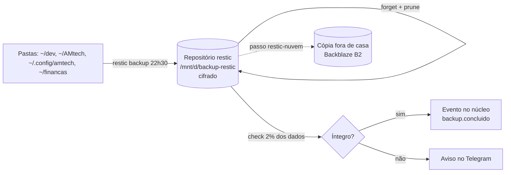

# Backup com restic: como o seu setup se protege e como restaurar

> Aula-modelo do Professor (módulo `s-backup`). As aulas geradas seguem esta mesma estrutura e ficam no seu vault, em 07-estudo-e-carreira/professor/aulas.

## Objetivo e por que isso importa

**Objetivo:** depois desta aula, você explica, sem consultar, como o seu backup funciona e restaura um arquivo sozinho.

**Por que importa:** o seu notebook guarda o dev-setup, os sistemas, o cofre e as finanças. Disco morre, notebook é roubado, IA apaga pasta. Um backup que você nunca restaurou é só uma esperança.

## Antes de começar

Responda de cabeça e anote. No fim da aula, compare com o que aprendeu.

1. Se o notebook sumisse hoje, o que você perderia e onde estaria a cópia?
2. Qual a diferença entre copiar uma pasta para o disco externo e fazer um backup?
3. Se alguém achar o seu disco externo na rua, o que ele consegue ler?

## Bloco 1 (25 min) · Intuição

Pense no caderno de receitas do restaurante.

- **Copiar a pasta** é fotocopiar o caderno inteiro toda noite. Ocupa espaço, e se alguém rasurou uma receita na terça, a cópia de quarta já sai rasurada: a versão boa se perde.
- **Um snapshot** é uma foto do caderno naquela noite, guardada numa pasta com a data. Se a terça estragou, você pega a foto de segunda.
- **A deduplicação** é não fotografar de novo as páginas que não mudaram: a foto nova só guarda as páginas diferentes e aponta para as antigas. Por isso 30 fotos não ocupam 30 vezes o espaço.
- **A criptografia** é guardar as fotos num cofre. Quem achar o disco vê só embaralhado.
- **A regra 3-2-1:** 3 cópias (o original e mais 2), em 2 mídias diferentes, 1 fora de casa. Incêndio na casa leva o notebook e o disco externo juntos; a cópia fora de casa sobrevive.

## Bloco 2 (25 min) · O modelo: como funciona por dentro

O que o seu `scripts/wsl/backup.sh` faz, na ordem:

1. **Lê a configuração** em `~/.config/amtech/backup.env`: onde fica o repositório (`RESTIC_REPOSITORY`), onde fica a senha (`RESTIC_PASSWORD_FILE`) e quais pastas entram. O script se recusa a rodar se o arquivo de senha não estiver com `chmod 600`, para nenhum outro usuário conseguir ler.
2. **`restic backup`** quebra os arquivos em pedaços. Pedaço que já existe no repositório não é gravado de novo: essa é a deduplicação. O que é novo é cifrado e gravado. O snapshot recebe a etiqueta `diario`. Ficam de fora `node_modules`, `bin`, `obj` e as pastas marcadas como cache: tudo isso se recria com um comando, então só gastaria espaço.
3. **`restic forget --keep-daily 7 --keep-weekly 4 --keep-monthly 12 --prune`** é a retenção. Ficam os últimos 7 dias, 4 semanas e 12 meses; os outros snapshots são esquecidos e o `--prune` apaga os pedaços que ninguém mais usa.
4. **`restic check --read-data-subset=2%`** lê de verdade 2% dos dados a cada noite. Em uns 50 dias o repositório inteiro foi conferido sem pesar em nenhuma noite.
5. **Registra o evento** `backup.concluido` no núcleo. O agendador avisa no Telegram se o backup falhar.

**Atenção:** o script grava num repositório só, o do disco externo. A cópia fora de casa (o 1 da regra 3-2-1) é o passo `restic-nuvem` do roteiro. Enquanto ele não estiver feito, você está no 2-1-0: um incêndio leva tudo.

## Bloco 3 (25 min) · Os detalhes que pegam

- **Perder a senha do restic é perder o backup.** Não há "esqueci minha senha": a criptografia é real. A senha mora no KeePassXC e no arquivo de senha; o kit de emergência em papel cobre o cofre.
- **Disco externo desconectado às 22h30:** o backup falha. O aviso no Telegram existe para isso; não ignore dois avisos seguidos.
- **"Repository is already locked":** um backup anterior caiu no meio. Antes de destravar, confira com `ps aux | grep restic` que nada está rodando; só então use `restic unlock`.
- **Backup não é sincronização.** O Syncthing espelha: apagou de um lado, apaga do outro. O restic guarda o passado. Os dois servem, mas não são a mesma coisa.
- **O que não está em `BACKUP_PASTAS` não existe para o backup.** Criou uma pasta nova importante fora do `~/dev`? Acrescente ao `backup.env`.
- **Um backup só vale se você já restaurou.** Restauração ensaiada é a regra AK-0009 do piloto da Escola Akita.

## Exemplo resolvido

**Situação:** você apagou sem querer `~/dev/dev-setup/docs/plano-eixo.md` e quer a versão de ontem.

1. Carregue a configuração, sem imprimir a senha: `set -a; source ~/.config/amtech/backup.env; set +a`. Isso põe as variáveis no ambiente e o restic as encontra sozinho.
2. Veja os snapshots: `restic snapshots --tag diario`. Escolha o de ontem pela data e anote o ID, por exemplo `4f2a91c3`.
3. Confira se o arquivo está nele antes de restaurar: `restic ls 4f2a91c3 | grep plano-eixo.md`.
4. Restaure para uma pasta de teste, nunca por cima do original: `restic restore 4f2a91c3 --target /tmp/restaurado --include "$HOME/dev/dev-setup/docs/plano-eixo.md"`.
5. Confira e só então copie de volta: `less /tmp/restaurado$HOME/dev/dev-setup/docs/plano-eixo.md`.

Por que restaurar para `/tmp` primeiro? Se você escolheu o snapshot errado, não estraga nada.

## Agora você

Situação: você quer o `justfile` como ele estava há uma semana. Complete as lacunas:

1. `set -a; source ___; set +a`
2. `restic ___ --tag diario` e escolha o snapshot de 7 dias atrás.
3. `restic restore ___ --target ___ --include "$HOME/dev/dev-setup/___"`
4. Compare com o atual: `diff ___ ~/dev/dev-setup/justfile`

## Exercícios em 4 níveis

**N1 · Reconhecimento**
1. Qual comando lista os snapshots?
2. Verdadeiro ou falso: o restic grava de novo o arquivo inteiro a cada noite.
3. Em que pasta fica a configuração do seu backup?

**N2 · Aplicação direta**
4. Escreva o comando que restaura só o `justfile` do snapshot mais recente para `/tmp/j`.
5. Escreva o comando que mostra quanto espaço o repositório ocupa.

**N3 · Aplicação combinada e "encontre o erro"**
6. Encontre o erro: `restic restore latest --target ~/dev/dev-setup`.
7. Você criou a pasta `~/clientes` ontem e o arquivo de lá sumiu hoje. O backup tem esse arquivo? Por quê?

**N4 · Desafio**
8. Desenhe (no papel ou em Mermaid) como ficaria o seu 3-2-1 completo com o B2. Escreva os passos para restaurar tudo num notebook novo, do zero.

> **Pare e responda:** se o notebook e o disco externo forem roubados juntos hoje, o que sobra?

## Prática no seu setup

Ubuntu do WSL, com o disco externo conectado:

1. Veja o que o backup faria, sem gravar nada: `cd ~/dev/dev-setup && bash scripts/wsl/backup.sh --simular`
2. Liste os snapshots: `set -a; source ~/.config/amtech/backup.env; set +a; restic snapshots --compact`
3. Restaure o README: `restic restore latest --target /tmp/teste-restauracao --include "$HOME/dev/dev-setup/README.md"`
4. Confira que é igual: `diff /tmp/teste-restauracao$HOME/dev/dev-setup/README.md ~/dev/dev-setup/README.md && echo IGUAL`

**Pronto quando:** aparece `IGUAL`. Depois marque com `just professor praticei s-backup`.

## Perguntas de recuperação

1. O que significa cada número da regra 3-2-1, e qual parte ainda falta no seu setup?
2. Por que 30 snapshots não ocupam 30 vezes o espaço?
3. O que acontece se o arquivo de senha estiver com permissão 644?
4. Por que restaurar para `/tmp` e não direto por cima do original?
5. Você recebeu dois avisos de backup falho seguidos. Qual é o seu diagnóstico em ordem?

Respostas

1. 3 cópias (o original e mais 2), 2 mídias diferentes, 1 fora de casa. Falta a cópia fora de casa, o passo `restic-nuvem` com o Backblaze B2.
2. Deduplicação: pedaços iguais são gravados uma vez só, e cada snapshot aponta para eles.
3. O `backup.sh` se recusa a rodar, porque outro usuário poderia ler a senha. Corrija com `chmod 600`.
4. Se o snapshot estiver errado, você não perde a versão atual.
5. O disco externo estava conectado e montado em `/mnt/d`? O arquivo `backup.env` e o de senha existem? Há trava de um backup anterior (`restic unlock` só depois de confirmar que nada roda)? O disco está cheio?

**Gabarito dos exercícios**

1. `restic snapshots`.
2. Falso: só os pedaços novos são gravados, graças à deduplicação.
3. `~/.config/amtech/backup.env`.
4. `restic restore latest --target /tmp/j --include "$HOME/dev/dev-setup/justfile"`.
5. `restic stats --mode raw-data`. Confira na documentação os outros modos: cada um mede uma coisa diferente.
6. O alvo é a própria pasta de trabalho: a restauração escreve por cima do que você tem. Restaure sempre para `/tmp` e compare antes.
7. Só se `~/clientes` estiver em `BACKUP_PASTAS`. A lista padrão não tem essa pasta, então não está: acrescente ao `backup.env`.
8. Resposta aberta. Confira se tem: instalar o restic, pegar a senha no KeePassXC (o kit de papel abre o cofre), apontar para o B2, `restic snapshots`, `restic restore latest --target`, conferir e só então rodar o setup.

**Fechamento do bloco:** feche esta aula, reconstrua de cabeça e rode `just professor fechar s-backup MINUTOS`.

## Cartões

- O que é um snapshot no restic? :: Uma foto do estado das pastas num momento, guardada com data
- O que a deduplicação evita? :: Gravar de novo pedaços de arquivo que já estão no repositório
- Regra 3-2-1 :: 3 cópias, 2 mídias diferentes, 1 fora de casa
- O que faz forget --prune? :: Esquece os snapshots fora da retenção e apaga os pedaços sem uso
- Retenção do seu setup :: 7 diários, 4 semanais, 12 mensais
- Esqueci a senha do restic: e agora? :: Backup perdido; por isso ela fica no KeePassXC e no kit de papel
- Para onde restaurar primeiro? :: Para uma pasta de teste, nunca por cima do original
- Backup x Syncthing :: O backup guarda o passado; a sincronização espelha, inclusive o que você apaga

## Se quiser ir além

- [Documentação oficial do restic](https://restic.readthedocs.io/): leia "Preparing a new repository", "Backing up", "Restoring from backup" e "Removing backup snapshots". É curta e bem escrita.
- O seu próprio `scripts/wsl/backup.sh`: com esta aula, você consegue ler cada linha dele. Esse é o teste final.
