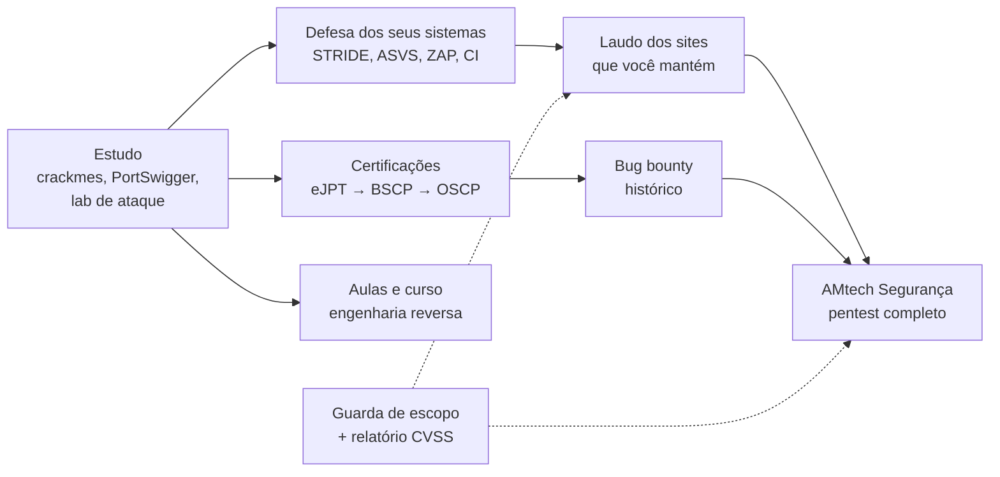

# Segurança: engenharia reversa, AppSec, pentest e o Jarvis

[← Índice da documentação](../README.md)

Uma frente só com quatro usos: entender como software compilado funciona por dentro, deixar os seus sistemas difíceis de invadir, vender testes de segurança de forma legal e montar um assistente que conversa com todo o setup.

## A ideia em uma frase

Aprender a atacar só no que é seu ou no que foi feito para isso, usar o que aprendeu para defender os seus sistemas primeiro, e só vender teste quando houver certificação, histórico, contrato e a trava de escopo funcionando.

## Documentos

1. [Engenharia reversa com IA](01-engenharia-reversa.md): o laboratório, o fluxo com Ghidra e GhidraMCP, a trilha de exercícios, a aula para os alunos e como usar nos seus próprios sistemas
2. [AppSec nos seus sistemas](02-appsec.md): o processo que pega a maior parte dos erros antes do cliente, com modelagem de ameaças, checklist ASVS, CI e os repositórios de referência para comparar arquitetura
3. [Empresa de pentest](03-empresa-de-pentest.md): o que um serviço completo tem, da autorização ao reteste, as ferramentas que você constrói e as que usa prontas, a lei, os portões e a ordem realista
4. [Jarvis: o lado da segurança](04-jarvis.md): as ameaças de um assistente de voz e como a política trava cada uma (o guia completo está em [docs/jarvis](../jarvis/README.md))

## O que já está pronto no repositório

| Peça | Onde | Para quê |
|---|---|---|
| Guarda de escopo | `tools/seguranca/escopo.py` | Bloqueia qualquer teste sem termo assinado, fora da janela ou fora do escopo; registra cada comando |
| Calculadora CVSS 3.1 | `tools/seguranca/cvss.py` | Nota de cada achado pela fórmula oficial do FIRST |
| Gerador de relatório | `tools/seguranca/relatorio.py` | Relatório completo a partir do escopo e dos achados; recusa achado fora do escopo |
| Modelos | `infra/templates/seguranca/` | Termo de autorização, escopo, achados, modelagem de ameaças, ZAP no CI e o crackme da aula |
| Laboratório de ataque | `infra/lab-seguranca/compose.yaml` | Juice Shop e WebGoat presos em 127.0.0.1 |
| Laboratório de alvo isolado | `scripts/wsl/lab-alvo.sh` e `scripts/windows/lab-alvo.ps1` | Qualquer software que você estudou rodando numa rede sem internet, com prova do isolamento e foto para desfazer o ataque |
| Ferramentas de engenharia reversa | `scripts/wsl/ferramentas-re.sh` | Ghidra, GhidraMCP, ILSpy, gdb e companhia no Ubuntu |

O passo a passo está nas fases 50 (segurança) e 51 (Jarvis) do [roteiro de implantação](../implantacao/roteiro.md#f-seguranca).

## Três regras que não mudam

1. **Só no que é seu, no que foi feito para isso ou no que tem autorização escrita.** Invadir sistema de terceiro sem autorização é crime (Lei 12.737/2012). Programa de bug bounty conta como autorização só dentro do escopo publicado por ele.
2. **Dado de cliente e evidência de falha nunca vão para o GitHub nem para IA na nuvem.** Ficam em `~/clientes`, criptografados no backup. Binário de cliente só com modelo local.
3. **Ferramenta não faz o profissional.** O que separa um pentester bom de um mediano é horas de laboratório, relatórios bem escritos e histórico. As peças daqui tiram o trabalho repetitivo do caminho; o resto é treino.
