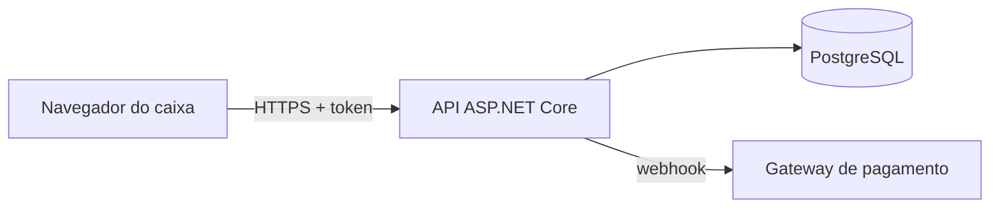

# Modelagem de ameaças: [nome do sistema]

> Copie para `docs/seguranca/ameacas.md` de cada sistema seu (ex.: AM Kaixara) antes de escrever a primeira linha
> de uma funcionalidade nova. Uma hora aqui evita a falha mais cara: a de desenho, que nenhum scanner acha.
> Revise a cada funcionalidade que mexe com login, dinheiro, dado pessoal ou integração externa.

**Versão:** [data] · **Quem revisou:** [nome]

## 1. O que estamos construindo

Uma frase por item: o que o sistema faz, quem usa, que dado guarda.

- Usuários e papéis: [ex.: dono da loja, caixa, cliente final]
- Dados sensíveis: [ex.: CPF, endereço, valor das vendas, chave do Pix]
- Integrações: [ex.: gateway de pagamento, API da NFC-e, e-mail]

## 2. Diagrama de fluxo de dados

Desenhe (Mermaid, Excalidraw) as caixas: navegador → API → banco, e marque cada **fronteira de confiança**
(onde o dado passa de quem você não controla para quem você controla).

## 3. Ameaças por STRIDE

Para cada caixa e cada seta, pergunte as seis letras. Anote só o que se aplica.

| # | Onde | STRIDE | Ameaça | Mitigação | Teste que prova | Status |
|---|---|---|---|---|---|---|
| 1 | API /pedidos/{id} | **I**nformação vazada | Cliente lê pedido de outro trocando o id (IDOR) | Filtrar pelo dono no servidor | Teste de integração com dois usuários | feito / falta |
| 2 | Login | **S**poofing (falsificação) | Força bruta de senha | Limite de tentativas + 2FA para admin | Teste do rate limit | |
| 3 | Webhook do gateway | **T**ampering (adulteração) | Alguém chama o webhook com pedido falso pago | Validar assinatura HMAC do gateway | Teste com assinatura errada → 401 | |
| 4 | Ações do caixa | **R**epúdio | Caixa nega que deu o desconto | Log de auditoria imutável com usuário e hora | Teste do log | |
| 5 | Upload de logo | **D**enial of service | Arquivo de 2 GB derruba a API | Limite de tamanho e tipo | Teste com arquivo grande | |
| 6 | Papéis | **E**levação de privilégio | Caixa chama rota de dono | Autorização por política em toda rota | Teste de cada rota com cada papel | |

## 4. Checklist ASVS mínimo (nível 1)

- [ ] Toda regra de negócio e toda checagem de permissão roda no servidor; o cliente (web, app, desktop) é só tela.
- [ ] Nenhum segredo no código ou no front: connection string, chave de API e senha vêm do cofre ou de variável de ambiente.
- [ ] Senhas com hash próprio para senha (ASP.NET Core Identity / PBKDF2, Argon2), nunca SHA puro.
- [ ] Consultas parametrizadas (EF Core) em todo lugar; nada de SQL montado com texto do usuário.
- [ ] Saída codificada no HTML (Razor/React já fazem; cuidado com `dangerouslySetInnerHTML` e `Html.Raw`).
- [ ] Cookies `HttpOnly`, `Secure`, `SameSite`; HTTPS obrigatório (HSTS).
- [ ] Cabeçalhos de segurança: CSP, X-Content-Type-Options, Referrer-Policy.
- [ ] Logs sem senha, token ou dado pessoal completo.
- [ ] Dependências sem vulnerabilidade alta (Trivy e Dependabot no CI).
- [ ] Backup do banco testado (restauração de verdade, não só o arquivo).

## 5. Riscos aceitos

| Risco | Por que aceitamos | Até quando |
|---|---|---|
| | | |
