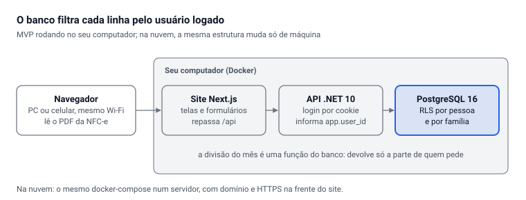

# AM Rendara — Especificação do MVP

Oct 9, 2026 · @Alan Mateus

## Visão geral

O MVP é o AM Rendara rodando no seu computador: cada pessoa entra com o próprio login, tem um controle financeiro pessoal que ninguém mais vê e participa de uma ou mais famílias, onde só as contas comuns são compartilhadas. A divisão das contas é calculada no servidor, que devolve a cada pessoa só a parte dela.

**Entra no MVP**

- Cadastro, login e saída, com senha guardada em hash.
- Famílias: criar, convidar por código, entrar, sair, papéis de administrador e membro.
- Área pessoal: rendas (com INSS e IR calculados), contas fixas, compras parceladas e consórcio.
- Contas pessoais divididas com a família: a conta inteira ou só uma parte.
- Contas da casa: valor fixo, valor do mês (água, luz) e anuais em cotas (IPTU), com quatro regras de divisão.
- Divisão do mês: minha parte em cada conta, quanto paguei, quanto devo ou tenho a receber, e as transferências que me envolvem.
- Notas fiscais (NFC-e da SEF-MG): leitura do PDF, itens pessoais ou da casa. Para a família só vai o total da parte da casa.
- Painel pessoal do mês: renda líquida, contas, minha parte da casa e sobra.

**Fica para as próximas etapas:** contracheques e extratos, investimentos e ARCA, metas de compra, valores a receber, impostos anuais, projeção, cobrança e LGPD completa. Tudo isso já foi testado no protótipo Caixa da Casa e será trazido em etapas (ver Roadmap).

## Arquitetura

Três serviços rodam no Docker do seu computador: o site em Next.js, a API em ASP.NET Core (.NET 10, Controllers, Clean Architecture) e o PostgreSQL 16. O mesmo `docker-compose.yml` sobe depois num servidor na nuvem.



O site repassa as chamadas `/api` para a API, então o navegador fala com um endereço só e o cookie de login funciona. A API usa Dapper sobre Npgsql e abre uma transação por consulta, informando ao banco quem está logado.

**Projetos .NET:** Domain (cálculos de INSS, IR, parcelas), Application (serviços e contratos), Infrastructure (banco e repositórios), Api (controllers e login), além de testes do domínio em xUnit.

## Usuários, famílias e permissões

Cada dado tem um dono: ou uma pessoa ou uma família. O que é da pessoa só ela vê; o que é da família, só os membros veem; e a renda usada na divisão é lida apenas pelo servidor, nunca devolvida a outro membro.

| Dado | Dono | Quem vê |
| --- | --- | --- |
| Rendas, contas pessoais, cartão, consórcio | Pessoa | Só a pessoa |
| Notas fiscais e itens (inclusive os da casa) | Pessoa | Só a pessoa |
| Renda informada para a divisão | Pessoa | Só a pessoa; o servidor usa no cálculo |
| Contas da casa e seus valores | Família | Membros da família |
| Parte dividida de uma conta pessoal | Família (espelho) | Membros: nome da conta, valor dividido, quem paga |
| Parte da casa de uma nota | Família | Membros: loja, data, valor total da parte da casa |
| Divisão do mês | Calculada | Cada membro vê o total de cada conta, a parte dele e as transferências que o envolvem |

**Papéis na família:** administrador (cria convites, edita e apaga contas da casa) e membro (vê, lança valores do mês, paga). Uma pessoa pode estar em várias famílias, e cada família tem a sua divisão.

**Limite conhecido:** na regra proporcional, quem sabe a própria parte e o total consegue estimar a proporção da renda dos outros. Por isso cada conta escolhe a própria regra.

**O dono do sistema** (você, como operador) tem acesso técnico ao banco. A proteção contra isso é processo, não código: dados criptografados em disco, registro de acesso e política de privacidade.

## Banco de dados

O isolamento é feito pelo próprio PostgreSQL com Row-Level Security (RLS): a API conecta com um usuário sem privilégios (`rendara_app`) e, em cada requisição, informa quem está logado (`app.user_id`). Mesmo que a API tenha um bug, o banco não devolve linha de outra pessoa ou de outra família.

| Tabela | Política de acesso | Conteúdo |
| --- | --- | --- |
| usuarios | só a própria linha | nome, e-mail, hash da senha |
| familias | só famílias de que sou membro | nome, quem criou |
| membros | só membros das minhas famílias | papel, se divide contas |
| convites | só por função (código de 8 letras, vale 7 dias) | família, validade, quem usou |
| rendas | só as minhas | regime, valor bruto ou líquido, dependentes, estabilidade, início e fim |
| contas | só as minhas | fixa, parcelada ou consórcio; se divide com a família, quanto e por qual regra |
| notas, nota\_itens | só as minhas | NFC-e completa, cada item pessoal ou da casa |
| renda\_divisao | só a minha | renda de cada mês usada na divisão |
| contas\_casa, contas\_casa\_valores | só das minhas famílias | contas comuns, valor fixo ou do mês, regra, quem paga; espelhos das contas pessoais divididas |
| despesas\_casa | só das minhas famílias | parte da casa de cada nota (só o total) |

**Funções com privilégio controlado** (rodam como dono do banco, mas checam se quem chama é membro): cadastrar e buscar usuário no login, criar família, criar e aceitar convite, sair da família, listar membros, sincronizar o espelho de uma conta pessoal dividida e calcular a divisão do mês.

**Espelho de conta pessoal:** quando uma conta pessoal é marcada para dividir, um gatilho no banco cria ou atualiza uma conta da casa ligada a ela, com os valores de 12 meses atrás até 36 meses à frente. Apagar ou deixar de dividir a conta apaga o espelho.

## Divisão das contas

A divisão do mês é uma função do banco (`divisao(familia, mes)`) que lê as rendas de todos, mas devolve a cada pessoa só a parte dela, o total de cada conta e as transferências em que ela aparece.

**Regras por conta da casa**

| Regra | Como divide |
| --- | --- |
| Proporcional | pela renda informada para a divisão por quem divide contas; sem renda de ninguém, divide igual |
| Partes iguais | entre os membros que dividem contas |
| Percentuais fixos | os percentuais combinados por membro |
| Uma pessoa só | 100% para o responsável |

**Valor da conta no mês:** o valor informado para aquele mês, se houver; senão, para cobrança mensal, o valor fixo dentro do período de início e fim; para cobrança anual, o valor ÷ cotas nos meses das cotas. Compras da casa vindas das notas são divididas pela regra proporcional.

**Cálculo de cada membro**

```latex
\text{parte} = \sum_{\text{contas}} \text{valor} \times \text{peso}_{\text{regra}} + \text{compras da casa} \times \text{peso}_{\text{renda}}
```

```latex
\text{saldo} = \text{o que pagou} - \text{parte}
```

Saldo positivo: tem a receber. As transferências são montadas do maior devedor para o maior credor, e cada pessoa recebe só as que envolvem ela.

**No painel pessoal**, uma conta pessoal dividida entra só com a parte que não foi dividida, e a parte da pessoa nas contas da casa entra como mais uma conta. Assim nada é contado duas vezes.

## API

Todas as rotas ficam em `/api`, exigem login (cookie HttpOnly) e rodam cada consulta numa transação com o usuário logado informado ao banco.

| Método e rota | O que faz |
| --- | --- |
| POST /api/auth/cadastro · /entrar · /sair · GET /eu | conta e sessão |
| GET /api/painel?mes=AAAA-MM | renda líquida, contas do mês, minha parte de cada família, sobra |
| GET · POST /api/rendas · PUT · DELETE /api/rendas/{id} | rendas, com INSS, IR (com a redução da Lei 15.270) e DAS calculados |
| GET · POST /api/contas · PUT · DELETE /api/contas/{id} | contas fixas, parceladas e consórcio, com a opção de dividir |
| GET /api/notas?mes · POST /api/notas · DELETE /api/notas/{id} | notas lidas do PDF da NFC-e; a parte da casa vira despesa da família |
| GET · POST /api/familias | minhas famílias; criar uma |
| GET /api/familias/{id}/membros · POST /{id}/convites · DELETE /{id}/sair | membros, convite, sair |
| POST /api/convites/{codigo}/aceitar | entrar numa família |
| GET · POST /api/familias/{id}/contas · PUT · DELETE /{id}/contas/{cid} | contas da casa |
| PUT /api/familias/{id}/contas/{cid}/valores/{mes} | valor de água, luz etc. no mês |
| GET · PUT /api/familias/{id}/renda-divisao/{mes} | a minha renda para a divisão (só eu vejo) |
| GET /api/familias/{id}/divisao?mes=AAAA-MM | a divisão do mês do meu ponto de vista |

A leitura do PDF da NFC-e acontece no navegador (pdf.js), como no protótipo, e a API recebe os itens já estruturados e confere se a soma bate com o total.

## Telas do site

O site usa a paleta fixa do Aura para painéis (petróleo, ocre e off-white) e funciona no celular.

| Tela | O que tem |
| --- | --- |
| Entrar e Criar conta | e-mail e senha |
| Painel | mês selecionado; renda líquida, contas pessoais, minha parte em cada família, sobra |
| Rendas | lista e formulário; bruto, INSS, IR e líquido de cada renda |
| Contas | fixas, parceladas e consórcio; opção “dividir com a família” (inteira ou parte, regra e família) |
| Notas | enviar o PDF da NFC-e, conferir os itens, marcar pessoal ou casa, escolher a família |
| Família | criar ou entrar com código; membros; contas da casa com valor do mês; minha renda para a divisão; divisão do mês com a minha parte e as transferências |

## Roadmap

O MVP roda no seu computador; cada etapa seguinte traz um bloco já testado no protótipo, e a venda só começa depois da etapa 4.

1. **MVP (esta entrega):** login, famílias, área pessoal, contas da casa, divisão no servidor, NFC-e e rendas. Uso pela família na mesma rede Wi-Fi.
2. **Histórico:** contracheques, extratos e faturas (CSV, OFX), operações de investimento; leitura de PDF e foto pela API do Claude.
3. **Planejamento:** investimentos e ARCA, metas de compra com diagnóstico, valores a receber, impostos anuais, projeção de 15 meses.
4. **Nuvem e venda:** servidor na internet, domínio, HTTPS, e-mail de convite, recuperar senha, cobrança recorrente por família, termos de uso e política de privacidade (LGPD), exportar e apagar dados, backup.
5. **Escala:** app de celular (PWA), Open Finance para extratos automáticos, painel do operador sem acesso a dados pessoais.
