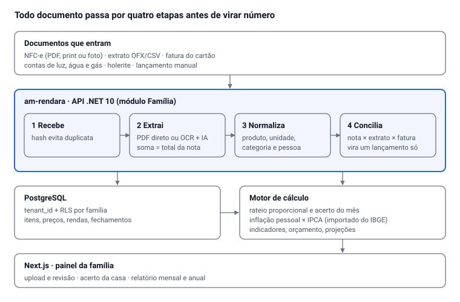

# AM Rendara — Módulo Família: plano do sistema de controle de gastos

Oct 9, 2026 · @Alan Mateus

## Visão e objetivos

O sistema vira um módulo do AM Rendara ("Família"): você joga um documento (nota, extrato, fatura, conta de luz), ele lê, categoriza, divide entre as pessoas e atualiza todos os indicadores sozinho. O ano inteiro fica registrado item por item, o que permite medir a sua inflação real, e não a média do IPCA.

Quatro perguntas que o sistema precisa responder a qualquer momento:

1. **Para onde vai o dinheiro?** Por pessoa, por categoria, por loja, por mês.
2. **Quem deve quanto na casa?** Rateio proporcional à renda e saldo de acerto entre os moradores.
3. **Quanto a minha vida ficou mais cara?** Inflação pessoal, item a item, comparada ao IPCA.
4. **Estou no rumo?** Orçamento, taxa de poupança, reserva de emergência e projeção do fim do mês e do ano.

Escopo: finanças pessoais e da família. Empresa (Grupo AMtech) fica fora deste módulo.

## Entrada de dados: o que o sistema lê

A NFC-e é a fonte mais rica, porque traz item, quantidade, unidade e preço. O resto entra com valor total e o sistema completa com categoria e pessoa.

| Documento | Como entra | O que extrai | Confiabilidade |
| --- | --- | --- | --- |
| NFC-e (cupom) — PDF ou print da página da SEF | Upload | Loja, CNPJ, data, cada item (qtd, unidade, preço), total, pagamento | Alta: texto estruturado |
| NFC-e — foto do cupom em papel | Câmera | Igual, via OCR + IA | Média: precisa revisão |
| NFC-e — QR Code | Câmera lê a URL | Chave de 44 dígitos (UF, data, CNPJ, número) | Só cabeçalho; itens exigem o PDF ou print |
| Extrato bancário OFX/CSV | Upload ou Open Finance | Toda movimentação da conta | Alta |
| Fatura do cartão (PDF) | Upload | Compras, parcelas, juros, anuidade | Média-alta |
| Contas de consumo (luz, água, gás, internet) | Upload do PDF | Valor, vencimento, consumo (kWh, m³) | Alta |
| Boleto / comprovante Pix | Upload ou print | Valor, data, favorecido | Alta |
| Holerite / comprovante de renda | Upload | Renda líquida de cada pessoa | Alta; define o rateio |
| Lançamento manual | Formulário rápido | Gasto sem documento (feira, dinheiro) | Depende do usuário |

### Pipeline de leitura

1. **Recebe** o arquivo e calcula um hash, para não lançar a mesma nota duas vezes.
2. **Identifica o tipo** (NFC-e, extrato, fatura, conta).
3. **Extrai** o texto: leitura direta do PDF; OCR quando é foto.
4. **Estrutura** com IA em JSON fixo (loja, data, itens, pagamentos) e valida: a soma dos itens precisa bater com o total da nota.
5. **Normaliza o produto**: "MAC INS NIS LAM 85G" vira "Macarrão instantâneo Nissin 85 g", com preço por kg ou por litro calculado.
6. **Categoriza** por regras aprendidas (código do produto, CNPJ da loja) e pede confirmação só quando não sabe.
7. **Concilia** com o extrato e a fatura: a compra da nota e o débito no banco viram um lançamento só.
8. **Atribui** a pessoa ou à casa (rateio) e recalcula todos os indicadores.

A nota de 08/10 já serve de teste: 87 itens somando exatamente R$ 887,63, pagos em dois débitos (R$ 268,73 + R$ 618,90).

## Rateio proporcional da casa

Cada pessoa paga das contas gerais a mesma fatia que a renda dela representa na renda total da casa.

```latex
\text{cota}_i = \frac{R_i}{\sum_j R_j} \times G
```

R = renda líquida do mês de cada pessoa; G = total das contas gerais do mês.

**Exemplo** (valores ilustrativos): contas gerais de R$ 2.500,00 no mês.

| Pessoa | Renda líquida (R$) | Fatia | Cota das contas gerais (R$) | Já pagou (R$) | Saldo (R$) |
| --- | --- | --- | --- | --- | --- |
| Pessoa A | 4.000,00 | 50% | 1.250,00 | 887,63 | deve 362,37 |
| Pessoa B | 2.400,00 | 30% | 750,00 | 1.200,00 | recebe 450,00 |
| Pessoa C | 1.600,00 | 20% | 500,00 | 412,37 | deve 87,63 |
| **Total** | **8.000,00** | **100%** | **2.500,00** | **2.500,00** | **0,00** |

O acerto do mês sai daqui: A transfere R$ 362,37 e C transfere R$ 87,63 para B. O sistema calcula o menor número de transferências possível.

### Regras que o sistema precisa ter

- **Três tipos de gasto:** geral da casa (rateado), pessoal (só de quem gastou) e compartilhado entre algumas pessoas (rateio parcial, ex.: só o casal).
- **Nota mista é dividida por item:** na compra de 08/10, desodorante e cerveja podem ser pessoais e arroz e limpeza, gerais. Um toque por item muda a classificação.
- **Base de renda configurável:** renda líquida do mês (padrão), média dos últimos 3 meses (para quem tem renda variável) ou valor fixo combinado.
- **Piso para quem não tem renda:** dependentes têm fatia 0%, mas os gastos deles entram como gerais.
- **Renda que muda no meio do mês** é recalculada no fechamento, nunca no lançamento.
- **Histórico imutável:** um mês fechado não se altera; correções entram no mês seguinte como ajuste.

## Inflação pessoal

A sua inflação é a variação de preço dos produtos que você realmente compra, ponderada pelo quanto cada um pesa no seu bolso. O IPCA usa a cesta média do Brasil; a sua pode ser bem diferente.

São dois números diferentes, e o sistema mostra os dois:

1. **Inflação de preço (o índice):** quanto a mesma cesta custaria hoje. Mede preço, não consumo.
2. **Variação do custo de vida:** quanto você gastou a mais. Mistura preço e mudança de hábito (comprou mais, trocou de marca).

### Como calcular

**Passo 1 — preço unitário comparável.** Cada item vira preço por kg, litro ou unidade. Ex.: patinho em 08/10 = R$ 43,41 ÷ 1,088 kg = R$ 39,90 por kg.

**Passo 2 — relativo de preço de cada produto** contra o mês-base (o primeiro mês em que foi comprado):

```latex
r_k = \frac{p_{k,t}}{p_{k,0}}
```

**Passo 3 — índice da cesta (Laspeyres, o mesmo método do IPCA)**, com peso w = participação do produto no gasto do mês-base:

```latex
I_t = \sum_k w_k \times r_k \times 100
```

I = 108 significa que sua cesta ficou 8% mais cara desde a base.

**Passo 4 — comparar com o IPCA** do mesmo período (série oficial do IBGE, importada todo mês). A diferença mostra se a sua vida está encarecendo mais rápido ou mais devagar que a média.

### Cuidados para o número ser honesto

- **Produto equivalente:** "Feijão vermelho 1 kg" de outra marca entra como substituto, marcado como tal, para não confundir troca de marca com aumento.
- **Produto que você parou de comprar** sai da cesta no ano seguinte; a cesta é revista uma vez por ano (janeiro).
- **Promoção:** o sistema guarda preço pago e preço de tabela quando a nota trouxer desconto.
- **Mínimo de dados:** o índice só é confiável com uns 3 meses de notas e os produtos recorrentes comprados mais de uma vez. Antes disso, aparece como "provisório".
- **Contas de consumo** entram por unidade física (reais por kWh, reais por metro cúbico), não pelo valor da conta.

## Indicadores e relatórios

São 6 grupos de indicadores, todos recalculados a cada documento lançado e consultáveis por pessoa, pela casa e por período.

| Grupo | Indicador | Para que serve |
| --- | --- | --- |
| Onde vai o dinheiro | Gasto por categoria e subcategoria (valor e % do total) | Achar o maior peso; na nota de 08/10, mercearia e higiene juntas foram 41% |
|  | Top 20 produtos do ano por gasto acumulado | Mostra o que mais pesa no ano, não só no mês |
|  | Gasto por loja e ticket médio por compra | Compara mercados e frequência de idas |
|  | Gasto por forma de pagamento (débito, crédito, Pix, dinheiro) | Controla o cartão |
|  | Gastos fixos × variáveis × eventuais | Sabe quanto do mês já nasce comprometido |
|  | Gasto essencial × supérfluo (você marca o que é supérfluo) | Mostra onde dá para cortar |
| Orçamento | Previsto × realizado por categoria, com alerta em 80% e 100% | Evita estourar no meio do mês |
|  | Projeção do fim do mês (ritmo diário × dias restantes) | Avisa antes do problema |
|  | Contas a vencer nos próximos 7 dias | Evita juros e multa |
| Saúde financeira | Taxa de poupança = (renda − gastos) ÷ renda | O número mais importante do controle |
|  | Comprometimento da renda com fixos e com dívidas | Acima de 30% em dívidas é sinal de alerta |
|  | Reserva de emergência em meses de custo de vida | Meta comum: 6 meses |
|  | Patrimônio líquido mês a mês | Mostra se você está enriquecendo |
| Casa | Cota de cada pessoa, quanto pagou e saldo do acerto | O rateio proporcional |
|  | Custo da casa por morador e por mês | Base para negociar contas |
| Preços | Inflação pessoal × IPCA (mensal e acumulada em 12 meses) | Sua inflação real |
|  | Histórico de preço por produto (R$ por kg, por litro, por unidade) | Saber se uma promoção é real |
|  | Melhor loja para cada produto recorrente | Onde comprar cada coisa |
|  | Consumo físico de luz (kWh) e água (m³) por mês | Separa aumento de tarifa de aumento de uso |
| Cartão e dívidas | Parcelas futuras já comprometidas por mês | Evita a bola de neve |
|  | Juros e tarifas pagos no ano (anuidade, IOF, multa) | Dinheiro que não comprou nada |
|  | Assinaturas recorrentes e quanto somam no ano | Corta o que não usa |

### Relatórios automáticos

- **Fechamento do mês:** resumo, rateio e acerto da casa, maiores variações contra o mês anterior.
- **Relatório anual:** inflação pessoal do ano, top produtos, quanto cada categoria custou e quanto foi poupado. Serve também de base para o Imposto de Renda (despesas médicas e de educação ficam marcadas).

## Modelo de dados

O coração é separar **produto** (o que é, de forma estável) de **item de compra** (quanto custou naquele dia). É isso que permite a série de preço do ano inteiro.

| Entidade | Campos principais | Observação |
| --- | --- | --- |
| Familia | id, nome, base\_rateio (liquida, media\_3m, fixa) | Raiz do tenant (tenant\_id + RLS, padrão Aura) |
| Pessoa | id, familia\_id, nome, papel (adulto, dependente) | Dependente tem fatia 0 |
| Renda | pessoa\_id, competencia (mês), valor\_liquido, origem (holerite, manual) | Define a fatia do rateio |
| Documento | id, tipo, arquivo, hash, status (lido, revisar, confirmado), chave\_nfce | Hash e chave impedem duplicidade |
| Estabelecimento | cnpj, nome, cidade | Vem da nota |
| Produto | id, nome\_normalizado, marca, quantidade\_embalagem, unidade\_base (kg, l, un), categoria\_id, equivalente\_de | Um produto pode ter vários códigos de lojas |
| ProdutoCodigo | produto\_id, cnpj, codigo\_loja, descricao\_original | Liga "MAC INS NIS LAM 85G" ao produto |
| Compra | id, documento\_id, estabelecimento\_id, data, total, pagou\_pessoa\_id | Uma nota = uma compra |
| ItemCompra | compra\_id, produto\_id, quantidade, unidade, valor\_total, desconto, preco\_unitario\_base, tipo\_rateio (geral, pessoal, compartilhado), pessoa\_id | Base da inflação e do rateio |
| Pagamento | compra\_id, forma (debito, credito, pix, dinheiro), valor, parcelas, conta\_id | A nota de 08/10 tem 2 pagamentos |
| Lancamento | id, conta\_id, data, valor, descricao, compra\_id (conciliação) | Vem do extrato ou da fatura |
| Conta | id, pessoa\_id, tipo (corrente, cartão, carteira), banco |  |
| Categoria | id, nome, pai\_id, essencial (sim/não) | Árvore de 2 níveis |
| Orcamento | familia\_id, categoria\_id, competencia, valor\_previsto |  |
| ContaConsumo | documento\_id, tipo (luz, água, gás), consumo\_fisico, unidade, valor | Separa tarifa de uso |
| Fechamento | familia\_id, competencia, totais, cotas, acertos, fechado\_em | Imutável depois de fechado |
| IndiceReferencia | nome (IPCA), competencia, variacao | Importado do IBGE |

## Arquitetura dentro do Aura

O módulo fica dentro do repositório am-rendara, na stack fixa do Aura (.NET 10 com Controllers, Clean Architecture + DDD, PostgreSQL, Next.js). Nenhum serviço novo é criado.



O documento só vira lançamento definitivo depois da etapa 4 e da confirmação do usuário; o motor de cálculo roda de novo a cada lançamento confirmado.

## Roadmap e o que fazer já

Comece a coletar dados hoje, antes de o sistema existir: a inflação pessoal só funciona com histórico, e cada mês sem nota guardada é um mês perdido.

**Agora (sem código):**

- [ ] Guardar o PDF ou print de toda NFC-e numa pasta por mês (você já tem a de 08/10)
- [ ] Exportar o extrato OFX ou CSV do banco no fim de cada mês
- [ ] Combinar com a família quais contas são gerais e qual base de renda vale para o rateio

**Fases de desenvolvimento:**

1. **MVP — leitura e rateio:** upload de PDF da NFC-e, extração com validação de total, categorias, pessoas, rateio proporcional e acerto do mês. Já resolve o uso diário.
2. **Conciliação:** importação de extrato OFX/CSV e fatura de cartão, conciliação automática com as notas, contas de consumo.
3. **Inteligência de preço:** normalização de produtos, histórico de preço unitário, inflação pessoal, importação do IPCA.
4. **Planejamento:** orçamento, alertas, projeção do mês, reserva, patrimônio, relatório anual.
5. **Conveniência:** foto do cupom com OCR, leitura do QR Code, app mobile, Open Finance.

Cada fase é usável sozinha; a 3 só precisa de dados que a 1 já guarda.

## Limites e riscos

O maior risco não é técnico: é a família parar de lançar os gastos. Um sistema perfeito com metade dos documentos dá números errados com cara de certos.

- **QR Code sozinho não traz itens.** A página da SEF-MG exige reCAPTCHA, e automatizar a passagem dele viola as regras do portal. O caminho é o PDF ou print que o usuário salva.
- **Gasto sem documento escapa:** feira, dinheiro vivo, Pix entre pessoas. Precisa de lançamento manual rápido, ou o extrato bancário como rede de segurança.
- **OCR de cupom em papel erra** com cupom amassado ou desbotado. A validação "soma dos itens = total" detecta o erro, mas alguém precisa revisar.
- **Normalizar produto é o trabalho mais difícil:** as descrições são abreviadas e mudam entre lojas. A primeira vez de cada produto vai pedir confirmação.
- **Rateio por renda pode gerar atrito** se a regra não for combinada antes. O sistema calcula; o acordo é entre as pessoas.
- **Dados sensíveis:** renda e gastos de várias pessoas. Cada pessoa vê os próprios gastos pessoais; a casa vê só o que é geral e as cotas.
- **IA na extração** precisa seguir a governança RNFT-IA do Aura: o usuário confirma antes de um dado extraído virar lançamento definitivo.

---

<!-- conexoes:inicio -->
## 🔗 Onde isto entra no plano

- [AM Rendara — Documento de Projeto Final](../../02-sistemas-de-negocio/rendara-documento-projeto-final.md)

🗂️ Voltar ao [índice dos artefatos](../00-INDICE-DOS-ARTEFATOS.md) · [mapa de conexões](../01-MAPA-DE-CONEXOES.md)
<!-- conexoes:fim -->
