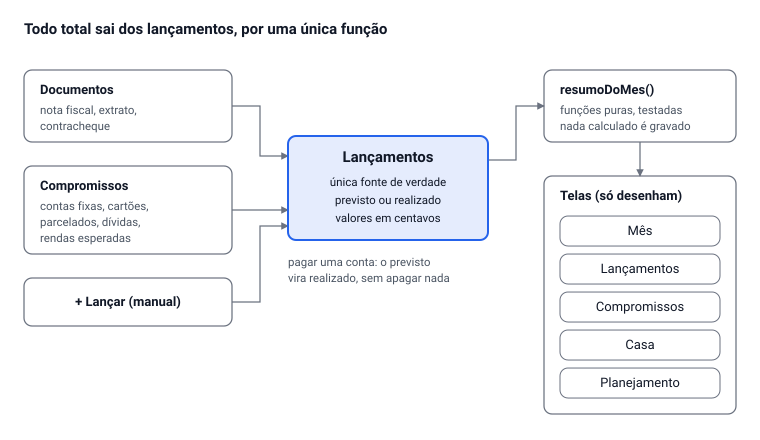

# Auditoria do Caixa da Casa (v35)

Oct 16, 2026 · @Alan Mateus

## Resumo

Hoje o Caixa da Casa não responde com segurança à pergunta principal de um controle de gastos: quanto sobrou neste mês. Com os seus dados reais de outubro/2026, o Painel mostra sobra de R$ 1.340,05 e o Meu mês mostra R$ 1.531,47. Nenhum dos dois conta R$ 3.786,23 em contas que você marcou como pagas. A causa não é uma conta errada isolada. O sistema tem várias fontes de verdade para o mesmo número e cresceu por remendos. A recomendação é parar de remendar (não fazer uma v36 no mesmo modelo) e reconstruir o núcleo de gastos sobre um modelo de dados único, migrando os dados que você já tem.

Os 5 problemas mais graves:

1. **Contas pagas que somem dos totais.** Em out/2026 há 7 pagamentos marcados, que somam R$ 3.786,23: consórcio Sahara, Claude, faculdade, internet, mãe, ração e fatura Nubank. As contas desses pagamentos não existem mais no cadastro. Por isso o Painel mostra "Contas pessoais R$ 0,00".
2. **Duas sobras diferentes para o mesmo mês.** O Painel desconta "minha parte da casa" (R$ 1.419,51). O Meu mês desconta "o que eu pago da casa" (R$ 1.228,09). As duas telas usam o mesmo rótulo, "Sobra".
3. **Duas rendas para a mesma pessoa.** A divisão da casa usa R$ 4.900,00, digitado à mão. O resto do sistema usa R$ 2.759,56 confirmados. É daí que sai a sua parte de 62,8% da casa.
4. **Falta de dado vira zero.** Outubro aparece com R$ 0,00 de gastos do dia a dia, e a sobra é calculada como se você não tivesse gastado nada no mês. Os meses futuros aparecem com sobra de −R$ 1.419,51, porque a renda futura nunca é "confirmada".
5. **Código que não dá mais para manter com segurança.** O sistema é gerado por uma cadeia de 30 versões de scripts de remendo. O resultado é um arquivo de 4.970 linhas, organizado por versão (v5, v18, v29…) e não por assunto, e sem testes automáticos dos cálculos de dinheiro.

Uma decisão é sua antes de qualquer correção: as 7 contas pessoais foram apagadas de propósito? Pelos dados não dá para saber quem as apagou nem quando.

## Escopo e método

A auditoria cobriu o Caixa da Casa v35, o sistema de controle de gastos pessoal e da casa. O AM Kaixara ficou de fora. Os módulos de investimentos, veículos, rotina e impostos entraram só quando afetam os números de gasto.

| O que foi feito | Como |
| --- | --- |
| Leitura do código | Cadeia de build, 381 funções, modelo de dados, gravações, eventos |
| Dados reais | Cópia só de leitura, em 16/10/2026, de todos os seus documentos: 68 pessoais, 6 contas da casa, 2 notas, renda da divisão, família, acertos. Nada foi alterado. |
| Simulação | O v35 rodou num navegador com essa cópia. Os números de Painel, Meu mês, Ano e Projeção foram comparados para os mesmos meses. |
| Cliques | Clique em cada botão visível das 19 abas, no computador e na largura de celular (390 px) |

Os dados da Claudia são privados e não foram lidos. Por isso, o lado dela da divisão foi avaliado só pelo que está nas coleções compartilhadas.

## Problemas nos números

Nove problemas fazem o mesmo mês mostrar números diferentes conforme a tela. Todos foram vistos rodando o v35 com os seus dados de out/2026, salvo onde está indicado.

| # | Problema | Evidência | Gravidade |
| --- | --- | --- | --- |
| N1 | Pagamentos de contas apagadas não entram em nenhum total | O documento de pagamentos de out/2026 tem 7 itens pagos (R$ 3.786,23), mas nenhum cadastro de conta, cartão ou consórcio existe. O Painel mostra "Contas pessoais R$ 0,00 · 0 compromissos". | Crítica |
| N2 | "Sobra" tem duas definições | Painel: R$ 1.340,05 (desconta a parte da casa pela regra, R$ 1.419,51). Meu mês: R$ 1.531,47 (desconta o que você pagou, R$ 1.228,09). | Crítica |
| N3 | Renda da divisão separada da renda real | `rendas/2026-10` guarda Alan R$ 4.900 e Claudia R$ 2.900, digitados. A renda confirmada calculada é R$ 2.759,56 (R$ 4.959,56 com a estimativa da Hashi). A sua parte da casa (62,8%) vem do valor digitado. | Alta |
| N4 | Falta de dado é tratada como zero | Out/2026 mostra "Gastos do dia a dia R$ 0,00" e calcula a sobra como se nada tivesse sido gasto no mês. O IPTU, que é anual e está sem valor, entra como R$ 0. | Alta |
| N5 | A aba Ano se contradiz na mesma tela | O cartão do topo diz "Gastos em 2026: R$ 0,00". Logo abaixo, "Categorias no ano" soma cerca de R$ 691, que é a sua parte das compras da casa. | Alta |
| N6 | "Contas" muda de significado entre telas | Painel: "Contas pessoais R$ 0,00", sem a casa. Ano e Projeção: "Contas e dívidas R$ 1.419,51" por mês, com a casa. | Média |
| N7 | A projeção principal é sempre negativa | Nov/2026 a abr/2027: sobra de −R$ 1.419,51, porque a renda futura nunca está "confirmada". A coluna útil ("com a estimada") fica em segundo plano. | Média |
| N8 | O gasto do dia a dia futuro é R$ 0 | A projeção usa a média dos meses lançados. Com o histórico vazio, a média é R$ 0,00, e mercado, transporte e lazer somem do futuro. | Média |
| N9 | A perda anual do "por fora" conta um salário a mais no FGTS | `perdaPorFora` usa a base 12 + 1 + 1 + 1/3 salários. O correto é 12 + 13º + 1/3 de férias. Para R$ 442,50 por mês, mostra R$ 1.097,40 por ano; o correto é R$ 1.062,00. | Baixa |

Cálculo correto da perda anual com dinheiro por fora (pf = valor mensal por fora), considerando só 13º, 1/3 de férias e FGTS:

```latex
\text{perda} = pf + \frac{pf}{3} + 0{,}08 \times \left(13\,pf + \frac{pf}{3}\right)
```

## Problemas no modelo de dados

Os problemas de números vêm quase todos daqui. O mesmo fato — entrou dinheiro, saiu dinheiro, alguém pagou — é guardado em lugares e formatos diferentes, e cada tela junta os pedaços do seu jeito.

| # | Problema | Onde está | Consequência |
| --- | --- | --- | --- |
| D1 | Não existe um registro de movimentação (lançamento). Saídas ficam espalhadas em notas, extratos, contas fixas, parcelados, consórcios, financiamentos, impostos, gastos de veículo e faturas. | `TYPES` e `compromissosMes` | Toda tela precisa saber juntar 9 tipos diferentes, e cada uma junta de um jeito (N2, N5, N6) |
| D2 | Dois modelos de pagamento. Contas pessoais: documento `pag-AAAA-MM` com chaves de texto (`conta:cad-conta-mae`). Contas da casa: campo `pagos` dentro de cada conta. | `pag-2026-10`, `casa/*.pagos` | Apagar uma conta deixa o pagamento órfão (N1); não há vínculo verificado |
| D3 | Duas rendas: a calculada (fontes + contracheques) e a digitada para a divisão | `data/users/*/cad-renda-*` e `rendas/AAAA-MM` | A divisão da casa usa um número que ninguém confere (N3) |
| D4 | Dados derivados gravados como se fossem fatos. O "espelho" de uma conta pessoal dividida grava na casa os valores já calculados de 48 meses. | `sincronizarEspelho` | Se a regra muda, o espelho só se atualiza quando a conta original é salva de novo |
| D5 | Gravações em várias etapas, sem garantia de tudo ou nada | `salvarManual` (nota e depois cartão), `excluirNota` (nota e depois parcelado), `salvarCadastro` (cadastro, operações e espelho) | Uma queda de conexão no meio deixa metade gravada |
| D6 | A última gravação vence. Para marcar o pagamento de uma conta da casa, o documento inteiro é reescrito a partir da cópia local. | `S.db.collection("casa").doc(cid).set({...corpo, pagos})` | Se você e a Claudia confirmarem pagamentos ao mesmo tempo, o de um apaga o do outro |
| D7 | Lançamentos pessoais na coleção compartilhada | `salvarManual` grava em `notas` | Um gasto lançado como só seu fica visível para todos da família |
| D8 | "Sem valor" e "zero" são a mesma coisa | `valor: null` entra nas somas como 0 | N4: a falta de informação parece economia |

## Problemas de experiência do usuário

O sistema faz muita coisa, mas não deixa claro o que fazer primeiro. As tarefas mais frequentes de um controle de gastos (lançar um gasto, marcar uma conta como paga, ver quanto sobra) competem com ferramentas de uso raro.

| # | Problema | Evidência |
| --- | --- | --- |
| U1 | 19 abas no topo, misturando finanças do dia a dia com outras ferramentas | Painel, Meu mês, Decisões, Roteiro de teste, Rotina, Lançar, Casa e divisão, Rendas, Contas e dívidas, Investimentos, Metas, A receber, Veículos, Histórico, Impostos, Projeção, Preços, Ano, Regras e ajustes |
| U2 | O Painel abre com a agenda do dia, e não com o dinheiro | Os primeiros itens são "Faculdade", "Cães", "Almoço"; a renda só aparece depois |
| U3 | Três telas de "meu mês" que não concordam | Painel, Meu mês e a tabela do Ano mostram o mesmo mês com sobras diferentes (N2) |
| U4 | Lançar um gasto não tem lugar fixo | Não há botão de lançamento rápido em todas as telas; a ação fica na 6ª aba |
| U5 | Cinco estados de renda para o usuário entender | confirmado, estimado, previsto, aguardando, não informado |
| U6 | O aviso de pagamentos órfãos oferece só "Apagar" | No Meu mês, os R$ 3.786,23 aparecem no rodapé com um botão Apagar em cada item. Não há opção de recriar a conta. |
| U7 | Ações sem resposta | "Usar como renda" num contracheque já ligado grava sem mostrar nada (3 botões no Histórico, no teste de celular) |
| U8 | A lista de pendências mistura o que importa com ruído | "Luz: sem quem paga, o acerto não fecha" aparece junto de "Estado de MG: nenhum custo cadastrado", que não se aplica a quem é empregado |
| U9 | Duas formas de editar a mesma coisa | Edição na linha (Meu mês, Mês a mês) e formulário ("Editar renda"), com campos diferentes |

Na auditoria de cliques, nenhum botão deixou de responder por erro, no computador ou no celular. Os "sem efeito" foram as abas internas já selecionadas e o U7. Se no seu celular algum botão não responde, preciso saber qual, porque o teste não reproduziu o problema.

## Problemas de engenharia

O código chegou ao ponto em que cada correção tem chance real de quebrar outra coisa. Hoje não há como provar que não quebrou. Essa responsabilidade é minha: fui eu que construí o sistema por remendos sucessivos.

| # | Problema | Evidência |
| --- | --- | --- |
| E1 | O código-fonte não existe como arquivo; ele é o resultado de uma cadeia de remendos | `build35.sh` chama `build34.sh`, que chama o 33, e assim até o 19. São 36 scripts de remendo e 17 de build; nos `patch*.py` há 70 substituições de texto |
| E2 | Um único arquivo organizado por versão, e não por assunto | 4.970 linhas, 778 KB, 46 seções com nomes como "v18" (533 linhas) e "v29" (478 linhas) |
| E3 | Cálculo misturado com tela | `vPainel` calcula a própria sobra em vez de chamar `sobraMes`: é a causa direta do N2 |
| E4 | Estado global que muda o resultado das funções | A flag `S._forcarPrev`, ligada por `comPrevisao`/`semPrevisao`, faz a mesma função devolver valores diferentes. Há também funções substituídas em tempo de execução (`vImpostos = …`). O objeto `S` recebe 91 campos diferentes. |
| E5 | Um tratador de eventos com 93 ramos `if (ds.…)` | Seção "eventos", 258 linhas |
| E6 | Código morto deixado pelos remendos | `usarHoleriteComoRenda` tem um bloco inteiro depois de `return`, que nunca roda |
| E7 | Não há testes automáticos dos cálculos de dinheiro | Mais de 380 scripts de teste copiados a cada versão (`t10defghi_16` … `_30`), sem um comando que rode todos. O meu próprio simulador não carregava a coleção `rendas`; descobri isso nesta auditoria. |
| E8 | Dinheiro em ponto flutuante, arredondado caso a caso | 32 arredondamentos `Math.round(x*100)/100` espalhados; nenhum valor guardado em centavos |
| E9 | Dados sem versão de formato | Nenhum documento tem campo de versão. Qualquer mudança de formato depende de adivinhar o formato antigo. |

O desempenho hoje está bom: a tela mais lenta, Projeção, desenha em 43 ms com os seus dados. Ele só vira problema com anos de notas lançadas.

## Arquitetura proposta

A proposta tem um registro só para todo dinheiro que entra ou sai, o lançamento, e uma função só que calcula o mês. Todas as telas mostram o resultado dessa função, e nenhuma calcula por conta própria. Com isso, N1 a N8 deixam de ser possíveis pela forma do sistema, e não por cuidado em cada tela.



Notas, compromissos e lançamentos manuais viram lançamentos. Só `resumoDoMes()` lê os lançamentos, e as cinco telas mostram o que ela devolve.

### Modelo de dados

| Entidade | O que é | Regra que resolve |
| --- | --- | --- |
| Lançamento | Um movimento de dinheiro: data, mês de competência, valor em centavos, entrada/saída/transferência, categoria, de quem é (pessoa ou casa), situação (previsto ou realizado) e origem | Única fonte para qualquer total (D1, N2, N5, N6) |
| Compromisso | O que se repete ou se parcela: conta fixa, cartão, parcelado, consórcio, financiamento, imposto, salário esperado. Ele gera lançamentos previstos. | Pagar = transformar o previsto em realizado. Apagar um compromisso pergunta o que fazer com o que já foi pago, e nunca deixa órfãos (N1, D2). |
| Documento | Nota fiscal, extrato, contracheque. Guarda o original e gera lançamentos. | O contracheque vira a entrada realizada; o "por fora" vira outro lançamento, separado |
| Divisão da casa | Regra (proporcional, igual, fixa) e base de renda | A proporção usa a renda realizada dos lançamentos. Um ajuste manual fica registrado e visível (D3, N3). |
| Acerto | Transferência entre você e a Claudia | É um lançamento de transferência, não um caso especial |

Três regras valem para tudo:

- **Valor desconhecido é diferente de zero.** Um compromisso sem valor aparece como "falta informar" e deixa a sobra marcada como incompleta, em vez de somar R$ 0 (N4, D8). Sem histórico de gastos, a projeção pede um valor estimado (N8).
- **Nada calculado é gravado.** Sobra, parte da casa, proporções e projeção são sempre recalculadas. O espelho de 48 meses deixa de existir (D4).
- **Cada fato é um documento próprio, que só é acrescentado.** Um pagamento vira um documento novo, em vez de um campo reescrito dentro da conta. Assim, duas pessoas confirmando ao mesmo tempo não se apagam (D6). Lançamentos pessoais ficam na área privada; só os da casa ficam na compartilhada (D7).

### Organização do código

| Camada | Conteúdo | Regra |
| --- | --- | --- |
| Domínio | Funções puras: `resumoDoMes(pessoa, mês)`, divisão, compromissos para previstos, impostos de folha | Não lê tela nem estado global; todo valor em centavos inteiros; coberta por testes |
| Dados | Leitura, gravação, migração do formato atual, versão de formato em cada documento | Único lugar que fala com o banco (E9) |
| Telas | Componentes que recebem o resumo e desenham | Não calculam (E3); ações nomeadas, em vez de 93 ramos `if` (E5) |
| Build e testes | Arquivos-fonte normais, empacotados num único HTML; um comando roda todos os testes | Fim da cadeia de remendos (E1, E2, E7). Teste-chave: com os seus dados reais, todas as telas têm que mostrar a mesma sobra. |

### Telas

As 19 abas viram 5 áreas e Ajustes. Um botão "+ Lançar" fica fixo em todas as telas.

| Área | Responde | Reúne o que hoje está em |
| --- | --- | --- |
| Mês | Quanto entrou, o que falta pagar, quanto sobra (um número) | Painel, Meu mês |
| Lançamentos | Tudo o que entrou e saiu, com filtros e importação de nota, extrato e contracheque | Lançar, Histórico |
| Compromissos | Contas fixas, cartões, parcelados, dívidas e rendas esperadas | Contas e dívidas, Rendas, A receber |
| Casa | Quanto cada um deve pela regra, quem pagou o quê, o acerto | Casa e divisão |
| Planejamento | Próximos meses, ano, metas | Projeção, Ano, Metas |

Decidido em 16/10/2026: Investimentos, Veículos, Rotina, Impostos, Preços, Decisões e Roteiro de teste continuam no mesmo sistema, sobre o mesmo registro de lançamentos. O plano de cada um está no documento de planejamento do sistema completo.

## Plano de reorganização

A reconstrução acontece ao lado do sistema atual. O v35 continua no ar e com os seus dados intactos até você aprovar a troca. Cada fase termina com um critério verificável, e não com um "parece bom".

1. **Decisões e correção dos dados.** Você responde às perguntas abaixo, e as contas pessoais que faltam são recriadas, se for o caso. Critério: nenhum pagamento órfão em out/2026.
2. **Núcleo de cálculo com testes.** `resumoDoMes`, divisão da casa, compromissos e folha (CLT + por fora), tudo em centavos. Critério: testes automáticos cobrindo N1 a N9 e os seus casos reais (escola, Hashi com por fora, casa com Claudia).
3. **Migração.** Um conversor transforma notas, contas, rendas, contracheques e pagamentos atuais em lançamentos e compromissos, sem apagar os originais. Critério: um relatório de antes e depois, mês a mês, em que cada diferença tem explicação.
4. **Telas do núcleo.** Mês, Lançamentos, Compromissos e Casa, publicadas num artefato de teste separado. Critério: as quatro telas mostram a mesma sobra para o mesmo mês, no computador e no celular.
5. **Planejamento e uso em paralelo.** Projeção, ano e metas. Depois, um mês real usando os dois sistemas lado a lado. Critério: você aprova a troca.
6. **Módulos fora do núcleo.** Investimentos, veículos e o resto, conforme a sua decisão sobre o escopo.

### Decisões pendentes

- [ ] As 7 contas pessoais (consórcio Sahara, Claude, faculdade, internet, mãe, ração, cartão Nubank) foram apagadas de propósito? Se não, recrio com os valores dos pagamentos de outubro.
- [ ] "Internet" pessoal (R$ 120) e "Internet da casa" (R$ 120) são a mesma conta?
- [ ] A divisão da casa deve usar a renda real do mês ou um valor combinado entre vocês? Hoje usa R$ 4.900 contra R$ 2.900.
- [ ] "Sobra" deve descontar a sua parte pela regra ou o que você de fato pagou da casa? A proposta é mostrar a primeira como sobra e a diferença como "a acertar com a Claudia".
- [ ] Decidido: todos os módulos ficam no mesmo sistema.
- [ ] Decidido: reconstruir num sistema novo, sem v36 sobre o v35.

---

<!-- conexoes:inicio -->
## 🔗 Onde isto entra no plano

- [AM Rendara — Documento de Projeto Final](../../02-sistemas-de-negocio/rendara-documento-projeto-final.md)

🗂️ Voltar ao [índice dos artefatos](../00-INDICE-DOS-ARTEFATOS.md) · [mapa de conexões](../01-MAPA-DE-CONEXOES.md)
<!-- conexoes:fim -->
