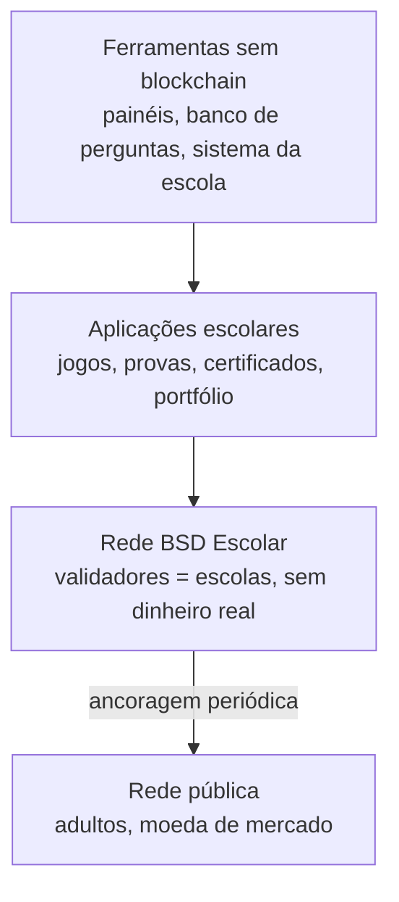

# ByteSDCoin — Catálogo de tudo que o sistema vai oferecer

Sep 23, 2026 · @Alan Mateus

## Como usar este catálogo

Este catálogo lista **tudo** o que foi proposto para o ecossistema ByteSDCoin até hoje, para você escolher o que fica. Cada item tem um código (A1, P2, E3...) para facilitar a conversa.

Em cada tabela, a coluna **Decisão** tem quatro opções:

- **Manter**: entra no plano.
- **Tirar**: sai do projeto. O item continua listado aqui, para ninguém repropor sem motivo.
- **Depois**: é bom, mas não é agora. Vai para o roadmap futuro.
- **Discutir**: precisa de mais conversa antes de decidir.

Três perguntas ajudam a decidir cada item:

1. **Resolve um problema real da escola ou dos alunos?** Se não resolve, é enfeite.
2. **Precisa mesmo de blockchain?** A coluna "Blockchain" diz se o item depende da cadeia. Quando só uma instituição guarda o dado, um banco de dados comum é melhor.
3. **Cabe no tempo disponível?** A coluna "Complexidade" estima o esforço: Baixa (semanas), Média (meses), Alta (um ano ou mais, ou depende de terceiros).

Os itens seguem o que já foi decidido: a versão pública não tem apostas (ADR-0008), e a segurança da rede é separada das bonificações dos jogos (ADR-0001).

## Visão geral: três camadas

O sistema tem três camadas, e só a primeira é usada pelos alunos.

| Camada | Quem usa | Tem valor em dinheiro? | Seção |
| --- | --- | --- | --- |
| Aplicações escolares e ferramentas sem blockchain | Alunos, professores, escola, Secretaria | Não | Alunos, Professores, Escola, Secretaria, Projeto Integrador, Outros públicos |
| Rede BSD Escolar | Escolas (validam) e qualquer pessoa (verifica) | Não | Infraestrutura |
| Rede pública | Adultos; a escola só grava resumos nela | Sim | Terceira criptomoeda |

A ancoragem é a única ligação entre a rede escolar e a rede pública. Nenhum aluno toca na moeda de mercado.

## Para os alunos

O aluno usa a rede para aprender jogando, ganhar reconhecimento verificável e montar um portfólio que ele leva consigo.

| Código | O que é | Problema que resolve | Blockchain | Complexidade | Decisão |
| --- | --- | --- | --- | --- | --- |
| A1 | Carteira BSD guardada pela plataforma, com autocustódia opcional (ADR-0011) | Aluno não perde tudo ao esquecer uma chave | Sim | Média |  |
| A2 | Jogos PoKS: xadrez, dama, dominó e quebra-cabeças | Falta de engajamento | Não (só a recompensa) | Alta |  |
| A3 | Perguntas relâmpago de TI, Matemática, Física e Química dentro das partidas | Revisão de conteúdo sem aula expositiva | Não (só a recompensa) | Média |  |
| A4 | Pontos semanais e divisão do pote de 50.000 BSD (ADR-0003) | Recompensa justa e previsível | Sim | Média |  |
| A5 | Mercado de BSD entre alunos, com cotação simulada (ADR-0007) | Educação financeira abstrata | Sim | Alta |  |
| A6 | Certificados verificáveis de cursos e atividades | Certificado fácil de falsificar | Sim (só o hash) | Média |  |
| A7 | Portfólio de conquistas: medalhas, projetos, olimpíadas | Aluno de escola pública sem portfólio verificável | Sim (só o hash) | Média |  |
| A8 | Registro de autoria de trabalhos, com data e hora | Plágio e disputa de autoria | Sim (só o hash) | Baixa |  |
| A9 | Caça a bugs e Pull Requests recompensados | Distância entre escola e prática de mercado | Sim (só a recompensa) | Baixa |  |
| A10 | Criar perguntas aprovadas para o banco | Aprender ensinando; o banco cresce sozinho | Sim (só a recompensa) | Baixa |  |
| A11 | Campeonato PoKS: escolar, regional, estadual e nacional | Engajamento e vitrine de talentos | Parcial | Alta |  |
| A12 | Rodar um nó verificador ou sentinela (alunos avançados) | Aprender infraestrutura de verdade | Sim | Média |  |
| A13 | Computação útil voluntária: emprestar o computador para simulações | Usar o poder dos computadores sem risco à rede | Não (só a recompensa) | Alta |  |

Os pontos dos jogos nunca têm relação com a nota oficial do aluno. Misturar as duas coisas cria incentivo para trapacear na avaliação.

## Para os professores

O professor ganha ferramentas para avaliar com integridade, acompanhar a turma e reconhecer o que não cabe na nota.

| Código | O que é | Problema que resolve | Blockchain | Complexidade | Decisão |
| --- | --- | --- | --- | --- | --- |
| P1 | Banco de perguntas por disciplina e nível de dificuldade | Preparar revisão toma tempo | Não | Média |  |
| P2 | Provas com integridade verificável: hash da prova antes da aplicação e das respostas logo após | Suspeita de alteração em provas e gabaritos | Sim (só o hash) | Média |  |
| P3 | Sessões supervisionadas em que as partidas valem pontos (ADR-0010) | Trapaça com motor de xadrez ou pesquisa | Não | Baixa |  |
| P4 | Painel da turma: participação e acertos por disciplina | Saber onde a turma tem dificuldade | Não | Média |  |
| P5 | Emissão de certificados assinados pela escola | Certificado fácil de falsificar | Sim (só o hash) | Média |  |
| P6 | Revisão e cancelamento de pontos suspeitos antes do fechamento da semana | Trapaça que vira moeda | Não | Baixa |  |
| P7 | Reserva de 5% do pote para monitoria, olimpíadas e casos especiais | Reconhecer o que não cabe nas categorias | Sim | Baixa |  |
| P8 | BSD Didático: o núcleo escrito do zero, usado para ensinar blocos, hashes e assinaturas | Blockchain como caixa-preta | Sim | Média (já tem 3 passos) |  |
| P9 | Material de aula pronto: apostilas, POPs e gabaritos por função | Falta de material sobre o tema | Não | Média |  |

## Para a escola e a gestão escolar

A escola passa a ser dona de um pedaço da rede e ganha um jeito de provar que seus documentos e contas não foram alterados.

| Código | O que é | Problema que resolve | Blockchain | Complexidade | Decisão |
| --- | --- | --- | --- | --- | --- |
| E1 | Nó validador da escola, com peso igual ao das outras escolas (ADR-0002) | Rede com um dono só | Sim | Média |  |
| E2 | Verificação de documentos: notas, histórico e declarações ficam no sistema da escola; só o hash vai para a cadeia (ADR-0009) | Documento escolar adulterado | Sim (só o hash) | Média |  |
| E3 | Transparência de verbas como o PDDE: hash de notas fiscais e atas publicado na cadeia | Desconfiança sobre a prestação de contas | Sim (só o hash) | Média |  |
| E4 | Contas verificadas pela matrícula (ADR-0010) | Contas falsas acumulando pontos | Não | Baixa |  |
| E5 | Identidade estudantil verificável: provar "sou aluno matriculado" sem revelar nome nem idade | Meia-entrada e descontos sem expor dados | Sim | Alta (depende de parceiros) |  |
| E6 | Guarda das chaves custodiadas e dos documentos, com responsável formal pela LGPD | Obrigação legal de quem guarda dados | Não | Média |  |

A rede é uma verificação **complementar**. Ela não substitui os sistemas oficiais da Secretaria de Educação.

## Para a Secretaria e a rede de ensino

A rede de ensino recebe um modelo aberto, sem custo de licença, que pode ser replicado escola por escola.

| Código | O que é | Problema que resolve | Blockchain | Complexidade | Decisão |
| --- | --- | --- | --- | --- | --- |
| S1 | Painel com dados agregados e anônimos de participação e desempenho por disciplina | Falta de indicadores de engajamento | Não | Média |  |
| S2 | Protocolo, código e currículo publicados como material aberto | Dependência de fornecedor externo | Não | Média |  |
| S3 | Regras de entrada de novas escolas como validadoras | Crescimento sem perder a segurança | Sim | Média |  |
| S4 | Alinhamento com a educação financeira da BNCC e com o programa Aprender Valor do Banco Central | Tema obrigatório sem formato engajante | Não | Baixa |  |
| S5 | Organização das fases regional e estadual do Campeonato PoKS | Escala além de uma escola | Parcial | Alta |  |

Antes de apresentar S4 à Secretaria, os números citados na proposta (Banco Central, IPESPE, OBMEP, Aprender Valor) precisam de link para a fonte original.

## Projeto Integrador em sala

O cassino simulado existe só dentro da sala de aula, como estudo de caso de transparência (ADR-0008). Nada desta seção vai para a versão pública.

| Código | O que é | Problema que resolve | Blockchain | Complexidade | Decisão |
| --- | --- | --- | --- | --- | --- |
| I1 | Voo PRIME: crash game com Commit-Reveal e fórmula de margem de 2% (ADR-0012, ADR-0013) | Probabilidade ensinada só no quadro | Parcial | Média |  |
| I2 | Os cinco requisitos obrigatórios do cassino: cadastro simulado, carteira, odds, jogo responsável e Provably Fair | Diferença entre sistema honesto e enganoso | Parcial | Alta |  |
| I3 | Bot Monte Carlo com intervalo de confiança | Provar a matemática com dados | Não | Baixa |  |
| I4 | Painel de auditoria, ancoragem por Merkle e prova de reservas (ADR-0014) | Confiar no cassino sem prova | Sim | Alta |  |
| I5 | Seção sobre a matemática e a psicologia das casas de apostas | Jovens expostos a apostas sem entender a conta | Não | Pronto |  |
| I6 | Documentos por função (Frontend, Backend, DevOps, Hardware) no formato POP | Trabalho sem execução prática | Não | Pronto |  |
| I7 | Pool sem perda (No-Loss), descrito no plano original | Mostrar uma alternativa sem perda ao jogador | Sim | Alta |  |
| I8 | Teste de estresse no Laboratório de Hardware | Ligar software e hardware | Não | Baixa |  |

## Infraestrutura e segurança da rede escolar

A base de tudo: sem estes itens, as aplicações das seções anteriores não têm onde rodar.

| Código | O que é | Problema que resolve | Blockchain | Complexidade | Decisão |
| --- | --- | --- | --- | --- | --- |
| R1 | Rede BSD sobre Hyperledger Besu com consenso QBFT, 4 validadores no piloto (ADR-0002, ADR-0006) | Rede segura sem depender do valor da moeda | Sim | Média |  |
| R2 | Contratos: token BSD, emissão semanal, registro de hashes e ancoragem | Regras públicas que ninguém altera sozinho | Sim | Alta |  |
| R3 | Nós verificadores abertos a qualquer pessoa, com sentinelas que denunciam validadores desonestos | Usar os computadores das pessoas na segurança | Sim | Média |  |
| R4 | Explorador de blocos público | Qualquer um conferir a rede | Sim | Baixa (já existe pronto) |  |
| R5 | API para as aplicações escolares | Aplicações sem acesso à rede | Sim | Média |  |
| R6 | Taxa fixa queimada contra spam, paga pela instituição quando o usuário é aluno | Rede entupida por transações falsas | Sim | Baixa |  |
| R7 | Backup testado das chaves e dos dados fora da cadeia | Perda de chaves e documentos | Não | Baixa |  |
| R8 | Testes automatizados, integração contínua e registro de decisões (ADRs) | Erros que só aparecem em produção | Não | Pronto no BSD Didático 2.0 |  |
| R9 | Migração para assinatura pós-quântica (ADR-0005) | Ameaça futura dos computadores quânticos | Sim | Alta (futuro) |  |
| R10 | Log de auditoria à prova de adulteração em todos os sistemas da escola, com a raiz ancorada na cadeia (ADR-0016) | Alteração silenciosa de notas, frequência, verbas e qualquer outro registro | Sim (só a raiz) | Média (motor pronto no BSD Didático 2.0) |  |
| R11 | Segurança operacional obrigatória: dois fatores, privilégio mínimo, guarda de chaves, atualizações e backups (ADR-0017) | Roubo de senhas e chaves, que a blockchain não impede | Não | Baixa |  |

## Robótica, sessões controladas e avaliações

As partidas que valem pontos e as provas acontecem em ambientes controlados, com o tabuleiro construído pelos próprios alunos (ADR-0019 a ADR-0022).

| Código | O que é | Problema que resolve | Blockchain | Complexidade | Decisão |
| --- | --- | --- | --- | --- | --- |
| T1 | Tabuleiro sensor (geração 1): detecta as peças, confere os lances e assina a partida | Resultado digitado ou forjado | Sim (só a assinatura e o hash) | Alta |  |
| T2 | Tabuleiro atuador (geração 2): move as peças sozinho com carro XY e eletroímã | Partidas físicas à distância | Não | Alta |  |
| T3 | Anúncio dos lances por voz e LEDs no tabuleiro | Jogos de tabuleiro inacessíveis a pessoas com deficiência visual | Não | Média |  |
| T4 | Sessões controladas: fiscal abre a sessão; tabuleiro e fiscal assinam cada resultado | Partidas vencidas com ajuda externa ou combinadas | Sim | Média (lógica pronta e testada) |  |
| T5 | Provas com variantes por aluno, commit antes da aplicação e recibo da resposta | Cola entre vizinhos, prova vazada ou alterada | Sim (só hashes) | Média (lógica pronta e testada) |  |
| T6 | Detector de respostas erradas idênticas, sempre com decisão humana | Cola que deixa rastro estatístico | Não | Baixa (pronto e testado) |  |

## Outros públicos

A mesma plataforma, sem dinheiro real, para universidades, cursos, empresas, clubes, olimpíadas e o público geral (ADR-0026, `PUBLICOS.md`).

| Código | O que é | Problema que resolve | Blockchain | Complexidade | Decisão |
| --- | --- | --- | --- | --- | --- |
| O1 | Instituições como inquilinos, com dados separados e papéis genéricos | Atender vários públicos com o mesmo sistema | Não | Média |  |
| O2 | Comunidade BSD: instituição aberta ao público geral | Participar sem pertencer a uma instituição | Sim (BSD interno) | Média |  |
| O3 | Treinamentos corporativos com certificado verificável | Treinamento sem comprovação | Sim (só o hash) | Baixa |  |
| O4 | Provas de seleção e de certificação para empresas, com variantes e recibos | Resultados de seleção contestáveis | Sim (só hashes) | Média (lógica pronta) |  |
| O5 | Torneios de clubes com rating calculado só de partidas verificadas | Ratings e resultados sem verificação | Sim | Média |  |
| O6 | Olimpíadas com provas íntegras em escala e resultados verificáveis por cada participante | Confiança em provas de milhares de participantes | Sim (só hashes) | Alta |  |
| O7 | Verificação de idade por prestador especializado, sem guardar documentos | Menores acessando o que não é para eles | Não | Média |  |
| O8 | BSD restrito a contas verificadas da mesma instituição | Mercado paralelo de BSD com alunos | Sim | Pronto e testado |  |

## Rede pública e moeda de mercado

Uma rede para adultos, com uma moeda de mercado de outro nome, construída em etapas (ADR-0029, `REDE_PUBLICA.md`). Nenhum menor e nenhuma conta escolar a acessa, e não existe ponte com o BSD (ADR-0027, ADR-0028).

| Código | O que é | Problema que resolve | Blockchain | Complexidade | Decisão |
| --- | --- | --- | --- | --- | --- |
| C1 | Rede pública aberta para adultos, construída em etapas | Moeda com regras públicas e âncora neutra para instituições | Sim | Alta |  |
| C2 | Mineração mesclada com o Bitcoin (etapa P3, só avaliação) | Herdar força computacional do Bitcoin | Sim | Alta |  |
| C3 | Compatibilidade com os contratos do Ethereum, desde a primeira etapa | Ferramentas e desenvolvedores prontos | Sim | Média |  |
| C4 | Ancoragem das redes educacionais na rede pública | Falsificar exigiria atacar as duas redes | Sim | Média |  |
| C5 | Parecer jurídico antes de qualquer valor real (ADR-0030) | Risco de valor mobiliário e de sanções | Não | Alta (depende de advogado) |  |
| C6 | Moeda de mercado como token numa rede de segunda camada do Ethereum já existente (etapa P1) | Começar com segurança herdada do Ethereum | Sim | Média |  |
| C7 | Rollup próprio que publica no Ethereum (etapa P2) | Rede própria sem abrir mão da segurança | Sim | Alta |  |

## Segurança contra fraude, clonagem e roubo

Quase nenhum ataque real quebra a blockchain: eles atacam pessoas, contas, chaves e aplicações. Estes itens tornam os golpes difíceis, lentos e detectáveis (ADR-0032 a ADR-0038, `SEGURANCA.md`).

| Código | O que é | Problema que resolve | Blockchain | Complexidade | Decisão |
| --- | --- | --- | --- | --- | --- |
| G1 | Registro de chaves de instituições na cadeia; o verificador recusa emissores fora dele | Sites clone emitindo certificados falsos | Sim | Pronto e testado |  |
| G2 | Login por passkey, sem SMS como segundo fator | Senhas roubadas por sites falsos; clonagem de chip | Não | Média |  |
| G3 | Proteções de saque: segundo fator, lista de endereços, 48 h para endereço novo, limite diário, botão de pânico | Ladrão esvaziando uma conta invadida | Não | Pronto e testado |  |
| G4 | Automação de segurança do código: CodeQL, Dependabot, revisão de dependências, revisores obrigatórios | Dependência maliciosa ou código escondido num Pull Request | Não | Pronto |  |
| G5 | Testes de invasão em quatro níveis, sempre com autorização escrita | Falhas descobertas por atacantes antes de nós | Não | Média (o externo tem custo) |  |
| G6 | Caça a bugs com regras e recompensa | Transformar quem procura falhas em aliado | Não | Baixa |  |
| G7 | Plano de resposta a incidentes, exercitado a cada semestre | Reação desordenada quando algo acontece | Não | Baixa |  |
| G8 | Laboratório de segurança isolado para os participantes, com termo de conduta | Curiosidade virando invasão ilegal | Não | Média |  |
| G9 | Registro de marca, domínio e canais oficiais únicos, aviso de que o projeto nunca pede senha ou chave | Golpes de falso suporte e tokens falsos com o mesmo nome | Não | Baixa (registro de marca tem custo) |  |
| G10 | Motor do Voo PRIME em repositório privado | Código de cassino reutilizado em sites de apostas | Não | Baixa |  |

## O que o sistema não vai oferecer

Estes itens foram considerados e ficam de fora, cada um por um motivo concreto. Mudar qualquer um deles exige um ADR novo.

| Item | Por que fica de fora |
| --- | --- |
| Apostas na versão pública | Decisão tomada (ADR-0008). O cassino é só exercício de sala. |
| Converter BSD em dinheiro real | Participantes menores de idade e promessa feita à escola (ADR-0007). |
| Notas, nomes ou dados pessoais gravados na cadeia | A LGPD garante o direito de apagar, e a blockchain não apaga (ADR-0009). Só o hash vai para a cadeia. |
| Pontos ou moeda ligados à nota oficial | Cria incentivo para trapacear na avaliação. |
| Jogos decidindo quem cria os blocos | Uma trapaça no jogo viraria controle da rede (ADR-0001). |
| Eleição do grêmio estudantil na blockchain | Um registro público e permanente facilita provar em quem se votou, o que abre espaço para pressão e compra de votos. Uma urna eletrônica simples com auditoria resolve melhor. |
| Moeda que ganha valor com as altas e baixas do BTC e do ETH | Esse valor sairia do bolso de outra pessoa. Moedas que prometeram isso quebraram, como a Terra/Luna em 2022. |
| Mineração aberta como única segurança da rede escolar | Numa rede sem valor, um único computador forte controlaria mais da metade do poder de mineração. |

Também fica de fora usar a blockchain **como proteção contra invasão**. Ela detecta alterações em registros já gravados, mas não impede roubo de senhas e chaves, vazamento de dados nem bugs. Por isso ela entra em todos os sistemas como registro de auditoria (R10), sempre junto com a segurança operacional (R11).

## Quadro-resumo e prioridade sugerida

São 83 itens no total. Construir todos levaria anos, então a sugestão abaixo divide em quatro fases. Ela é só um ponto de partida: quem decide são as escolhas que você marcar nas tabelas.

| Fase | Quando | Itens | Por que nesta fase |
| --- | --- | --- | --- |
| 1. Portfólio | Até o fim de 2026, antes da formatura da primeira turma | P8, I1, I3, I5, I6, R8, G4, G10 | Tudo pequeno, demonstrável e sem depender de aprovação. P8, I3, I5, I6, R8 e G4 já estão prontos; falta a interface do I1 |
| 2. Piloto na escola | Um semestre, após a autorização da escola | R1, R2, R10, R11, A1, A3, A4, A6, P1, P3, P5, P6, E4, E6, T1, T3, T4, T5, T6, O1, O8, G1, G2, G3, G5, G6, G7, G8, G9 | O mínimo para ganhar pontos e certificados de verdade, com segurança desde o primeiro dia |
| 3. Expansão | Depois do piloto, com dados de engajamento | A2, A5, A7, A8, A9, A10, A11, E1, E2, P2, P4, I2, I4, I8, S1 a S5, R3 a R7, T2 | Depende de resultados do piloto e de outras escolas |
| 4. Outros públicos e rede pública | Anos; a rede pública só depois do parecer jurídico e do teste de invasão externo | O2 a O7, C5 (primeiro), C1, C3, C4, C6, A12, A13, E3, E5, I7, P7, P9, R9 | Novos públicos entram como inquilinos; a moeda de mercado começa como token numa rede existente |
| 5. Rede pública própria | Só se justificada por uso e análise | C7, C2 | Rede própria só quando houver adoção que a sustente |

Na Fase 4, o item C5 (estrutura jurídica) vem antes de qualquer outro item da terceira criptomoeda.

**Contagem por seção:** Alunos 13 · Professores 9 · Escola 6 · Secretaria 5 · Projeto Integrador 8 · Infraestrutura 11 · Robótica, sessões e avaliações 6 · Outros públicos 8 · Rede pública 7 · Segurança 10.

---

<!-- conexoes:inicio -->
## 🔗 Onde isto entra no plano

- [🏫 Trabalho na escola (EMTI): aulas, atividades e projetos](../../01-planejamento-geral/docencia-escola-emti.md)

🗂️ Voltar ao [índice dos artefatos](../00-INDICE-DOS-ARTEFATOS.md) · [mapa de conexões](../01-MAPA-DE-CONEXOES.md)
<!-- conexoes:fim -->
