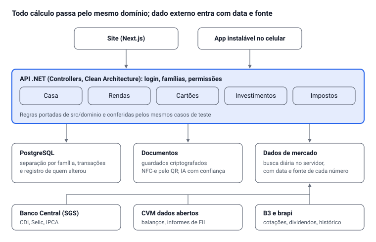

# Caixa da Casa 2 — auditoria final para produção

Oct 16, 2026 · @Alan Mateus

## Resumo

**Veredito: as regras do Caixa da Casa 2 estão sólidas e testadas, mas ele ainda não pode ir para produção.** O que impede não é a qualidade do código, e sim onde ele roda e de onde vêm os dados.

O sistema roda como artefato do Claude. Isso foi ótimo para validar as regras com você, mas impede quatro coisas que um produto precisa:

- **Outros usuários:** cada artefato é de uma pessoa. Não existe cadastro, login próprio nem separação entre famílias.
- **Dados externos:** a página não pode buscar nada fora dela, nem cotações, nem CDI e IPCA, nem dados de empresas. Por isso, hoje, todo preço, índice e indicador é digitado à mão.
- **Banco de dados:** não existem transações nem regras de acesso declaradas, e cada mês guarda no máximo 256 KiB.
- **Dados pessoais:** não há nenhum dos controles que a LGPD exige para guardar renda, contracheque e documentos de terceiros.

Além da plataforma, encontrei **31 problemas**: 4 críticos, 11 altos, 12 médios e 4 baixos. Um deles é um defeito de gravação que corrompe dados e já tem teste que o reproduz. Os críticos e altos vêm primeiro na correção.

O plano proposto é manter o domínio (as regras em `src/dominio`, sem dependência de tela nem de banco) e levar para a stack do Aura: .NET, PostgreSQL e Next.js, como o AM Rendara. Ali entram login, multi-família, busca automática de dados oficiais e as exigências legais. A parte de investimentos tem uma questão regulatória da CVM que precisa ser resolvida antes de qualquer cliente pagante (seção Investimentos).

## Situação das correções em 16/10/2026

Dos 31 problemas, 25 estão corrigidos no sistema publicado, 3 foram corrigidos até onde o artefato permite e 3 dependem de servidor próprio. Cada correção tem teste automático em `testes/auditoria/achados.test.ts`. São 178 testes de regras, mais os de tela, um de importações de ponta a ponta com IA simulada (`testes/e2e/importacoes.mjs`) e a varredura de acessibilidade, que não acusou nenhuma violação. As tabelas de INSS e IR de 2026, inclusive a redução da Lei 15.270, foram conferidas com as tabelas publicadas e batem; ainda falta a revisão de um contador.

| Situação | Itens | O que foi feito |
| --- | --- | --- |
| Corrigido | B1 a B10 | Gravação substitui o item inteiro; crédito de fatura não vira renda; o mesmo dinheiro é reconhecido entre contracheque, extrato, nota e fatura; valor fora do normal pede confirmação; valores em formato americano; parcela com centavos de ajuste; aviso de tabela de impostos do ano; renda que não recebe no mês; fechamento do cartão deduzido da fatura |
| Corrigido | S1, S3, S4 | Sete regras de acesso no banco (família, categorias e base dos outros só o dono muda; cada pessoa grava o próprio vínculo e a própria base); CSV sem fórmulas; opção de não publicar sua base |
| Corrigido | R1 a R3 | Limite por categoria pessoal, com a sua parte da casa item por item; base incompleta não é publicada e disponível ≤ 0 pede decisão; 13º em dezembro e 1/3 de férias no mês escolhido |
| Corrigido | P3, P4 | Gravar por cima de mudança feita em outro aparelho vira aviso de conflito; mês cheio passa para um segundo documento; lixeira apaga de vez |
| Corrigido | I3 a I5 | Cada método como lista de critérios editáveis, FIIs com critérios próprios, margem de segurança, Barsi não manda vender só por nota baixa, sem nota com menos da metade dos dados |
| Corrigido | U1 a U4 | Conferência da leitura com IA aponta somas que não batem e exige "Conferi"; idioma e contraste; atalho para o conteúdo; explicação dos termos |
| Em parte | I1 | O sistema diz "atende aos critérios que você definiu" e avisa que não é recomendação. Falta o parecer jurídico antes de vender, que só um advogado dá |
| Em parte | I2 | Indicadores com data e fonte, aviso depois de 90 dias, leitura de indicadores e de IPCA/CDI a partir de um print. A busca automática, sem print, precisa do servidor |
| Em parte | S2 | Aviso de privacidade aceito no primeiro acesso, registro de quem alterou o quê (Ajustes › Histórico), exclusão definitiva e "Apagar meus dados". Falta o termo revisado por advogado e o contrato com o provedor de IA, que são do produto |
| Depende do produto | P1, P2, P5 | Multiusuário, dados externos e IA pelo servidor (Fase 1) |

A versão publicada continua lendo os dados no formato antigo, então nada do que já estava gravado precisou ser convertido.

## Como foi feita

Cada problema daqui foi verificado. Não há item tirado de lista genérica.

- **Código:** as 11.676 linhas de TypeScript do projeto (`src/dominio`, `src/dados`, `src/leitura`, `src/telas`), lidas nos pontos de gravação, importação, divisão e investimentos.
- **Testes:** os 117 testes automáticos passam. Criei testes novos que *reproduzem* defeitos; o do item B1 fica no projeto marcado como defeito conhecido e avisa quando a correção entrar (`testes/auditoria/achados.test.ts`).
- **Sondas:** chamadas diretas das funções com entradas difíceis (valores em formato americano, base negativa, ano sem tabela de impostos, compra da casa com limite de categoria).
- **Carga:** 5 anos simulados, 4.980 lançamentos e 480 notas com 35 itens. O mês calcula em 26 ms, a projeção de 12 meses em 54 ms e a verificação completa em 350 ms. Desempenho não é problema hoje.
- **Acessibilidade:** varredura automática (axe-core, WCAG 2.1 AA) em 17 telas, no computador e no celular, claro e escuro.
- **Dados reais:** o histórico do seu banco hoje, incluindo o valor de R$ 190.025 digitado como salário da Hashi.
- **Fontes externas:** documentação da CVM, da API do Banco Central e de provedores de dados de mercado e Open Finance, citadas no fim.

**Severidade:**

| Nível | Significa |
| --- | --- |
| Crítico | Impede produção ou corrompe/expõe dados. Corrigir antes de qualquer outro usuário. |
| Alto | Leva a número errado sem o usuário perceber, ou a risco legal. |
| Médio | Erro em caso específico, ou falta que o usuário contorna. |
| Baixo | Acabamento. |

## Bloqueadores de produção

Cinco limites vêm do lugar onde o sistema roda, não do código. Só somem com servidor e banco próprios.

| ID | Severidade | Problema | Consequência | Correção |
| --- | --- | --- | --- | --- |
| P1 | Crítico | Artefato do Claude não é plataforma multiusuário: sem cadastro, sem login próprio, sem separação entre famílias | Não dá para vender nem atender 3 famílias de 10 pessoas. Cada pessoa precisa de conta no Claude | Backend próprio com contas, famílias (tenant) e convites |
| P2 | Crítico | A página não acessa nenhum site externo (regra de segurança do artefato) | Cotações, CDI, IPCA, Selic e indicadores de empresas são digitados. Não há "dados reais" automáticos | Serviço no servidor que busca e guarda dados oficiais (seção Investimentos) |
| P3 | Alto | Banco sem transações; vence quem grava por último. Família, categorias e parâmetros são regravados inteiros | Duas pessoas editando ao mesmo tempo perdem alterações sem aviso | PostgreSQL com transações e controle de versão por registro |
| P4 | Médio | Cada mês da casa é um documento de no máximo 256 KiB; excluídos nunca são apagados de fato; tudo é carregado ao abrir | 8 notas de 35 itens ocupam 30 KiB: a partir de umas 68 notas no mês a gravação falha. Abrir fica lento com anos de dados | Uma linha por lançamento e por item; carregar só o período da tela |
| P5 | Médio | A leitura de PDFs usa a cota de IA de quem está usando | Custo e limite fora do seu controle; sem leitura quando a cota acaba | IA chamada pelo servidor, com custo por família e leitura sem IA para os formatos conhecidos (NFC-e tem XML público) |

O artefato continua sendo um bom lugar para **você** usar e validar regras novas antes de levá-las ao produto.

## Segurança e privacidade

O maior risco está em compartilhar o sistema com a Claudia: hoje nada impede que ela, ou qualquer pessoa com acesso de uso, apague as contas da casa.

| ID | Severidade | Problema | Cenário | Correção |
| --- | --- | --- | --- | --- |
| S1 | Crítico | Nenhuma regra de acesso declarada no banco. O padrão deixa qualquer pessoa com acesso de uso regravar ou apagar tudo em `casa2` | Ao compartilhar, um clique errado (ou outra pessoa com o link de uso) apaga família, contas da casa, bases e acordos de todos | Já no artefato: regras por caminho (família só o dono altera; cada pessoa só grava a própria base). No produto: Row-Level Security por família e papel |
| S2 | Alto | Faltam os controles da LGPD para dados financeiros: consentimento, política de privacidade, exclusão definitiva, exportação para o titular e registro de quem alterou o quê | Contracheques e faturas trazem CPF, matrícula e dados de terceiros. Sem registro de alteração não há como apurar um erro ou um acesso indevido | Termo de uso e consentimento; exclusão real com prazo; trilha de auditoria por registro; documentos criptografados; contrato de operador com o provedor de IA |
| S3 | Médio | A exportação CSV não neutraliza fórmulas | Uma descrição lida de nota ou fatura que comece com `=`, `+`, `-` ou `@` vira fórmula ao abrir no Excel | Prefixar com apóstrofo células que começam com esses caracteres |
| S4 | Baixo | Sua base da divisão (renda menos contas) é publicada para a família automaticamente | Você não escolhe o que a outra pessoa vê sobre sua renda | Opção: publicar o valor, só a porcentagem, ou nada |

O que já está certo:

- Dados pessoais de cada um ficam em área privada do banco, invisível até para o dono do artefato.
- O sistema não copia CPF, PIS nem número de conta dos documentos.
- A tela não injeta HTML vindo dos documentos.
- A resposta da IA passa por normalização e conferência antes de gravar.

Uma ressalva: o texto do PDF inteiro (com CPF) ainda passa pela IA para ser lido.

## Bugs e defeitos no código

O defeito mais grave é o B1: editar um lançamento e tirar um campo não tira o campo do banco. Os altos são todos de importação, onde o mesmo dinheiro pode entrar duas vezes.

| ID | Severidade | Onde | Defeito | Cenário real | Correção |
| --- | --- | --- | --- | --- | --- |
| B1 | Crítico | `dados/repositorio.ts`, `mesclarItem` | A gravação mescla o lançamento novo com o antigo; campo removido continua salvo | Você tira o cartão de uma compra: ela continua na fatura. Desliga um gasto da renda: continua como custo dela. Teste `A1` reproduz | Gravar o item inteiro (substituir, não mesclar), ou mandar os campos removidos como exclusão |
| B2 | Alto | `LeituraDocumento.tsx`, fatura | Créditos da fatura (pagamento da fatura anterior, estorno) entram como entrada de dinheiro | O "Pagamento recebido R$ 1.761,23" da fatura vira renda do mês e a sobra fica R$ 1.761,23 maior | Na fatura, crédito nunca é renda: pagamento é ignorado, estorno abate a compra ou a fatura |
| B3 | Alto | Extrato | Conferir repetidos exige a mesma conta; o salário lançado pelo contracheque não tem conta | Importar o extrato do banco depois do contracheque lança o salário duas vezes | Comparar com recebimentos de renda pelo valor e data, independentemente da conta |
| B4 | Alto | Nota fiscal + fatura | Mesma regra: compra lida pela nota sem cartão marcado não é reconhecida na fatura | Mercado lançado pela nota e de novo pela fatura: gasto em dobro | Ligar nota e linha da fatura por valor, data e loja; perguntar quando houver dúvida |
| B5 | Alto | Todos os campos de dinheiro | Nenhuma checagem de valor fora do normal | Hoje: "190025" virou salário de R$ 190.025,00 na Hashi | Aviso quando o valor for 5 vezes maior que o histórico ou o esperado, e mostrar o valor por extenso antes de salvar |
| B6 | Médio | `dominio/dinheiro.ts`, `lerValor` | "1,900.25" vira R$ 1,90; aceita "1e3" | Colar valor de site ou planilha em inglês | Reconhecer o formato pelo último separador; recusar notação científica |
| B7 | Médio | `contas.ts`, `parceladoExistente` | Exige valor de parcela idêntico | Última parcela com centavos de ajuste cria um segundo parcelado | Tolerância de alguns centavos e mesmo total de parcelas |
| B8 | Médio | `parametros.ts`, `tabelaDoAno` | Só existe a tabela de 2026; 2027 em diante usa 2026 sem avisar | Impostos e projeção de 2027 com faixas velhas | Aviso "tabela de 2026 usada" e tabelas atualizadas pelo servidor todo ano |
| B9 | Médio | Rendas | Fonte paga no mês seguinte e iniciada no mês atual | A mesma renda aparece como "sem recebimento previsto" no detalhe e "falta informar" na tabela | Uma regra só para "renda ativa no mês" usada nas duas telas |
| B10 | Baixo | Cartão criado pela fatura | Dia de fechamento sugerido (vencimento − 7) | Compra perto do fechamento cai na fatura errada até você corrigir | Deduzir o fechamento da data da compra mais recente da fatura |

O teste do B1 está marcado como defeito conhecido (\`it.fails\`): o conjunto de testes passa hoje e, quando a correção entrar, ele acusa e deve virar um teste normal.

## Regras de negócio

A divisão da casa está certa nos casos testados: contas pessoais saem antes, cada conta segue a própria regra, o valor combinado do mês substitui as regras e a ajuda fixa conta como entrega para a casa. Três pontos ainda podem dar número errado.

| ID | Severidade | Regra | O que acontece | Correção |
| --- | --- | --- | --- | --- |
| R1 | Alto | Limite por categoria | Compras da casa não contam no limite (Mercado fica sempre em R$ 0). O limite vale para a família inteira, não só para você | Contar a sua parte das compras da casa; limites por pessoa e limites da casa separados |
| R2 | Médio | Base da divisão publicada | A base vai para a família mesmo com renda faltando ou negativa. Com disponível zero ou negativo, a pessoa não paga nada da parte proporcional | Publicar só base completa; disponível ≤ 0 exige decisão (valor mínimo combinado ou partes iguais) |
| R3 | Médio | Planejamento do ano | 13º, férias com 1/3 e reajustes não entram na projeção: o ano previsto fica menor que o real em dezembro e no mês de férias | Prever 13º e férias pelas regras da CLT e do serviço público, e o reajuste anual de cada fonte |

Na dúvida, o sistema mostra "falta informar" em vez de supor zero. Isso continua valendo e é a base para evitar erro.

**Impostos.** As faixas de INSS e IR de 2026, inclusive a redução da Lei 15.270, estão escritas no código e nunca foram revisadas por um contador. Antes de vender o sistema, essa revisão é obrigatória, e as tabelas precisam vir de uma fonte oficial atualizada todo ano. Simulação de declaração tem de vir marcada como estimativa.

## Investimentos

O módulo calcula certo o que recebe, mas recebe pouco: os indicadores são digitados e cada método está reduzido a uma fórmula. Para planejar com segurança e com dados reais, são três frentes: dados automáticos, métodos completos e a questão da CVM.

O que já funciona: a cascata (zerar cartão, depois reserva, depois investir), a divisão ARCA com aporte sem venda, a rentabilidade pelo método de cotas, o "Rendeu ou perdeu", a comparação de renda fixa com IR regressivo e as carteiras reais e simuladas por método.

| ID | Severidade | Problema | Consequência | Correção |
| --- | --- | --- | --- | --- |
| I1 | Alto | O sistema diz "pode comprar", "manter" ou "vender" para um ativo específico | Para uso próprio, sem problema. Oferecido a clientes, pode ser tratado como relatório de análise, atividade exclusiva de analista credenciado ([Resolução CVM 20](https://conteudo.cvm.gov.br/export/sites/cvm/legislacao/resolucoes/anexos/001/resol020consolid.pdf), arts. 1º a 3º) | No produto: o usuário monta as próprias regras e o sistema só diz "atende / não atende aos critérios que você definiu". Parecer de advogado antes de vender |
| I2 | Alto | Preço, dividendos, LPA, VPA, ROE, dívida, CDI, IPCA e Selic são digitados, sem fonte nem data | Nota calculada com dado velho ou errado; renda fixa "a mercado" é estimada pelo índice digitado | Busca automática diária das fontes oficiais abaixo, com data e origem em cada número |
| I3 | Alto | Métodos reduzidos a uma fórmula | Barsi sem o filtro de setores perenes (BEST) e sem histórico de dividendos; Bazin sem dívida e sem consistência de 5 anos; Graham só com √(22,5 × LPA × VPA), sem os critérios defensivos; Buffett com limites fixos; FIIs avaliados com fórmulas de ações | Cada método como lista de critérios (tabela abaixo), FIIs com critérios próprios |
| I4 | Médio | Nota baixa num ativo que você tem vira "vender" | Contraria Barsi, que compra para nunca vender enquanto os dividendos se mantêm | A decisão segue a filosofia do método escolhido para aquela carteira |
| I5 | Médio | Nota = 50 + (preço justo ÷ preço − 1) × 100, sem margem de segurança | Ativo 1% abaixo do preço justo já ganha nota boa | Margem de segurança configurável por método (ex.: comprar só 20% abaixo do preço justo) |

### Cada método, completo

| Método | Regra que falta no sistema | Dados necessários |
| --- | --- | --- |
| Barsi | Setores perenes (bancos, energia, saneamento, seguros, telecom); pagamento de dividendos em todos os anos; preço teto pelo dividendo médio | Setor, dividendos de 5 a 10 anos, preço |
| Bazin | Dividend yield mínimo de 6%; dívida baixa; dividendos constantes ou crescentes | Dividendos de 5 anos, dívida bruta e patrimônio |
| Graham | Além da fórmula: P/L e P/VP máximos, lucro positivo por vários anos, liquidez corrente, histórico de dividendos | Balanços de 5 a 10 anos (DFP) |
| Buffett | Retorno alto e estável, margens, dívida baixa, lucro crescente por anos. A vantagem competitiva fica como nota sua, não como número do sistema | Balanços de 5 a 10 anos |
| FIIs | P/VP, dividend yield, vacância, liquidez, quantidade de imóveis e inquilinos | Informes mensais dos fundos |
| ARCA | Já completo: 25% em cada classe, aporte vai para a classe abaixo do alvo | Valor de mercado de cada ativo |

Os limites (6%, P/L máximo, anos de histórico) ficam editáveis, como já são os pesos do seu método.

### De onde vêm os dados reais

| Dado | Fonte | Custo | Observação |
| --- | --- | --- | --- |
| CDI, Selic, IPCA | [API SGS do Banco Central](https://www.tabnews.com.br/SidneyBissoli/series-do-banco-central-como-consultar-o-sgs-a-focus-e-a-ptax-sem-cair-nas-armadilhas) | Gratuito | IPCA = série 433, meta Selic = 432. Consultas diárias de até 10 anos por vez |
| Balanços (DFP e ITR), dados cadastrais, informes de FII | [Dados abertos da CVM](https://www.gov.br/cvm/pt-br/acesso-a-informacao-cvm/dados-abertos/PDACVMATUALIZADOEM1742023.pdf) | Gratuito | Arquivos oficiais, processados no servidor. É a base para Graham, Bazin e Buffett |
| Cotações, dividendos, JCP, histórico | [brapi](https://brapi.dev/blog/api-bolsa-de-valores-brasil-guia-desenvolvedores-2026) | Plano gratuito limitado; recursos avançados são pagos | Atraso e cobertura variam por plano |
| Histórico oficial de preços | Arquivo COTAHIST da B3 (citado no mesmo guia) | Gratuito | Fechamento do dia, para cálculo e conferência |
| Contas, cartões e investimentos do usuário | Open Finance por agregador: Pluggy (cerca de R$ 2.500/mês), Belvo (cerca de R$ 6.000/mês), Tecnospeed (R$ 1.500 de entrada + R$ 540/mês), [segundo relato de maio de 2026](https://www.tabnews.com.br/GuilhermeVieira/estou-desenvolvendo-um-app-de-financas-pessoais-e-nao-consigo-pagar-o-open-finance-pluggy-r2-5k-mes-belvo-r6k-mes-tecnospeed-r1-5k-de-entrada-r540) | Alto para começar | Elimina digitação e importação de faturas. Vale quando houver clientes pagantes; antes disso, PDFs e planilhas |

Regra para todo dado externo: guardar o valor, a data e a fonte; nunca sobrescrever o que o usuário corrigiu; mostrar "atualizado em" ao lado de cada número.

**Sobre a consultoria com o sócio CEA ou CFP.** Essas certificações não substituem o registro na CVM exigido para consultoria de valores mobiliários. Confirme com advogado qual registro o modelo de negócio exige.

## Usabilidade e acessibilidade

A base é boa para quem já entende de finanças. Para "qualquer usuário", o risco é salvar a leitura da IA sem conferir. Testado:

- 17 telas em 1280 px e 390 px, tema claro e escuro, sem rolagem lateral.
- Todos os botões respondem ao toque.
- Navegação por teclado funciona; cada valor tem status com ícone e texto, não só cor.

| ID | Severidade | Problema | Correção |
| --- | --- | --- | --- |
| U1 | Alto | A tela de conferência da leitura com IA mostra tudo igual; não destaca o valor duvidoso nem compara com o mês anterior | Marcar campos de baixa confiança e diferenças grandes contra o histórico; exigir confirmação explícita só nesses |
| U2 | Médio | A varredura WCAG achou página sem idioma declarado (todas as 17 telas) e texto secundário com contraste 4,34:1 sobre o fundo cinza (mínimo 4,5:1) em Veículos e Rotina | `lang="pt-BR"` e um tom mais escuro no token de texto secundário |
| U3 | Baixo | Sem atalho "pular para o conteúdo"; no celular o primeiro Tab cai no seletor de mês | Link de salto no topo |
| U4 | Baixo | Termos técnicos sem explicação no lugar: competência, regime, disponível, por fora, método de cotas | Botão "?" ao lado de cada termo, com uma frase e um exemplo |

"De qualquer lugar" pede também o que um artefato não dá: endereço próprio, instalação como app no celular, uso sem a conta do Claude e notificação de vencimento. Tudo isso entra no produto (Arquitetura).

## O que falta

Para resolver o problema de verdade, faltam sobretudo coisas que tiram trabalho do usuário: lembrar, conciliar e ler documentos sem digitação.

| Funcionalidade | Por que importa | Fase |
| --- | --- | --- |
| Contas de usuário, famílias, convites e papéis (dono, membro, só leitura) | Requisito para qualquer outro usuário e para vender | 1 |
| Lembretes de vencimento por notificação e e-mail | Evita juros e multa, que hoje o sistema só registra depois | 1 |
| Nota fiscal pelo QR code da NFC-e, sem IA | O QR leva aos dados oficiais da nota: itens e preços exatos, sem erro de leitura | 1 |
| Conciliação: cada linha do extrato ligada a um lançamento, com sugestão automática | Resolve B3 e B4 de vez e mostra o que ainda não foi lançado | 1 |
| Backup automático diário e restauração por data | Hoje o backup é manual | 1 |
| Boleto e Pix pelo código de barras ou copia-e-cola | Conta variável (luz, água) com valor e vencimento sem digitar | 2 |
| Acerto da casa por Pix copia-e-cola | Fecha o ciclo da divisão: o sistema calcula e a pessoa paga | 2 |
| Uma pessoa em mais de uma casa | Filhos, casais em casas diferentes, repúblicas | 2 |
| Informe anual para o Imposto de Renda e DARF de ações | Os dados já estão no sistema; falta o documento pronto | 2 |
| Calendário de proventos e rebalanceamento ARCA sugerido com os preços do dia | Depende dos dados automáticos (I2) | 2 |
| Simulador de financiamento de imóvel (renda exigida, entrada, SAC e Price) | Uma das suas metas; os cálculos de financiamento já existem | 2 |
| Open Finance (contas, cartões, investimentos sem importar arquivo) | Fim da digitação; custo alto, só com receita | 3 |
| App instalável no celular, funcionando sem internet | Lançar gasto na hora, no caixa do mercado | 3 |

## Arquitetura para produção

Recomendo levar o sistema para a stack por problema do Aura, como AM Rendara: .NET 10 com Controllers, PostgreSQL com Row-Level Security por família, Redis, Next.js e Docker. As regras de `src/dominio` são portadas, não reinventadas.

Site e app falam só com a API; as fontes oficiais só entram pelo serviço de dados de mercado, nunca direto na tela. Open Finance (fase 3) entra pela API, no lugar da importação de arquivos.

Como portar sem perder o que já foi validado: transformar os casos dos testes atuais em arquivos JSON (entrada e resultado esperado). Os mesmos arquivos rodam no TypeScript de hoje e no C# novo; a porta está pronta quando os dois dão o mesmo resultado em todos os casos.

### Roteiro

1. **Fase 0 — corrigir no artefato.** B1 a B5, S1 (regras de acesso), R1 e U2. Você usa por um mês com dados reais. *Passa quando:* nenhum crítico aberto e nenhum valor errado no mês.
2. **Fase 1 — produto mínimo.** Contas e famílias, domínio portado, Banco Central e CVM automáticos, lembretes, NFC-e pelo QR, conciliação, backup diário, LGPD (S2). *Passa quando:* três famílias de teste usam por dois meses sem erro de valor.
3. **Fase 2 — investimentos completos.** Métodos como critérios (I3 a I5), cotações e dividendos automáticos, boleto e Pix, informe de IR. *Passa quando:* houver parecer jurídico sobre a CVM (I1).
4. **Fase 3 — escala.** Open Finance, app instalável e sem internet, cobrança pelo aura-licensing.

## Decisões suas

- [ ] **Fase 0 agora?** Posso corrigir B1 a B5, S1, R1 e U2 no artefato atual, com testes, antes de você lançar os dados reais. Recomendo fazer antes de lançar.
- [ ] **Compartilhar com a Claudia só depois do S1.** Sem as regras de acesso, quem recebe o link de uso pode apagar as contas da casa.
- [ ] **Stack do produto.** O caminho .NET segue o Aura e o AM Rendara, mas exige portar o domínio para C#. A outra opção é um backend em TypeScript, que reaproveita `src/dominio` sem porta, mas é um desvio da stack por problema.
- [ ] **Caixa da Casa como produto próprio ou como módulo do AM Rendara.** O escopo dos dois já se sobrepõe (finanças pessoais, ARCA).
- [ ] **Investimentos para clientes.** O sistema só aplica as regras que o próprio cliente define, sem recomendação, ou vira consultoria registrada na CVM com o sócio. Decidir com parecer de advogado.
- [ ] **Quando pagar Open Finance.** O agregador mais barato do relato custa R$ 540/mês mais R$ 1.500 de entrada; só se paga com clientes.

## Fontes

- [Resolução CVM 20, texto consolidado](https://conteudo.cvm.gov.br/export/sites/cvm/legislacao/resolucoes/anexos/001/resol020consolid.pdf)
- [Plano de dados abertos da CVM](https://www.gov.br/cvm/pt-br/acesso-a-informacao-cvm/dados-abertos/PDACVMATUALIZADOEM1742023.pdf)
- [Séries do Banco Central: como consultar o SGS (TabNews)](https://www.tabnews.com.br/SidneyBissoli/series-do-banco-central-como-consultar-o-sgs-a-focus-e-a-ptax-sem-cair-nas-armadilhas)
- [Guia de APIs da bolsa brasileira 2026 (brapi)](https://brapi.dev/blog/api-bolsa-de-valores-brasil-guia-desenvolvedores-2026)
- [Custos de Open Finance para app de finanças pessoais (TabNews, maio de 2026)](https://www.tabnews.com.br/GuilhermeVieira/estou-desenvolvendo-um-app-de-financas-pessoais-e-nao-consigo-pagar-o-open-finance-pluggy-r2-5k-mes-belvo-r6k-mes-tecnospeed-r1-5k-de-entrada-r540)

---

<!-- conexoes:inicio -->
## 🔗 Onde isto entra no plano

- [AM Rendara — Documento de Projeto Final](../../02-sistemas-de-negocio/rendara-documento-projeto-final.md)

🗂️ Voltar ao [índice dos artefatos](../00-INDICE-DOS-ARTEFATOS.md) · [mapa de conexões](../01-MAPA-DE-CONEXOES.md)
<!-- conexoes:fim -->
