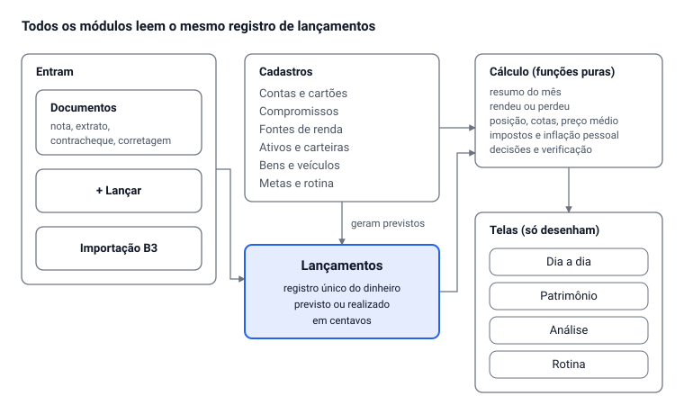

# Caixa da Casa 2 — plano do sistema completo

Oct 16, 2026 · @Alan Mateus

## Resumo

O Caixa da Casa 2 é um sistema novo, escrito do zero, que mantém tudo o que o v35 faz em um lugar só: gastos, casa, rendas, investimentos, veículos, impostos, preços, decisões e rotina. Todos os módulos leem o mesmo registro de lançamentos. Todos respondem às mesmas duas perguntas, com as mesmas contas: **quanto rendeu** e **quanto eu perdi**.

O plano segue as regras definidas na auditoria do v35:

- um registro único de dinheiro;
- nada calculado é gravado;
- valor desconhecido é diferente de zero;
- todo valor em centavos;
- telas que só desenham.

Três coisas mudam em relação ao v35. Investir deixa de ser contado como gasto: vira uma transferência para uma conta de investimento. Os módulos de análise (impostos, preços, decisões) deixam de ter dados próprios: tudo sai dos lançamentos. E o roteiro de teste vira uma verificação automática que roda sobre os seus dados reais.

O v35 continua no ar, com os seus dados, até você aprovar a troca. Antes de começar a construir, preciso da sua aprovação deste plano e das respostas na seção final.

## Mapa do sistema



Documentos, lançamentos manuais e importações entram no mesmo registro. Os cadastros descrevem as coisas e geram os lançamentos previstos. As funções de cálculo leem os dois, e as telas só mostram o que elas devolvem.

## Rendeu ou perdeu

Todo módulo mostra o resultado em reais e em porcentagem, comparado com a inflação (IPCA) e com o CDI, usando as definições abaixo. Elas ficam numa única função, testada, e nenhuma tela faz a própria versão.

### Quanto rendeu

O ganho de qualquer coisa que tem valor (uma carteira, um ativo, um veículo, o patrimônio inteiro), num período, é o que ela vale no fim mais o que saiu dela, menos o que ela valia no começo e o que entrou nela:

```latex
\text{ganho} = (V_{fim} + \text{saídas}) - (V_{início} + \text{entradas})
```

Entradas são aportes e compras. Saídas são resgates, vendas e proventos recebidos. Taxas, IR e corretagem já reduzem o valor ou são saídas de dinheiro, então o ganho é sempre líquido de custos.

A porcentagem usa o método de cotas, o mesmo dos fundos de investimento. Com ele, a rentabilidade não muda por você ter aportado muito ou pouco no meio do período, e dá para comparar com o CDI. A rentabilidade real desconta a inflação:

```latex
r_{real} = \frac{1 + r}{1 + \text{IPCA}} - 1
```

### Quanto eu perdi

Toda perda cai em uma de três classes, sempre separadas, porque são coisas diferentes:

| Classe | O que é | Exemplos | De onde vem |
| --- | --- | --- | --- |
| Perdi | Dinheiro que saiu sem voltar em bem ou serviço | Juros do cartão e do financiamento, taxa de administração do consórcio, multas e juros de atraso, corretagem, custódia, IR e IOF, prejuízo em venda de ativo | Lançamentos marcados como encargo ou taxa; prejuízo calculado pelo preço médio |
| No papel | Valor que caiu, mas ainda não foi vendido | Ação abaixo do preço médio, desvalorização do veículo pela FIPE | Diferença entre o valor atual e o custo |
| Deixei de ganhar | Custo de oportunidade: não saiu dinheiro, mas outra escolha teria rendido mais | Saldo parado em conta perdendo para a inflação, carteira abaixo do CDI, 13º, férias e FGTS do valor pago por fora | Comparado com o IPCA ou com o CDI do mesmo período |

O painel "Rendeu ou perdeu" soma cada classe no mês, no ano e desde o início. Cada valor abre a lista dos lançamentos ou posições que o formam, para você conferir de onde ele veio.

## Modelo de dados

São 17 entidades. Só o lançamento registra dinheiro; as outras descrevem coisas (uma conta, um ativo, um veículo) ou geram lançamentos. Posições, saldos, rentabilidade, impostos devidos, preços médios e inflação pessoal são sempre calculados e nunca gravados.

| Entidade | Módulo | O que guarda | Onde fica |
| --- | --- | --- | --- |
| Família | Núcleo | Pessoas, regra de divisão da casa | Compartilhado |
| Conta | Núcleo | Onde o dinheiro está: conta corrente, poupança, dinheiro, cartão de crédito, corretora. O saldo é calculado. | Privado, ou compartilhado se for da casa |
| Lançamento | Núcleo | Data, competência, valor em centavos, entrada, saída ou transferência, conta, categoria, natureza (consumo, encargo, taxa, imposto, aporte, provento…), de quem é, previsto ou realizado, origem e vínculos (compromisso, ativo, bem, renda) | Privado (os seus) e compartilhado (os da casa), agrupados por mês |
| Compromisso | Núcleo | Conta fixa, fatura de cartão, parcelado, consórcio, financiamento, imposto anual, renda esperada, valor a receber. Gera lançamentos previstos. | Privado ou compartilhado |
| Fonte de renda | Rendas | Regime (CLT, público, autônomo, MEI, empresa, passiva), custos para trabalhar, valor por fora | Privado |
| Documento | Núcleo | Nota fiscal, extrato, contracheque, nota de corretagem, print de cotação: o arquivo original e os dados lidos | Privado; o arquivo original fica no armazenamento de arquivos |
| Categoria e regra | Núcleo | Categorias e o dicionário que classifica itens de nota | Compartilhado |
| Parâmetros | Núcleo | Tabelas por ano (IR, INSS, salário mínimo), IPCA e CDI mensais, regras ARCA e da cascata | Compartilhado (índices) e privado (regras) |
| Ativo | Investimentos | Ticker ou produto, classe ARCA, método, indexador e taxa, vencimento, instituição | Privado |
| Carteira | Investimentos | Real ou simulada, método, meta de alocação | Privado |
| Cotação | Investimentos e Preços | Preço de um ativo numa data, com a origem (digitado, print, importação B3) | Privado |
| Análise | Investimentos | Indicadores lidos de um ativo e a situação (estudando, comprar, manter, vender) | Privado |
| Bem | Veículos e bens | Veículo, imóvel ou outro: compra, avaliações com data (FIPE), plano de manutenção | Privado |
| Registro de uso | Veículos | Data, hodômetro, litros abastecidos | Privado |
| Meta | Metas | Valor alvo, prazo, conta ou caixa onde o dinheiro fica | Privado |
| Decisão | Decisões | Data, assunto, o que o sistema recomendou, o que você escolheu e por quê | Privado |
| Rotina | Rotina | Blocos semanais (com vínculo opcional a uma renda) e tarefas mensais | Privado |

Como as entidades viram dinheiro:

- **Investir** é uma transferência da conta corrente para a conta da corretora, e não um gasto. Uma compra de ação é um lançamento na conta da corretora, ligado ao ativo, com quantidade e preço. A posição e o preço médio saem da soma desses lançamentos.
- **O contracheque** gera uma entrada realizada (o líquido, mais o adiantamento quando houver). Bruto, INSS, IR e outros descontos ficam no próprio documento, porque esse dinheiro nunca passou pela sua conta; Impostos e o bruto real leem de lá. O valor por fora é outro lançamento, separado.
- **O consórcio e o financiamento** separam cada parcela em amortização e encargo (juros ou taxa de administração). Só o encargo conta como "perdi".
- **O gasto de um veículo** é um lançamento comum, com vínculo ao bem. A mesma compra aparece no mês e no custo por km do veículo, sem ser digitada duas vezes.

Regras de armazenamento, escolhidas pelos limites do banco do artefato (sem transações, a última gravação vence, até 256 KiB por documento):

- Os lançamentos de cada mês ficam num documento por pessoa (`lanc-2026-10`), cada um sob a própria chave. A gravação mescla só aquela chave. Assim, você e a Claudia gravando no mesmo mês da casa não se apagam.
- Nada é apagado de verdade. Excluir marca o item como excluído, e a tela "Lixeira" desfaz.
- Todo documento tem `versaoFormato`. A migração roda uma vez, com trava, e guarda um relatório.

## Módulos

Cada módulo mantém o que o v35 já faz, agora lendo o mesmo registro de lançamentos. O que não existia no v35 está marcado como **novo**.

### Investimentos

Responde: quanto tenho, quanto rendeu cada ativo, carteira e método, e onde investir o próximo aporte.

- **Investir passo a passo.** Segue a sua cascata: primeiro zerar o cartão, depois a reserva de emergência, depois as classes ARCA. Diz quanto vai para cada caixa neste mês.
- **Carteiras reais e simuladas, uma por método** (Barsi, Bazin, Buffett, Graham, índice, Método Alan). Todas usam a mesma conta de rentabilidade, para comparar métodos lado a lado. **Novo:** gráfico das carteiras contra CDI e IPCA desde a criação.
- **Meu método.** Pesos de cada método, nota mínima, distribuição, quantidade máxima de ativos, compra mínima. Mostra o plano da carteira, o que ficou de fora e por quê.
- **Analisar ativos.** Você cola um texto ou um print de indicadores, o sistema lê com IA e calcula a nota e o preço justo por método. Cada mudança de situação entra no histórico de decisões.
- **Comparar renda fixa.** Ofertas lidas de print ou texto, comparadas pelo líquido de IR contra um CDB de 100% do CDI.
- **Importar.** Planilhas da B3 (movimentação, negociação, posição) e nota de corretagem. Viram lançamentos, com conferência antes de gravar.
- **Patrimônio e independência.** O que tenho, o que devo, renda passiva, bola de neve com aporte mensal e quanto falta para a independência.
- **Cada investimento como empresa.** Proventos, custos (corretagem, custódia, IR, taxa de administração) e resultado líquido.

### Veículos e bens

Responde: quanto cada veículo custa por mês e por km, quanto já perdeu de valor e quando é a próxima manutenção.

- **Lançamento rápido do veículo:** abasteci, troquei o óleo, manutenção, outro gasto, receita. Cada um já pede o hodômetro e, no abastecimento, os litros.
- **Plano de manutenção** por km ou por meses, com última vez e próxima. Quando estiver perto, aparece na Rotina e no Mês.
- **Valor e desvalorização:** valor pago, avaliações FIPE com data, quanto perdeu até agora (classe "no papel").
- **Mês a mês e custo total**, incluindo o que foi pago no cartão. **Novo:** custo por km e consumo (km/l), calculados dos registros de uso.
- **Veículo como empresa:** se ele gera receita (corridas, entregas, aluguel), mostra lucro e margem.
- **Novo:** o consórcio da Sahara fica ligado ao bem. Lance planejado, contemplação e o custo do consórcio entram no custo total da moto.

### Impostos

Responde: quanto pago de imposto, quanto ainda vou pagar e se a declaração vai dar restituição ou imposto a pagar.

- **Sobre a renda:** rendimento bruto, INSS, IR retido e FGTS de cada contracheque, por ano.
- **Declaração anual simulada:** modelo simplificado e modelo completo, com as suas deduções.
- **Por regime:** carnê-leão para autônomo, DAS para MEI, pró-labore para empresa.
- **Investimentos:** ganho de capital por mês em ações e FII, IR de renda fixa provisionado se resgatar hoje, exterior anual.
- **Impostos e taxas anuais** (IPVA, IPTU, licenciamento) como compromissos, com cotas.
- **Impostos no consumo** estimados por categoria dos seus gastos.
- **Novo:** calendário de vencimentos (DARF, DAS, IPVA, declaração) junto com as contas do mês.

As tabelas e alíquotas ficam em parâmetros por ano, editáveis por você e conferidas com a Receita na hora de construir. Nenhum valor de imposto fica escrito no código.

### Preços e inflação

Responde: o que ficou mais caro para mim e qual é a minha inflação comparada com o IPCA.

- **Preço de cada produto mês a mês**, a partir dos itens das notas. O mesmo produto é reconhecido pelo código de barras, ou pela descrição quando não houver código.
- **Inflação pessoal** com o peso de cada produto na sua cesta, comparada com o IPCA, por mês e acumulada.
- **Categorias no ano**, com variação.
- **Novo:** onde está mais barato. O mesmo produto é comparado entre as lojas em que você comprou.

### Decisões

Responde: o que fazer agora com o dinheiro, com cada ativo, com cada renda e com cada gasto grande. O sistema recomenda, mas nunca executa nada sozinho.

- **Cascata e reserva:** em que fase você está (cartão, reserva, investir) e o próximo passo.
- **Equilíbrio do ARCA:** em qual classe colocar o próximo aporte para voltar à alocação alvo, sem vender.
- **Cada ativo:** comprar, manter ou vender, pela nota do método e pelo preço teto. O botão "já vendi" leva ao lançamento da venda.
- **Cada fonte de renda:** lucro, margem e hora real, com a recomendação de manter, ajustar ou largar.
- **Gastos:** vender, reduzir ou trocar (assinaturas, bens caros de manter).
- **Novo:** cada decisão tomada fica registrada. Seis meses depois, o sistema mostra se ela rendeu ou custou dinheiro.

Cada recomendação mostra a regra usada e os números, para você discordar com base.

### Rotina

Responde: o que tenho hoje, na semana e no mês, e quanto vale de verdade a hora de cada trabalho.

- **Hoje, semana e mês:** blocos semanais (dias, início, fim, tipo) e tarefas mensais (vacina dos cães, revisão da moto).
- **Hora real:** o líquido de cada renda dividido por todas as horas que ela consome, incluindo deslocamento e trabalho fora do horário.
- **Novo:** os vencimentos do mês e as manutenções do veículo aparecem na agenda, a partir dos compromissos.

A Rotina tem área própria. O Mês mostra só um cartão pequeno com "hoje", que pode ser desligado.

### Verificação (antigo Roteiro de teste)

Responde: os números que estou vendo estão certos?

- **Verificação automática dos seus dados reais**, a cada abertura: todas as telas mostram a mesma sobra; nenhum pagamento sem compromisso; o saldo de cada conta é igual à soma dos lançamentos; a posição de cada ativo é igual à soma das operações; nenhum documento em formato antigo. Cada falha tem um botão que leva à correção.
- **Modo demonstração** com uma família fictícia que roda só na memória. Nada é gravado e os seus dados nunca são tocados.
- **Roteiro guiado** de conferência manual dentro do modo demonstração, com o resultado esperado de cada passo.

### Metas e A receber

- **Metas:** metas de compra (valor do bem, guardado, quanto guardar por mês, custo mensal depois da compra) e metas simples. O progresso é o saldo da conta ou caixa ligado à meta.
- **A receber:** dinheiro que alguém te deve, em parcelas. É um compromisso de entrada: cada parcela recebida vira um lançamento realizado.

## Navegação e experiência

As 19 abas viram 4 grupos, mais Ajustes. O que você faz todo dia fica a um toque; o que você consulta uma vez por mês fica a dois.

| Grupo | Áreas | Uso |
| --- | --- | --- |
| Dia a dia | Mês, Lançamentos, Compromissos, Casa | Todo dia |
| Patrimônio | Investimentos, Veículos e bens, Metas, A receber | Toda semana |
| Análise | Rendeu ou perdeu, Planejamento (próximos meses e ano), Impostos, Preços e inflação, Decisões | Todo mês |
| Rotina | Hoje, semana, mês, hora real | Todo dia |
| Ajustes | Pessoas, contas, categorias, parâmetros, backup, Verificação, Lixeira, modo demonstração | Raro |

No computador, os grupos ficam num menu lateral. No celular, há uma barra inferior com Mês, Lançamentos, **+**, Patrimônio e Mais. Três controles aparecem em todas as telas: o botão **+ Lançar**, o seletor de mês e o seletor "eu / casa / todos".

### Padrões que valem em todas as telas

- **Um número principal por tela**, sempre calculado pela mesma função.
- **Três estados de valor, em vez de cinco:** realizado, previsto e falta informar. Cada um tem ícone e texto, nunca só cor.
- **Todo número abre a sua origem.** Tocar num total mostra os lançamentos que o formam.
- **Um único editor.** Tocar em qualquer item, em qualquer tela, abre o mesmo painel de edição. Ações rápidas, como "paguei", são um toque.
- **Desfazer em vez de confirmar.** Toda ação mostra um aviso com "Desfazer" por 6 segundos. Como nada é apagado de verdade, não há caixas de "tem certeza?".
- **Resposta a toda ação.** Salvando, salvo, sem conexão (o que você digitou continua na tela) ou erro com o que fazer.
- **Pendências ordenadas pelo impacto em reais.** O Mês mostra as 5 maiores; o resto fica numa lista.
- **Tela vazia ensina o primeiro passo**, com o botão da ação.
- **Acessibilidade WCAG 2.1 AA:** contraste, área de toque de 44 px, teclado, leitor de tela, números alinhados, tema claro e escuro.

### Jornadas principais

| Jornada | Caminho | Toques além de digitar |
| --- | --- | --- |
| Ver quanto sobra no mês | Abrir o sistema | 0 |
| Lançar um gasto | + → valor → categoria sugerida → Salvar | 3 |
| Marcar uma conta como paga | Mês → a conta → Paguei (valor já preenchido) | 2 |
| Ler uma nota fiscal | + → Ler documento → foto ou PDF → conferir → Salvar | 4 |
| Importar contracheque | + → Ler documento → PDF → conferir → Salvar | 4 |
| Acertar com a Claudia | Casa → Acertar → confirmar a transferência | 2 |
| Registrar compra de ação | + → Investimento → ativo, quantidade, preço → Salvar | 3 |
| Registrar abastecimento | + → Veículo → Abasteci → valor, litros, km → Salvar | 3 |
| Ver o que rendeu e o que perdi no ano | Análise → Rendeu ou perdeu → Ano | 2 |

## Engenharia

O código passa a existir como código-fonte normal, num repositório, com testes que rodam num comando só. Não pode ser publicada nenhuma versão com teste falhando.

### Plataforma

O sistema continua sendo um artefato do Claude, publicado no mesmo endereço do Caixa da Casa atual. O artefato já resolve:

- hospedagem;
- login;
- privacidade por pessoa (os dados da Claudia continuam invisíveis para você e vice-versa);
- compartilhamento da casa;
- banco de dados;
- armazenamento de arquivos;
- leitura de documentos com IA.

Os seus dados e os da Claudia já estão nesse banco. Manter o endereço permite migrar sem copiar dados entre sistemas.

Limite assumido: o artefato serve a sua família. Vender como SaaS para várias famílias exige servidor próprio. As regras de cálculo e os testes servem de especificação para essa versão futura, mas o código teria de ser reescrito se ela for na stack .NET do Aura.

### Tecnologia

| Parte | Escolha | Por quê |
| --- | --- | --- |
| Linguagem | TypeScript em modo estrito | Erros de tipo (um centavo virando texto, um campo que falta) aparecem antes de publicar |
| Interface | Preact | Componentes como React, com cerca de 4 KB |
| Empacotamento | esbuild, gerando um único HTML | O formato que o artefato publica |
| Leitura de PDF | pdf.js | Como hoje |
| Testes | Vitest para regras, Playwright para telas | Os dois já funcionam neste ambiente |

### Estrutura do código

| Pasta | Contém | Pode usar |
| --- | --- | --- |
| `dominio/` | Dinheiro em centavos, lançamentos, compromissos, `resumoDoMes`, divisão, rendimento, perdas e uma subpasta por módulo (investimentos, veículos, impostos, preços, decisões, rotina, verificação) | Nada além de `dominio/` |
| `dados/` | Repositório (único lugar que fala com o banco), formatos com versão, migração do v35 | `dominio/` |
| `leitura/` | Leitura de documentos com IA: prompts e conversão do resultado em lançamentos para conferência | `dominio/` |
| `telas/` | Componentes, o editor único, uma pasta por área | `dominio/`, `dados/` e `leitura/`, mas sem calcular |
| `testes/` | Unidade, cenários reais, telas | Tudo |

As regras dessa tabela são conferidas por um teste. Se uma tela importar algo proibido, o build falha.

### Testes

- **Regras:** toda função de dinheiro tem teste, incluindo arredondamento, mês sem dado, valor negativo e mudança de ano.
- **Cenários reais:** uma cópia dos seus dados (que fica só neste ambiente, nunca no repositório nem publicada) e casos montados a partir deles. Exemplos: escola com contracheque, Hashi com valor por fora, casa dividida com a Claudia, consórcio da Sahara.
- **Concordância:** para cada mês, todas as telas têm que mostrar a mesma sobra. Isso transforma os problemas N1 a N8 da auditoria em testes que não podem voltar.
- **Telas:** cada jornada da seção anterior, no computador e no celular (390 px). Mais uma auditoria de cliques: nenhum botão sem resposta.

### Migração

1. Um artefato de teste separado recebe uma cópia dos seus dados. Você usa os dois sistemas lado a lado.
2. Na troca, a versão nova é publicada no endereço atual. Na primeira abertura, cada pessoa converte os próprios dados no próprio navegador (a Claudia converte os dela), gravando no formato novo ao lado do antigo. Nada antigo é apagado.
3. Se algo der errado, basta republicar o v35. Os documentos antigos estão intactos.

## Plano de implementação

São oito fases, construídas em várias sessões. Cada fase termina publicada no artefato de teste, para você usar, e só é dada como pronta quando o critério dela passa.

1. **Fundação.** Repositório, build, testes, dinheiro em centavos, formatos com versão. Critério: um comando gera o HTML e roda os testes.
2. **Núcleo de cálculo.** Lançamentos, compromissos, `resumoDoMes`, divisão da casa, rendeu e perdeu. Critério: os problemas N1 a N9 da auditoria viram testes que passam.
3. **Dados e migração.** Conversão de tudo o que existe no v35 (notas, contas, rendas, contracheques, pagamentos, investimentos, veículos, rotina, metas). Critério: relatório de antes e depois, mês a mês, com cada diferença explicada.
4. **Dia a dia.** Mês, Lançamentos, Compromissos, Casa, o editor único e a leitura de documentos. Critério: as telas concordam, e as jornadas passam no computador e no celular.
5. **Patrimônio.** Investimentos, Veículos e bens, Metas, A receber. Critério: posição igual à soma das operações, e a rentabilidade de duas carteiras igual à conta feita à mão.
6. **Análise.** Rendeu ou perdeu, Planejamento, Impostos, Preços e inflação, Decisões. Critério: a declaração simulada confere com um caso calculado à mão, e cada recomendação mostra a regra usada.
7. **Rotina e Verificação.** Agenda, hora real, verificação automática e modo demonstração. Critério: a verificação acusa os problemas que forem plantados de propósito nos dados de teste.
8. **Uso em paralelo e troca.** Um mês real com os dois sistemas, depois a publicação no endereço atual. Critério: você aprova.

### Decisões pendentes

- [ ] Aprovar este plano para eu começar a fase 1.
- [ ] Criar um repositório privado no GitHub para o código, ou me autorizar a usar um seu. Hoje o código do v35 só existe neste ambiente temporário; se ele for apagado, sobra apenas o HTML publicado.
- [ ] As 7 contas pessoais que sumiram (consórcio Sahara, Claude, faculdade, internet, mãe, ração, Nubank) foram apagadas de propósito?
- [ ] "Sobra" desconta a sua parte da casa pela regra (proposta), deixando a diferença para o que você pagou como "a acertar com a Claudia"?
- [ ] A divisão da casa usa a renda real do mês (proposta) ou um valor combinado entre vocês?
- [ ] Aceitar que, por enquanto, o sistema atende só a sua família (artefato), deixando o SaaS para depois?
- [ ] Combinar com a Claudia que, na troca, ela abre o sistema uma vez para converter os dados dela.
