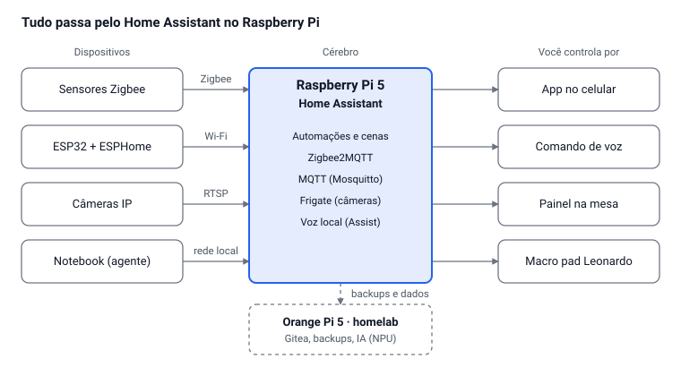

# Casa Inteligente e Setup Automatizado

Oct 7, 2026 · @Alan Mateus

## Como as peças se encaixam

O Raspberry Pi 5 com Home Assistant é o cérebro: todo sensor, lâmpada, ESP32 e até o notebook conversam com ele, e você controla tudo de um lugar só.

Dispositivos Zigbee falam com o Pi pelo dongle; os ESP32 entram pelo Wi-Fi com ESPHome; o Orange Pi fica ao lado como servidor de experimentos.

**Raspberry Pi ou Orange Pi?** Os dois, com papéis diferentes. Se for comprar só um agora, compre o Raspberry Pi.

|  | Raspberry Pi 5 8 GB | Orange Pi 5 8 GB |
| --- | --- | --- |
| Papel | Cérebro da casa (Home Assistant) | Homelab: Gitea, backups, IA, testes |
| Suporte de software | Oficial do Home Assistant, documentação enorme | Comunidade menor; Home Assistant só em Docker |
| Desempenho | Bom | Maior, com NPU para IA |
| Preço aproximado (só a placa) | R$ 750 a 1.100 | R$ 600 a 1.000 |
| Para aprender | Melhor para começar | Bom para Linux e servidores, depois |

## Lista de compras da casa inteligente

O kit essencial para começar custa cerca de R$ 2.000 a 3.500; a casa inteira, de R$ 8.000 a 15.000. Preços são estimativas aproximadas por unidade (out/2026), sem cotação: confira antes de comprar. "Pronto" = produto comercial que conversa com o Home Assistant; "DIY" = você monta com ESP32.

| Função | Item | Qtd | R$ por unidade | Tipo | Prioridade |
| --- | --- | --- | --- | --- | --- |
| Cérebro | Raspberry Pi 5 8 GB + fonte 27 W + case com cooler + SSD NVMe 256 GB com HAT | 1 | 1.100 a 1.700 (kit) | Pronto | Essencial |
| Cérebro | Orange Pi 5 8 GB (segundo servidor: homelab, NAS leve, IA) | 1 | 600 a 1.000 | Pronto | Depois |
| Rede | Dongle Zigbee (Sonoff ZBDongle-E ou SMLIGHT SLZB-06) | 1 | 120 a 300 | Pronto | Essencial |
| Rede | Roteador com boa cobertura ou mesh, com rede separada para IoT | 1 | 300 a 900 | Pronto | Recomendado |
| Rede | Nobreak 600 a 1.200 VA (Pi, roteador, notebook) | 1 | 400 a 800 | Pronto | Recomendado |
| Luz | Lâmpada inteligente Zigbee RGB | 4 a 8 | 50 a 120 | Pronto | Essencial |
| Luz | Mini relé Zigbee atrás do interruptor atual | 2 a 4 | 50 a 100 | Pronto | Recomendado |
| Luz | Interruptor de parede Zigbee (instalar com eletricista) | 2 a 4 | 80 a 180 | Pronto | Depois |
| Luz | Fita LED WS2812B 5 m + ESP32 com WLED | 2 | 100 a 240 | DIY | Essencial |
| Energia | Tomada inteligente Zigbee com medição de consumo | 4 a 6 | 50 a 120 | Pronto | Essencial |
| Energia | Medidor de energia do quadro (PZEM-004T + ESP32, ou Shelly EM) | 1 | 100 a 400 | DIY ou pronto | Recomendado |
| Sensores | Sensor de porta e janela Zigbee | 4 a 8 | 30 a 60 | Pronto | Essencial |
| Sensores | Presença mmWave (LD2410 + ESP32, ou Zigbee pronto) | 3 | 30 a 200 | DIY ou pronto | Essencial |
| Sensores | Temperatura e umidade Zigbee | 3 a 4 | 30 a 60 | Pronto | Essencial |
| Sensores | Vazamento de água Zigbee | 2 | 30 a 60 | Pronto | Recomendado |
| Sensores | CO2 SCD40 + ESP32 (qualidade do ar da mesa) | 1 | 120 a 250 | DIY | Recomendado |
| Sensores | Detector de fumaça certificado (o sistema só avisa; não substitui o detector) | 1 a 2 | 80 a 200 | Pronto | Recomendado |
| Clima | Controle infravermelho Wi-Fi (Broadlink RM4 Mini) ou ESP32 + LED IR | 1 a 2 | 30 a 200 | DIY ou pronto | Essencial |
| Segurança | Câmera IP com RTSP local (Tapo C210, Reolink) | 2 a 4 | 150 a 400 | Pronto | Recomendado |
| Segurança | Sirene Zigbee | 1 | 60 a 150 | Pronto | Depois |
| Segurança | Coral USB ou AI HAT+ para detectar pessoas nas câmeras | 1 | 500 a 1.300 | Pronto | Depois |
| Segurança | Fechadura inteligente e campainha com vídeo | 1 | 800 a 2.000 (par) | Pronto | Depois |
| Voz | Home Assistant Voice Preview Edition ou ESP32-S3-BOX-3 | 1 a 2 | 300 a 600 | Pronto | Recomendado |
| Portão | Relé Zigbee ou ESP32 ligado ao botão da central do portão | 1 | 50 a 150 | DIY ou pronto | Recomendado |
| Cortina | Motor de cortina Zigbee | 1 a 2 | 300 a 800 | Pronto | Depois |
| Jardim | Válvula solenoide 12 V + sensor de umidade do solo + ESP32 | 1 | 80 a 200 | DIY | Depois |
| Controle | Botão Zigbee de cena (sem fio, com pilha) | 3 a 4 | 40 a 90 | Pronto | Essencial |

Prefira Zigbee e ESPHome: funcionam sem internet e sem nuvem de fabricante. Evite dispositivos Wi-Fi que só funcionam pelo aplicativo do fabricante, porque somem do sistema se a empresa mudar o serviço.

## O que dá para automatizar na casa

Com a lista acima, praticamente tudo que tem tomada, interruptor, controle remoto ou botão vira automação. Cada item abaixo é uma regra do tipo "quando isso acontecer, faça aquilo".

**Iluminação**

- Luz acende ao entrar no cômodo e apaga quando não há ninguém (sensor mmWave, que percebe até gente parada).
- Brilho e cor mudam com a hora: branca de dia, quente à noite, fraca de madrugada para ir ao banheiro.
- Cenas por botão ou voz: "estudo", "filme", "dormir", "sair de casa".
- Simulação de presença quando você viaja.

**Energia**

- Consumo de cada tomada e da casa inteira em gráfico, com custo estimado em reais por mês.
- Corta aparelhos em standby à noite ou quando ninguém está em casa.
- Aviso quando a máquina de lavar termina (o consumo cai a zero).

**Clima**

- Ar-condicionado ou ventilador liga quando a temperatura passa do limite e há alguém no cômodo, e desliga se a janela abrir.
- TV, som e ar controlados pelo infravermelho, sem trocar os aparelhos.

**Segurança**

- Aviso no celular se uma porta ou janela abrir quando a casa está vazia.
- Câmeras gravando só quando detectam uma pessoa, e não a cada folha que mexe.
- Alerta de vazamento de água e de fumaça, com sirene.
- Abrir o portão pelo celular ou automaticamente quando você chega.
- Rotina "sair de casa": um toque apaga tudo, desliga tomadas e arma os alertas.

**Rotina e conforto**

- Despertar com a luz subindo devagar e um resumo do dia na tela ou por voz.
- Cortina abrindo de manhã e fechando à noite.
- Irrigação das plantas pela umidade do solo, e não por horário fixo.
- Comando de voz em português para tudo acima.

## O que dá para automatizar no seu setup

O setup tem três trabalhos: proteger as 4 horas de estudo, preparar e gravar aulas, e cuidar dos seus projetos e servidores sem você ficar olhando. Para o notebook conversar com o Home Assistant, ele precisa de um agente: HASS.Agent no Windows; no Arch/Omarchy, um script pequeno via MQTT.

| Automação | Como funciona | Peças |
| --- | --- | --- |
| Modo estudo com um botão | Luz de foco, monitor ligado, abre VS Code, Docker e o vault do Obsidian, celular em não perturbe | Macro pad Leonardo ou botão Zigbee, agente no notebook |
| Pomodoro físico | A fita LED muda de cor em cada bloco de estudo e pausa, sem olhar o relógio | ESP32 + WS2812B |
| Painel de status na mesa | Mostra o passo atual do plano de estudos, status dos repositórios no GitHub, backups e alertas do Dependabot, aproveitando a ideia do Aura Status | ESP32 + tela e-paper 4,2" ou TFT |
| Aviso de saída para o restaurante | 30 min antes do turno a luz da mesa pisca e o painel avisa; ao sair, o setup desliga sozinho | Agenda no Home Assistant, sensor mmWave, tomada inteligente |
| Despertar às 6h | Luz sobe devagar e o painel mostra o dia: escola, restaurante, treino e o passo de estudo | Lâmpada Zigbee, painel da mesa |
| Luz "gravando" | Acende quando a câmera ou o microfone do notebook estão em uso, para gravar aulas do curso online sem interrupção | ESP32 + LED, agente no notebook |
| Iluminação de gravação | Cena "aula" liga a luz principal e a de preenchimento na intensidade certa | Lâmpadas ou painéis LED inteligentes |
| Bateria do notebook | A tomada liga com 20% e desliga com 80%, para o Acer Nitro durar mais | Tomada inteligente + agente |
| Qualidade do ar | Avisa para abrir a janela quando o CO2 sobe, que é o que dá sono no meio do estudo | SCD40 + ESP32 |
| Consumo do setup | Quanto o notebook, monitor e servidores gastam por mês | Tomadas com medição |
| Ligar e desligar o PC de longe | Wake-on-LAN para ligar; comando para desligar ou bloquear | Home Assistant + agente |
| Backup noturno | Copia o workspace para o servidor quando o notebook está ocioso e avisa se falhar | Orange Pi ou Pi com disco, script agendado |
| Homelab vigiado | Gitea, registro Docker e servidores monitorados; o painel fica vermelho se algo cair | Orange Pi 5 + Uptime Kuma |
| Bancada segura | Carregador de 18650 e ferro de solda desligam sozinhos depois de um tempo | Tomadas inteligentes |
| Impressora 3D vigiada | Câmera acompanha a impressão e a tomada corta quando termina ou falha | Câmera + tomada inteligente |
| Lembrete de treino | Aviso do treino do TAF, natação ou pedal do domingo no horário combinado | Agenda no Home Assistant |

As peças de DIY desta tabela (Leonardo, ESP32, fita LED, sensores) já estão na lista da Bancada Maker; o que é novo aqui é o agente no notebook e as tomadas e lâmpadas Zigbee.

## Ordem de compra e limites

Comece pelo cérebro e por poucos sensores: em um mês você já tem automações funcionando e sabe o que vale comprar a seguir.

1. **Mês 1 (R$ 2.000 a 3.500):** Raspberry Pi 5 com Home Assistant, dongle Zigbee, 4 sensores de porta, 3 de temperatura, 2 tomadas com medição, 4 lâmpadas e 2 botões. Meta: luz por presença, aviso de porta aberta e consumo em gráfico.
2. **Mês 2:** ESP32 com ESPHome: painel de status da mesa, fita LED com Pomodoro, sensor mmWave e CO2. O macro pad do Leonardo entra aqui.
3. **Mês 3:** câmeras com Frigate, assistente de voz e controle infravermelho do ar e da TV.
4. **Depois:** Orange Pi como homelab, interruptores de parede, portão, cortina e fechadura.

**Limites que você precisa saber:**

- **Rede elétrica de 127/220 V:** trocar interruptor ou mexer no quadro exige conhecimento de elétrica e segue a NBR 5410. Até ter isso, use lâmpadas, tomadas e mini relés prontos, e chame um eletricista para o que fica dentro da parede. Seus projetos com ESP32 ficam em 5 e 12 V.
- **Imóvel alugado:** prefira o que sai sem deixar marca (lâmpadas, tomadas, sensores com fita).
- **Voz local em português:** funciona, mas no Raspberry Pi 5 é mais lenta e erra mais que Alexa ou Google. Dá para integrar um Echo ou Nest e manter o resto local.
- **Orange Pi:** é mais potente e mais barato que o Pi, mas o Home Assistant OS não tem suporte oficial nele. Use o Raspberry Pi como cérebro da casa e o Orange Pi para experimentar.
- **Detector de fumaça e gás:** o sistema só envia o alerta. A proteção real é o detector certificado.
- **Câmeras:** não aponte para áreas dos vizinhos ou da rua, e deixe as gravações no servidor de casa, não na nuvem do fabricante.
