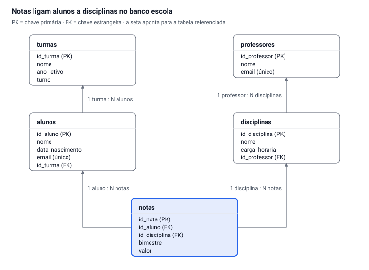

# Criação de Banco de Dados com MySQL

Oct 5, 2026 · @Alan Mateus

## 1. O que é um banco de dados

Um banco de dados é um lugar organizado para guardar informações e encontrá-las depois, rápido e sem erro. A secretaria da escola, a cantina, o Instagram e o sistema do banco funcionam em cima de um.

Pense na caderneta de chamada: cada aluno ocupa uma linha, e cada coluna guarda um tipo de informação (nome, turma, presença). Um banco de dados faz a mesma coisa, só que no computador, com regras que impedem bagunça.

**Por que não usar só uma planilha?**

- **Muitas pessoas ao mesmo tempo:** a secretaria e os professores podem lançar dados juntos sem um apagar o do outro.
- **Regras de qualidade:** o banco recusa, por exemplo, um aluno sem nome ou uma matrícula repetida.
- **Relacionamentos:** um aluno pertence a uma turma, e a turma tem vários alunos; o banco liga essas informações.
- **Volume:** milhões de registros continuam rápidos de consultar.

**Objetivo desta aula:** ao final, você vai criar do zero o banco de dados de uma escola no MySQL, com tabelas ligadas entre si, e inserir dados nele.

## 2. Conceitos essenciais

São sete termos que você vai usar o tempo todo. Decore estas e o resto fica fácil.

| Termo | O que é | Exemplo na escola |
| --- | --- | --- |
| SGBD | Programa que gerencia o banco de dados | MySQL |
| Banco de dados | Conjunto de tabelas de um mesmo sistema | `escola` |
| Tabela | Grupo de dados sobre um mesmo assunto | `alunos`, `turmas` |
| Coluna (campo) | Um tipo de informação dentro da tabela | `nome`, `data_nascimento` |
| Linha (registro) | Um item cadastrado | A aluna Ana Souza |
| Chave primária (PK) | Coluna que identifica cada linha de forma única | `id_aluno` |
| Chave estrangeira (FK) | Coluna que aponta para a chave primária de outra tabela | `id_turma` dentro de `alunos` |

**Por que a chave primária importa?** Duas alunas podem se chamar Ana Souza. O nome não serve para identificar; o número `id_aluno` sim, porque nunca se repete.

**E a chave estrangeira?** Em vez de escrever "1º ano A" em todo aluno, a tabela `alunos` guarda só o número da turma. Se o nome da turma mudar, você altera em um único lugar.

## 3. Tipos de dados no MySQL

Toda coluna precisa de um tipo, que diz ao banco que espécie de informação ela aceita. Para começar, estes oito resolvem quase tudo.

| Tipo | Guarda | Exemplo de uso |
| --- | --- | --- |
| `INT` | Número inteiro | `id_aluno`, `ano_letivo` |
| `DECIMAL(5,2)` | Número com casas decimais exatas | Nota `8.75`, preço |
| `VARCHAR(n)` | Texto de até n caracteres | Nome com `VARCHAR(100)` |
| `CHAR(n)` | Texto de tamanho fixo | Sigla do estado `CHAR(2)` |
| `TEXT` | Texto longo | Observações do aluno |
| `DATE` | Data (ano-mês-dia) | `'2010-03-15'` |
| `DATETIME` | Data e hora | Momento do registro |
| `BOOLEAN` | Verdadeiro ou falso | `ativo` |

**Restrições (regras extras na coluna):**

- `PRIMARY KEY`: identifica a linha; não repete e não fica vazia.
- `AUTO_INCREMENT`: o MySQL numera sozinho (1, 2, 3…).
- `NOT NULL`: o campo é obrigatório.
- `UNIQUE`: o valor não pode se repetir (ex.: e-mail, matrícula).
- `DEFAULT`: valor usado quando nada é informado.
- `FOREIGN KEY`: liga a coluna a outra tabela.

## 4. Modelagem: do problema ao modelo

Antes de digitar qualquer comando, desenhe o banco no papel. Mudar um desenho custa um minuto; mudar uma tabela cheia de dados custa uma tarde.

**O problema:** a escola quer registrar turmas, alunos, professores, disciplinas e as notas de cada aluno por bimestre.

1. **Encontre as entidades.** Procure os substantivos do problema: turma, aluno, professor, disciplina, nota. Cada um vira uma tabela.
2. **Liste os atributos.** O que a escola precisa saber de cada um? Do aluno: nome, data de nascimento, e-mail.
3. **Defina a chave primária.** Cada tabela ganha um `id` numérico que nunca se repete.
4. **Descubra os relacionamentos.** Pergunte "quantos?" nos dois sentidos. Uma turma tem vários alunos; um aluno está em uma turma só. Isso é **1 para N**: a chave estrangeira fica no lado N (`id_turma` dentro de `alunos`).
5. **Resolva o N para N.** Um aluno cursa várias disciplinas e uma disciplina tem vários alunos. Esse caso vira uma tabela no meio, `notas`, que guarda as duas chaves estrangeiras.



Leia o diagrama pelas setas: cada uma sai da chave estrangeira e aponta para a tabela de onde ela vem. A tabela `notas`, em destaque, é a que une alunos e disciplinas.

## 5. Roteiro prático passo a passo

Siga os passos na ordem, executando um comando por vez e conferindo o resultado. Use o MySQL Workbench ou o terminal (`mysql -u root -p`). Todo comando SQL termina com ponto e vírgula.

### Passo 1 — Criar o banco e selecioná-lo

```sql
CREATE DATABASE escola
  CHARACTER SET utf8mb4
  COLLATE utf8mb4_unicode_ci;

USE escola;
```

`utf8mb4` garante que acentos e o "ç" sejam gravados corretamente. `USE` diz ao MySQL em qual banco você vai trabalhar.

### Passo 2 — Criar a tabela de turmas

Comece sempre pelas tabelas que não dependem de nenhuma outra.

```sql
CREATE TABLE turmas (
  id_turma   INT AUTO_INCREMENT PRIMARY KEY,
  nome       VARCHAR(20) NOT NULL,
  ano_letivo INT NOT NULL,
  turno      VARCHAR(10) DEFAULT 'Integral'
);
```

### Passo 3 — Criar a tabela de alunos, ligada a turmas

```sql
CREATE TABLE alunos (
  id_aluno        INT AUTO_INCREMENT PRIMARY KEY,
  nome            VARCHAR(100) NOT NULL,
  data_nascimento DATE,
  email           VARCHAR(100) UNIQUE,
  id_turma        INT NOT NULL,
  FOREIGN KEY (id_turma) REFERENCES turmas(id_turma)
);
```

A última linha cria a chave estrangeira: só é possível cadastrar um aluno numa turma que já existe.

### Passo 4 — Criar professores e disciplinas

```sql
CREATE TABLE professores (
  id_professor INT AUTO_INCREMENT PRIMARY KEY,
  nome         VARCHAR(100) NOT NULL,
  email        VARCHAR(100) UNIQUE
);

CREATE TABLE disciplinas (
  id_disciplina INT AUTO_INCREMENT PRIMARY KEY,
  nome          VARCHAR(60) NOT NULL,
  carga_horaria INT NOT NULL,
  id_professor  INT,
  FOREIGN KEY (id_professor) REFERENCES professores(id_professor)
);
```

### Passo 5 — Criar a tabela de notas (liga aluno e disciplina)

```sql
CREATE TABLE notas (
  id_nota       INT AUTO_INCREMENT PRIMARY KEY,
  id_aluno      INT NOT NULL,
  id_disciplina INT NOT NULL,
  bimestre      INT NOT NULL CHECK (bimestre BETWEEN 1 AND 4),
  valor         DECIMAL(4,2) NOT NULL CHECK (valor BETWEEN 0 AND 10),
  FOREIGN KEY (id_aluno)      REFERENCES alunos(id_aluno),
  FOREIGN KEY (id_disciplina) REFERENCES disciplinas(id_disciplina)
);
```

`CHECK` impede notas fora de 0 a 10 e bimestres inexistentes (funciona no MySQL 8.0.16 ou mais novo).

### Passo 6 — Conferir o que foi criado

```sql
SHOW TABLES;
DESCRIBE alunos;
```

Você deve ver as 5 tabelas e, em `alunos`, as colunas com seus tipos e chaves.

### Passo 7 — Inserir dados

Respeite a ordem: primeiro turmas e professores, depois alunos e disciplinas, por último notas.

```sql
INSERT INTO turmas (nome, ano_letivo) VALUES
  ('1º ano A', 2026),
  ('2º ano A', 2026);

INSERT INTO alunos (nome, data_nascimento, email, id_turma) VALUES
  ('Ana Souza',    '2010-03-15', 'ana@escola.com',    1),
  ('Bruno Lima',   '2010-07-22', 'bruno@escola.com',  1),
  ('Carla Mendes', '2009-11-05', 'carla@escola.com',  2);
```

Não informamos `id_aluno`: o `AUTO_INCREMENT` preenche sozinho.

### Passo 8 — Consultar

```sql
-- Todos os alunos
SELECT * FROM alunos;

-- Alunos com o nome da turma (junta duas tabelas)
SELECT a.nome, t.nome AS turma
FROM alunos a
JOIN turmas t ON t.id_turma = a.id_turma;
```

### Passo 9 — Alterar a estrutura depois de pronta

```sql
ALTER TABLE alunos ADD telefone VARCHAR(15);
```

**Cuidado:** `DROP TABLE` e `DROP DATABASE` apagam tudo, sem lixeira. Só use quando tiver certeza.

## 6. Script completo

Este script cria o banco inteiro, insere dados de exemplo e roda três consultas de conferência. Ele começa com `DROP DATABASE IF EXISTS`, então pode ser executado várias vezes no laboratório sem dar erro.

```sql
DROP DATABASE IF EXISTS escola;

CREATE DATABASE escola
  CHARACTER SET utf8mb4
  COLLATE utf8mb4_unicode_ci;

USE escola;

-- Tabelas sem dependências
CREATE TABLE turmas (
  id_turma   INT AUTO_INCREMENT PRIMARY KEY,
  nome       VARCHAR(20) NOT NULL,
  ano_letivo INT NOT NULL,
  turno      VARCHAR(10) DEFAULT 'Integral'
);

CREATE TABLE professores (
  id_professor INT AUTO_INCREMENT PRIMARY KEY,
  nome         VARCHAR(100) NOT NULL,
  email        VARCHAR(100) UNIQUE
);

-- Tabelas que dependem de outras
CREATE TABLE alunos (
  id_aluno        INT AUTO_INCREMENT PRIMARY KEY,
  nome            VARCHAR(100) NOT NULL,
  data_nascimento DATE,
  email           VARCHAR(100) UNIQUE,
  id_turma        INT NOT NULL,
  FOREIGN KEY (id_turma) REFERENCES turmas(id_turma)
);

CREATE TABLE disciplinas (
  id_disciplina INT AUTO_INCREMENT PRIMARY KEY,
  nome          VARCHAR(60) NOT NULL,
  carga_horaria INT NOT NULL,
  id_professor  INT,
  FOREIGN KEY (id_professor) REFERENCES professores(id_professor)
);

CREATE TABLE notas (
  id_nota       INT AUTO_INCREMENT PRIMARY KEY,
  id_aluno      INT NOT NULL,
  id_disciplina INT NOT NULL,
  bimestre      INT NOT NULL CHECK (bimestre BETWEEN 1 AND 4),
  valor         DECIMAL(4,2) NOT NULL CHECK (valor BETWEEN 0 AND 10),
  FOREIGN KEY (id_aluno)      REFERENCES alunos(id_aluno),
  FOREIGN KEY (id_disciplina) REFERENCES disciplinas(id_disciplina)
);

-- Dados de exemplo
INSERT INTO turmas (nome, ano_letivo) VALUES
  ('1º ano A', 2026),
  ('2º ano A', 2026);

INSERT INTO professores (nome, email) VALUES
  ('Marcos Pereira', 'marcos@escola.com'),
  ('Juliana Rocha',  'juliana@escola.com');

INSERT INTO alunos (nome, data_nascimento, email, id_turma) VALUES
  ('Ana Souza',     '2010-03-15', 'ana@escola.com',     1),
  ('Bruno Lima',    '2010-07-22', 'bruno@escola.com',   1),
  ('Carla Mendes',  '2009-11-05', 'carla@escola.com',   2),
  ('Diego Alves',   '2009-05-30', 'diego@escola.com',   2),
  ('Eduarda Costa', '2010-01-12', 'eduarda@escola.com', 1);

INSERT INTO disciplinas (nome, carga_horaria, id_professor) VALUES
  ('Lógica de Programação', 80, 1),
  ('HTML/CSS',              80, 1),
  ('Banco de Dados',        80, 2);

INSERT INTO notas (id_aluno, id_disciplina, bimestre, valor) VALUES
  (1, 1, 1, 8.50), (1, 3, 1, 9.00),
  (2, 1, 1, 6.75), (2, 3, 1, 7.00),
  (3, 2, 1, 9.50), (4, 2, 1, 5.25),
  (5, 1, 1, 10.00);

-- Consultas de conferência
SHOW TABLES;

SELECT a.nome AS aluno, t.nome AS turma
FROM alunos a
JOIN turmas t ON t.id_turma = a.id_turma
ORDER BY t.nome, a.nome;

SELECT a.nome AS aluno, d.nome AS disciplina, n.bimestre, n.valor
FROM notas n
JOIN alunos a      ON a.id_aluno = n.id_aluno
JOIN disciplinas d ON d.id_disciplina = n.id_disciplina
ORDER BY a.nome;
```

**Resultado esperado:** 5 tabelas listadas, 5 alunos com suas turmas e 7 notas com o nome do aluno e da disciplina.

## 7. Exercícios e desafio

Faça no banco `escola` já criado. Execute cada comando e confira o resultado com `SELECT`.

1. Cadastre uma nova turma, `3º ano A`, de 2026.
2. Cadastre dois alunos nessa nova turma.
3. Cadastre a disciplina `Sistemas Operacionais` (60 horas), sem professor.
4. Lance a nota 7.5 do 1º bimestre de Banco de Dados para a aluna Carla Mendes.
5. Tente cadastrar um aluno com `id_turma = 99`. Que erro aparece? Por quê?
6. Tente lançar uma nota 11. O que acontece?
7. Adicione à tabela `professores` a coluna `telefone` do tipo `VARCHAR(15)`.

**Gabarito dos itens 1, 5 e 6:**

```sql
-- 1
INSERT INTO turmas (nome, ano_letivo) VALUES ('3º ano A', 2026);

-- 5: erro de chave estrangeira (a turma 99 não existe)
INSERT INTO alunos (nome, id_turma) VALUES ('Teste', 99);

-- 6: erro de CHECK (a nota precisa estar entre 0 e 10)
INSERT INTO notas (id_aluno, id_disciplina, bimestre, valor) VALUES (1, 1, 2, 11);
```

### Desafio: banco da biblioteca

Crie do zero o banco `biblioteca` com três tabelas:

- `livros`: título, autor, ano de publicação e quantidade em estoque.
- `leitores`: nome, e-mail (sem repetir) e telefone.
- `emprestimos`: qual leitor pegou qual livro, data do empréstimo e data de devolução (pode ficar vazia).

Regras: toda tabela com chave primária automática; `emprestimos` ligada às outras duas por chaves estrangeiras; estoque não pode ser negativo. Insira pelo menos 3 livros, 3 leitores e 4 empréstimos.

## 8. Erros comuns

A maioria dos erros de iniciante vem de ordem errada ou de digitação. Antes de chamar o professor, confira esta tabela.

| Mensagem ou sintoma | Causa provável | Como resolver |
| --- | --- | --- |
| `No database selected` | Faltou escolher o banco | Rode `USE escola;` |
| `Table 'escola.turmas' doesn't exist` ao criar `alunos` | Criou a tabela filha antes da tabela pai | Crie `turmas` primeiro |
| `Cannot add or update a child row: a foreign key constraint fails` | O id informado não existe na outra tabela | Confira o id com `SELECT` |
| `Duplicate entry ... for key` | Valor repetido em coluna `UNIQUE` ou `PRIMARY KEY` | Use outro valor |
| `Check constraint ... is violated` | Valor fora da regra `CHECK` | Respeite o intervalo definido |
| `You have an error in your SQL syntax` | Vírgula sobrando, aspas ou parênteses faltando | Leia a linha indicada; a última coluna não leva vírgula |
| Acentos aparecem como `é` | Banco criado sem `utf8mb4` | Recrie com `CHARACTER SET utf8mb4` |

**Dica:** texto e data vão entre aspas simples (`'Ana'`, `'2010-03-15'`); números, não (`8.5`). O separador decimal no SQL é o ponto.
