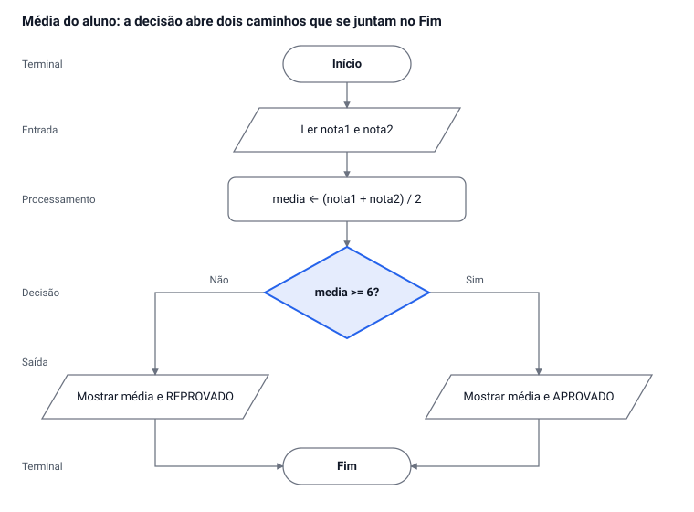

# Do Fluxograma ao Código

Oct 26, 2026 · @Alan Mateus

## Identificação e instruções

| Disciplina | Professor | Turma |
| --- | --- | --- |
| Lógica de Programação | Alan Mateus | 2º EMTI |

**Nome:** \_\_\_\_\_\_\_\_\_\_\_\_\_\_\_\_\_\_\_\_\_\_\_\_\_\_\_\_\_\_ **Nº:** \_\_\_\_ **Data:** \_\_\_\_ / \_\_\_\_ / \_\_\_\_\_\_

**Objetivo:** primeiro você desenha a solução em fluxograma; só depois transforma o desenho em código Portugol (VisuAlg). O fluxograma é o mapa, o código é a viagem.

**Regras da atividade:**

1. Para cada exercício, entregue **duas partes**: (a) o fluxograma e (b) o código.
2. Não comece pelo código. Se o fluxograma estiver errado, o código também estará.
3. Antes de desenhar, liste: **o que entra** (entrada), **o que o programa faz** (processamento) e **o que sai** (saída).
4. Depois de escrever o código, faça o **teste de mesa**: escolha valores, siga o fluxograma com o dedo e confira se o código dá o mesmo resultado.
5. Cada bloco do fluxograma deve virar uma ou mais linhas do código. Se sobrou bloco sem código (ou código sem bloco), algo está faltando.

## Lembrete: os símbolos e o que viram no código

Cada símbolo do fluxograma tem um "par" no Portugol. Use esta tabela como dicionário durante toda a atividade.

| Símbolo | Formato | Para que serve | Vira no Portugol |
| --- | --- | --- | --- |
| Terminal | Oval (cápsula) | Marca o início e o fim | `algoritmo`, `inicio`, `fimalgoritmo` |
| Entrada | Paralelogramo | Ler um dado do usuário | `leia(variavel)` |
| Processamento | Retângulo | Fazer um cálculo ou atribuição | `variavel <- expressao` |
| Decisão | Losango | Fazer uma pergunta de sim/não | `se ... entao ... senao ... fimse` |
| Saída | Paralelogramo (ou documento) | Mostrar um resultado | `escreval("texto", variavel)` |
| Seta | Linha com ponta | Indica a ordem dos passos | A ordem das linhas do código |

**Atenção — erro comum:** o losango sempre tem **duas saídas**, uma marcada "Sim" e outra "Não". Losango com uma saída só não é decisão.

**Atenção — erro comum:** uma repetição aparece no fluxograma como uma seta que **volta** para um bloco anterior. No código, essa volta vira `enquanto`, `para` ou `repita`.

## Exemplo resolvido: média do aluno

**Problema:** leia duas notas de um aluno, calcule a média e informe se ele foi **APROVADO** (média maior ou igual a 6) ou **REPROVADO**.

**Passo 1 — Entrada, processamento e saída**

- **Entrada:** nota1, nota2
- **Processamento:** media ← (nota1 + nota2) / 2; comparar media com 6
- **Saída:** a média e a mensagem APROVADO ou REPROVADO

**Passo 2 — Fluxograma:** veja o desenho logo abaixo.



Repare: o losango gera dois caminhos (Sim e Não), e os dois chegam ao mesmo Fim. No código, isso é exatamente o `se ... senao ... fimse`.

**Passo 3 — Código Portugol (VisuAlg)**

```
algoritmo "MediaAluno"
var
   nota1, nota2, media: real
inicio
   escreva("Digite a 1a nota: ")
   leia(nota1)
   escreva("Digite a 2a nota: ")
   leia(nota2)
   media <- (nota1 + nota2) / 2
   se media >= 6 entao
      escreval("Media: ", media:4:1, " - APROVADO")
   senao
      escreval("Media: ", media:4:1, " - REPROVADO")
   fimse
fimalgoritmo
```

**Atenção — erro comum:** escrever `media <- nota1 + nota2 / 2` sem parênteses. O computador divide primeiro e soma depois: com notas 8 e 6 o resultado seria 11, e não 7.

**Passo 4 — Teste de mesa**

| nota1 | nota2 | media | media >= 6? | Saída |
| --- | --- | --- | --- | --- |
| 8 | 6 | 7,0 | Sim | Media: 7.0 - APROVADO |
| 5 | 4 | 4,5 | Não | Media: 4.5 - REPROVADO |
| 6 | 6 | 6,0 | Sim | Media: 6.0 - APROVADO |

**Confira antes de seguir:** por que o terceiro teste (6 e 6) é importante? *Resposta: ele testa o valor exato do limite. Se você tivesse escrito `>` em vez de `>=`, esse aluno seria reprovado por engano.*

### Sua vez (quase igual)

Leia **três** notas, calcule a média e informe **APROVADO** se a média for maior ou igual a **7**, ou **RECUPERAÇÃO** caso contrário. Mostre a média com uma casa decimal junto da mensagem (ex.: "Media: 7.5 - APROVADO").

- [ ] Escrevi entrada, processamento e saída
- [ ] Desenhei o fluxograma (com o losango de duas saídas)
- [ ] Escrevi o código Portugol
- [ ] Fiz o teste de mesa com 3 casos, incluindo média exatamente 7

## Exercícios

Em todos: (a) entrada/processamento/saída, (b) fluxograma, (c) código Portugol, (d) teste de mesa com um caso para cada caminho do fluxograma (no mínimo 2 casos).

### Nível 1 — Sequência (sem decisão)

1. **Conversor de temperatura.** Leia uma temperatura em graus Celsius e mostre o valor em Fahrenheit. Fórmula: F = C × 1,8 + 32.
2. **Pedido na lanchonete.** Leia o preço de um lanche e a quantidade pedida. Mostre o valor total a pagar.
3. **Tempo de jogo.** Leia uma quantidade de minutos jogados e mostre quantas horas e quantos minutos isso representa. Exemplo: 135 minutos = 2 horas e 15 minutos. Dica: use `div` e `mod`.

### Nível 2 — Decisão (losango)

4. **Par ou ímpar.** Leia um número inteiro e informe se ele é PAR ou ÍMPAR. Dica: um número é par quando `numero mod 2 = 0`.
5. **O maior número.** Leia dois números e mostre o maior. Se forem iguais, mostre "Os números são iguais". (Seu fluxograma vai precisar de **dois** losangos.)
6. **Desconto no restaurante.** Leia o valor da conta. Se for maior que R$ 100,00, aplique 10% de desconto. Mostre o valor do desconto (R$ 0,00 se não houver) e o valor final a pagar. Contas de exatamente R$ 100,00 não ganham desconto.
7. **Faixa etária.** Leia a idade de uma pessoa e informe: CRIANÇA (até 11 anos), ADOLESCENTE (12 a 17) ou ADULTO (18 ou mais).

### Nível 3 — Repetição (seta que volta)

8. **Tabuada.** Leia um número e mostre a tabuada dele de 1 a 10, uma linha por vez, no formato "5 x 1 = 5". Use `para`.
9. **Soma até o zero.** Leia números até o usuário digitar 0. No final, mostre a soma de todos os números digitados. Use `enquanto`.
10. **Senha com três tentativas.** A senha correta é o número inteiro 1234. O usuário tem até 3 tentativas. Se acertar, mostre "Acesso liberado"; se errar as 3, mostre "Acesso bloqueado". Assim que o usuário acertar, o programa para de pedir a senha. A cada erro, mostre quantas tentativas restam.

**Atenção — erro comum no Nível 3:** esquecer de atualizar a variável que controla a repetição. Se o contador nunca muda, a seta volta para sempre e o programa nunca termina (*loop* infinito).

### Leitura reversa: do código para o fluxograma

11. Desenhe o fluxograma do código abaixo e diga o que ele faz em uma frase.

```
algoritmo "Misterio"
var
   n, i, cont: inteiro
inicio
   leia(n)
   cont <- 0
   para i de 1 ate n faca
      se n mod i = 0 entao
         cont <- cont + 1
      fimse
   fimpara
   se cont = 2 entao
      escreval("SIM")
   senao
      escreval("NAO")
   fimse
fimalgoritmo
```

## Desafio e autoavaliação

### Desafio: caixa da cantina

A cantina da escola vende três itens: **1 – Salgado (R$ 6,00)**, **2 – Suco (R$ 4,00)** e **3 – Bolo (R$ 5,00)**. Faça um programa que:

1. Mostre o cardápio e leia o código do item.
2. Se o código for **0**, encerre a compra sem pedir a quantidade.
3. Se o código não for 0, 1, 2 nem 3, mostre "Item inválido", não peça a quantidade e volte a mostrar o cardápio.
4. Se o código for válido, leia a quantidade. Se a quantidade for menor ou igual a 0, mostre "Quantidade inválida" e não some nada.
5. Repita os passos 1 a 4 até o usuário digitar o código 0.
6. No final, mostre o **subtotal**, o **desconto** e o **total a pagar**. O desconto é de 5% somente se o subtotal for maior que R$ 30,00 (exatamente R$ 30,00 não ganha desconto). Se nenhum item foi comprado, mostre "Nenhum item comprado".

Este desafio junta os três níveis: sequência, decisão e repetição. Desenhe o fluxograma inteiro **antes** de abrir o VisuAlg.

### Checklist de autoavaliação

- [ ] Todo fluxograma tem um Início e um Fim
- [ ] Todo losango tem duas saídas, marcadas Sim e Não
- [ ] Toda repetição tem uma seta que volta e uma condição de parada
- [ ] Cada bloco do fluxograma tem a sua linha correspondente no código
- [ ] Declarei todas as variáveis em `var` com o tipo certo (inteiro, real, caractere)
- [ ] O teste de mesa deu o mesmo resultado que o programa no VisuAlg
- [ ] Testei os valores de limite (ex.: exatamente 6, exatamente 100, exatamente 18)
