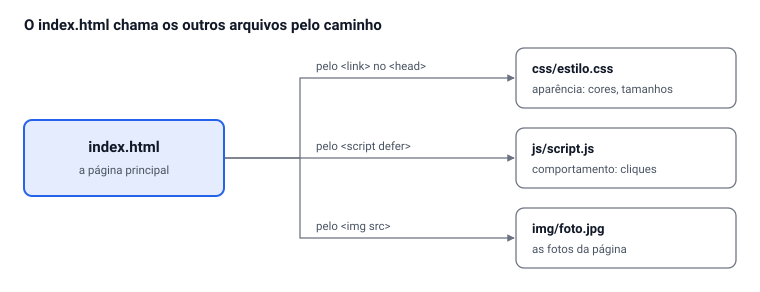

# Do zero ao ar: sua página com HTML, CSS e JavaScript

Sep 28, 2026 · @Alan Mateus

## Antes de começar

No fim deste roteiro você terá **um site seu, publicado na internet**, com endereço próprio para mandar para qualquer pessoa. Você vai escrever o HTML, o CSS e o JavaScript do zero, usando o **Catálogo do HTML** como consulta.

**O que você precisa ter:**

- [ ] Uma conta no GitHub (github.com, gratuita). Anote o seu nome de usuário: ele vai fazer parte do endereço do seu site.
- [ ] O VS Code instalado, com a extensão **Live Server**.
- [ ] O Catálogo do HTML aberto no navegador, no endereço alanmateus17.github.io/catalogo-html. Deixe o navegador de um lado da tela e o VS Code do outro.
- [ ] Um caderno ou folha para a Etapa 1.

**Como usar o Catálogo:** ele não é para ser copiado inteiro. Ele é um cardápio. Cada funcionalidade tem um botão **Ver código** com três abas (HTML, CSS e JavaScript): é o código completo daquela funcionalidade, e só dele, pronto para colar num projeto em branco. Cada aba diz em qual arquivo colar e tem um botão **Copiar**. A página **Códigos**, no menu do Catálogo, reúne todos, com busca. Para entender cada linha, leia os comentários do código do próprio Catálogo: os marcados com **POR QUÊ** explicam o motivo, e os com **TESTE** sugerem experiências.

**Como ler este roteiro:** faça as etapas na ordem. Em cada uma aparecem:

- **Confira:** uma pergunta rápida. Responda de cabeça antes de seguir. Se não souber, releia o trecho.
- **Erro comum:** um erro que quase todo mundo comete naquele ponto. Leia antes de fazer, e não depois de travar.
- **Pronto quando:** o que precisa estar funcionando para você passar para a próxima etapa.

## Etapa 1 — Escolher o tema e planejar no papel

Quem começa digitando sem plano gasta o dobro do tempo. Nesta etapa você não abre o computador.

1. **Escolha um tema** de que você goste e sobre o qual saiba escrever. Ideias: você mesmo (um portfólio), um lugar turístico da cidade, receitas da sua família, seu esporte ou time, um hobby, um jogo, um projeto da escola.
2. **Divida o assunto em 4 a 6 seções.** Exemplo para "Pontos turísticos de Barbacena": Início, História, Lugares para visitar (galeria), Como chegar (mapa), Contato (formulário).
3. **Desenhe a página** numa folha, de cima para baixo: o cabeçalho com o menu, a primeira área grande, cada seção como um retângulo e o rodapé. Escreva dentro de cada retângulo o que vai lá (texto, fotos, tabela...). Isso se chama *wireframe*.
4. **Marque ao lado de cada retângulo a tag do HTML** que vai usar: `header`, `nav`, `section`, `article`, `footer`. Na dúvida, abra a seção 9 do Catálogo (Layout).
5. **Liste o material:** os textos que vai escrever e de 4 a 6 imagens. Use fotos suas ou de sites de imagens livres (como Unsplash ou Pexels). Imagem pega no Google pode ter dono.
6. **Escolha 2 cores** para o site: uma principal e uma de destaque. Anote o código delas (ex.: `#12324a`). Um site de paleta ajuda, como coolors.co.
7. **Escolha 2 ou 3 interações** da seção 10 do Catálogo que combinem com o seu tema. Exemplo: galeria ampliada para as fotos, filtro para uma lista de receitas, modal para um aviso.

Leia também o **checklist de entrega** no fim deste roteiro: ele diz o mínimo que o projeto precisa ter.

**Confira:** por que a sua página deve ter um único `h1`, mas pode ter vários `h2`?

**Pronto quando:** você tem na folha o tema, o desenho com as seções, as tags marcadas, as 2 cores e as interações escolhidas. Mostre ao professor antes de seguir.

## Etapa 2 — Criar a pasta do projeto e os arquivos

Você vai criar a mesma organização de pastas do Catálogo: cada linguagem no seu arquivo, cada tipo de arquivo na sua pasta.

1. Na Área de Trabalho (ou em Documentos), crie uma pasta com o nome do seu projeto. Esse nome vai virar o endereço do site, então siga as regras de nomes abaixo. Exemplo: `turismo-barbacena`.
2. No VS Code, vá em **Arquivo > Abrir Pasta** e escolha essa pasta.
3. Usando os ícones de *Novo Arquivo* e *Nova Pasta* que aparecem no topo do painel Explorer, do lado esquerdo, crie esta estrutura:

```
turismo-barbacena/
├── index.html
├── css/
│   └── estilo.css
├── js/
│   └── script.js
└── img/
```

4. Copie as suas imagens para dentro da pasta `img`.

**Regras de nomes** (para pastas, arquivos e imagens):

- Tudo em **minúsculas**.
- **Sem espaço:** use hífen. `praca-central.jpg`, e não `Praca Central.jpg`.
- **Sem acento e sem ç:** `praca`, e não `praça`.
- A página principal se chama **sempre** `index.html`. É o arquivo que o navegador abre primeiro quando alguém entra no seu site.

Por que tanta regra? No seu computador, `Foto.jpg` e `foto.jpg` são o mesmo arquivo. No servidor onde o site vai ficar, são dois arquivos diferentes. A imagem funciona em casa e some quando o site vai para a internet.

> **Erro comum:** no Windows, o arquivo criado pelo Explorador pode virar `estilo.css.txt` sem você perceber, porque o Windows esconde a extensão. Crie os arquivos **pelo VS Code**, e não pelo Explorador de Arquivos.

> **Erro comum:** abrir só o `index.html` no VS Code, em vez da pasta inteira. Sempre use **Abrir Pasta**: é assim que o VS Code enxerga o CSS, o JS e as imagens juntos.

**Confira:** qual destes nomes está certo: `Minha Foto.JPG`, `minha-foto.jpg` ou `minha_fóto.jpg`?

**Pronto quando:** o painel Explorer do VS Code mostra exatamente a estrutura acima, com as suas imagens dentro de `img`.

## Etapa 3 — Esqueleto do HTML e conexão com CSS e JS

O `index.html` é o chefe: ele chama o CSS, o JavaScript e as imagens, cada um pelo seu **caminho**. Se um caminho estiver errado, aquele arquivo simplesmente não chega, e nenhuma mensagem aparece na tela.



Os caminhos são **relativos**: partem da pasta onde está o `index.html`. `css/estilo.css` quer dizer "entre na pasta css e pegue estilo.css".

1. Abra o `index.html`, digite `!` e aperte **Enter**. O VS Code escreve o esqueleto sozinho (esse atalho se chama Emmet).
2. Troque `lang="en"` por `lang="pt-BR"` e escreva no `<title>` o nome do seu site.
3. Dentro do `<head>`, antes do `</head>`, acrescente as duas linhas de conexão. São as mesmas do Catálogo (veja a seção 1 dele e os comentários do `<head>` no `index.html`).
4. Dentro do `<body>`, coloque um `<h1>` com o nome do site, só para ter algo na tela.

O arquivo deve ficar assim:

```html
<!DOCTYPE html>
<html lang="pt-BR">
<head>
  <meta charset="UTF-8">
  <meta name="viewport" content="width=device-width, initial-scale=1.0">
  <title>Turismo em Barbacena</title>

  <link rel="stylesheet" href="css/estilo.css">
  <script src="js/script.js" defer></script>
</head>
<body>
  <h1>Turismo em Barbacena</h1>
</body>
</html>
```

**Atalho:** na página Códigos do Catálogo, o painel **Estrutura de um projeto novo** tem os três arquivos completos, já conectados, com um cabeçalho, três seções e um rodapé. Você pode começar por ele em vez de digitar o esqueleto, mas faça o teste de conexão do mesmo jeito.

**Teste de conexão** (faça sempre, antes de escrever qualquer outra coisa):

1. No `estilo.css`, escreva: `body { background-color: yellow; }`
2. No `script.js`, escreva: `console.log("JavaScript conectado!");`
3. Clique com o botão direito no `index.html` e escolha **Open with Live Server**.
4. Página amarela = o CSS está conectado. Aperte **F12**, aba **Console**: apareceu a mensagem = o JS está conectado.
5. Deu certo? Apague as duas linhas de teste.

> **Erro comum:** a página não ficou amarela. Confira letra por letra o `href`: o nome da pasta, a barra e o nome do arquivo. No F12, aba **Rede** (Network), o arquivo com problema aparece com o código **404**, que quer dizer "arquivo não encontrado".

> **Erro comum:** escrever `<style>` dentro do `estilo.css` ou `<script>` dentro do `script.js`. Esses arquivos já são CSS e JS puros: as tags só existem no HTML.

> **Erro comum:** esquecer o `defer`. Sem ele, o JavaScript roda antes de a página existir e, mais tarde, dá o erro `Cannot read properties of null`.

**Confira:** o que acontece se você escrever `href="estilo.css"` em vez de `href="css/estilo.css"`? Por quê?

**Pronto quando:** a página ficou amarela e a mensagem apareceu no Console. Só depois disso siga para a próxima etapa.

## Etapa 4 — Montar o conteúdo com blocos do Catálogo

Agora você transforma o desenho da Etapa 1 em HTML. Nesta etapa a página vai ficar "feia", sem cor nem organização. É normal: a aparência vem na Etapa 5.

**Primeiro, a estrutura geral.** Dentro do `<body>`, monte as partes grandes da página, ainda vazias. Cada seção ganha um `id`, que será o destino dos links do menu:

```html
<header>
  <nav>
    <ul>
      <li><a href="#historia">História</a></li>
      <li><a href="#lugares">Lugares</a></li>
      <li><a href="#contato">Contato</a></li>
    </ul>
  </nav>
</header>

<main>
  <section id="inicio">
    <h1>Turismo em Barbacena</h1>
  </section>
  <section id="historia">
    <h2>História</h2>
  </section>
  <section id="lugares">
    <h2>Lugares para visitar</h2>
  </section>
  <section id="contato">
    <h2>Contato</h2>
  </section>
</main>

<footer>
  <p>&copy; 2026 Seu Nome</p>
</footer>
```

Salve e clique nos links do menu: a página tem que pular para cada seção.

**Depois, encha cada seção usando o método copiar, adaptar, testar:**

1. **Ache** no Catálogo o elemento que você quer (uma galeria, uma tabela, um formulário). O mapa no fim deste roteiro diz em que seção fica cada coisa. Também dá para procurar pelo nome na página Códigos.
2. **Abra o Ver código** logo embaixo do elemento e leia a explicação do painel: ela diz o que você deve trocar.
3. **Copie a aba HTML** com o botão Copiar.
4. **Cole** dentro da sua seção e **adapte:** troque os textos pelos seus, o `src` e o `alt` pelas suas imagens, os links pelos seus destinos. Apague o que não precisar.
5. **Salve e olhe no navegador** antes de copiar o próximo bloco. Um bloco por vez: se algo quebrar, você sabe exatamente onde foi.
6. **Quer entender uma linha?** Procure o mesmo trecho no `index.html` do Catálogo (**Ctrl + F**) e leia o comentário que vem logo acima dele.

**Não mude os nomes das classes e dos ids** que vieram no código (`galeria`, `card`, `tabela`...). As abas CSS e JS do mesmo painel dependem deles: nas Etapas 5 e 6 você cola essas abas, e elas só funcionam se os nomes forem iguais.

**Exemplo resolvido: a galeria.** No painel Ver código da galeria, cada foto é assim:

```html
<li>
  <button type="button" class="galeria-item" data-grande="img/foto-1.jpg" data-legenda="Legenda da foto 1">
    
  </button>
</li>
```

Adaptado para o projeto de turismo:

```html
<li>
  <button type="button" class="galeria-item" data-grande="img/igreja-matriz.jpg" data-legenda="Igreja Matriz de Nossa Senhora da Piedade">
    
  </button>
</li>
```

Repare no que mudou: os caminhos das imagens, a legenda e o `alt`. O `alt` descreve o que se **vê** na foto, para quem não pode ver. A estrutura e as classes continuaram iguais.

**Você tenta:** escolha outro bloco do Catálogo (uma lista, uma tabela ou os cards da seção 9) e faça o mesmo caminho: achar, ler o comentário, copiar, adaptar, testar.

> **Erro comum:** copiar a tag de abertura e esquecer a de fechamento, ou copiar um `</div>` a mais. A página fica toda torta do meio para baixo. Use a setinha de recolher do VS Code para ver onde o bloco termina.

> **Erro comum:** o link do menu não funciona. O `href="#lugares"` precisa ser **exatamente** igual ao `id="lugares"`, com as mesmas maiúsculas e sem acento.

> **Erro comum:** colar o mesmo bloco duas vezes e deixar dois elementos com o mesmo `id`. Um `id` só pode existir **uma vez** na página. Para repetir, use `class`.

**Confira:** qual a diferença entre `id` e `class`? Quando você usa cada um?

**Pronto quando:** todas as seções têm o seu conteúdo de verdade, as imagens aparecem, os links do menu levam para as seções certas e o seu código passa no validador do HTML: em validator.w3.org, escolha **Validate by Direct Input**, cole o seu `index.html` e corrija os erros apontados.

## Etapa 5 — Estilizar com CSS

Cada código pronto já traz o CSS dele. Nesta etapa você junta tudo num `estilo.css` só e dá a cara do seu site: as suas cores, a sua fonte, as suas regras.

1. **Confira a base:** se você começou pelo painel **Estrutura de um projeto novo**, o seu `estilo.css` já tem as variáveis de cor, o reset e o `.container`. Se começou do zero, copie agora a aba CSS desse painel para o começo do arquivo.
2. **Coloque as suas cores:** nas variáveis do `:root`, troque os códigos pelos das 2 cores que você escolheu na Etapa 1.
3. **Cole a aba CSS de cada bloco** que você usou na Etapa 4, no final do `estilo.css`. Sem ela, o HTML do bloco aparece sem forma.
4. **Troque as cores dos blocos:** os códigos prontos usam cores fixas, como `#12324a`. Troque pelas suas, ou por `var(--cor-principal)` e `var(--cor-destaque)` para seguirem as variáveis.
5. **Teste no celular:** aperte **F12** e depois **Ctrl + Shift + M**. Escolha uma tela de 390 px de largura. Os códigos prontos já se ajustam ao celular; se alguma coisa sua cortar ou criar rolagem para o lado, é aí que você corrige.
6. **Faça pelo menos 3 regras suas**, que não vieram prontas. Ideias: um efeito de `:hover` diferente, uma borda nos títulos, uma animação.
7. **Quer ir além?** O `estilo.css` completo do Catálogo tem 25 seções comentadas (submenu, animações, impressão...). Use **Ctrl + F** e procure `== 14`, por exemplo.

**Exemplo resolvido: trocar a identidade.** Para um site em roxo e laranja, só estas linhas mudam no `:root`:

```css
:root {
  --cor-principal: #5a189a;  /* cabeçalho, botões, links */
  --cor-destaque: #ff9e00;   /* realces */
}
```

Toda regra que usa `var(--cor-principal)` ou `var(--cor-destaque)` muda de cor junto. Por isso vale trocar as cores fixas dos blocos por essas variáveis.

**Para trocar a fonte:** escolha uma em fonts.google.com, copie o `<link>` que o site oferece e cole no `<head>` do seu HTML, **antes** do `estilo.css`. Depois use o nome dela no `font-family` do `body`. Exemplo: `font-family: "Poppins", Arial, sans-serif;`

**Você tenta:** coloque uma foto sua como fundo da primeira seção. O painel **Primeira área grande (herói)** já faz isso: cole as abas e troque `img/fundo.jpg` pelo nome da sua foto. Depois mude a transparência da película escura (o `0.75` do `rgba`) e veja a diferença.

> **Erro comum:** a imagem de fundo não aparece. Dentro do CSS, o caminho parte da pasta **css**, e não do HTML. O certo é `url("../img/foto.jpg")`: o `../` quer dizer "volte uma pasta" e só então entre em `img`.

> **Erro comum:** uma regra no meio do arquivo sem o `;` ou sem a `}` de fechamento. O CSS não avisa: ele simplesmente ignora as regras seguintes. Se de repente "nada funciona" da metade do arquivo para baixo, procure a chave ou o ponto e vírgula que faltou.

> **Erro comum:** mudar o CSS e não ver diferença. Clique com o botão direito no elemento e escolha **Inspecionar**. O painel mostra quais regras estão valendo e quais estão riscadas, ou seja, perdendo para outra regra mais forte.

**Confira:** por que o Catálogo guarda as cores em variáveis, em vez de escrever `#12324a` direto em cada regra?

**Pronto quando:** o site tem as suas cores, todos os blocos estão estilizados, existem pelo menos 3 regras escritas por você, e numa tela de 390 px não aparece rolagem para o lado.

## Etapa 6 — Adicionar interatividade com JavaScript

Cada exemplo de interação do Catálogo tem **três peças**, e as três precisam vir juntas:

| Aba do Ver código | Onde colar | O que faz |
| --- | --- | --- |
| 1. HTML | `index.html`, no lugar onde o elemento deve aparecer | o botão, a caixa, a lista |
| 2. CSS | final do `css/estilo.css` | a aparência de cada estado |
| 3. JavaScript | final do `js/script.js` | o que acontece no clique |

1. Pegue as 2 ou 3 interações que você escolheu na Etapa 1.
2. Abra o **Ver código** de cada uma, na seção 10 do Catálogo ou na página Códigos.
3. Copie as **três abas**, cada uma no seu arquivo, no lugar que o painel indica.
4. Troque os textos e as imagens pelos seus. Não mude os `id` nem as classes: o JavaScript procura os elementos por eles.
5. Salve, teste, e olhe o **Console** (F12): não pode ter nenhuma mensagem vermelha.
6. Quer entender cada linha? No `script.js` do Catálogo, procure `PARTE` e o número do exemplo (ex.: `PARTE 6`). A versão de lá tem mais comentários.

**Exemplo resolvido: o botão Curtir (exemplo 6).**

HTML, onde você quiser o botão:

```html
<button type="button" class="btn-curtir" id="btn-curtir" aria-pressed="false">
  <span class="coracao" aria-hidden="true">♥</span> <span id="curtir-texto">Curtir</span>
</button>
```

JavaScript, no seu `script.js`:

```javascript
const btnCurtir = document.getElementById("btn-curtir");

if (btnCurtir) {
  btnCurtir.addEventListener("click", function () {
    const curtido = btnCurtir.classList.toggle("curtido");
    document.getElementById("curtir-texto").textContent = curtido ? "Curtido!" : "Curtir";
    btnCurtir.setAttribute("aria-pressed", String(curtido));
  });
}
```

CSS: a aba CSS do painel traz juntas as regras `.btn-curtir`, `.coracao` e `.btn-curtir.curtido` e a animação `@keyframes pulsar`.

Repare na divisão de trabalho: o JavaScript só coloca e tira a classe `curtido`. Quem diz que "curtido" é vermelho e pulsa é o CSS.

**Você tenta:** coloque o contador (exemplo 7) ou o "Leia mais" (exemplo 8) na sua página, seguindo as mesmas três peças. Depois **mude alguma coisa no comportamento**: o texto que aparece, o tempo de uma animação, o limite do contador. Copiar e não mudar nada não vale.

> **Erro comum:** clicar e nada acontecer, sem nenhum erro no Console. Quase sempre é `id` diferente entre o HTML e o JS. Os exemplos começam com `if (elemento)`: se o `id` não existe, o código simplesmente não roda. Para descobrir, coloque `console.log(btnCurtir);` logo depois do `getElementById`. Se aparecer `null`, o `id` está errado.

> **Erro comum:** `Unexpected end of input` ou `Unexpected token` no Console. Você copiou a função pela metade: faltou uma `}` ou um `)` do final. Clique no nome do arquivo ao lado do erro: o navegador mostra a linha.

> **Erro comum:** colar só uma ou duas abas. Sem o CSS, o elemento aparece sem forma; sem o JS, ele aparece, mas não faz nada. Confira se as três abas do painel foram coladas, cada uma no arquivo certo.

**Confira:** para que serve o `if (btnCurtir)` antes do `addEventListener`? O que aconteceria sem ele numa página que não tem esse botão?

**Pronto quando:** pelo menos 2 interações funcionam, o Console não mostra nenhum erro vermelho, e você consegue explicar para o professor o que faz cada linha de uma delas.

## Etapa 7 — Publicar no GitHub e colocar no ar

O GitHub guarda o seu código, e o **GitHub Pages** transforma esse código num site com endereço público, de graça. O endereço terá este formato: `https://seu-usuario.github.io/nome-do-projeto/`.

**Parte A — Criar o repositório**

1. Entre no github.com e clique no **+** (canto superior direito) e depois em **New repository**.
2. Em **Repository name**, use o **mesmo nome da pasta** do projeto (ex.: `turismo-barbacena`).
3. Marque **Public**. O Pages gratuito só funciona com repositório público.
4. Clique em **Create repository**.

**Parte B — Enviar os arquivos (pelo site, o caminho recomendado)**

1. Na página do repositório vazio, clique no link **uploading an existing file**.
2. Abra a pasta do seu projeto no Explorador de Arquivos e **entre nela**.
3. Selecione **o que está dentro dela**: `index.html` e as pastas `css`, `js` e `img`. Arraste tudo para a janela do GitHub.
4. Espere a lista de arquivos terminar de carregar. Embaixo, em **Commit changes**, escreva uma mensagem como `Primeira versão do site` e clique no botão verde.
5. Confira: na página do repositório, o `index.html` precisa aparecer **na lista principal**, ao lado das pastas `css`, `js` e `img`, e não dentro de outra pasta.

> **Erro comum:** arrastar a pasta do projeto inteira, em vez do que está dentro dela. O GitHub cria `turismo-barbacena/index.html` dentro do repositório, e o site abre com erro 404. Se isso acontecer, apague os arquivos e envie de novo, arrastando o **conteúdo** da pasta.

**Parte C — Colocar no ar com o GitHub Pages**

1. No repositório, clique em **Settings** (a engrenagem na barra de cima).
2. No menu da esquerda, clique em **Pages**.
3. Em **Source**, escolha **Deploy from a branch**.
4. Em **Branch**, escolha **main** e a pasta **/ (root)**. Clique em **Save**.
5. Espere de 1 a 3 minutos e recarregue a página. Aparece no topo: **Your site is live at** e o endereço. Clique e confira o seu site.
6. Abra o endereço também no celular.

> **Erro comum:** o site abre, mas sem estilo ou sem algumas fotos, e no seu computador estava tudo certo. É a diferença de maiúsculas: `Foto.JPG` no arquivo e `foto.jpg` no código. No servidor do GitHub isso conta. Renomeie os arquivos para minúsculas e corrija o código.

> **Erro comum:** "404 — There isn't a GitHub Pages site here". Confira três coisas: se o arquivo se chama exatamente `index.html`, se ele está na raiz do repositório, e se você esperou alguns minutos depois de salvar o Pages.

**Parte B pelo terminal (opcional, para quem já usa o Git Bash)**

Use este caminho **no lugar** do envio pelo site, nunca os dois. No Explorador de Arquivos, entre na pasta do projeto, clique com o botão direito num espaço vazio e escolha **Open Git Bash here**. Antes de qualquer outro comando, rode `ls` e confira se aparecem **só** os arquivos do seu projeto (`index.html  css  js  img`). Depois:

```bash
git init
git add .
git commit -m "Primeira versão do site"
git branch -M main
git remote add origin https://github.com/seu-usuario/turismo-barbacena.git
git push -u origin main
```

> **Erro comum (e perigoso):** rodar `git init` fora da pasta do projeto, por exemplo na pasta do seu usuário. O sinal é o `git add .` listar pastas como `AppData`, `Desktop`, `Documents` e `.ssh`, ou o terminal mostrar `(main)` na sua pasta pessoal. **Pare na hora:** você estaria enviando o seu computador inteiro, com senhas e chaves, para um repositório público. Para desfazer, rode `rm -rf .git` **nessa mesma pasta** onde deu o `init` errado e chame o professor. Por isso o `ls` antes de tudo.

**Confira:** por que o repositório precisa ter o `index.html` na raiz, e não dentro de uma pasta?

**Pronto quando:** o seu site abre pelo endereço `github.io`, no computador e no celular, com estilo, imagens e interações funcionando. Envie esse endereço para o professor.

## Etapa 8 — Atualizar o site depois de publicado

O site no ar muda sozinho sempre que o repositório muda. Cada envio se chama **commit** e fica guardado no histórico: dá para ver o que mudou e quando, e voltar atrás se algo quebrar.

**Jeito 1 — Editar direto no navegador (ideal no laboratório):**

1. Abra o seu repositório no GitHub e aperte a tecla **.** (ponto). Abre um VS Code dentro do navegador, o *github.dev*, com todos os seus arquivos.
2. Faça as mudanças normalmente.
3. No menu da esquerda, clique no ícone de **Source Control** (as três bolinhas ligadas por linhas), escreva uma mensagem que diga o que mudou e clique em **Commit & Push**.

**Jeito 2 — Reenviar arquivos pelo site:**

1. No repositório, **entre na pasta** onde o arquivo mora (ex.: clique em `css`).
2. Clique em **Add file > Upload files** e arraste o arquivo novo. Um arquivo com o mesmo nome é substituído.
3. Escreva a mensagem e clique em **Commit changes**.

**Jeito 3 — Pelo terminal** (para quem usou o Git Bash na Etapa 7), dentro da pasta do projeto:

```bash
git add .
git commit -m "Adiciona galeria de fotos"
git push
```

Depois de qualquer um dos três, espere 1 ou 2 minutos e recarregue o seu site com **Ctrl + F5**.

**Mensagens de commit** dizem o que mudou, começando por um verbo: `Adiciona formulário de contato`, `Corrige link do menu`, `Troca cores do tema`. Evite `ajustes` ou `aaa`: daqui a um mês, nem você vai saber o que fez.

> **Erro comum:** enviar o `estilo.css` novo na **raiz** do repositório, em vez de dentro da pasta `css`. Ficam dois arquivos: o novo na raiz, que ninguém usa, e o velho em `css/`, que continua valendo. O site "não muda". Entre sempre na pasta certa antes de enviar.

**Confira:** você mudou uma cor, fez o commit, recarregou o site e nada mudou. Cite dois motivos possíveis.

**Pronto quando:** você fez pelo menos uma alteração depois da publicação, com uma mensagem de commit clara, e viu a mudança no site no ar.

## Checklist de entrega

Marque cada item só depois de conferir no site **publicado**, e não só no seu computador.

**HTML**

- [ ] `<!DOCTYPE html>`, `lang="pt-BR"`, `charset`, `viewport` e um `<title>` com o nome do site
- [ ] Um único `<h1>`
- [ ] `header`, `nav`, `main` e `footer`
- [ ] Pelo menos 3 `section`, cada uma com `id` e `<h2>`
- [ ] Menu com links que levam a cada seção
- [ ] Pelo menos 1 lista (`ul`, `ol` ou `dl`)
- [ ] Pelo menos 3 imagens, todas com `alt` descritivo
- [ ] Pelo menos 1 link externo com `target="_blank"` e `rel="noopener"`
- [ ] Pelo menos 1 tabela ou 1 formulário
- [ ] Passa no validador (validator.w3.org) sem erros

**CSS**

- [ ] Em arquivo externo, conectado pelo `<link>`
- [ ] Variáveis de cor com as suas cores
- [ ] Pelo menos 3 regras escritas por você
- [ ] Efeito de `:hover` em links ou botões
- [ ] Numa tela de 390 px, sem rolagem para o lado

**JavaScript**

- [ ] Em arquivo externo, com `defer`
- [ ] Pelo menos 2 interações funcionando, com pelo menos uma mudança feita por você
- [ ] Console (F12) sem erros vermelhos

**Publicação**

- [ ] Repositório público com o `index.html` na raiz
- [ ] GitHub Pages ativo, abrindo no computador e no celular
- [ ] Pelo menos 2 commits, com mensagens claras
- [ ] Todos os nomes de arquivos em minúsculas, sem espaço e sem acento
- [ ] Link do site enviado ao professor

## Quando algo dá errado

| Sintoma | Causa mais provável | Como resolver |
| --- | --- | --- |
| Página sem nenhum estilo | Caminho do CSS errado no `href` | Conferir letra por letra; F12 > Rede mostra 404 |
| Imagem não aparece, só o texto do `alt` | Nome, pasta ou maiúsculas diferentes no `src` | Comparar o `src` com o nome real do arquivo |
| Imagem de fundo do CSS não aparece | O caminho no CSS parte da pasta `css` | Usar `url("../img/foto.jpg")` |
| `Cannot read properties of null` | `id` errado ou `<script>` sem `defer` | Conferir o `id` e o `defer` |
| Clique não faz nada, sem erro | `id` diferente entre HTML e JS | `console.log` do elemento: se der `null`, o `id` está errado |
| `Unexpected token` ou `Unexpected end of input` | Falta `}`, `)` ou aspas no JS | Clicar no erro do Console: ele mostra a linha |
| Layout torto a partir de um ponto | Tag aberta e nunca fechada | Validador do HTML; recolher os blocos no VS Code |
| Link do menu não pula para a seção | `href="#..."` diferente do `id` | Deixar os dois exatamente iguais |
| Mudei e nada mudou | Não salvou, cache, ou o Pages ainda não atualizou | Ctrl + S; Ctrl + F5; esperar 2 minutos |
| Site no ar dá 404 | `index.html` fora da raiz ou com outro nome | Mover para a raiz; renomear para `index.html` |

## Onde achar cada coisa no Catálogo

Seções do HTML = as seções numeradas da página. Seções do CSS = o `== número` do índice do `estilo.css`. JS = a `PARTE` do `script.js`.

Cada linha desta tabela tem um painel **Ver código** com o código pronto, ao lado do exemplo no Catálogo e também na página Códigos, onde dá para procurar pelo nome.

| Quero colocar... | HTML | CSS | JS |
| --- | --- | --- | --- |
| Cabeçalho fixo com menu | cabeçalho, no topo | 05 | PARTES 2 e 3 |
| Primeira área grande (herói) | início da página | 06 | — |
| Títulos, textos e listas | seção 2 | 08 | — |
| Links, WhatsApp, e-mail, download | seção 3 | 09 | — |
| Imagem com legenda | seção 4 | 10 | — |
| Galeria que amplia a foto | seção 4 + o `dialog` do fim | 10 e 17 | PARTE 16 |
| Vídeo e áudio | seção 5 | 11 | PARTE 18 (player próprio) |
| Vídeo do YouTube ou mapa | seção 6 | 12 | — |
| Tabela | seção 7 | 13 | — |
| Formulário de contato | seção 8 | 14 | PARTES 24, 25 e 27 |
| Cards | seção 9 | 15 | — |
| Perguntas que abrem e fecham | seção 9 | 15 | nenhum (é só HTML) |
| Tema escuro | botão do cabeçalho | 01 e 05 | PARTE 1 |
| Filtro de busca | seção 10, exemplo 13 | 16 | PARTE 13 |
| Lista de tarefas | seção 10, exemplo 14 | 16 | PARTE 14 |
| Abas | seção 10, exemplo 15 | 16 | PARTE 15 |
| Janela modal | seção 10, exemplo 17 + o `dialog` do fim | 17 | PARTE 17 |
| Carrossel | seção 10, exemplo 19 | 16 | PARTE 19 |
| Botão de voltar ao topo | fim do `body` | 18 | PARTE 5 |
| Rodapé com ano automático | `footer` | 19 | PARTE 30 |
