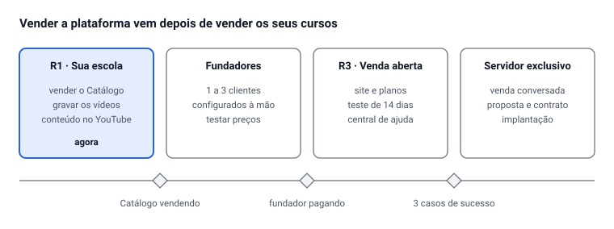

# Plano comercial — venda da plataforma

Oct 6, 2026 · @Alan Mateus

## Resumo

**Vendemos uma escola online com a marca do cliente, de dois jeitos:** assinatura, que o cliente contrata sozinho pelo site, e servidor exclusivo, vendido em conversa, com implantação e mensalidade de manutenção.

- **Para quem primeiro:** professores de programação e de cursos técnicos, e escolas pequenas. É onde o diferencial (atividades corrigidas, laboratório de código, modo foco) pesa mais.
- **Como:** site da plataforma → demonstração viva (Instituto AMS) → teste grátis de 14 dias → plano pago. Para servidor exclusivo: diagnóstico → demonstração → proposta → contrato → implantação.
- **Quando:** depois que a R1 vender os seus cursos. Entre a R1 e a R3, 1 a 3 **clientes fundadores** com desconto validam preço e pacotes.
- **O gargalo:** suporte. Uma pessoa só atende poucos clientes; central de ajuda e assistente de criação são tão importantes quanto qualquer recurso.

Tudo o que este plano precisa do sistema está em Plataforma de cursos — Especificação funcional v1 (seções Venda da plataforma e Recursos para vender).

## Para quem vender

Quatro perfis, em ordem de prioridade. O primeiro é onde a plataforma ganha com folga; o último só depois de casos de sucesso.

| Perfil | Dor principal | O que convence | Onde encontrar | Forma de venda |
| --- | --- | --- | --- | --- |
| **1. Professor de programação ou curso técnico** que vende curso gravado | Plataformas genéricas não corrigem código; aluno abandona; taxa alta por venda | Laboratório de código, exercícios corrigidos sozinhos, marca própria | YouTube e Instagram de programação, comunidades de dev, colegas professores | Assinatura |
| **2. Escola pequena** (informática, reforço, idiomas, preparatório) | Usa WhatsApp + Google Drive + planilha; nada organizado; sem venda online | Tudo num lugar com a marca dela; provas e certificado; venda com Pix | Região de Barbacena primeiro, depois indicação | Assinatura, venda conversada |
| **3. Professor de outras áreas** que quer sair de marketplace | Não é dono do aluno nem da marca | Domínio e marca próprios, lista de alunos dele, página de venda montada por ele | Grupos de infoprodutores, indicação dos perfis 1 e 2 | Assinatura |
| **4. Rede de escolas, prefeitura, empresa** | Exigência de dados separados e controle | Servidor exclusivo, contrato, LGPD, suporte com prazo | Contato direto, licitação (mais tarde) | Servidor exclusivo |

**Quem não é cliente agora:** quem quer só hospedar vídeo barato, quem precisa de app nativo na loja, e quem vende cursos de milhares de alunos por mês logo no primeiro contrato. Atender esses agora tiraria o foco da R1.

## Proposta de valor

**Frase de venda:** *"Sua escola online com a sua marca, onde o aluno pratica e é corrigido na hora — e não se distrai."*

Três diferenciais, sempre nesta ordem em site, demonstração e proposta:

1. **Aprender fazendo:** atividades corrigidas no servidor, prova por módulo, revisão espaçada e laboratório de código.
2. **Aluno que termina:** modo foco sem distrações, "continuar de onde parei", metas e lembretes.
3. **Escola que é do cliente:** marca, domínio, páginas montadas por ele, alunos e dados dele (com exportação a qualquer momento).

Como comparar com as alternativas (confirme os recursos atuais delas antes de usar em material de venda):

| Critério | Nossa plataforma | Marketplaces de infoproduto (Hotmart, Kiwify) | Plataformas internacionais de escola (Teachable, Kajabi) | WhatsApp + Drive + planilha |
| --- | --- | --- | --- | --- |
| Marca e domínio próprios | Sim | Limitado | Sim | — |
| Atividades corrigidas sozinhas | Sim, incluindo código | Básico | Básico | Não |
| Laboratório de código | Sim | Não | Não | Não |
| Pix, boleto e cartão com divisão | Sim (Asaas) | Sim | Limitado no Brasil | Manual |
| Suporte em português, próximo | Sim | Sim | Não | — |
| Servidor exclusivo | Sim | Não | Não | — |

Nunca vender contra a concorrência falando mal: mostrar o curso funcionando e deixar o cliente comparar.

## Planos e preço

**Quatro planos; os valores ficam em aberto até os clientes fundadores responderem.** Preço inventado antes de conversar com cliente costuma errar para baixo.

| Plano | Para quem | Cobrança | Inclui |
| --- | --- | --- | --- |
| **Começo** | Professor iniciando | Sem mensalidade + % por venda (a maior) | Base: cursos, aulas, vídeo até um limite, blocos essenciais, prova, certificado, checkout, marca, subdomínio, construtor de páginas, 1 professor |
| **Profissional** | Professor que já vende | Mensalidade + % baixa | Começo + trilhas, pacote de programação, projetos com rubrica, domínio próprio, relatórios, 3 professores, mais vídeo |
| **Escola** | Escola com equipe | Mensalidade maior, sem % | Profissional + remover "feito com", código próprio nas páginas, aulas ao vivo, comunidade, professores ilimitados, suporte prioritário |
| **Exclusivo** | Rede, prefeitura, empresa | Implantação + mensalidade de manutenção, sem % | Tudo + servidor próprio, tema exclusivo (opcional, cobrado à parte), contrato com prazo de atendimento |

**Adicionais avulsos** em qualquer plano: mais armazenamento e minutos de vídeo, professor extra, tema exclusivo, migração de conteúdo feita por você.

**Como chegar aos valores:**

1. **Piso:** custo por cliente (servidor rateado, Bunny, R2, e-mail, taxa do Asaas, suas horas de suporte) × 3, no mínimo.
2. **Referência:** quanto o cliente paga hoje em taxas no marketplace num mês típico. O plano Profissional precisa sair mais barato a partir de um volume de vendas que você consiga mostrar na conta.
3. **Teste:** pergunte aos 3 primeiros clientes "a partir de quanto seria caro demais?" e "a partir de quanto desconfiaria da qualidade?". O preço fica entre as duas respostas.
4. **Anual com desconto** (ex.: 2 meses grátis) para segurar o cliente e antecipar caixa.
5. **Exclusivo sempre por proposta**, nunca com preço público.

## Venda da assinatura

**Seis etapas, todas sem precisar de você.** Cada etapa diz o que o sistema precisa ter (os códigos estão na especificação) e qual número mostra se ela funciona.

| Etapa | O que acontece | O sistema precisa | Número que mostra se funciona |
| --- | --- | --- | --- |
| **1. Descoberta** | Vídeo no YouTube, post, indicação ou busca levam ao site | Site da plataforma com SEO (VND-10) | Visitas por semana |
| **2. Interesse** | Visitante vê o que a plataforma faz, os planos e a demonstração viva | Página de planos (VND-02), escola de demonstração com dados de exemplo (VND-11) | % que clica em "Criar minha escola" |
| **3. Teste** | Cria a escola em 5 passos, sem cartão; recebe e-mails de ajuda nos dias 1, 3, 7 e 12 | Teste grátis de 14 dias (VND-12), assistente (ESC-06), sequência de e-mails (VND-13) | % que publica o primeiro curso no teste |
| **4. Ativação** | Publica o primeiro curso e faz a primeira venda ou matrícula | Lista de primeiros passos com progresso (VND-14) | % que chega à primeira matrícula |
| **5. Compra** | Escolhe o plano e paga no Asaas | Contratação pelo próprio cliente (VND-02, VND-03) | % de testes que viram pagantes |
| **6. Indicação** | Cliente satisfeito indica e ganha 1 mês | Programa de indicação com link e crédito automático (VND-15) | Clientes novos vindos de indicação |

**Onde o teste costuma morrer:** escola criada e vazia. Por isso o assistente já cria um curso de exemplo, e o e-mail do dia 3 é sobre isso. Quem não publicou nada até o dia 7 recebe convite para uma conversa de 15 minutos com você.

## Venda do servidor exclusivo

**Venda conversada em sete etapas.** Só ofereça quando o cliente *precisa* de dados separados; marca própria sozinha se resolve com o plano Escola.

1. **Diagnóstico (30 min):** quantos alunos e professores, que cursos, como vendem hoje, por que precisam de servidor próprio, quem decide e quem paga, prazo.
2. **Demonstração (45 min)** com a marca do cliente já aplicada numa escola de demonstração.
3. **Proposta escrita** em até 3 dias úteis.
4. **Negociação:** mude escopo, prazo ou forma de pagamento; evite baixar o preço sem tirar algo.
5. **Contrato:** contrato de software, acordo de tratamento de dados (LGPD), política de atualização.
6. **Implantação** (próxima seção).
7. **Acompanhamento:** conversa mensal nos 3 primeiros meses, depois trimestral.

**Roteiro da demonstração** — mostre o aluno antes do painel; é o resultado que vende:

| Minuto | Mostrar | Frase-chave |
| --- | --- | --- |
| 0–5 | Página inicial com a marca do cliente | "Esta é a sua escola." |
| 5–15 | Aluno: catálogo, compra com Pix, aula em modo foco, atividade corrigida na hora | "O aluno aprende fazendo e não se perde." |
| 15–25 | Professor: criar aula por blocos, enviar vídeo, prova do módulo | "Seu professor monta uma aula em minutos." |
| 25–35 | Dono: painel de vendas, alunos, construtor de páginas | "Você controla tudo e muda o site quando quiser." |
| 35–45 | Perguntas; segurança, LGPD e backup | "Seus dados ficam num servidor só seu." |

**Modelo de proposta** (uma página, mais anexo técnico):

- O problema do cliente, nas palavras dele (do diagnóstico)
- A solução: escola com a marca dele em servidor exclusivo, recursos incluídos
- **Implantação:** o que entra (servidor, domínio, marca, importação de até X cursos, treinamento), prazo e valor
- **Mensalidade:** o que entra (atualizações, backup, monitoramento, suporte com prazo), valor e reajuste anual
- **Não está incluso:** produção de conteúdo, gravação de vídeo, custo do Bunny (conta do cliente), tema exclusivo
- Validade da proposta (15 dias) e próximos passos

## Implantação e primeiros 30 dias

**Meta: o cliente com o primeiro curso publicado em até 7 dias.** Cliente que não publica no primeiro mês costuma cancelar.

**Checklist de implantação** (assinatura: o cliente faz com o assistente; exclusivo: você faz):

- [ ] Escola criada (ou servidor exclusivo no ar pelo script, com licença)
- [ ] Domínio apontado e HTTPS ativo
- [ ] Marca: logo, cores, fontes, e-mails
- [ ] Conta Asaas do cliente conectada e uma compra de teste feita
- [ ] Páginas públicas montadas (início, sobre, termos, privacidade)
- [ ] Primeiro curso importado ou criado, com vídeo tocando
- [ ] Professores convidados, com 2FA ativo
- [ ] Backup e monitoramento confirmados (exclusivo)
- [ ] Treinamento feito (exclusivo: 1 a 2 h gravadas para a equipe)

**Primeiros 30 dias:**

| Dia | O que acontece |
| --- | --- |
| 1 | Boas-vindas com o link da central de ajuda e da lista de primeiros passos |
| 3 | Se o curso ainda está vazio: e-mail com o passo a passo e oferta de ajuda |
| 7 | Conferir: primeiro curso publicado? Se não, ligação de 15 min |
| 14 | Primeira matrícula? Dica de divulgação (link do curso, cupom de lançamento) |
| 30 | Conversa rápida: o que falta, o que atrapalha. Vira item no backlog ou artigo na central |

## Suporte e central de ajuda

**Regra: toda pergunta respondida duas vezes vira artigo.** É assim que uma pessoa só consegue atender mais clientes.

| Plano | Canal | Prazo de resposta | Horário |
| --- | --- | --- | --- |
| Começo | Central de ajuda + chamado pelo painel | 2 dias úteis | Dias úteis |
| Profissional | Chamado pelo painel | 1 dia útil | Dias úteis |
| Escola | Chamado + WhatsApp | 1 dia útil, urgente em 4 h | Dias úteis |
| Exclusivo | Chamado + WhatsApp + conversa mensal | Conforme contrato; site fora do ar em 2 h | Contrato |

Atenda por chamado dentro do sistema, não só no WhatsApp pessoal: o chamado guarda histórico, mostra o que falta responder e mede o tempo. **Escolha prazos que caibam na sua rotina de aulas e restaurante**; prometer menos e cumprir vale mais que o contrário.

**Central de ajuda: 15 artigos antes do primeiro cliente**, cada um com texto curto e vídeo de até 3 min:

1. Criar a escola e aplicar a marca
2. Apontar o domínio próprio
3. Conectar a conta Asaas
4. Criar o primeiro curso
5. Montar uma aula com blocos
6. Enviar vídeos
7. Criar a prova do módulo
8. Publicar e divulgar o curso
9. Criar cupons e planos de assinatura
10. Montar as páginas com o construtor
11. Convidar professores e monitores
12. Responder dúvidas e corrigir entregas
13. Emitir e verificar certificados
14. Reembolso e cancelamento
15. Exportar os dados da escola

## Clientes fundadores

**1 a 3 clientes que pagam pouco, mas pagam, enquanto a R3 é construída.** Cliente que não paga nada não valida preço nem compromisso.

| Você oferece | O cliente fundador oferece |
| --- | --- |
| Desconto vitalício enquanto mantiver a assinatura (ex.: 50% do plano) | Uso real por 3 meses no mínimo |
| Implantação e migração feitas por você | Uma conversa de 30 min por mês sobre o que falta e o que atrapalha |
| Acesso antecipado a cada recurso novo | Depoimento escrito ou em vídeo e permissão para virar caso de sucesso |
| Canal direto com você | Indicar pelo menos uma pessoa se estiver satisfeito |

**Quem escolher:** um professor de programação (perfil 1) e uma escola pequena da região (perfil 2). Perfis diferentes mostram o que é geral e o que é só de um tipo de cliente.

**O que registrar de cada um:** quanto tempo levou para publicar o primeiro curso, onde travou, que preço achou justo, o que pediu e ninguém mais pediu. Pedido de um cliente só não entra no sistema sem antes aparecer em outro.

## Antes da primeira venda

Nada aqui é opcional: vender software sem isso expõe você a problema fiscal e de LGPD. Os itens de empresa e impostos precisam do contador; eu não substituo essa conversa.

**Empresa e impostos**

- [ ] CNPJ que possa emitir nota de licenciamento ou cessão de uso de software (confirmar com o contador se sai pela Grupo AMtech Digital e qual CNAE)
- [ ] Emissão de nota fiscal de serviço configurada
- [ ] Conta Asaas da empresa, com cobrança recorrente e split testados em sandbox

**Documentos**

- [ ] Termos de uso da plataforma (cliente escola)
- [ ] Contrato de software por assinatura: prazo, disponibilidade, suporte, reajuste, cancelamento, exportação dos dados na saída
- [ ] Acordo de tratamento de dados (LGPD): escola controladora, plataforma operadora, suboperadores listados (Asaas, Bunny, Cloudflare, provedor de e-mail, servidor)
- [ ] Política de privacidade da plataforma
- [ ] Modelo de contrato do servidor exclusivo: implantação, manutenção, política de atualização
- [ ] Modelo de proposta comercial

**Operação**

- [ ] Site da plataforma com planos e perguntas frequentes
- [ ] Escola de demonstração com dados de exemplo
- [ ] 15 artigos da central de ajuda
- [ ] Chamados funcionando no painel
- [ ] Monitoramento e backup testados com restauração

## Números para acompanhar

Oito números, vistos uma vez por mês no painel do admin (VND-16). As metas iniciais são ponto de partida, para ajustar depois de 3 meses de dados reais.

| Número | O que é | Por que importa | Meta inicial |
| --- | --- | --- | --- |
| Receita recorrente mensal (MRR) | Soma das mensalidades ativas | Mostra se o negócio cresce | Crescer todo mês |
| Clientes pagantes | Escolas com plano pago ativo | Base do MRR | — |
| Conversão do teste | % de testes que viram pagantes | Diz se o produto convence | Acima de 10% |
| Ativação | % de escolas novas com curso publicado em 7 dias | Principal sinal de que o cliente vai ficar | Acima de 50% |
| Cancelamento mensal (churn) | % de clientes que saem no mês | Cliente que sai custa mais que cliente novo | Abaixo de 5% |
| Custo por cliente | Servidor + Bunny + R2 + e-mail + Asaas + horas de suporte, por cliente | Garante que o preço paga a conta | Menos de 1/3 do que o cliente paga |
| Chamados por cliente | Chamados abertos por mês | Mostra onde falta artigo ou onde a tela confunde | Cair mês a mês |
| Indicações | Clientes novos vindos de indicação | Mede satisfação de verdade | — |

## Cronograma

Cada fase só começa quando o portão anterior é cumprido, não numa data. A R2 (professores convidados no Instituto AMS) corre em paralelo aos fundadores e não depende da venda da plataforma.

---

<!-- conexoes:inicio -->
## 🔗 Onde isto entra no plano

- [💰 Todas as Fontes de Renda — O Catálogo Completo](../../01-planejamento-geral/fontes-de-renda-completas.md)
- [O que fazer agora — Ação imediata no portfólio](../../01-planejamento-geral/acao-imediata-portfolio.md)
- [AM Saberia — Documento de Projeto Final (Nome provisório)](../../02-sistemas-de-negocio/saberia-documento-projeto-final.md)

🗂️ Voltar ao [índice dos artefatos](../00-INDICE-DOS-ARTEFATOS.md) · [mapa de conexões](../01-MAPA-DE-CONEXOES.md)
<!-- conexoes:fim -->
