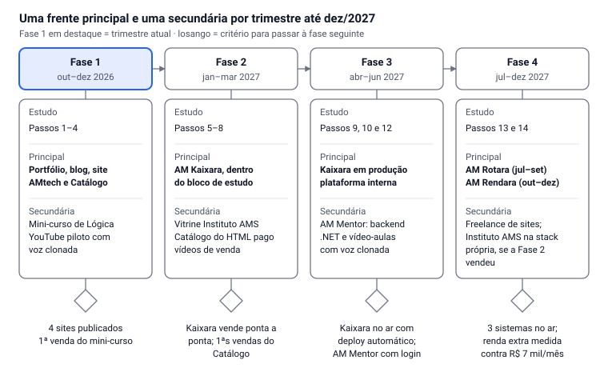
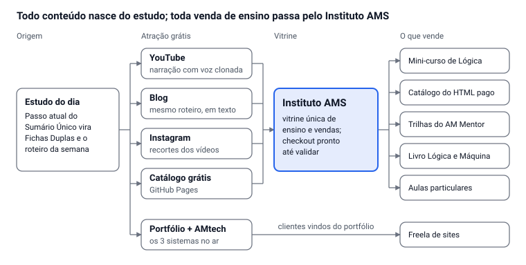

# Plano de Prioridades — Out/2026 a Dez/2027

Oct 5, 2026 · @Alan Mateus

## Resumo

O estudo segue o Sumário Único todos os dias, e os três projetos de portfólio são construídos dentro dele. Fora do estudo, cada trimestre tem uma frente principal e uma secundária; todo o resto espera na fila.

**Três regras que valem para o plano inteiro**

- **Estudo é a espinha dorsal.** O que fazer agora é sempre o próximo Passo não marcado do Sumário Único.
- **No máximo 1 principal + 1 secundária por fase** — a regra de foco do seu próprio vault.
- **Validar antes de construir.** Vende primeiro com o mínimo (checkout de plataforma pronta); sistema próprio de venda só depois que vender.

**Ordem de conclusão**

1. Presença digital fechada e no ar — portfólio, blog, site da AMtech e Catálogo gratuito (dez/2026)
2. Primeiro infoproduto vendendo: mini-curso de Lógica (dez/2026)
3. Catálogo do HTML pago, vendido pela vitrine do Instituto AMS (mar/2027)
4. AM Kaixara em produção — Passo 10 (abr–jun/2027)
5. AM Mentor com backend .NET e vídeo-aulas (jun/2027)
6. AM Rotara — Passo 13 (set/2027)
7. AM Rendara — Passo 14 (dez/2027)

O livro *Lógica e Máquina* e o canal no YouTube não entram nessa fila: rodam como hábitos contínuos, alimentados pelo próprio estudo.

## O tempo que você realmente tem

Com os dois empregos, sobram cerca de 24 h de estudo e 10 h de produção por semana. É por isso que só cabe uma frente secundária por vez.

| Dia | Estudo (Sumário Único) | Produção (frentes fora do estudo) |
| --- | --- | --- |
| Segunda | 6h–10h | Noite, \~3 h (sem restaurante) |
| Terça | — (escola + restaurante) | — |
| Quarta | 6h–10h | — |
| Quinta | 6h–10h | Tarde, \~4 h (sem escola) |
| Sexta | 7h–11h | — |
| Sábado | 6h–10h | 11h–14h, \~1,5 h |
| Domingo | 6h–10h | 11h–14h, \~1,5 h |

- **Estudo (\~24 h):** inclui o "Desenvolver" de cada Passo — ou seja, Kaixara, Rotara e Rendara já estão aqui dentro e não competem com o resto.
- **Produção (\~10 h):** vai para a frente fora do estudo da fase e para o conteúdo semanal (vídeo + post).
- **Terça é dia de descanso do plano:** só Anki, se der. Os "4 h por dia" são, na prática, 6 dias.

## Espinha dorsal: os Passos do Sumário Único

A ordem dos estudos é exatamente a do `00-SUMARIO-UNICO-SEQUENCIA-DE-ESTUDO.md`, sem mudança. As janelas abaixo são estimativas a partir das durações do vault; ajuste pelo tempo real que você registrar no Protocolo de Fim de Bloco.

| Passo | Conteúdo | Projeto que avança | Janela estimada |
| --- | --- | --- | --- |
| 1 | Lógica + Matemática cap. 1–2 + Inglês A | 3 exercícios (carrinho, inadimplência, ARCA) | out/2026 (em andamento) |
| 2 | Git, SQL/PostgreSQL, Docker | Schema do Kaixara + aura-licensing | out–nov/2026 |
| 3 | C# fundamentos + Matemática cap. 3 | Entidades do Kaixara + Euclides | nov/2026 |
| 4 | API, JWT, OWASP + Matemática cap. 4 + Inglês B | Login, RLS, tela de login do Kaixara | nov–dez/2026 |
| 5 | EF Core + Matemática cap. 5–8 | CRUD molde + reserva de estoque | dez/2026–jan/2027 |
| 6 | Testes, TDD, Playwright | Testes do fluxo de venda | jan/2027 |
| 7 | Pagamento e cobrança | Kaixara com venda ponta a ponta | fev/2027 |
| 8 | SOLID, patterns, Clean Architecture | Refatoração do Kaixara | fev–mar/2027 |
| 9 | PostGIS, Redis, SignalR + Matemática cap. 13 e 17 + Inglês C | Cache + dashboard em tempo real | mar/2027 |
| 10 | Docker multi-stage, deploy, CI/CD, observabilidade | **Kaixara no ar** | abr/2027 |
| 12 | Template, NuGet, plataforma interna + Espanhol A | Fundação reutilizável extraída do Kaixara | mai–jun/2027 |
| 13 | Geometria analítica, Python + OR-Tools, Combinatória | **AM Rotara** | jul–set/2027 |
| 14 | Terceiro sistema | **AM Rendara** | out–dez/2027 |

- **Passo 11** (performance com dado real) só faz sentido depois de meses do Kaixara em produção; ele roda junto do Passo 13 ou 14, sem bloquear.
- **Depois do Passo 8** destravam a Trilha 42 e Pentest/OSCP, cerca de 2 h por semana dentro do bloco de estudo, respeitando o gate de Linux.
- **Física básica** segue em paralelo desde o Passo 1, mas só ganha estrutura real quando você comprar o livro.

## As quatro fases

Cada trimestre fecha um critério antes de abrir o próximo; os projetos de portfólio são a principal a partir da Fase 2, porque já estão dentro do estudo.

Na Fase 1 a principal fica fora do estudo (os sites) porque os Passos 1–4 ainda não produzem um sistema para mostrar.

## Como as frentes se conectam

O estudo gera o conteúdo, o conteúdo grátis atrai, e o Instituto AMS é a única vitrine onde os produtos de ensino são vendidos.

- **Instituto AMS é a vitrine, não um sistema novo agora.** Na Fase 2 ele é uma página que apresenta os cursos e leva ao checkout de uma plataforma de infoproduto. Catálogo do HTML e AM Mentor viram cursos dentro dele, cada um com o seu design.
- **Catálogo do HTML** mantém as duas camadas que você já decidiu: versão grátis no GitHub Pages (atração) e versão completa paga, com os 12 projetos AM. O preço de \~R$ 300 é o que a Fase 2 testa.
- **AM Mentor** continua só para uso próprio até a Fase 3; quando ganhar login, as trilhas (livro, Aura, 42) viram produto.
- **Mini-curso de Lógica** sai do Passo 1, que você está estudando agora — o mesmo conteúdo, gravado.
- **Portfólio e site AMtech** levam a freela de sites, por fora da vitrine de ensino.

**Vídeos com voz clonada — fluxo de produção**

1. O roteiro sai da Ficha Dupla do Passo da semana.
2. Grave uma vez uma amostra limpa da sua voz (bom microfone, ambiente silencioso) para treinar o clone.
3. Gere a narração e revise a pronúncia dos termos técnicos em inglês.
4. Monte tela, código ou animação sobre a narração — a integração com Manim do AM Mentor já serve.
5. Publique o vídeo completo no YouTube, os recortes no Instagram e o texto no blog.

Três cuidados: use só a sua própria voz; confirme que o plano da ferramenta permite uso comercial, porque vídeos de venda e cursos pagos são uso comercial; e sinalize o conteúdo como sintético quando a plataforma exigir (o YouTube tem regra de divulgação para conteúdo realista gerado por IA — confira a versão atual ao publicar). Antes de produzir em série, faça um piloto e compare a retenção com um vídeo na sua voz real.

## Hábitos contínuos

Livro e conteúdo não ganham fase própria: eles saem do que você já produz estudando, com pouco tempo extra.

- **Uma peça de conteúdo por semana, três formatos.** O tema do Passo da semana vira um roteiro, que vira um vídeo no YouTube, um post no blog e recortes para o Instagram. Substitui "1 post por semana" e "vídeos" como duas tarefas separadas.
- **Livro *Lógica e Máquina*, uma sessão por quinzena.** As Fichas Duplas do protocolo de cada Passo viram seções do Volume 1A, que cobre justamente os Passos 1–8. Sem prazo de término, como você já decidiu.
- **Do Sumário Único, sem mudança:** Anki diário, um conteúdo do Akita por semana, roadmap.sh no início dos Passos 3, 8, 9 e 10, e o `aura-status` toda segunda.

## Fila congelada de propósito

Nada aqui foi cancelado; só não recebe tempo até 2028 ou até o gatilho indicado.

| Item | Volta quando |
| --- | --- |
| Os outros 9 sistemas AM (Predara, Canteira, Consertta, Horaria, Saberia, Petara, Vendra, Vynla, Projeta) | Passo 14 em diante, um por vez |
| AM Taskoro | 2–3 sistemas em produção e Trilha 42 avançada (gatilho do Sumário) |
| Instituto AMS completo na stack própria | Fase 4, e só se as vendas da Fase 2 existirem |
| ByteSDCoin | Fica só como atividade de sala até dezembro |
| Concurso PF/PRF e TAF | Você não citou nesta priorização — ver Pontos de atenção |
| Certificações (A+ ao OSCP) | Seguem o gate Linux da trilha de Pentest, depois do Passo 8 |
| AM-OS e AM Linux | Plano de \~10 anos, sem data |
| Mandarim, desenho, violão | 2028+ |
| Decisão do `aura-historico` (Clojure vs. Marten) | Quando chegar a vez dele |

## Pontos de atenção

- **"Concluir a presença digital de uma vez" só fecha em dezembro se for dividido em dois.** Os frontends já construídos vão ao ar agora. O que depende da sua API própria (admin, comentários, newsletter) só liga depois dos Passos 4–5 e do deploy do Passo 10. Sem essa divisão, "concluir" vira meses.
- **O vault se contradiz na ordem Rotara × Rendara.** A tabela de fases dele põe Rendara antes; os Passos põem Rotara no 13 e Rendara no 14. Como você pediu para seguir a sequência de estudo, segui os Passos.
- **A Fase 1 do vault tinha o ByteSDCoin como principal.** Troquei pela presença digital, como você priorizou. Mas outubro a dezembro já tem revisão de fim de ano, formatura da sua primeira turma e o ByteSDCoin em sala. Se apertar, corte a secundária, nunca o estudo.
- **Não construa login, planos e pagamento próprios antes de vender.** Está no seu plano do Catálogo, mas contradiz a sua regra de validar antes de construir. Venda primeiro por checkout pronto; o sistema próprio entra na Fase 4 se houver vendas.
- **Duas metas de renda diferentes.** O replanejamento fala em R$ 7 mil líquidos/mês; os planos de infoprodutos e do Catálogo falam em R$ 10 mil. Este plano usa R$ 7 mil como meta de 2027.
- **Concurso PF/PRF e TAF ficaram de fora desta lista.** Antes eram "extra" com tempo reduzido. Decida se congelam de vez ou se mantêm um mínimo — nesta agenda, não sobra espaço para os dois além do que está aqui.
- **As janelas são estimativas.** Ao fim de cada fase, compare com o tempo real registrado e empurre as datas, não o foco.
