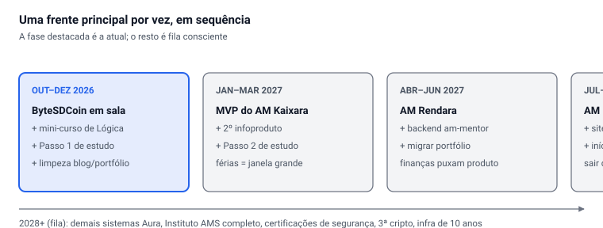

# Plano-Mestre — Alan

Sep 27, 2026 · @Alan Mateus

Única fonte de verdade da ordem e das tarefas ativas. Consolida o cronograma por fases, a grade semanal e as trilhas. Aponta para os documentos detalhados por área.

## Como usar este mestre

Quando bater a dúvida "o que eu faço agora?", abra aqui. Este documento manda; os outros são o detalhe.

- **Aposta dos 12 meses:** vaga de dev + renda própria (infoprodutos, freela, aulas). Concurso PF/PRF segue em ritmo leve de manutenção, sem sumir. Tudo é ordenado por essa aposta.
- **Regra de foco (a mais importante):** no máximo **1 projeto principal + 1 secundário** por fase. O resto fica numa fila, pausado de propósito, com data para voltar. Com TDAH, esse limite é o que impede abrir 10 frentes e não fechar nenhuma.
- **Sobreposição:** sempre que possível, um mesmo esforço serve a vários objetivos. Ex.: estudar Lógica alimenta ao mesmo tempo o mini-curso, o post do blog e o capítulo do livro. Estude uma vez, produza várias.
- **Este mestre não substitui os documentos por área.** Ele dá a ordem e as tarefas ativas, e aponta para onde está o detalhe.
- **Pendência aberta:** reorganizar o repositório de estudos (você vai me passar o endereço).

## A ordem, por fases

Esta é a sequência que você já tinha definido, agora com as trilhas de hoje encaixadas. A regra: uma frente principal por vez, o resto espera.

Os critérios da ordem: prazo real (fim do ano letivo primeiro), dinheiro (renda o quanto antes) e o que destrava outros projetos (o AM Kaixara vem cedo porque constrói blocos de frontend que os outros sistemas reusam).

## Fase 1 detalhada (out–dez 2026)

A fase atual. Só o que está aqui é para agora; o resto espera.

**Principal — fechar o ano letivo:**

- [ ] ByteSDCoin em sala (versão didática) com a primeira turma de EMTI
- [ ] Revisão de fim de ano dos alunos

**Secundário — primeira renda:**

- [ ] Mini-curso de Lógica de Programação (nasce do seu próprio Passo 1 de estudo)
- [ ] Vender primeiro por plataforma pronta (ex.: Hotmart); plataforma própria depois
- [ ] Instagram como canal

**Estudo (blocos de stack + matemática):**

- [ ] Passo 1: Lógica (variável, condicional, laço, função, coleção) + Matemática cap. 1–2 + Inglês Fase A
- [ ] Pronto quando resolver os 3 exercícios de lógica sem travar
- [ ] Em paralelo, nas horas livres: OverTheWire Bandit (entrada da trilha de segurança)

**Pequeno (baixo esforço, alto valor):**

- [ ] Limpeza do blog e do portfólio (só remover e migrar páginas)
- [ ] Criar o repositório `AlanMateus17/dotfiles` vazio, para receber evidências

**A sobreposição desta fase:** Lógica de Programação é o tema que alimenta ao mesmo tempo o estudo, o mini-curso, o post do blog e o capítulo do livro. Um esforço, quatro saídas.

## Grade semanal atual

Acordar 6h. Restaurante terça a domingo. Escola seg/ter/qua à tarde, ter de manhã, sex a partir de 12h55; quinta sem escola. Esta é a versão com stack priorizada.

| Dia | Blocos |
| --- | --- |
| Segunda | 08–09 TAF · 09h30–11h30 stack+matemática · 13–17 escola · 19–21h30 projeto principal |
| Terça | 07–17 escola · 17–22 restaurante |
| Quarta | 08–11 stack+matemática · 13–17 escola · 17–23 restaurante |
| Quinta | 08–09 natação · 09h30–11 concurso · 12h30–14h30 projeto principal · 15–16 stack+matemática · 17–23 restaurante |
| Sexta | 08–09 TAF · 09–11 stack+matemática · 11–12 planejamento de aulas · 12h55–23 escola e restaurante |
| Sábado | 08–09h30 concurso · 10–11h30 stack+matemática · 12h30–14 blog e mini-curso · 15–23 restaurante |
| Domingo | 07–10h30 pedal · 12–13h30 planejamento de aulas · 13h30–14 revisão semanal · 15–23 restaurante |

**Totais/semana:** stack+matemática \~9h30, projeto principal \~4h30, concurso 3h, blog e mini-curso 1h30, planejamento 2h30. Físico: 2 TAF, 1 natação, 1 pedal.

**Regra dinâmica:** quando sair edital do PF/PRF, os blocos de projeto de segunda e quinta viram concurso até a prova. Matemática é estudada junto com programação (estuda o tópico no livro, implementa em C#).

**Custo honesto:** saindo do restaurante às 23h e acordando 6h, são \~6h de sono em 5 noites. Se o rendimento cair, o corte é no bloco da manhã, não no sono; um cochilo de 20 min após o almoço ajuda.

## As trilhas técnicas

Três trilhas criadas em detalhe (cada uma com fases, tarefas e evidências). Elas se entrelaçam; a de segurança só avança com o gate da de Linux fechado.

1. **Linux/Arch** — base de tudo; 10 fases, do fundamento ao currículo, com o projeto autoral aura-status na Waybar
2. **Redes** — 6 fases; faça cedo, destrava segurança e homelab
3. **Cibersegurança e Pentest** — mentalidade dos atacantes + 8 fases com gates

**Ordem entrelaçada:** Linux F1 + Segurança S1 juntas → Redes → Linux F2 abre S2 → Linux F3–4 abre S3 (testar o Aura, maior retorno) → Linux F5–6 abre S4 → Linux F8 abre S5 → S6 (Windows/AD) → S7 → S8.

Estas trilhas são de médio prazo. Na Fase 1 do roadmap, o que roda delas é só o começo: fundamentos de Linux e o Bandit, nas horas livres. O grosso entra a partir de 2027, quando a stack já estiver firme.

## Mapa das frentes por área

Onde vive cada plano detalhado. Este mestre dá a ordem; abra a área quando for executar aquela fase.

| Área | O que é | Quando entra |
| --- | --- | --- |
| Ecossistema Aura | 20+ sistemas (.NET); AM Kaixara, Rendara, Rotara, AgileFlow, AuraArquiteto e outros | Kaixara na Fase 2; demais em fila a partir de 2027 |
| Infoprodutos | Cursos, código-fonte, templates nos 3 nichos (TI, Matemática, Finanças) | Mini-curso na Fase 1; escala depois |
| Sites | Portfólio, blog, Instituto AMS, institucional AMtech | Limpeza na Fase 1; migração na Fase 3; Instituto completo em fila |
| Livro "Lógica e Máquina" | Livro didático de TI em 5 volumes | Capítulos saem do estudo; sem prazo próprio agora |
| Ensino EMTI | Aulas, ByteSDCoin em sala, avaliações | Contínuo; principal da Fase 1 |
| Estudo (plano-mestre) | Programação, matemática, C/C++ (École 42), idiomas | Contínuo, nos blocos da grade |
| Concurso PF/PRF | Estudo + TAF | Manutenção leve; sobe quando sair edital |
| Infraestrutura pessoal | Plano de 10 anos (workstation, NAS, homelab) | Fila; o homelab conversa com a trilha Linux |

**Sobre o Aura:** honestamente, 20+ sistemas com uma pessoa levam anos. A regra de validar antes de construir (planilha antes do sistema) vale para todos: só constrói o grande se o pequeno vender.

## Marcado para revisar (você decide o corte)

Você pediu para deixar só o que realmente vai estudar e executar. Eu **não** removi nada por conta própria. Abaixo está o que parece obsoleto, reduzido ou em conflito. Marque a caixa do que confirmar que sai, e eu atualizo.

- [ ] **Mandarim** — seu próprio plano de idiomas o coloca só depois de inglês B2 + espanhol B1, o que é anos. Sugestão: tirar do radar ativo e deixar como sonho de longo prazo.
- [ ] **Desenho e violão** — têm planos detalhados, mas competem com a aposta dos 12 meses e não têm hora na grade. Sugestão: pausar formalmente, com data para reconsiderar.
- [ ] **Matemática como bloco isolado** — você já decidiu estudá-la junto com programação. Confirmar que não existe mais um bloco separado de matemática.
- [ ] **Lógica no plano de estudo** — você é formado em ADS e dá aula disso; ela já vive no mini-curso e no blog. Confirmar que sai do plano como item de *estudo*.
- [ ] **Concurso PF/PRF em ritmo forte** — rebaixado para manutenção leve pela sua escolha de priorizar dev+renda. Confirmar que fica assim até sair edital.
- [ ] **TAF em evolução** — hoje são 2 treinos/semana, o que é manutenção, não evolução. Confirmar que está ok manter em manutenção.
- [ ] **Sistemas Aura além dos 3 primeiros** (Kaixara, Rendara, Rotara) — confirmar que todos os outros ficam em fila para 2028+, sem tocá-los antes.

**Conflito que preciso que você resolva:** em conversas diferentes apareceram grades semanais com totais distintos de horas (uma com \~11h de stack, outra com \~9h30 após você priorizar stack e reduzir concurso/TAF). Usei a mais recente aqui. Confirme se é essa que vale.

## Esta semana

Só isto. Nada do resto do documento importa até estes estarem andando.

- [ ] **Estudo:** Passo 1 — Lógica + Matemática cap. 1–2 + Inglês Fase A
- [ ] **Aula:** avançar o ByteSDCoin didático com a turma (principal da fase)
- [ ] **Produto:** esboçar só o índice do mini-curso de Lógica, aproveitando o que estudar
- [ ] **Hacker:** começar o OverTheWire Bandit nas horas livres
- [ ] **Base:** criar o repositório dotfiles vazio
- [ ] **Pendência:** me mandar o endereço do repositório de estudos + confirmar os cortes acima

Uma coisa de cada vez. Terminou? Volte ao topo e pegue o próximo item da Fase 1.

---

<!-- conexoes:inicio -->
## 🔗 Onde isto entra no plano

- [🧭 Plano Mestre — tudo em um só passo a passo](../PLANO-UNICO-AMtech.md)
- [🎯 Plano Unificado AMS — O Mapa de Tudo](../PLANO-UNICO-AMtech.md)
- [Plano Mestre — Frentes de Estudo, Negócio e Renda](../../01-planejamento-geral/plano-mestre-frentes-alan.md)
- [Status de Planejamento do Portfólio — o que já existe, o que falta, e o que se reaproveita de onde](../../01-planejamento-geral/status-planejamento-portfolio.md)

🗂️ Voltar ao [índice dos artefatos](../00-INDICE-DOS-ARTEFATOS.md) · [mapa de conexões](../01-MAPA-DE-CONEXOES.md)
<!-- conexoes:fim -->
