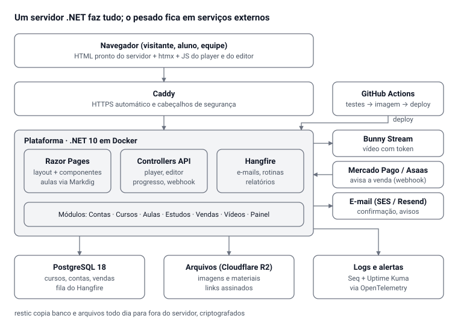

# Plataforma de cursos — Stack profissional

Oct 6, 2026 · @Alan Mateus

## Resumo

**Decisão:** um monólito modular em **.NET 10** que monta as páginas no servidor (**Razor Pages**) e expõe uma API com **Controllers**, sobre **PostgreSQL 18**. Uma linguagem principal (C#), um servidor, um banco, um deploy.

Princípios que decidem cada escolha abaixo:

- **Tamanho certo para quem mantém.** Uma pessoa cuida de tudo; cada peça nova precisa pagar o próprio custo.
- **Mesma base da stack Aura:** .NET 10, Controllers, Clean Architecture, PostgreSQL, Docker e GitHub Actions. O que você aprende aqui serve nos outros sistemas, e vice-versa.
- **Três desvios conscientes**, registrados como ADR: Razor Pages no lugar de Next.js, CSS próprio no lugar de Tailwind e nada de Redis por enquanto. A seção "O que não usar agora" explica cada um.
- **O servidor decide o acesso.** Páginas, gabaritos e vídeos só saem depois de o servidor conferir quem pede. Isso já é assim e continua.
- **Pronto para crescer sem reescrever.** `escola_id` + Row-Level Security, o padrão Aura, desde o primeiro dia, porque a plataforma será vendida para outras escolas (ver a especificação funcional).

## Stack completa

São 37 camadas: 6 já estão certas hoje (algumas ganham um complemento); as outras 31 são troca ou acréscimo. A coluna **Hoje → ação** compara com o que existe no projeto agora.

| Camada | Tecnologia | Por quê | Hoje → ação |
| --- | --- | --- | --- |
| Linguagem e runtime | C# + **.NET 10 LTS** (suporte até 14/11/2028) | O .NET 11 sai em nov/2026, mas é STS (suporte curto). Fique no 10 | Mantém |
| Páginas | **ASP.NET Core Razor Pages** com `_Layout` e componentes | Cabeçalho, rodapé e botões escritos uma vez; página pronta para o Google | Troca (HTML estático + gerador) |
| API | **ASP.NET Core Controllers** | Seu padrão; serve o player, o editor e um app futuro | Mantém |
| Interatividade | **htmx 2** + JavaScript em módulos ES | htmx troca trechos da página sem recarregar (enviar dúvida, marcar aula). Player e editor seguem em JS puro | Adiciona htmx |
| Tipagem do JS | `// @ts-check` + JSDoc, conferido pelo TypeScript | Erros de tipo apanhados sem etapa de build | Adiciona |
| CSS | CSS moderno próprio: tokens em variáveis, `@layer`, container queries | O site é exemplo para os alunos de CSS | Organiza |
| Arquivos estáticos | `MapStaticAssets` do ASP.NET | Compressão e nome com impressão digital: cache eterno sem arquivo velho | Adiciona |
| Aulas em Markdown | **Markdig** (C#) + HybridCache | Renderiza a aula do banco na hora; acaba o Python no servidor | Troca (`gerar-aulas.py`) |
| Acesso a dados | **EF Core 10** (Npgsql) para escrita; **Dapper** para relatórios | EF Core é o padrão do mercado .NET e cai em entrevista; Dapper onde o SQL precisa ser fino | Troca (Npgsql direto) |
| Migrações | **EF Core Migrations**, aplicadas no deploy | Histórico do banco versionado junto com o código | Troca (scripts SQL próprios) |
| Banco | **PostgreSQL 18** | Versão estável atual (18.6). O 19 está em beta | Troca (16 → 18) |
| Busca | Full-text do PostgreSQL (português + `unaccent`) | Busca nas aulas sem outro servidor | Adiciona |
| Contas | **ASP.NET Core Identity**: cookie, 2FA (TOTP) e **passkeys** | Passkeys = entrar com digital ou rosto, sem senha | Mantém + passkeys |
| Validação | **FluentValidation** | Regras de formulário num lugar só, testáveis | Adiciona |
| Cache | **HybridCache** em memória | Redis só com 2+ servidores, sem mudar o código | Adiciona |
| Tarefas em segundo plano | **Hangfire** guardado no PostgreSQL | E-mails, rotinas e relatórios com nova tentativa e painel | Adiciona |
| E-mail | **MailKit** + SMTP de provedor (Amazon SES, Resend ou Brevo) com SPF, DKIM e DMARC | Sem isso o e-mail cai no spam | Troca (arquivo local) |
| Pagamento | **Asaas (decidido)**, atrás de `IGatewayPagamento` | Pix, cartão, boleto e divisão de pagamento para instrutores no futuro | Mantém webhook + gateway real |
| Vídeo | **Bunny Stream** + envio TUS pelo Painel | Streaming adaptativo, token e CDN no Brasil | Mantém |
| Arquivos e materiais | Armazenamento S3: **Cloudflare R2** ou Bunny Storage, com links assinados | Arquivos fora do servidor; material pago protegido | Troca (volume local) |
| Logs | **Serilog** estruturado + **OpenTelemetry** → **Seq** (instalado no servidor) | Achar erro por aluno, rota ou requisição | Adiciona |
| Disponibilidade | Health checks + **Uptime Kuma** (instalado no servidor) | Aviso no celular quando o site cair | Adiciona |
| Ambiente local | **Aspire** + **Mailpit** | Um comando sobe banco, sistema e uma caixa de e-mail de teste no navegador | Adiciona |
| Testes | **xUnit v3**, WebApplicationFactory, **Testcontainers** (PostgreSQL real), **Playwright .NET** + axe-core | Tudo em C#; os testes em Python migram aos poucos | Troca gradual |
| CI/CD | **GitHub Actions** → imagem no **GHCR** → deploy por SSH; Dependabot e CodeQL | Nada vai ao ar sem testes verdes | Adiciona |
| Servidor | VPS + **Docker Compose** + **Caddy** (HTTPS) | Simples e barato para um servidor | Mantém |
| Backup | `pg_dump` diário + **restic** criptografado para R2 ou Backblaze B2 | Cópia fora do servidor; restauração ensaiada todo mês | Troca (só local) |
| Métricas de visita | **Umami** (instalado no servidor) | Sem cookies: não precisa de aviso LGPD | Adiciona |
| Documentação | ADRs em `docs/adr` + MkDocs | Cada decisão grande registrada com o motivo | Adiciona |
| Domínios dos clientes | Caddy on-demand TLS | Certificado HTTPS emitido sozinho para cada domínio confirmado pelo sistema | Adiciona |
| Integrações resilientes | Microsoft.Extensions.Http.Resilience | Repetir e cortar chamadas lentas ao Asaas e ao Bunny | Adiciona |
| Armazenamento S3 | AWSSDK.S3 apontando para o R2 | Envio e links assinados de arquivos | Adiciona |
| Envio retomável de vídeo | tus-js-client (protocolo TUS do Bunny) | Vídeo grande continua de onde parou se a internet cair | Adiciona |
| Antivírus de arquivos | ClamAV em contêiner | Entregas e materiais de muitos professores e alunos | Adiciona (R3) |
| PDF do certificado | QuestPDF (conferir a licença para o faturamento da empresa) | Certificado gerado no servidor com o modelo da escola | Adiciona |
| Editor e fórmulas | SortableJS (arrastar) + KaTeX (fórmulas) | Bibliotecas pequenas, sem etapa de build | Adiciona |
| Licença do servidor exclusivo | Assinatura ECDSA com System.Security.Cryptography | Recursos e validade conferidos sem internet, sem biblioteca extra | Adiciona (R3) |

Tudo acima é gratuito ou código aberto, exceto o que se paga por uso: e-mail, Bunny, R2 e o gateway (por venda).

## Arquitetura alvo



O sistema monta as páginas, responde a API e roda as tarefas no mesmo processo. O que é pesado ou regulado (vídeo, pagamento, entrega de e-mail) fica com quem faz só isso.

## Organização do código

Clean Architecture com quatro projetos, como na stack Aura. Dentro de cada projeto, uma pasta por módulo: **Contas, Cursos, Aulas, Estudos, Vendas, Vídeos, Painel**. Quem mexe em vendas abre só as pastas `Vendas`.

```
plataforma/
├─ src/
│  ├─ Plataforma.Dominio/          entidades e regras: Curso, Modulo, Licao, Matricula, Plano
│  ├─ Plataforma.Aplicacao/        casos de uso por módulo (Cursos/, Vendas/...), validações
│  ├─ Plataforma.Infraestrutura/   EF Core, Dapper, e-mail, Bunny, gateway, R2, Hangfire
│  └─ Plataforma.Web/
│     ├─ Pages/
│     │  ├─ Shared/_Layout.cshtml   cabeçalho e rodapé: UMA vez só
│     │  ├─ Shared/Components/      Menu, BotaoComprar, CardCurso, AvisoPlano
│     │  ├─ Cursos/                 vitrine e página de cada curso
│     │  ├─ Aulas/Aula.cshtml       /cursos/{curso}/{modulo}/{aula}
│     │  ├─ Conta/  Painel/  Planos/
│     ├─ Controllers/Api/           JSON para player, editor e progresso
│     └─ wwwroot/css  wwwroot/js
├─ tests/
│  ├─ Plataforma.Testes.Unidade/
│  ├─ Plataforma.Testes.Integracao/  PostgreSQL real via Testcontainers
│  └─ Plataforma.Testes.E2E/         Playwright
├─ aspire/Plataforma.AppHost/        ambiente local com um comando
├─ deploy/                           compose, Caddyfile, scripts
└─ docs/adr/                         decisões registradas
```

Convenções:

- **Domínio em português**, como já está; nomes técnicos do framework ficam em inglês.
- **A dependência só aponta para dentro**: Web → Aplicação → Domínio. Um teste de arquitetura (NetArchTest) quebra o build se o Domínio citar a Infraestrutura.
- **Analisadores + `.editorconfig` com avisos tratados como erro**: nomes fora do PascalCase (`CreatedAT`, `UTCNow`) param o build antes de chegar ao Git.
- **`Directory.Build.props` e gestão central de pacotes**: versão do .NET, `nullable` ligado e versões dos pacotes num só arquivo.
- **Um endereço por conteúdo**: as URLs antigas (`aula-1-01-....html`) redirecionam com 301 para as novas, sem perder links nem Google.

Honestamente: quatro projetos é mais cerimônia do que este tamanho exige. Vale por ser o seu padrão e por ser o que as vagas pedem.

## Boas práticas

Cada item abaixo vira uma regra que o CI confere sozinho sempre que der; o que depende só de disciplina tende a ser esquecido.

| Área | Prática | Como garantir |
| --- | --- | --- |
| Git | Trunk-based: branches curtas, PR até trabalhando sozinho, Conventional Commits, tags de versão (v1.4.0) | Branch `main` protegida: só entra com CI verde |
| Testes | Muitos de unidade, vários de integração, poucos E2E. Todo bug corrigido ganha um teste | CI roda tudo a cada PR |
| Banco | Toda mudança por migração; nada de mexer à mão em produção. Usuário do banco sem permissão de apagar tabelas | Migração aplicada pelo pipeline |
| Segredos | Nada no código: `.env` no servidor, GitHub Secrets no CI | Secret scanning do GitHub ligado |
| Segurança | Manter o que existe (CSP, anti-CSRF, cookies `__Host-`, limites por rota, 2FA na equipe). Webhook com assinatura conferida e processado uma vez só. Referência: OWASP ASVS nível 2 | Dependabot + CodeQL; teste automatizado para cada regra |
| Dependências | Poucas, conhecidas e atualizadas toda semana | Dependabot abre o PR; o CI aprova ou recusa |
| Observabilidade | Logs estruturados com o id da requisição; `/saude` para o monitor; alerta quando o site cai ou o erro dispara | Seq + Uptime Kuma |
| Desempenho | Metas do Google (Core Web Vitals): LCP abaixo de 2,5 s, INP abaixo de 200 ms, CLS abaixo de 0,1. Cache de saída nas páginas públicas | Lighthouse no CI |
| Acessibilidade | WCAG 2.2 nível AA | axe-core nos testes Playwright |
| Dados e LGPD | Backup 3-2-1 (3 cópias, 2 mídias, 1 fora do servidor), restauração ensaiada, exportação e exclusão pelo aluno | Lembrete mensal + script de restauração testado |
| Decisões | Cada escolha grande vira um ADR curto: contexto, decisão, consequências | Pasta `docs/adr`, revisada no PR |

Primeiros ADRs a escrever: **001** Razor Pages em vez de Next.js · **002** CSS próprio em vez de Tailwind · **003** sem Redis enquanto houver um servidor · **004** EF Core + Dapper.

## O que não usar agora

Nenhuma destas é ruim. Para este sistema, hoje, cada uma custa mais do que entrega.

| Tecnologia | Por que não agora | Quando reconsiderar |
| --- | --- | --- |
| **Next.js / React** (padrão Aura) | Seria um segundo servidor (Node) repetindo login e regras de acesso que o .NET já faz. Razor já entrega página pronta para o Google | Editor colaborativo em tempo real ou app de celular. A API com Controllers já serve os dois |
| **Tailwind** | O site é material de aula de CSS; classes utilitárias esconderiam o CSS que você ensina | Se outra pessoa passar a cuidar do visual |
| **Redis** | Com um servidor, a memória local faz o mesmo papel sem outra peça | Segundo servidor: o HybridCache liga o Redis sem mudar o código |
| **Microsserviços, Kubernetes** | Muitas peças e deploys para uma pessoa cuidar | Equipe com vários times |
| **Blazor interativo** (Server ou WebAssembly) | Server mantém uma conexão aberta por aluno; WebAssembly faz o aluno baixar megabytes antes de ver a aula | Ferramenta interna rica no Painel |
| **SignalR** | Nada precisa de tempo real hoje | Aulas ao vivo ou notificação instantânea de resposta à dúvida |
| **Elasticsearch / Meilisearch** | O full-text do PostgreSQL dá conta de milhares de aulas | Busca com erros de digitação em muitos cursos |
| **MongoDB** | Cursos, matrículas e pagamentos são dados relacionais | — |
| **PostgreSQL 19** | Ainda em beta (Beta 4, 24/09/2026) | Alguns meses após o lançamento, a partir do 19.1 |
| **.NET 11** | STS: suporte mais curto que o .NET 10 LTS | Pule; vá do 10 direto para o 12 (próximo LTS) |

## Plano de migração

Cinco fases, cada uma termina com o sistema funcionando e testado. Em paralelo, continue escrevendo os módulos 2 e 3: as aulas são Markdown no banco e passam intactas por todas as fases.

**Fase 0 — Base**

- [ ] Criar a solução com os 4 projetos, `Directory.Build.props`, analisadores e `.editorconfig`
- [ ] Aspire + Mailpit: um comando sobe tudo e os e-mails aparecem no navegador
- [ ] GitHub Actions: build e testes a cada PR; `main` protegida
- [ ] Escrever os ADRs 001 a 004

**Fase 1 — Dados**

- [ ] Subir para PostgreSQL 18 (dump e restore)
- [ ] Mapear as tabelas atuais no EF Core e criar a migração inicial a partir delas
- [ ] Testes de integração com Testcontainers cobrindo contas, acesso e vendas

**Fase 2 — Páginas**

- [ ] `_Layout` e componentes (menu, rodapé, botão de compra, aviso de plano)
- [ ] Migrar as páginas fixas para Razor; redirecionar as URLs antigas com 301
- [ ] Aulas renderizadas do banco com Markdig + cache
- [ ] Remover `gerar-aulas.py`, a pasta de gerações, o `ProvedorSite` e a cópia duplicada do site
- [ ] Portar os testes de tela para Playwright .NET

**Fase 3 — Vários cursos**

- [ ] Entidade `Curso` e `curso_id` em módulos, matrículas, planos e certificados
- [ ] Vitrine de cursos e acesso por curso
- [ ] Convite para criar conta no fim das aulas grátis; volta para a aula depois da compra

**Fase 4 — Produção**

- [ ] SMTP real com SPF, DKIM e DMARC; gateway real com compra de teste
- [ ] Arquivos no R2; backup com restic fora do servidor e uma restauração ensaiada
- [ ] Seq, Uptime Kuma e deploy automático pelo Actions

**Depois do lançamento**

- [ ] Hangfire com e-mails automáticos (boas-vindas, aluno parado)
- [ ] Busca, Umami, SEO (sitemap, Open Graph, dados de curso)
- [ ] Passkeys
- [ ] Instrutores convidados, se a validação com professores der certo

## Fontes

- [PostgreSQL — versões suportadas e 19 Beta 4](https://www.postgresql.org/)
- [.NET — política de suporte (LTS e STS)](https://dotnet.microsoft.com/en-us/platform/support/policy/dotnet-core)

---

<!-- conexoes:inicio -->
## 🔗 Onde isto entra no plano

- [AM Saberia — Documento de Projeto Final (Nome provisório)](../../02-sistemas-de-negocio/saberia-documento-projeto-final.md)

🗂️ Voltar ao [índice dos artefatos](../00-INDICE-DOS-ARTEFATOS.md) · [mapa de conexões](../01-MAPA-DE-CONEXOES.md)
<!-- conexoes:fim -->
