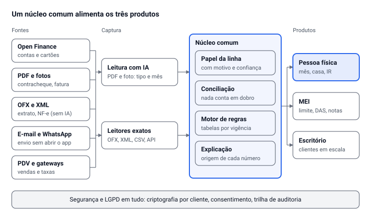
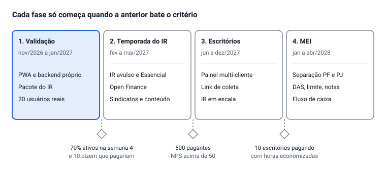

# Plataforma financeira, contábil e tributária: análise completa

Oct 17, 2026 · @Alan Mateus

## Resumo executivo

A visão é boa e o mercado existe. Mas "all-in-one para pessoa física, empresário e contador" é, como está escrito, três empresas diferentes. Tentar as três no primeiro ano é o motivo mais provável de o projeto não chegar a lugar nenhum. A recomendação é **um núcleo comum, uma entrada de mercado e uma promessa**:

- **Núcleo comum (o que já existe no Caixa da Casa 2):** um motor que recebe documentos e movimentações, entende o que cada linha é, concilia sem duplicar e calcula. Ele vale para as três personas.
- **Entrada recomendada:** pessoa física CLT/servidor e famílias, com o **Pacote do IR** como gancho de venda anual e a **divisão justa do casal** como uso diário.
- **Segunda onda (meses 9 a 18):** escritórios de contabilidade, comprando o mesmo motor para os clientes PF deles (IR em escala). Essa é a forma mais barata de conseguir milhares de usuários.
- **Empresas (MEI e Simples)** só depois, e começando pelo MEI. Empresa no Lucro Presumido ou Real exige um produto contábil de verdade, com responsável técnico (contador com CRC); não é um módulo.

**As 5 decisões que mais importam**

| # | Decisão | Recomendação | Por quê |
| --- | --- | --- | --- |
| 1 | Para quem é o primeiro produto | Pessoa física e família (CLT/servidor) | Dor anual garantida (IR) + uso diário (casa, contas); vocês já têm o motor |
| 2 | Prometer "conformidade garantida"? | Não. Prometer "conferido, explicado e pronto para você transmitir" | Quem transmite e responde é o contribuinte; garantia de resultado vira passivo jurídico |
| 3 | Recomendar investimentos? | Só como aplicação das regras que o próprio usuário define, ou com parceiro registrado na CVM | Recomendação personalizada é atividade regulada |
| 4 | Como capturar dados | Open Finance via agregador + importação de documentos + chat | Sem dado automático não há hábito; sem documento não há IR |
| 5 | Plataforma | Sair do artefato: web app próprio (PWA) com backend, criptografia e LGPD | Não dá para cobrar nem proteger dados no formato atual |

## 1. Auditoria e diagnóstico

A proposta acerta o problema (burocracia financeira e fiscal custa tempo e dinheiro) e erra o tamanho: ela descreve um ERP contábil, um app de finanças pessoais, uma consultoria de investimentos e um assistente de IR ao mesmo tempo, sem ordem nem limite.

### 1.1 O que está claro

- **O problema:** pessoas e pequenas empresas perdem tempo, pagam imposto errado (a mais ou a menos) e não sabem a própria situação financeira.
- **As três personas:** pessoa física, empresário, contador.
- **A ambição técnica:** capturar dados sozinho (bancos, notas, vendas), calcular sozinho e guiar a declaração.
- **O que já existe e funciona (Caixa da Casa 2):** leitura de contracheque, fatura, extrato, OFX e nota; conciliação sem duplicar; divisão da casa; impostos PF com tabelas 2025/2026; investimentos com critérios; 207 testes automatizados.

### 1.2 O que não está claro (perguntas que você precisa responder)

| Pergunta | Por que importa |
| --- | --- |
| Qual persona paga primeiro? | Cada uma tem jornada, preço, canal de venda e regulação diferentes |
| "Empresa" inclui quais regimes? MEI, Simples, Presumido, Real? | MEI é simples; Lucro Real é outro produto, com contador responsável |
| O sistema substitui o contador ou trabalha com ele? | Substituir exige responsabilidade técnica (CRC); trabalhar com ele é um canal de vendas |
| O que significa "garantia de que não está fazendo nada errado"? | Garantia de resultado fiscal vira responsabilidade civil; o certo é garantir conferência e explicação |
| A "otimização tributária" decide ou sugere? | Escolher regime ou estrutura é consultoria; deve sugerir com simulação e deixar a decisão com o usuário ou o contador |
| As "IAs especialistas" são personas de prompt ou regras verificadas? | Imposto não pode depender de texto gerado; precisa de motor de regras determinístico e testado, com a IA só para ler e explicar |
| Quem paga o custo de IA por documento? | Ler 30 documentos por cliente custa dinheiro a cada temporada; precisa entrar no preço |

### 1.3 O que está sendo esquecido

**Jurídico e regulatório**

- **CVM:** orientação personalizada de investimento é consultoria de valores mobiliários e exige registro, inclusive para robôs ([gov.br](https://www.gov.br/investidor/pt-br/investir/como-investir/profissionais-do-mercado/consultor-de-valores-mobiliarios)). Saída: regras definidas pelo usuário, ou parceiro registrado.
- **Contabilidade é profissão regulamentada:** escrituração, balanço e obrigações de empresa exigem contador com CRC. O sistema pode automatizar o trabalho do contador, não assinar no lugar dele.
- **Responsabilidade:** um cálculo errado que gera multa vira reclamação no Procon e ação judicial. Precisa de termos de uso claros, log de cada cálculo (qual tabela, qual regra, qual versão) e seguro de responsabilidade civil profissional quando houver receita.
- **Nenhuma API para transmitir IRPF:** quem transmite é o contribuinte, pelo programa da Receita. O leiaute do arquivo da declaração é público ([leiaute DIRPF](https://www.gov.br/receitafederal/pt-br/centrais-de-conteudo/publicacoes/documentos-tecnicos/dirpf/leiaute-dirpf-2023.pdf)), mas não há autorização para geração por terceiros.

**LGPD e dados bancários**

- Renda, dívidas, gastos de saúde e dados de dependentes são dados pessoais de alto risco; saúde é dado sensível. Exige base legal, consentimento granular, encarregado (DPO), relatório de impacto (RIPD), plano de incidente com comunicação à ANPD e retenção mínima.
- Contador acessando dados do cliente: o escritório é controlador e a plataforma é operadora. Isso precisa estar no contrato.
- **Open Finance:** só instituições autorizadas participam diretamente. Uma startup entra por um agregador parceiro, e o uso dos dados é limitado à finalidade consentida; o Banco Central está revisando as regras de compartilhamento ([Let's Money, set/2026](https://www.letsmoney.com.br/noticias/bc-veta-venda-dados-open-finance/)). Revender ou usar para outro fim está fora.

**Complexidade tributária (o tamanho real)**

- **Reforma tributária em andamento:** 2026 é ano-teste com CBS 0,9% e IBS 0,1% destacados em nota; em 2027 a CBS substitui PIS/Cofins; entre 2029 e 2032 ICMS e ISS caem enquanto o IBS sobe; em 2033 o sistema novo fica completo ([CompanyHero](https://www.companyhero.com/blog/reforma-tributaria-cbs-ibs)). Um motor fiscal de empresa construído agora tem de suportar dois sistemas por sete anos.
- **NFS-e:** o MEI emite pelo emissor nacional desde 2023; desde janeiro de 2026 todos os municípios devem enviar os dados ao repositório nacional, mas a emissão continua municipal em boa parte do país ([Nota Gateway](https://notagateway.com.br/blog/tudo-sobre-nfs-e-nacional/)). Integrar emissão = muitos padrões.
- **Simples Nacional:** anexos, fator R, sublimites e segregação de receitas mudam o imposto em vários pontos percentuais. Erro aqui é o que mais gera cobrança.
- **Tabelas mudam todo ano** (e até no meio do ano, como o IRRF em maio de 2025). O sistema precisa de tabelas versionadas por vigência, com fonte citada.

**Segurança**

- Senhas de banco nunca (só Open Finance com consentimento). Certificado digital do cliente: guardar só em cofre (HSM ou KMS), com uso registrado. Login com segundo fator. Criptografia por cliente. Teste de invasão antes de vender para escritório.

### 1.4 O que corrigir (no produto atual e na proposta)

| Ponto | Hoje | Correção |
| --- | --- | --- |
| Plataforma | Artefato do Claude: não tem login próprio, cobrança, notificação nem backup | PWA próprio + backend (seção 2.3) |
| Escopo | 14 áreas abertas para todo mundo | Modo simples (Mês, Casa, Contas, IR) e o resto como módulos ligados sob demanda |
| Linguagem | "competência", "base da divisão", "ARCA" | Linguagem de leigo, com o termo técnico só no detalhe |
| Hábito | O sistema espera ser aberto | Gatilhos: notificação, resumo semanal, WhatsApp |
| Entrada de dados | Upload de PDF e print | Open Finance + encaminhar por e-mail/WhatsApp + chat |
| Investimentos | "Comprar X unidades" | "Pelas regras que você definiu, X atende"; recomendação só com parceiro CVM |
| Validação | Um usuário (você) e leitura de IA só simulada nos testes | 10 a 20 usuários reais antes de escrever mais módulos |
| IA nos cálculos | Correta hoje (IA só lê, regras calculam) | Manter assim: a IA nunca decide valor de imposto |

## 2. Engenharia de requisitos

O sistema é um único motor (capturar → entender → conciliar → calcular → explicar) com três telas de produto por cima. Os requisitos abaixo têm prioridade: **M** = MVP (versão para vender), **2** = segunda onda, **3** = depois.

### 2.1 Requisitos funcionais

**Núcleo comum (todas as personas)**

| ID | Requisito | Prioridade |
| --- | --- | --- |
| RF-01 | Importar documentos em lote (PDF, foto, OFX, CSV, XML de NF-e) e descobrir tipo e mês sozinho | M |
| RF-02 | Dar papel a cada linha (gasto, renda, transferência, pagamento de fatura, imposto, tarifa) com motivo e nível de confiança | M |
| RF-03 | Conciliar sem duplicar entre fontes (extrato × fatura × nota × contracheque × Open Finance) | M |
| RF-04 | Tela de revisão: só o que tem dúvida aparece; aprender com cada correção (regras por descrição) | M |
| RF-05 | Motor de regras tributárias versionado por vigência (tabela, fonte, data), com teste por regra | M |
| RF-06 | Explicar cada número: de onde veio, qual regra, qual documento | M |
| RF-07 | Histórico, lixeira e desfazer em tudo | M |
| RF-08 | Sincronizar contas e cartões via Open Finance (agregador) | 2 |
| RF-09 | Receber documentos por e-mail dedicado e WhatsApp | 2 |
| RF-10 | Chat para lançar e perguntar ("gastei 80 no mercado", "quanto sobra em dezembro?") | 2 |

**Pessoa física**

| ID | Requisito | Problema que resolve | Prioridade |
| --- | --- | --- | --- |
| RF-PF-01 | Mês: entra, sai, sobra, o que falta informar | "Não sei para onde vai meu dinheiro" | M |
| RF-PF-02 | Rendas pelos contracheques: bruto, líquido, por fora, 13º, férias | Previsão errada de renda | M |
| RF-PF-03 | Casa e casal: divisão justa pelo que sobra, acerto automático, privacidade entre os dois | Briga por dinheiro | M |
| RF-PF-04 | Pacote do IR: ficha por ficha, bens pelo custo, renda variável, saúde, dependentes, simplificado × completo | Medo da declaração e da malha fina | M |
| RF-PF-05 | Conferência com informes de rendimentos e com a pré-preenchida | Divergência que leva à malha | M |
| RF-PF-06 | Pendências do ano: recibo sem CPF, DARF de ações, carnê-leão | Multa por esquecimento | M |
| RF-PF-07 | Cartões, parcelados e dívidas, com custo total de juros | Endividamento invisível | M |
| RF-PF-08 | Metas, reserva e cascata (cartão → reserva → investir) | "Não consigo guardar" | 2 |
| RF-PF-09 | Carteira de investimentos com preço médio, IR mensal e critérios definidos pelo usuário | IR de bolsa errado | 2 |
| RF-PF-10 | Inflação pessoal pelas notas fiscais | Preço subindo sem perceber | 3 |

**Empresário (começando pelo MEI)**

| ID | Requisito | Problema que resolve | Prioridade |
| --- | --- | --- | --- |
| RF-E-01 | Separar PF e PJ do mesmo dono, com pró-labore e retirada | Mistura de contas | 2 |
| RF-E-02 | MEI: faturamento acumulado contra o limite anual, DAS do mês, DASN anual | Desenquadramento e multa | 2 |
| RF-E-03 | Importar notas emitidas e recebidas (XML NF-e, NFS-e nacional) | Digitação | 2 |
| RF-E-04 | Vendas de maquininha e gateway (conciliação de recebíveis e taxas) | Taxa cobrada errada, receita sem nota | 2 |
| RF-E-05 | Fluxo de caixa e previsão de 90 dias | Falta de caixa | 2 |
| RF-E-06 | Simples Nacional: simulação de anexo e fator R, sempre com contador | Imposto a mais | 3 |
| RF-E-07 | Simulação MEI → ME e efeito da reforma (CBS/IBS) | Mudança de regime na hora errada | 3 |

**Contador**

| ID | Requisito | Problema que resolve | Prioridade |
| --- | --- | --- | --- |
| RF-C-01 | Painel multi-cliente: quem mandou o quê, o que falta, prazos | Cobrança de documentos por WhatsApp | 2 |
| RF-C-02 | Link de coleta para o cliente: ele envia tudo, o sistema classifica | Documentos chegando bagunçados | 2 |
| RF-C-03 | IRPF em escala: pacote ficha por ficha por cliente, divergências marcadas | Horas digitando informes | 2 |
| RF-C-04 | Exportar para os sistemas contábeis usados (Domínio, Alério, Fortes, Questor) por planilha ou arquivo de lançamentos | Retrabalho | 3 |
| RF-C-05 | Permissões por cliente, trilha de auditoria, contrato de operador LGPD | Responsabilidade do escritório | 2 |
| RF-C-06 | Marca do escritório no app do cliente | Fidelização | 3 |

### 2.2 Requisitos não funcionais

| Tema | Requisito |
| --- | --- |
| Segurança | TLS 1.2+; criptografia em repouso (AES-256) com chave por cliente em KMS; segundo fator no login; senha de banco nunca armazenada; certificado digital só em cofre, com uso registrado |
| Privacidade (LGPD) | Consentimento por finalidade; exportar e apagar dados em 1 clique; retenção definida; DPO e RIPD; dados de saúde separados; registros de acesso por 6 meses no mínimo |
| Exatidão | Dinheiro em centavos inteiros; tabelas versionadas com fonte; teste automático por regra fiscal; nenhum valor de imposto vindo de IA |
| Rastreabilidade | Cada número com origem (documento, linha, regra, versão) |
| Disponibilidade | 99,5% fora da temporada, 99,9% de março a maio; backup diário com restauração testada |
| Escala | Temporada do IR = pico de 10 a 20 vezes; leitura de documentos em fila assíncrona com prioridade |
| Desempenho | Tela principal abaixo de 1,5 s em 4G; importação de 30 documentos abaixo de 5 min, com progresso |
| Usabilidade | Leigo conclui o primeiro mês em até 10 min; WCAG 2.1 AA; funciona no celular primeiro |
| Custo de IA | Medido por documento; OFX e XML sem IA; cache por documento já lido |
| Portabilidade | Exportar tudo em Excel/CSV/JSON a qualquer momento |

### 2.3 Arquitetura de integrações

A IA só lê e explica; todo valor de imposto sai do motor de regras. A pessoa física, em destaque, é o primeiro produto.

| Fonte | Como conectar | Observação |
| --- | --- | --- |
| Bancos e cartões | Open Finance por agregador (Pluggy, Belvo ou similar); OFX como alternativa gratuita | Startup não participa direto; contrato com o agregador e consentimento do cliente |
| Investimentos | Open Finance de investimentos, nota de corretagem, planilha da Área do Investidor da B3 | Preço médio e IR exigem todas as operações desde o início |
| Contracheques | PDF (IA) e, para servidores, portais de RH que exportam PDF | Não há API padrão de folha para o empregado |
| NF-e e NFC-e | XML (sem IA, exato); consulta por chave; NFC-e por QR code | O XML é sempre melhor que PDF |
| NFS-e | Repositório nacional (notas tomadas por CNPJ) + emissores municipais | Emissão ainda fragmentada por município |
| PDV e e-commerce | APIs de Stone, Cielo, PagBank, Mercado Pago, Shopify, Nuvemshop | Começar por 2 ou 3 com mais clientes |
| Receita Federal | Sem API para IRPF; Integra Contador (SERPRO) para serviços de empresa via contador | A transmissão do IRPF fica com o contribuinte |
| Pagamentos do próprio SaaS | Gateway com assinatura recorrente (Pix automático, cartão) |  |

**Pilha técnica sugerida**

- **Frontend:** o Preact + TypeScript atual vira PWA (instalável, notificações, offline de leitura).
- **Backend:** API em TypeScript (Node) ou .NET, Postgres com isolamento por cliente (row-level security), fila de trabalhos para leitura de documentos, armazenamento de arquivos criptografado.
- **Domínio:** o motor atual (`dominio/`) já é puro e testado: vira um pacote compartilhado entre frontend e backend.
- **IA:** só para ler documentos, sugerir papel e categoria e explicar. Cálculo sempre no motor de regras.
- **Observabilidade:** log de cada cálculo fiscal com a versão da regra; alertas de erro de leitura por tipo de documento.

## 3. UX e metodologia "zero fricção"

A regra que guia tudo: **a pessoa não alimenta o sistema; ela confirma o que o sistema já sabe.** Cada tela pede no máximo uma decisão, e o sistema só pergunta o que não conseguiu descobrir sozinho.

### 3.1 A jornada

1. **Primeiros 10 minutos (valor imediato):** a pessoa conecta um banco (Open Finance) ou arrasta o último contracheque e a última fatura. Em 2 minutos vê o mês montado: quanto entrou, quanto saiu, quanto sobra. Sem cadastro de categorias, contas ou metas antes disso.
2. **Primeira semana (confiança):** o sistema faz 3 perguntas por dia, de 10 segundos cada ("Este Pix de R$ 600 para Claudia foi da casa?"). Cada resposta vira regra e a pergunta não se repete.
3. **Rotina (hábito):** um resumo semanal de 1 minuto (o que mudou, o que vence, quanto sobra) e alertas só quando algo exige ação. Nada de dashboards para "explorar".
4. **Temporada do IR (o grande momento):** em fevereiro o sistema avisa o que falta; em março entrega o pacote ficha por ficha, já conferido contra os informes.
5. **Expansão:** o casal convida o parceiro; o autônomo liga o módulo de MEI; o investidor liga a carteira. Cada módulo aparece quando os dados mostram que faz sentido ("vimos vendas na maquininha: quer separar o seu MEI?").

### 3.2 Mecanismos

| Mecanismo | Como funciona | Por que reduz esforço |
| --- | --- | --- |
| Captura passiva | Open Finance + e-mail dedicado (encaminhe faturas e notas) + WhatsApp (mande foto) | Ninguém precisa abrir o app para alimentar |
| Chat | "Paguei 120 de luz", "quanto gastei com mercado em setembro?", "posso comprar uma TV de 3 mil em 10x?" | Fala no lugar de formulário |
| Conciliação automática | O mesmo dinheiro em extrato, fatura e nota vira um lançamento só | Elimina o medo de contar em dobro |
| Fila de dúvidas | Só aparece o que o sistema não tem certeza, com a sugestão pronta | Revisar 5 linhas, não 300 |
| Aprendizado por correção | Corrigiu "UBER → Trabalho"? Vale para as próximas | O trabalho diminui a cada mês |
| Preditivo | Previsão de sobra dos próximos 3 meses, conta que vai vencer, fatura que vai fechar alta | Age antes do problema |
| "Falta informar", nunca zero | Valor desconhecido fica marcado e a sobra avisa que está incompleta | Confiança: o sistema não inventa |
| Explicação em cada número | Toque no valor → de onde veio, qual regra, qual documento | A pessoa entende e confia |

### 3.3 "Garantia de que não estou fazendo nada errado"

Nenhum sistema pode garantir o resultado fiscal; quem declara responde. O que dá para garantir, e vender, é um **semáforo de conferência** com critérios objetivos:

- **Verde:** todos os informes conferem com os lançamentos; nenhum valor faltando; nenhuma regra em zona cinzenta.
- **Amarelo:** divergência pequena ou documento faltando; o sistema diz exatamente qual e onde buscar.
- **Vermelho:** risco conhecido de malha (renda de dependente não declarada, despesa médica sem CPF do prestador, bem sem custo de aquisição).
- **Revisão humana opcional:** um contador parceiro revisa o pacote por um valor fixo. É o que transforma confiança em garantia real, e é também uma fonte de receita.

### 3.4 Gamificação (com cuidado)

Dinheiro é assunto de ansiedade; gamificação infantil afasta adulto. Use progresso, não pontos:

- **Meses fechados:** uma sequência de meses com tudo conferido ("6 meses em ordem").
- **Prontidão para o IR:** uma porcentagem que sobe ao longo do ano conforme os documentos chegam ("seu IR está 82% pronto").
- **Placar das decisões:** "suas 5 últimas decisões economizaram R$ 1.240" (já existe no Caixa da Casa como revisão de decisões).
- **Marcos reais:** cartão zerado, reserva de 3 meses completa, primeira meta atingida.

Evitar: ranking entre usuários, moedas virtuais, notificações diárias sem motivo.

## 4. Modelo de negócios, preços e go-to-market

A âncora de preço é o que a pessoa já paga hoje: um contador cobra de R$ 200 a R$ 500 por uma declaração simples e pode passar de R$ 1.000 numa completa ([Catraca Livre, fev/2026](https://catracalivre.com.br/noticias/quanto-custa-contratar-um-contador-para-o-imposto-de-renda-em-2026/)). Contabilidade online para pequena empresa custa a partir de R$ 120 por mês, e o MEI sem funcionário paga de R$ 0 a R$ 150 ([Meu Contador Online](https://www.meucontadoronline.com.br/blog/quanto-custa-contador-pequenas-empresas/)). Os preços abaixo são hipóteses para testar, não valores validados.

### 4.1 Planos

| Plano | Para quem | O que inclui | Preço sugerido |
| --- | --- | --- | --- |
| Grátis | Qualquer pessoa | Mês, contas, casa básica; importação por arquivo (OFX, PDF) até 15 documentos por mês | R$ 0 |
| Essencial | PF e casal | Tudo do grátis + Open Finance (até 3 contas), documentos sem limite razoável, casal completo, alertas e resumo semanal, **Pacote do IR incluído** | R$ 19,90/mês ou R$ 179/ano |
| Pacote do IR avulso | Quem só quer declarar | Ficha por ficha, conferência com informes, semáforo de risco | R$ 79 (simples) / R$ 149 (com investimentos ou aluguel) |
| Revisão por contador | Quem quer garantia humana | Contador parceiro revisa o pacote antes da transmissão | + R$ 149 (R$ 100 repassados ao contador) |
| Investidor | PF com bolsa | Essencial + carteira, IR mensal de renda variável e DARF, critérios por método | R$ 34,90/mês ou R$ 329/ano |
| MEI | Autônomo e MEI | Separação PF/PJ, limite anual, DAS, notas, DASN, fluxo de caixa | R$ 29,90/mês |
| Escritório | Contadores | Painel multi-cliente, link de coleta, IRPF em escala, exportações | R$ 249/mês com 30 clientes + R$ 6 por cliente adicional; na temporada, R$ 25 por declaração extra |

Por que assim: o **anual com IR incluído** derruba o cancelamento (a pessoa paga uma vez e tem motivo para ficar), e o **avulso** captura quem só aparece em março e pode virar assinante depois.

### 4.2 Contas de unidade (hipóteses para validar)

| Item | Pessoa física (Essencial anual) | Escritório |
| --- | --- | --- |
| Receita média por mês | R$ 15 (R$ 179/12) | R$ 400 |
| Custo variável por mês (agregador, IA, nuvem, meio de pagamento) | R$ 3 a R$ 5 (estimativa; cotar com o agregador) | R$ 60 a R$ 100 |
| Margem bruta | cerca de 70% | cerca de 80% |
| Cancelamento mensal equivalente | 3% a 4% | 1,5% a 2% |
| LTV (margem ÷ cancelamento) | cerca de R$ 300 | cerca de R$ 16.000 |
| CAC máximo (LTV ÷ 3) | cerca de R$ 100 | cerca de R$ 5.000 |

Leitura: o escritório vale 50 pessoas físicas. Mas é a pessoa física que prova o produto, e cada escritório traz dezenas de pessoas físicas que podem virar assinantes diretas.

### 4.3 Go-to-market

**Fase 0, validação (até jan/2027):** 20 pessoas usando de verdade, de graça, em troca de conversa semanal. Comece pela sua rede: professores e servidores. Eles têm contracheque complexo, dependentes e medo do IR, e você fala a língua deles. Meta: 70% ainda usando depois de 4 semanas e pelo menos 10 dizendo que pagariam.

**Fase 1, temporada do IR 2027 (fev a mai):**

- Lançar o Pacote do IR avulso em fevereiro, quando a busca por "como declarar" explode.
- Conteúdo curto (Instagram, TikTok, YouTube): "o erro de IR que todo professor comete", "quanto você perde recebendo por fora". O conteúdo mostra o produto resolvendo o problema.
- Parcerias com sindicatos e associações de professores e servidores: desconto como benefício para o associado. Um acordo traz milhares de pessoas.
- Indicação dentro do produto: o casal convida o parceiro; quem indica ganha um mês.

**Fase 2, escritórios (a partir de jun/2027):**

- Vender para 10 escritórios pequenos (1 a 5 contadores) com os dados reais da temporada: "economizamos X horas por declaração".
- Programa de parceria: o contador indica, ganha comissão recorrente e faz a revisão paga do Pacote do IR.
- Presença onde o contador está: grupos de CRC, eventos regionais, YouTube contábil.

**Fase 3, MEI (a partir de 2028):** o mesmo canal do contador, mais o funil de quem já usa o plano pessoal e começa a vender.

**Métricas que mandam**

| Métrica | Meta inicial |
| --- | --- |
| Ativação: vê o primeiro mês montado em até 10 min | 60% de quem se cadastra |
| Retenção na semana 4 | 40% (grátis), 80% (pago) |
| Conversão grátis → pago na temporada do IR | 5% a 8% |
| Documentos lidos sem correção | acima de 90% |
| NPS do Pacote do IR | acima de 50 |

## 5. Roadmap de 18 meses, riscos e o que falta

Cada fase só começa quando a anterior bate o seu critério. Construir o módulo de empresa antes de ter pessoas físicas pagando é o erro mais caro possível aqui.

Se um critério não for batido, a fase seguinte espera e o produto atual é corrigido; as datas são metas, os critérios não.

### 5.1 Riscos principais

| Risco | Probabilidade | Impacto | Mitigação |
| --- | --- | --- | --- |
| Escopo grande demais: nada fica pronto | Alta | Alto | Uma persona por fase; critério de passagem |
| Cálculo fiscal errado gera multa e processo | Média | Alto | Motor de regras testado e versionado; semáforo; revisão por contador; termos de uso; seguro |
| Recomendação de investimento sem registro CVM | Média | Alto | Regras do usuário, sem recomendação; parecer de advogado antes de lançar |
| Vazamento de dados financeiros | Baixa a média | Muito alto | Criptografia por cliente, segundo fator, teste de invasão, plano de incidente |
| Custo de IA e Open Finance maior que o preço | Média | Médio | OFX e XML sem IA; cache; limite justo; medir custo por cliente desde o dia 1 |
| Concorrente grande copia (banco, contabilidade online) | Média | Médio | Nicho (professores, servidores, casais) e canal (sindicatos, contadores) antes de escala |
| Fundador sozinho, com outros empregos | Alta | Alto | Escopo mínimo; sócio técnico ou de negócios antes da fase 2 |

### 5.2 Ferramentas e permissões que faltam

Para esta análise usei busca na web (fontes oficiais e de mercado, citadas no texto) e o código do Caixa da Casa 2. Para as próximas etapas, estas coisas dependem de você:

- **Agregador de Open Finance:** criar conta de desenvolvedor (Pluggy, Belvo ou outro) para eu integrar e medir o custo real por conexão.
- **Hospedagem e banco de dados:** uma conta (Supabase, Vercel, Hostinger ou AWS; algumas já estão conectadas a esta sessão) para eu tirar o sistema do artefato.
- **Repositório no GitHub:** para o código sair do zip e ter versão, testes automáticos e deploy.
- **Gateway de pagamento:** conta em Stripe, Asaas, Pagar.me ou similar para assinaturas com Pix e cartão.
- **Assessoria jurídica:** parecer sobre CVM, termos de uso e LGPD. Isso eu não substituo.
- **Contador parceiro:** para validar o Pacote do IR e fazer a revisão paga.

### Fontes

- [Consultor de Valores Mobiliários – Portal do Investidor (gov.br)](https://www.gov.br/investidor/pt-br/investir/como-investir/profissionais-do-mercado/consultor-de-valores-mobiliarios)
- [Leiaute DIRPF – Receita Federal](https://www.gov.br/receitafederal/pt-br/centrais-de-conteudo/publicacoes/documentos-tecnicos/dirpf/leiaute-dirpf-2023.pdf)
- [Tributação de 2025 – Receita Federal](https://www.gov.br/receitafederal/pt-br/assuntos/meu-imposto-de-renda/tabelas/2025)
- [Reforma tributária CBS e IBS – CompanyHero](https://www.companyhero.com/blog/reforma-tributaria-cbs-ibs)
- [NFS-e Nacional – Nota Gateway](https://notagateway.com.br/blog/tudo-sobre-nfs-e-nacional/)
- [Open Finance e dados – Let's Money](https://www.letsmoney.com.br/noticias/bc-veta-venda-dados-open-finance/)
- [Preço de contador para IR 2026 – Catraca Livre](https://catracalivre.com.br/noticias/quanto-custa-contratar-um-contador-para-o-imposto-de-renda-em-2026/)
- [Preço de contabilidade para pequenas empresas – Meu Contador Online](https://www.meucontadoronline.com.br/blog/quanto-custa-contador-pequenas-empresas/)
- [Integra Contador – Jornal Contábil](https://jornalcontabil.com.br/noticia/integra-contador-oferece-27-servicos-e-ficara-apta-a-partir-de-outubro/)

---

<!-- conexoes:inicio -->
## 🔗 Onde isto entra no plano

- [💰 Todas as Fontes de Renda — O Catálogo Completo](../../01-planejamento-geral/fontes-de-renda-completas.md)
- [O que fazer agora — Ação imediata no portfólio](../../01-planejamento-geral/acao-imediata-portfolio.md)
- [AM Rendara — Documento de Projeto Final](../../02-sistemas-de-negocio/rendara-documento-projeto-final.md)
- [💹 Trilha de Finanças e Economia — Especialização no Mercado Financeiro e Econômico](../../07-estudo-e-carreira/trilha-financas-economia.md)
- [🎓 Formação — Diplomas, Certificações e o Que Fica Só no Autodidata](../../07-estudo-e-carreira/formacao-academica.md)

🗂️ Voltar ao [índice dos artefatos](../00-INDICE-DOS-ARTEFATOS.md) · [mapa de conexões](../01-MAPA-DE-CONEXOES.md)
<!-- conexoes:fim -->
