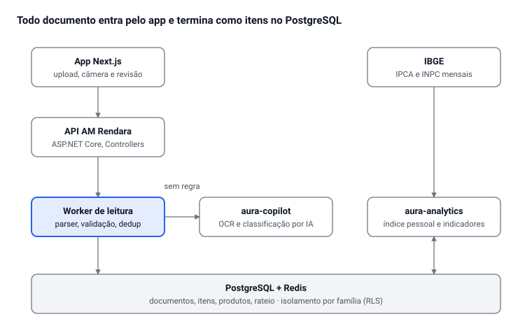

# Sistema de Controle Financeiro Familiar

Oct 9, 2026 · @Alan Mateus

## Visão geral

O sistema transforma cada documento financeiro (nota, extrato, holerite, boleto) em dados estruturados no nível do item, e a partir disso calcula sozinho: quanto cada pessoa gastou, quanto cada uma deve à casa, qual é a inflação real da família e para onde o dinheiro está indo. A proposta é que ele nasça como o módulo **Família** do AM Rendara, não como um sistema novo.

**Problemas que resolve**

- Lançar gasto à mão é o motivo nº 1 de controle financeiro ser abandonado. Aqui a entrada é por documento: foto, PDF, QR Code ou extrato.
- Dividir conta da casa "meio a meio" é injusto quando as rendas são diferentes. O sistema calcula a cota proporcional de cada um, todo mês, e mostra quem está devendo para quem.
- O IPCA mede a cesta média do Brasil, não a sua. Como a nota fiscal traz cada produto com preço e quantidade, dá para medir a inflação da cesta que a família de fato compra.
- Saber o total gasto não basta: o sistema precisa responder onde, com o quê, com que frequência e se está melhorando.

**Escopo**

- Uma **família** (domicílio) com várias **pessoas**. Cada pessoa tem rendas e gastos próprios.
- Todo gasto é marcado como **pessoal** (só daquela pessoa) ou **da casa** (entra no rateio).
- Uma mesma nota pode misturar os dois: o arroz é da casa, o desodorante é pessoal. A classificação é por item, não por nota.
- Horizonte: acompanhamento contínuo, com fechamento mensal e relatório anual comparando 12 meses.

**Fora do escopo do MVP:** finanças da empresa (já cobertas pelo resto do Rendara), declaração de IR e integração bancária automática via Open Finance (entra numa fase posterior).

## Entrada de dados

A NFC-e é a fonte mais rica, porque traz cada item com quantidade, unidade e preço; o resto (extrato, holerite, boleto) completa o que não passa pelo caixa. O caminho mais confiável para a NFC-e hoje é o PDF ou print da página da SEF-MG, como o que você mandou: a consulta automática pela chave esbarra no reCAPTCHA do portal.

| Documento | Como entra | O que o sistema extrai | Confiabilidade |
| --- | --- | --- | --- |
| NFC-e (PDF/print da SEF) | upload ou compartilhar do celular | emitente, CNPJ, data, chave, itens (código, descrição, qtde, unidade, valor), total, formas de pagamento | alta: texto estruturado |
| NFC-e (foto do cupom) | câmera | o mesmo, via OCR + IA | média: exige revisão |
| QR Code / chave de 44 dígitos | leitor no app | UF, ano/mês, CNPJ, modelo, série, número; serve para deduplicar | alta, mas sem itens |
| Extrato bancário (OFX/CSV) | upload | data, valor, descrição, conta | alta |
| Fatura de cartão (PDF/CSV) | upload | lançamentos, parcelas, data de vencimento | média |
| Holerite / comprovante de renda | upload ou manual | renda bruta, descontos, renda líquida | alta |
| Boletos e contas de consumo (luz, água, internet) | upload | valor, vencimento, consumo (kWh, m³) | média |
| Pix e gastos sem nota | manual rápido | valor, categoria, pessoa | depende do usuário |

**Pipeline de um documento**

1. **Recebe** o arquivo e calcula um hash; o mesmo arquivo duas vezes é recusado.
2. **Identifica o tipo** (NFC-e, extrato, holerite…) pelo layout e por palavras-chave.
3. **Extrai**: parser determinístico para formatos conhecidos (PDF da SEF-MG, OFX); OCR + IA só para foto e layout desconhecido.
4. **Valida**: soma dos itens = total da nota; soma dos pagamentos = total. Se não bater, vai para revisão. Na nota de 08/10 a soma dos 87 itens deu exatamente R$ 887,63.
5. **Deduplica** pela chave de acesso: a mesma NFC-e lida por PDF e por foto vira uma só. O lançamento no extrato (os dois débitos de R$ 268,73 e R$ 618,90) é **conciliado** com a nota, não somado de novo.
6. **Normaliza produtos**: "MAC INS NIS LAM 85G" vira *Macarrão instantâneo Nissin Lámen 85 g*. A chave é CNPJ do emitente + código interno do produto; uma vez mapeado, nunca mais precisa revisar.
7. **Classifica** cada item: categoria, subcategoria, essencial ou supérfluo, pessoal ou da casa (e de quem). Regras primeiro, IA só para o que as regras não cobrem.
8. **Revisão humana** só do que ficou com baixa confiança, numa tela de "confirmar ou corrigir". Cada correção vira regra.
9. **Recalcula** rateio, indicadores e inflação do mês.

**Anatomia da chave de 44 dígitos** (útil para deduplicar e validar): UF (2) · ano e mês (4) · CNPJ do emitente (14) · modelo, 65 = NFC-e (2) · série (3) · número (9) · tipo de emissão (1) · código numérico (8) · dígito verificador (1).

## Modelo de dados

O coração do modelo é que o gasto vive no **item**, não na nota: é o item que tem categoria, dono e preço unitário, e é dele que saem o rateio e a inflação.

| Entidade | Campos principais | Observação |
| --- | --- | --- |
| Familia | id, nome, regra\_de\_rateio, dia\_de\_fechamento | o domicílio; tenant do sistema |
| Pessoa | id, familia\_id, nome, papel (adulto, dependente), participa\_do\_rateio | dependente não paga cota, mas tem gasto atribuído |
| Renda | pessoa\_id, competencia (mês), tipo (salário, extra, benefício), bruto, liquido, fonte\_documento | base do rateio; líquida por padrão |
| Conta | id, pessoa\_id ou familia\_id, tipo (corrente, cartão, carteira, poupança) | de onde o dinheiro sai |
| Documento | id, tipo, hash, chave\_acesso, arquivo, status (lido, em revisão, confirmado) | origem de tudo; nunca é apagado |
| Estabelecimento | cnpj, nome, cidade, categoria\_padrao | Supermercados BH, Barbacena |
| Transacao | id, documento\_id, conta\_id, data, valor, forma\_pagamento, parcela\_n\_de\_m, conciliada\_com | o débito no cartão ou extrato |
| Item | id, transacao\_id, produto\_id, descricao\_original, quantidade, unidade, valor\_total, valor\_unitario, categoria\_id, escopo (pessoal ou casa), pessoa\_id | a menor unidade de gasto |
| Produto | id, nome\_canonico, marca, tamanho, unidade\_base (kg, L, un), ean | identidade estável para a inflação |
| ProdutoAlias | estabelecimento\_cnpj, codigo\_interno, produto\_id | "3636 no BH" = toucinho |
| Categoria | id, pai\_id, nome, tipo (essencial, supérfluo), grupo\_ipca | árvore: Alimentação > Carnes > Suína |
| ContaDaCasa | familia\_id, competencia, descricao, valor, vencimento, pago\_por | aluguel, luz, água, internet, mercado da casa |
| Rateio | familia\_id, competencia, pessoa\_id, renda\_considerada, percentual, cota, pago, saldo | resultado do cálculo, congelado no fechamento |
| Acerto | de\_pessoa, para\_pessoa, competencia, valor, pago\_em | quem paga quem para zerar o mês |
| Orcamento | familia\_id ou pessoa\_id, categoria\_id, competencia, limite | previsto x realizado |
| Meta | pessoa\_id ou familia\_id, nome, valor\_alvo, prazo, acumulado | reserva, viagem, entrada de imóvel |
| IndiceReferencia | nome (IPCA, INPC), competencia, variacao | para comparar com a inflação da família |

**Regras importantes**

- **Preço unitário normalizado** = valor ÷ quantidade, sempre na unidade base (reais por kg, por litro ou por unidade). Sem isso, "toucinho 2,230 kg por 44,56" não é comparável com outra compra de 1,5 kg.
- **Fechamento do mês congela** o rateio. Correção depois do fechamento gera um ajuste no mês seguinte, não reescreve o passado.
- **Item pessoal pago com dinheiro da casa** (ou o contrário) gera crédito ou débito automático no acerto.

## Rateio proporcional à renda

Cada adulto paga das contas da casa o mesmo percentual que a renda dele representa na renda total da família. Assim todos comprometem a mesma fatia do que ganham, e ninguém fica sem sobra porque ganha menos.

```latex
\text{cota}_i = \frac{\text{renda}_i}{\sum_j \text{renda}_j} \times \text{total da casa no mês}
```

```latex
\text{saldo}_i = \text{pago}_i - \text{cota}_i
```

Saldo positivo: a pessoa pagou a mais e tem a receber. Saldo negativo: deve à casa. O sistema então gera o menor número de transferências que zera todos os saldos.

**Exemplo** (valores em reais, ilustrativos)

| Pessoa | Renda líquida | % da renda total | Cota de 2.500 da casa | Pagou no mês | Saldo | Sobra após a cota |
| --- | --- | --- | --- | --- | --- | --- |
| Pessoa A | 3.000 | 60% | 1.500 | 900 | −600 | 1.500 |
| Pessoa B | 2.000 | 40% | 1.000 | 1.600 | +600 | 1.000 |
| Total | 5.000 | 100% | 2.500 | 2.500 | 0 | 2.500 |

Acerto do mês: A transfere 600 para B. Os dois comprometeram exatamente 50% da renda com a casa.

**O que entra como conta da casa**

- Moradia: aluguel ou financiamento, condomínio, IPTU, seguro.
- Consumo: luz, água, gás, internet.
- Itens da casa nas notas: alimentação compartilhada, limpeza, higiene de uso comum.
- Manutenção e eletrodomésticos.
- Fica de fora: itens pessoais (desodorante de um, cerveja de outro), assinaturas individuais, transporte individual. A marcação é por item, então uma compra de mercado se divide sozinha.

**Regras configuráveis por família**

| Regra | Opções | Padrão sugerido |
| --- | --- | --- |
| Base de renda | líquida, bruta, disponível (líquida menos dívidas obrigatórias como pensão) | líquida |
| Renda variável | mês corrente, média dos últimos 3 meses | média de 3 meses, para a cota não oscilar com bico ou hora extra |
| Piso | cota mínima fixa para quem tem renda baixa ou zero | sem piso |
| Dependentes | gasto atribuído a eles é dividido entre os responsáveis pela mesma proporção | proporcional |
| Fundo da casa | cada um transfere a cota para uma conta conjunta no início do mês, em vez de acertar no fim | opcional |
| Revisão | quando alguém muda de emprego ou a renda varia mais de 10% | automática, com aviso |

**O que o sistema mostra a cada pessoa**: cota do mês, quanto já pagou, quanto falta, saldo com cada membro, e a sobra pessoal (renda − cota − gastos pessoais).

## Inflação pessoal

O sistema mede duas coisas diferentes, que costumam ser confundidas: quanto os **preços** do que você compra subiram (inflação pessoal, comparável ao IPCA) e quanto o seu **custo de vida** subiu (que inclui comprar mais ou coisas mais caras). Separar as duas diz se o problema é o mercado ou o seu consumo.

**1. Inflação pessoal de preços** (índice encadeado mês a mês, mesma lógica do IPCA)

Para cada produto comprado no mês atual e no anterior, o sistema compara o preço unitário normalizado. Cada produto pesa o quanto ele representou no seu gasto dos últimos 12 meses.

```latex
\text{relativo}_k = \frac{p_{k,t}}{p_{k,t-1}}
```

```latex
\text{inflação do mês} = \left( \sum_k w_k \cdot \text{relativo}_k \right) - 1, \quad w_k = \frac{\text{gasto com } k \text{ nos últimos 12 meses}}{\text{gasto total com os produtos comparáveis}}
```

```latex
\text{inflação acumulada no ano} = \prod_{m=1}^{12} (1 + \pi_m) - 1
```

- **Comparação em três níveis**, do mais preciso ao mais tolerante: mesmo produto na mesma loja; mesmo produto em qualquer loja; produto genérico ("macarrão instantâneo 85 g", qualquer marca). O nível genérico capta a troca de marca sem perder o produto.
- **Produto que não foi comprado no mês** mantém o último preço (não entra como variação zero inventada) e é sinalizado.
- **Serviços e contas** entram pelo preço da unidade, não pelo valor da conta: tarifa por kWh, por m³ de água, mensalidade da internet, aluguel. A conta de luz subir porque você usou mais ar-condicionado não é inflação.
- **Comparação com o IPCA** e o INPC do mesmo mês (IBGE), no total e por grupo (Alimentação, Habitação, Saúde e cuidados pessoais…). É aqui que aparece "o IPCA de setembro foi X, o seu foi Y, e a diferença veio das carnes".

**2. Variação do custo de vida**

```latex
\text{variação do custo de vida} = \underbrace{\text{efeito preço}}_{\text{inflação pessoal}} + \underbrace{\text{efeito quantidade}}_{\text{comprou mais}} + \underbrace{\text{efeito troca}}_{\text{trocou por mais caro ou mais barato}}
```

O sistema decompõe a diferença entre dois meses (ou dois anos) nesses três efeitos, por categoria. Ex.: "o mercado subiu 180 reais: 60 de preço, 110 de quantidade, 10 de troca de marca".

**3. Poder de compra real**

```latex
\text{renda real}_t = \frac{\text{renda}_t}{\text{índice pessoal acumulado}_t}
```

Se sua renda subiu 5% no ano e sua inflação pessoal foi 7%, o sistema mostra que você ficou 1,9% mais pobre, mesmo ganhando mais.

**Limitação honesta**: o índice só fica confiável com volume. Com poucas notas por mês, um único produto domina a média. Ele começa a fazer sentido depois de 2 a 3 meses de notas de mercado registradas com regularidade, e fica sólido com 12.

## Indicadores e relatórios

São cerca de 30 indicadores em seis grupos; os cinco que mais importam no dia a dia são taxa de poupança, comprometimento da renda, inflação pessoal, gasto por categoria e meses de reserva. Todos existem por pessoa e por família, por mês e acumulados em 12 meses.

| Grupo | Indicador | Como calcula | Pergunta que responde |
| --- | --- | --- | --- |
| Fluxo | Saldo do mês | renda − gastos | sobrou ou faltou? |
| Fluxo | Taxa de poupança | (renda − gastos) ÷ renda | que fatia do que ganho eu guardo? |
| Fluxo | Comprometimento da renda | gastos ÷ renda, total e só fixos | quanto da renda já nasce gasta? |
| Fluxo | Fixos x variáveis | soma por tipo de gasto | quanto consigo cortar de fato? |
| Fluxo | Essencial x supérfluo | soma por marcação do item | quanto é escolha e quanto é necessidade? |
| Para onde vai | Gasto por categoria e subcategoria | soma dos itens | onde mais gasto? |
| Para onde vai | Curva ABC de produtos | ordena produtos pelo gasto acumulado | quais 20% dos produtos são 80% do mercado? |
| Para onde vai | Gasto por estabelecimento | soma por CNPJ | em que loja deixo mais dinheiro? |
| Para onde vai | Ticket médio e frequência de compra | total ÷ número de compras | compro muitas vezes pouco ou poucas vezes muito? |
| Para onde vai | Gasto por dia da semana e hora | agrupa pela data da nota | quando gasto por impulso? |
| Para onde vai | Gasto por forma de pagamento | débito, crédito, pix, dinheiro | o cartão está inflando o gasto? |
| Preço | Inflação pessoal (mês, 12 meses, ano) | índice encadeado (seção anterior) | meus preços subiram quanto? |
| Preço | Inflação pessoal x IPCA, por grupo | diferença em pontos | estou acima ou abaixo do Brasil, e por quê? |
| Preço | Histórico de preço por produto | preço unitário no tempo | o café está caro agora ou sempre foi? |
| Preço | Melhor loja por produto | menor preço unitário por CNPJ nos últimos 90 dias | onde compro cada coisa mais barato? |
| Preço | Reduflação | preço por unidade base sobe com embalagem menor | pagaram igual por menos produto? |
| Casa | Cota de cada pessoa e saldo do acerto | rateio proporcional | quem deve quanto para quem? |
| Casa | Custo da casa por pessoa e por m² | total da casa ÷ pessoas ou área | morar aqui custa quanto de fato? |
| Casa | Consumo de luz e água | kWh e m³ por mês, tarifa unitária | gastei mais por usar mais ou por tarifa? |
| Planejamento | Orçado x realizado | gasto ÷ limite por categoria | estourei onde? |
| Planejamento | Projeção de fim de mês | ritmo diário × dias restantes | vou fechar no azul? |
| Planejamento | Progresso das metas | acumulado ÷ alvo e prazo restante | chego na meta a tempo? |
| Segurança | Reserva de emergência em meses | reserva ÷ gasto essencial médio | quanto tempo aguento sem renda? |
| Segurança | Endividamento | parcelas ÷ renda; saldo devedor total | o crédito está me apertando? |
| Segurança | Parcelas futuras | soma das parcelas a vencer por mês | quanto da renda dos próximos meses já está comprometido? |
| Segurança | Assinaturas e recorrências | lançamentos que se repetem com valor parecido | estou pagando algo que não uso? |
| Real | Renda real | renda ÷ índice pessoal acumulado | fiquei mais rico ou mais pobre? |
| Real | Decomposição do custo de vida | efeito preço, quantidade e troca | gastei mais por inflação ou por consumo? |
| Real | Patrimônio líquido | ativos − dívidas | estou construindo algo? |

**Relatórios**

- **Por nota** (na hora): o que foi lido, categorias, itens pessoais x casa, produtos que subiram desde a última compra.
- **Fechamento mensal**: saldo, rateio e acerto, top 10 categorias e produtos, inflação do mês x IPCA, alertas.
- **Anual**: os 12 meses lado a lado, inflação acumulada, renda real, onde o gasto mais cresceu, metas, e a pergunta final: o que mudar no próximo ano.

**Alertas automáticos**: categoria passando de 80% do orçamento; produto com aumento acima de 15% desde a última compra; assinatura nova detectada; nota com soma divergente; saldo de acerto acima de um valor definido.

## Arquitetura e stack

O sistema cabe inteiro na stack fixa do Aura e reaproveita dois serviços que já existem: aura-copilot para a IA e aura-analytics para os cálculos pesados. Nenhum serviço novo precisa ser inventado.



O worker processa cada documento fora da requisição, então o upload responde na hora e o resultado chega ao app por SignalR quando a leitura termina. A IA só entra quando regra e parser não resolvem.

- **Encaixe no Rendara**: a família é o tenant (tenant\_id + Row-Level Security), como no resto do ecossistema. Finanças pessoais e familiares ficam no mesmo produto que já cobre as empresariais.
- **Leitura de NFC-e** atrás da interface IFonteDeMovimentacaoBancaria (ou uma irmã dela, IFonteDeDocumentoFiscal), com uma implementação por formato: PDF da SEF-MG, foto, e no futuro API pela chave. Trocar a fonte não mexe no resto.
- **Determinístico primeiro**: o PDF da SEF-MG tem layout fixo, então um parser em C# lê com precisão total e custo zero. IA é o fallback, não o caminho principal.
- **Dados guardados para sempre**: o documento original e o item como foi lido ficam imutáveis; normalização e categoria são camadas por cima. Se a regra de categoria mudar, o histórico é reprocessado sem perder nada.

## Roadmap por fases

O MVP é o que já gera valor com uma nota por semana: ler o PDF da SEF-MG, classificar os itens e fazer o rateio. A inflação pessoal vem na fase 3 porque precisa de meses de histórico, que as fases 1 e 2 já vão acumulando.

1. **Fase 1, MVP de leitura** (comece já, mesmo antes do código)
   - Parser do PDF da NFC-e da SEF-MG (o formato que você mandou), com validação soma dos itens = total.
   - Cadastro de família, pessoas e rendas; categorias fixas.
   - Classificação por item (pessoal ou casa) com revisão manual.
   - Rateio proporcional e acerto mensal.
   - Enquanto o sistema não existe: guarde todos os PDFs das notas numa pasta por mês. Eles viram o histórico que alimenta a fase 3.
2. **Fase 2, outras fontes**
   - Extrato OFX/CSV com conciliação nota x débito.
   - Foto do cupom com OCR e IA, holerite, contas de luz e água.
   - Dicionário de produtos (código interno → produto canônico) que aprende com as correções.
   - Orçamento por categoria, alertas e relatório mensal.
3. **Fase 3, inflação e análise** (a partir de 3 meses de dados)
   - Índice pessoal encadeado, comparação com IPCA/INPC por grupo.
   - Histórico de preço por produto, melhor loja, reduflação.
   - Decomposição do custo de vida e renda real.
4. **Fase 4, planejamento e patrimônio**
   - Metas, reserva de emergência, parcelas futuras, patrimônio líquido.
   - Relatório anual.
   - Integração com o rebalanceamento ARCA que o Rendara já prevê.
5. **Fase 5, automação**
   - Open Finance para extratos automáticos.
   - Avaliar API paga de consulta de NFC-e pela chave, para eliminar o PDF (verificar custo e termos antes).

**Decisões em aberto**

- [ ] Base do rateio: renda líquida do mês ou média de 3 meses?
- [ ] Quem mais da família vai usar e lançar notas (acesso por pessoa ou um só operador)?
- [ ] Categorias: começar com uma árvore própria ou espelhar os grupos do IPCA para facilitar a comparação?
- [ ] Módulo dentro do AM Rendara ou ferramenta pessoal com prefixo aura- antes de virar produto?
